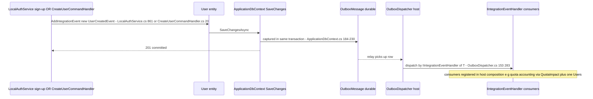
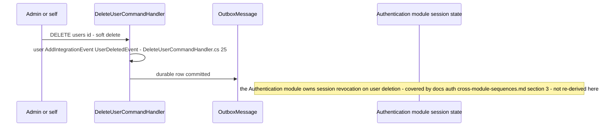
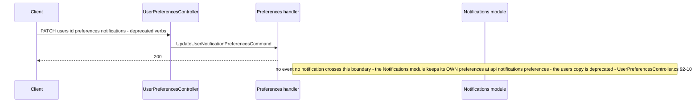
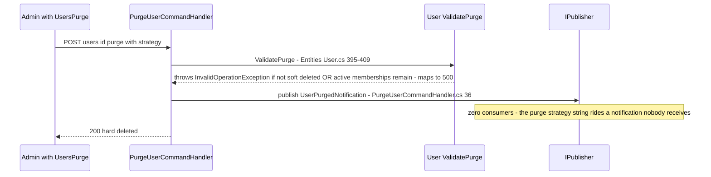

# Identity.Users — Sequences (lite)

> `develop` 7ae5a28a65 · Cross-module sequences only, per the campaign's sequences-lite convention. Paths relative to `apps/api/Source/Modules/GameGuild.Identity.Users/` unless stated.

## 1. Sign-up / admin-create → durable UserCreatedEvent → consumers

Fallback: none needed — outbox is transactional; redelivery is the dispatcher's inbox/retry ladder.

## 2. User delete vs active sessions / refresh tokens

## 3. Preference write → Notifications module (absent flow)

Verdict: **no integration exists** — the deprecated users-side notification preferences drift independently of the Notifications module's live copy (gap G-Users-3 in `gaps.md`).

## 4. Purge → tenant membership coupling

