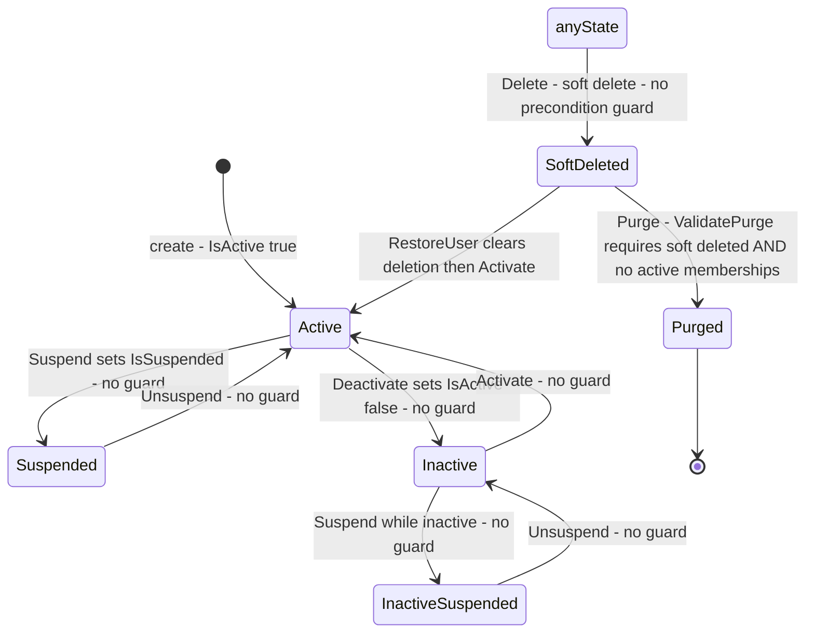
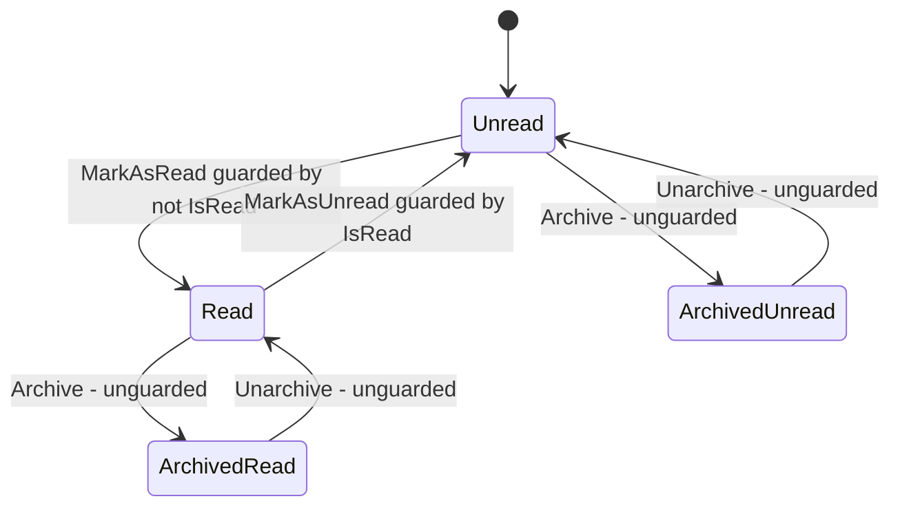

# Identity.Users State Machines

> `develop` 7ae5a28a65 · Mermaid `stateDiagram-v2`, no parentheses or colons in labels. Paths relative to `apps/api/Source/Modules/GameGuild.Identity.Users/`.

## 1. User record status — derived, not enforced

`UserStatus` is a `readonly record struct` **derived** from two independent flags (`Entities/User.cs:155`; `ValueObjects/UserStatus.cs:21-67`). There is no transition table — every mutation method writes flags unconditionally (`Entities/User.cs:288-318`). The diagram shows *reachable* combinations, with the guards that do NOT exist called out.

Transitions audit:

| Transition | Guard | Evidence |
|---|---|---|
| any → Suspended/Inactive/Active | none (idempotent flag writes) | `Entities/User.cs:288-318` |
| → SoftDeleted | none on the entity (authz at controller: `UsersDeleteSelf`) | `Commands/DeleteUser/` |
| SoftDeleted → Active | `RestoreUser` = `Restore()` + `Activate()` | `Entities/User.cs:387-391` |
| SoftDeleted → Purged | `ValidatePurge` throws unless soft-deleted first and no active tenant memberships | `Entities/User.cs:395-409` |

Derived gates consumed elsewhere: `CanSignIn` = `IsActive` (suspension does NOT block sign-in), `CanPerformActions` = `IsActive && !IsSuspended` (`ValueObjects/UserStatus.cs:50-56`, `Entities/User.cs:414-419`).

## 2. Purge strategy selection

`PurgeStrategy { Immediate, Scheduled, GracePeriod }` (`Commands/PurgeUser/PurgeUserCommand.cs:8`) — a parameter, not a state machine: the handler hard-deletes on all three and only the (unconsumed) notification payload differs.

## 3. UserNotification read/archive state

Audit: read↔unread transitions are guarded no-ops on repeat (`Entities/UserNotification.cs:124-143`); archive/unarchive are unguarded flag writes that also stamp/clear `ArchivedAt` (`:74-84`), so repeated archives refresh the timestamp. No deleted state exists for notifications — archived is terminal.

## 4. Preferences families

Not a state machine: five independent JSON columns with replace/update/reset verbs; reset rewrites the family default (`Commands/ResetUser*Preferences/`). No versioning, no audit trail of preference changes.
