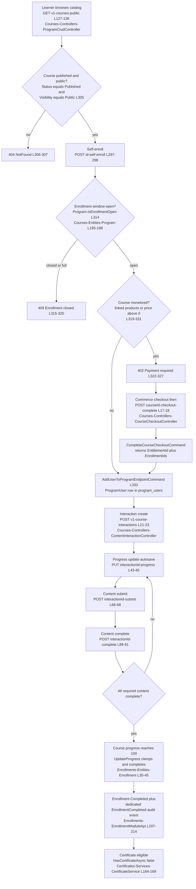
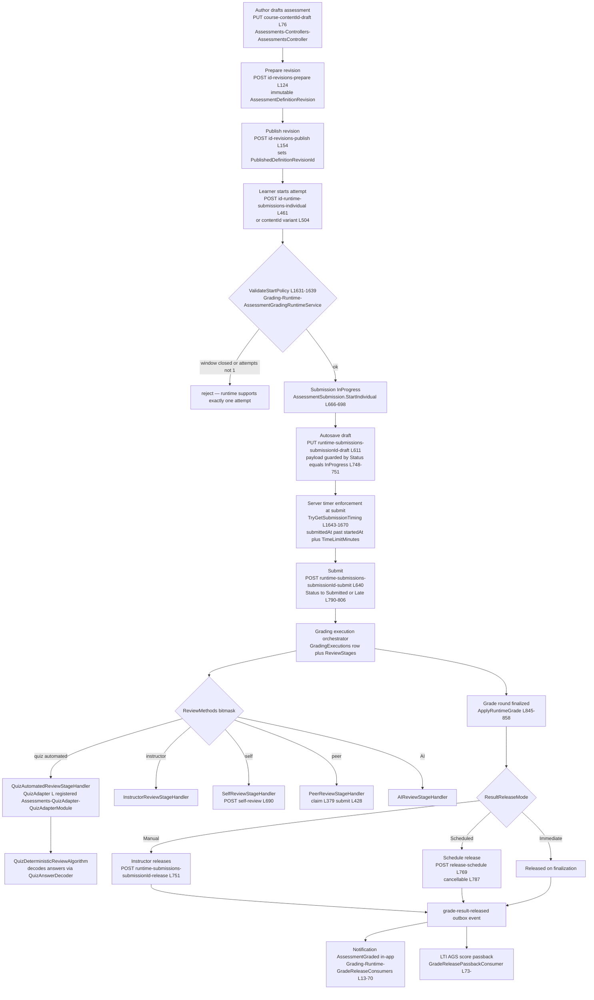
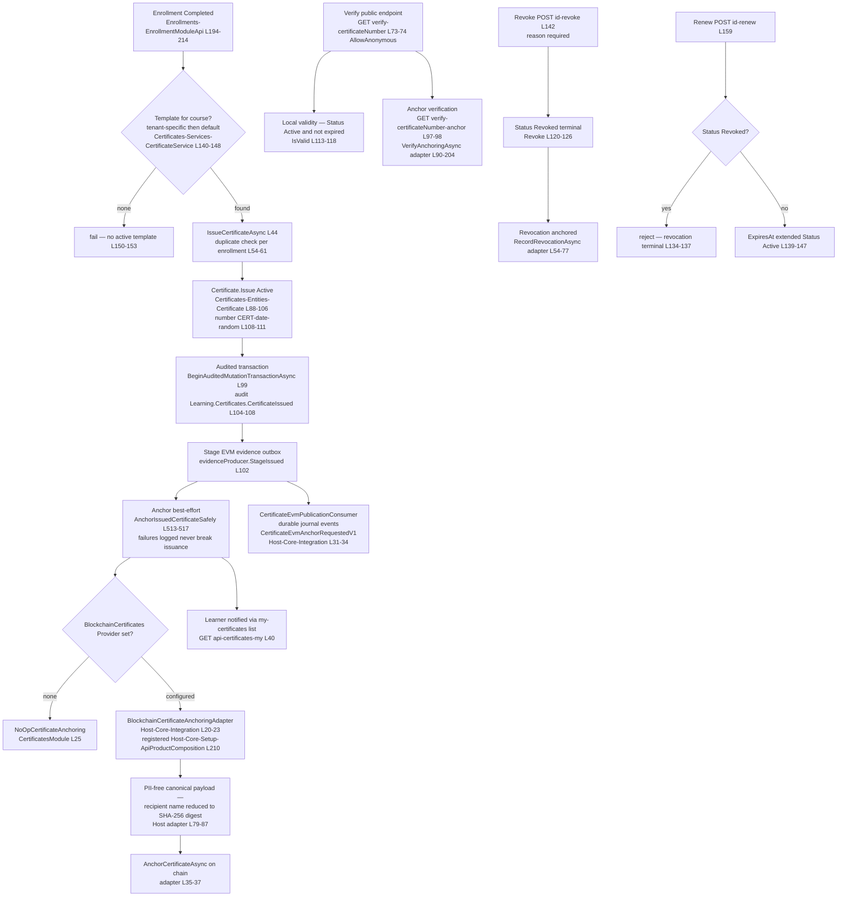
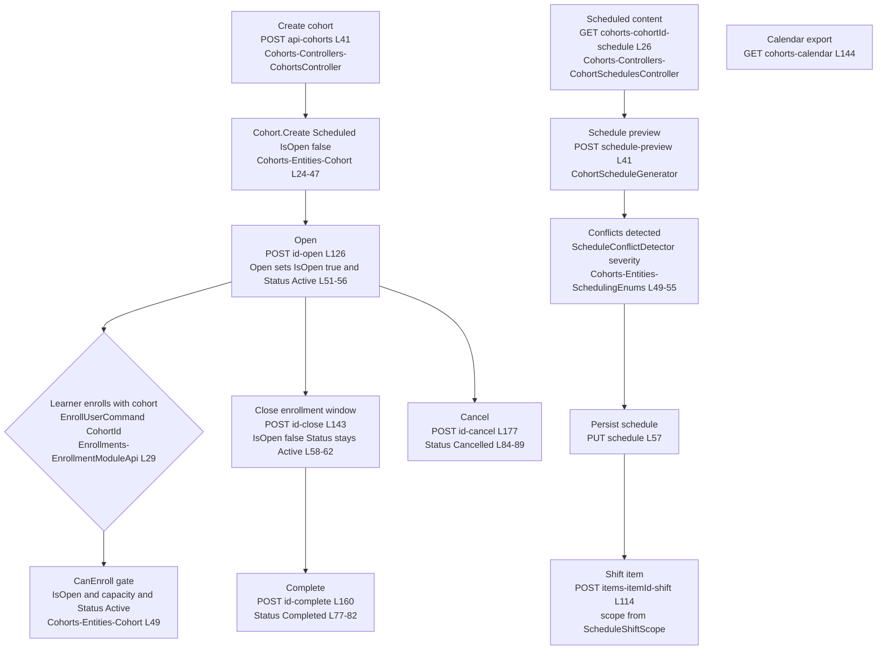
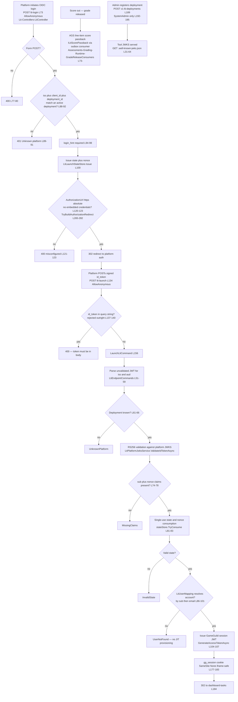
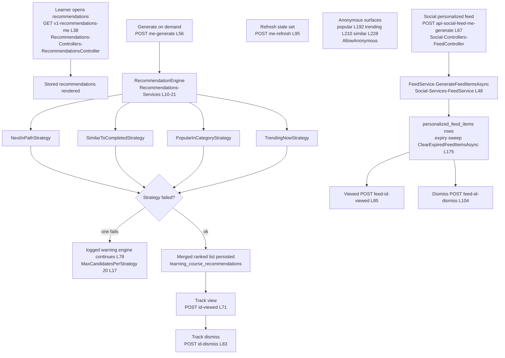

# Learning User Flows

> Learning family modules (`GameGuild.Learning.*`) · Documented against `develop` commit `ac959fd8f`.
> Mermaid `flowchart TD` per flow, file:line on every node, `L###` shorthand inside labels, edge-case matrix after each flow.
> Mermaid labels contain no parentheses and no colons (repo rendering constraint).

Citation shorthand used throughout this package:

- `Shared:` = `apps/api/Source/Modules/GameGuild.Learning/`
- `Courses:` = `apps/api/Source/Modules/GameGuild.Learning.Courses/`
- `Enrollments:` = `apps/api/Source/Modules/GameGuild.Learning.Enrollments/`
- `Assessments:` = `apps/api/Source/Modules/GameGuild.Learning.Assessments/`
- `QuizAdapter:` = `apps/api/Source/Modules/GameGuild.Learning.Assessments.QuizAdapter/`
- `Certificates:` = `apps/api/Source/Modules/GameGuild.Learning.Certificates/`
- `Cohorts:` = `apps/api/Source/Modules/GameGuild.Learning.Cohorts/`
- `Lti:` = `apps/api/Source/Modules/GameGuild.Learning.Lti/`
- `Discovery:` = `apps/api/Source/Modules/GameGuild.Learning.Experience.Discovery/`
- `LearningPaths:` = `apps/api/Source/Modules/GameGuild.Learning.Experience.LearningPaths/`
- `Recommendations:` = `apps/api/Source/Modules/GameGuild.Learning.Experience.Recommendations/`
- `Social:` = `apps/api/Source/Modules/GameGuild.Learning.Experience.Social/`
- `Workspaces:` = `apps/api/Source/Modules/GameGuild.Learning.Workspaces/`
- `TestingLabBridge:` = `apps/api/Source/Modules/GameGuild.Learning.TestingLab/`
- `Host:` = `apps/api/Source/GameGuild.API/`

---

## 1. Course catalog to enrollment to completion

The platform runs **two parallel enrollment stores**: `Courses` owns `program_users` (legacy, powers the learner UX and progress) and `Enrollments` owns `learning_enrollments` (stateful lifecycle, powers cohorts and certificates). Both are consulted by `CourseEnrollmentAccessReader` (`Enrollments:/CourseEnrollmentAccessReader.cs:14-33`) — "enrolled" means a row in either.

Note: the Mermaid edge labels avoid parentheses/colons. The monetized gate is `GetLinkedProductsAsync` + `GetProgramPricingAsync` at `Courses:/Controllers/ProgramCrudController.cs:319-331`.

### Edge-case matrix — catalog, enrollment, completion

| # | Case | Behavior | Where |
|---|------|----------|-------|
| 1 | Unpublished or non-public course self-enroll | 404 before any write | `Courses:/Controllers/ProgramCrudController.cs:305-307` |
| 2 | Enrollment deadline passed / capacity full / status Closed | 409 Conflict with ProblemDetails | `Courses:/Controllers/ProgramCrudController.cs:314-320`, gate `Courses:/Entities/Program.cs:195-198` |
| 3 | Monetized course self-enroll attempt | 402 Payment Required — no free ride | `Courses:/Controllers/ProgramCrudController.cs:319-327` |
| 4 | Checkout completed twice / replay | `AlreadyHadAccess` flag in response, idempotent | `Courses:/Controllers/CourseCheckoutController.cs:47-58` |
| 5 | Duplicate enrollment via `Enrollments` module | `GetActiveAsync` returns existing row, no second insert | `Enrollments:/EnrollmentModuleApi.cs:132-137` |
| 6 | Progress above 100 or below 0 | `Math.Clamp` to 0-100 | `Enrollments:/Entities/Enrollment.cs:37` |
| 7 | Progress hits 100 while Paused | No auto-complete — auto-complete only from Active | `Enrollments:/Entities/Enrollment.cs:41-44` |
| 8 | Enrollment + its audit event | Same DB transaction; audit failure rolls back enrollment | `Enrollments:/EnrollmentModuleApi.cs:141-159` |
| 9 | Cohort capacity exceeded | `CanEnroll` false — but enroll path does not call it (gap G-16) | `Cohorts:/Entities/Cohort.cs:49` |
| 10 | Testing Lab evidence completes an activity | Idempotent receipt + active-enrollment guard | `TestingLabBridge:/TestingLabLearningEvidenceHandler.cs:16-30` |
| 11 | Prerequisite not satisfied | `CheckPrerequisites` reports unmet chain — self-enroll does not consult it (gap G-15) | `Courses:/Controllers/PrerequisitesController.cs:120-151` |

---

## 2. Assessment taking — quiz adapter, timers, autosave

Assessments run on the executable-definition runtime: authoring produces an immutable `AssessmentDefinitionRevision`, the learner interacts with a runtime submission, and grading executes review stages. The quiz flavor is contributed by the `QuizAdapter` module.

### Edge-case matrix — assessment taking

| # | Case | Behavior | Where |
|---|------|----------|-------|
| 1 | Submit after time limit | Rejected — `TryGetSubmissionTiming` compares UTC stamps | `Assessments:/Grading/Runtime/AssessmentGradingRuntimeService.cs:1651-1655` |
| 2 | Submit before AvailableFrom / after AvailableUntil | Rejected, not marked late | `Assessments:/Grading/Runtime/AssessmentGradingRuntimeService.cs:1657-1662` |
| 3 | Submit after DueAt | `isLate` true; allowed only when `AllowLateSubmissions` and before `LateSubmissionDeadline` | `Assessments:/Grading/Runtime/AssessmentGradingRuntimeService.cs:1664-1670` |
| 4 | Second attempt | Runtime rejects — `MaxAttempts != 1` throws | `Assessments:/Grading/Runtime/AssessmentGradingRuntimeService.cs:1635-1638` |
| 5 | Payload edit after submit | `SetPayload` throws unless InProgress | `Assessments:/Entities/Assessment.cs:748-751` |
| 6 | Draft edit race on collective submissions | `AdvanceCollectiveDraft` optimistic version check | `Assessments:/Entities/Assessment.cs:808-828` |
| 7 | Modality not accepted by assessment | `SetPayload` throws on disallowed modality | `Assessments:/Entities/Assessment.cs:765-768` |
| 8 | Oversized file/project payload | 2048-char bound per payload field | `Assessments:/Entities/Assessment.cs:926-939` |
| 9 | Non-http URL payload | Rejected by `NormalizeUrlPayload` | `Assessments:/Entities/Assessment.cs:910-924` |
| 10 | Duplicate submit | `Submit` throws unless InProgress | `Assessments:/Entities/Assessment.cs:792-795` |
| 11 | Regrade of graded submission | Only via runtime `ApplyRuntimeGrade` (`allowRegrade`), not manual `Grade` | `Assessments:/Entities/Assessment.cs:877-897` |
| 12 | Grading command replay | `GradingCommandReceipts` idempotency-key lookup | `Assessments:/Grading/Runtime/AssessmentGradingRuntimeService.cs:1691-1700` |
| 13 | Quiz definition drift after publish | Learner graded against the immutable revision captured at start | `Assessments:/Entities/Assessment.cs:636-640` |
| 14 | Client-side timer vs server | Client timer is advisory only; server stamp comparison is the enforcement | flow nodes G and table row 1 |

### QuizAdapter notes

- The quiz type is not special-cased in the runtime: `QuizAssessmentTypeAdapter` is an `IAssessmentTypeAdapter` registration (`QuizAdapter:/QuizAdapterModule.cs:18-20`), and `QuizAutomatedReviewStageHandler` an `IReviewStageHandler` (`QuizAdapter:/QuizAdapterModule.cs:22-24`).
- Quiz content is mirrored into the course content tree on publication via `QuizProgramContentPublicationParticipant` (`QuizAdapter:/QuizProgramContentPublicationParticipant.cs:121-122` carries `timeLimitMinutes` into the content projection), and mirrored out of it on delete (`QuizProgramContentDeleteParticipant`).
- `QuizItemProjector`, `QuizDeliveryGenerator`, `QuizAnswerDecoder`, `QuizDeterministicReviewAlgorithm` are the delivery/grading quartet (`QuizAdapter:/QuizAdapterModule.cs:12-17`).

---

## 3. Certificate issuance incl. blockchain anchoring

Two trust layers: the local certificate row (source of truth) and an auxiliary anchor (config-gated EVM publication through the host composition root).

### Edge-case matrix — certificates

| # | Case | Behavior | Where |
|---|------|----------|-------|
| 1 | Issue twice for same enrollment + template | Conflict — duplicate check | `Certificates:/Services/CertificateService.cs:54-61` |
| 2 | Inactive or missing template | NotFound failure | `Certificates:/Services/CertificateService.cs:67-70` |
| 3 | Audit sink down at issue | Whole issuance rolls back (fail closed) | `Certificates:/Services/CertificateService.cs:97-117` |
| 4 | Blockchain backend down at issue | Non-fatal — logged, certificate still issued | `Certificates:/Services/CertificateService.cs:510-517`, adapter `Host:/Core/Integration/BlockchainCertificateAnchoringAdapter.cs:46-50` |
| 5 | Anchor verification backend unreachable | Fail-closed "unavailable" verdict, not a fake pass | `Host:/Core/Integration/BlockchainCertificateAnchoringAdapter.cs:104-115` |
| 6 | Anchor digest mismatch after local edit | `Mismatch` verdict with anchored vs recomputed digest | `Host:/Core/Integration/BlockchainCertificateAnchoringAdapter.cs:121-142` |
| 7 | Revoke a never-anchored certificate | Revocation anchoring skipped with debug log | `Host:/Core/Integration/BlockchainCertificateAnchoringAdapter.cs:70-76` |
| 8 | Renew a revoked certificate | Rejected — terminal state | `Certificates:/Entities/Certificate.cs:134-137` |
| 9 | Renew with past expiry date | Rejected — must be future | `Certificates:/Entities/Certificate.cs:139-142` |
| 10 | Unknown number on public verify | Returns invalid verdict with Revoked status, audited | `Certificates:/Services/CertificateService.cs:203-218` |
| 11 | Issued-but-unanchored certificate at verify | `NotAnchored` verdict distinguishes absence from mismatch | `Host:/Core/Integration/BlockchainCertificateAnchoringAdapter.cs:144` |
| 12 | Auto-issue on completion | Not wired — issuance is an explicit API call (gap G-8) | `Certificates:/Controllers/CertificatesController.cs:114` |

---

## 4. Cohort management

### Edge-case matrix — cohorts

| # | Case | Behavior | Where |
|---|------|----------|-------|
| 1 | Enroll into closed cohort | `CanEnroll` false | `Cohorts:/Entities/Cohort.cs:49` |
| 2 | Capacity exceeded | `CurrentEnrollmentCount < MaxCapacity` gate | `Cohorts:/Entities/Cohort.cs:49` |
| 3 | Counter underflow on drop | Guarded decrement | `Cohorts:/Entities/Cohort.cs:70-75` |
| 4 | Open a Completed or Cancelled cohort | `Open()` overwrites Status to Active unconditionally (gap G-11) | `Cohorts:/Entities/Cohort.cs:51-56` |
| 5 | Schedule item outside cohort window | Shift scopes + conflict severities surfaced by detector | `Cohorts:/Entities/SchedulingEnums.cs:43-55` |
| 6 | Content scheduled before cohort start | `ProgramContentScheduleGuard` participates in publication | `Cohorts:/CohortsModule.cs` guard registration |
| 7 | Cohort tenant vs actor tenant | Effective tenant from actor when request omits it | `Cohorts:/Controllers/CohortsController.cs:43-47` |

---

## 5. LTI 1.3 tool launch

GameGuild is the **tool**; external platforms (Moodle/Canvas-class) are the **platform**. Three unauthenticated protocol endpoints plus two system-admin management endpoints. Deep Linking is not implemented (gap G-13); grades flow out through AGS passback on grade release.

### Edge-case matrix — LTI

| # | Case | Behavior | Where |
|---|------|----------|-------|
| 1 | Unknown platform triple at login | 401 before any state issued | `Lti:/Controllers/LtiController.cs:88-92` |
| 2 | Missing login_hint | 400 | `Lti:/Controllers/LtiController.cs:94-98` |
| 3 | Authorization URL http / userinfo-bearing / relative | Fails closed — 400 | `Lti:/Controllers/LtiController.cs:265-282` |
| 4 | id_token delivered in query | Rejected before parse (log-leak hygiene) | `Lti:/Controllers/LtiController.cs:137-140` |
| 5 | Replayed launch (state reuse) | `TryConsume` single-use — InvalidState | `Lti:/Commands/LtiEndpointCommands.cs:81-83` |
| 6 | JWT signature invalid / aud mismatch | InvalidToken from JWKS validation | `Lti:/Commands/LtiEndpointCommands.cs:68-71` |
| 7 | Platform user with no local account | UserNotFound — no automatic account creation | `Lti:/Commands/LtiEndpointCommands.cs:86-101` |
| 8 | Unreadable tool private key at JWKS | Deployment excluded from JWKS, error logged | `Lti:/Controllers/LtiController.cs:57-60` |
| 9 | Non-system-admin hits deployment/line-item admin | Forbid | `Lti:/Controllers/LtiController.cs:192-195, 215-218` |
| 10 | Duplicate assessment-to-line-item mapping | 409 Conflict | `Lti:/Controllers/LtiController.cs:234-236` |
| 11 | Deep-linking message type | Not implemented — only resource-link launches (gap G-13) | `Lti:/Controllers/LtiController.cs` (absent) |
| 12 | Score passback for non-finalized round | Consumer throws — delivery retried with backoff | `Assessments:/Grading/Runtime/GradeReleaseConsumers.cs:97-100` |

---

## 6. Recommendations and personalized feed

### Edge-case matrix — recommendations and feed

| # | Case | Behavior | Where |
|---|------|----------|-------|
| 1 | One strategy throws | Swallowed per-strategy, remainder still ranked | `Recommendations:/Services/RecommendationEngine.cs:66-78` |
| 2 | Cold-start profile | Popular/Trending strategies still produce candidates | `Recommendations:/RecommendationsModule.cs:12-17` |
| 3 | Strategy candidate flood | Hard cap 20 per strategy | `Recommendations:/Services/RecommendationEngine.cs:17` |
| 4 | Telemetry events feeding personalization | Defined and handled but never published — dead pipeline (gap G-1) | `Shared:/Events/LearningEvents.cs`, `Recommendations:/Handlers/LearningEventHandlers.cs:15-184` |
| 5 | Expired feed items | Cleared only when `ClearExpiredFeedItemsAsync` invoked — no hosted sweeper registered | `Social:/Services/FeedService.cs:175`, `Social:/SocialModule.cs` |
| 6 | Skill profile self-service | add via `me/profile/skills` L155, remove L173 | `Recommendations:/Controllers/RecommendationsController.cs:155-174` |
| 7 | Anonymous similar-courses | `courses/{courseId}/similar` AllowAnonymous | `Recommendations:/Controllers/RecommendationsController.cs:228-229` |
