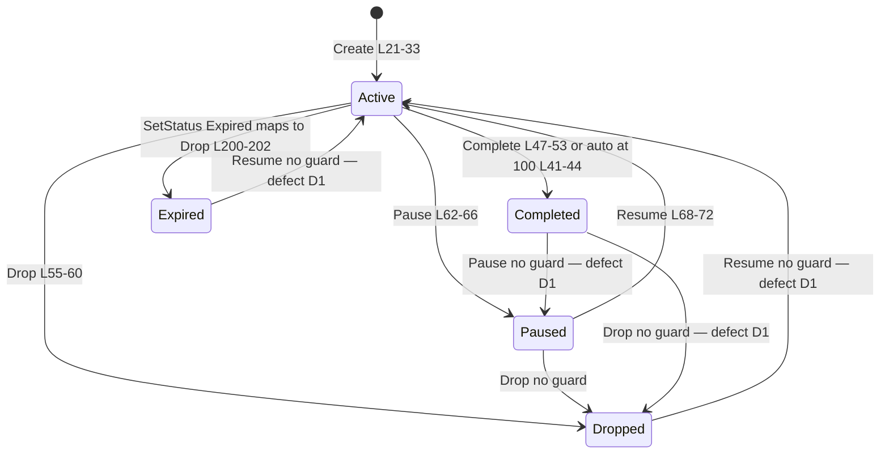
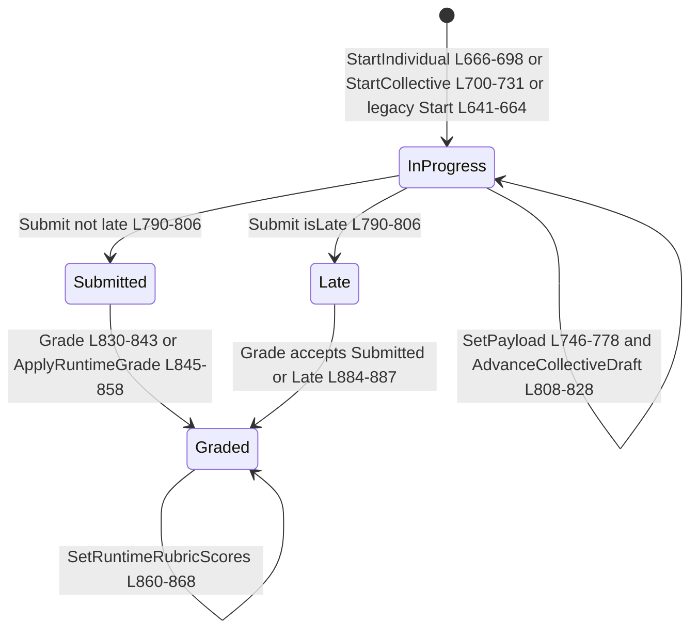
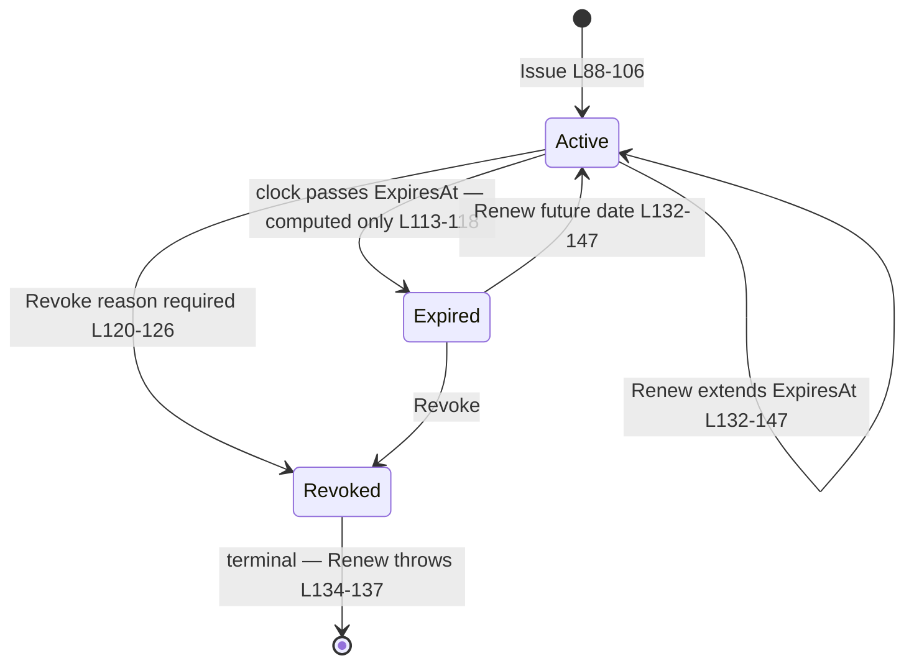
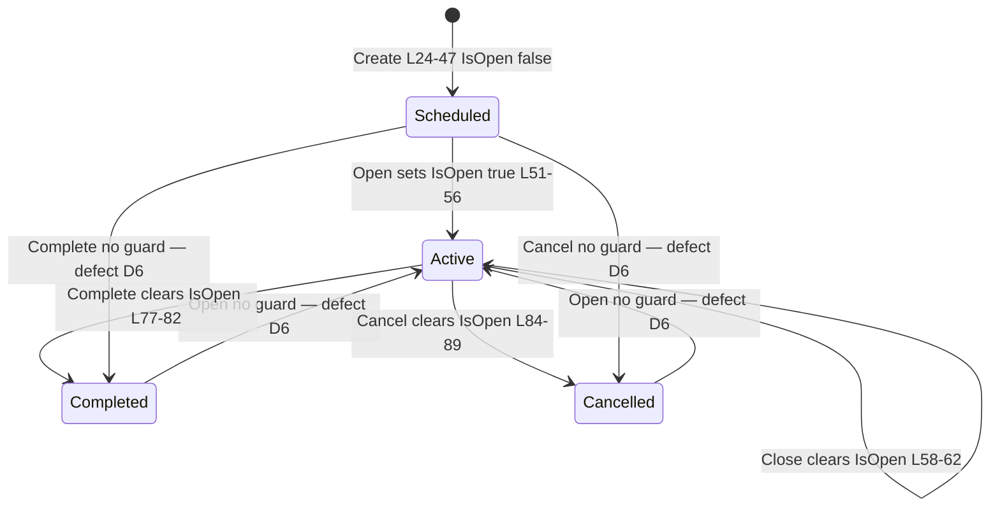
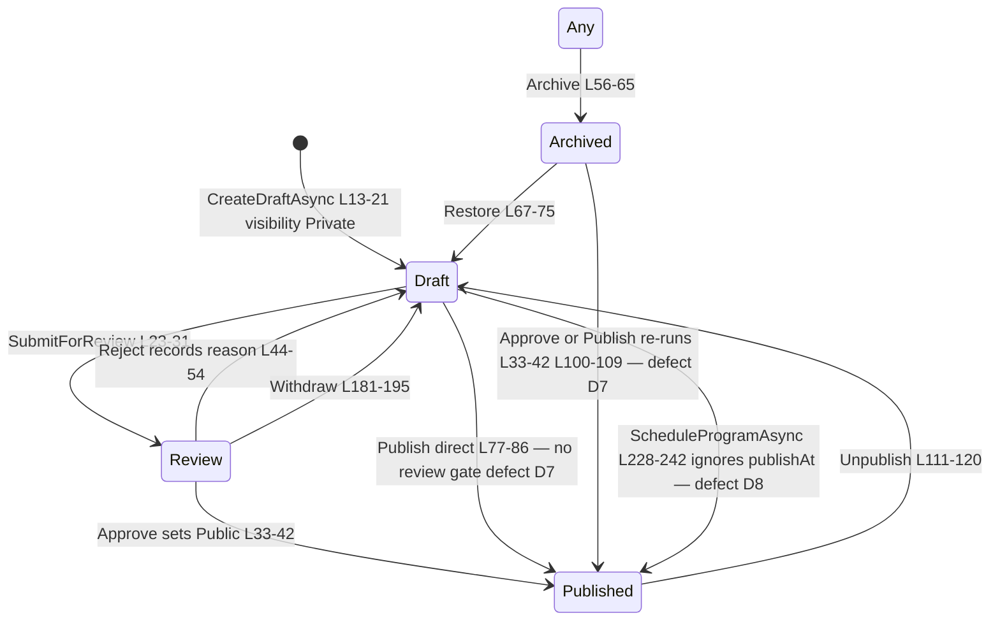

# Learning State Machines

> Learning family modules (`GameGuild.Learning.*`) · Documented against `develop` commit `ac959fd8f`.
> `stateDiagram-v2` for the four core aggregates plus the program-publication lifecycle. Transitions audit lists triggers with file:line, guards, and defects found (unreachable states, missing guards).
> Mermaid labels contain no parentheses and no colons.

## 1. Enrollment — `Enrollments:/Entities/Enrollment.cs`

States (`EnrollmentStatus` L75-82): Active, Paused, Completed, Dropped, Expired.

### Transitions audit — Enrollment

| Transition | Trigger | Guard | Verdict |
|-----------|---------|-------|---------|
| `[*] → Active` | `EnrollUserCommand` → `Enrollment.Create` (`Enrollments:/EnrollmentModuleApi.cs:139`) | duplicate-active check L132-137 | OK — idempotent re-enroll returns existing |
| `Active → Paused` | `SetStatusAsync(Paused)` → `Pause()` (`Enrollments:/EnrollmentModuleApi.cs:191-193`) | none | defect D1 — Paused reachable from Completed/Dropped/Expired |
| `Paused → Active` | `SetStatusAsync(Active)` → `Resume()` (L188-190) | none | defect D1 — resurrection of Dropped/Expired enrollments |
| `Active → Completed` | progress 100 while Active (`Enrollment.cs:41-44`) or `SetStatusAsync(Completed)` (L194-196) | auto-path guards Active; manual path none | manual Completed from Dropped possible — D1 |
| `→ Dropped` | `SetStatusAsync(Dropped)` → `Drop()` (L197-199) | none; `reason` parameter discarded (L55-60) | D1 + D2 — reason accepted but never stored |
| `→ Expired` | `SetStatusAsync(Expired)` → **`Drop()`** (L200-202) | none | D3 — Expired stored as Dropped with `DroppedAt`, no `ExpiredAt` field exists; audit metadata says Expired while row says Dropped |
| Completion side-effects | dedicated `Learning.Enrollments.EnrollmentCompleted` audit event in same transaction (L207-214) | — | OK — completion reporting does not depend on parsing StatusChanged |
| Out-of-range progress | `UpdateProgress` clamps 0-100 (`Enrollment.cs:37`) | — | OK |

**Unreachable/ill-defined**: `Expired` is reachable only through the aliasing above and is indistinguishable from Dropped in the row. No expiry worker exists anywhere in the family to set it.

## 2. Assessment attempt — `Assessments:/Entities/Assessment.cs` (AssessmentSubmission L605-941)

States (`SubmissionStatus` L952-958): InProgress, Submitted, Graded, Returned, Late.

### Transitions audit — AssessmentSubmission

| Transition | Trigger | Guard | Verdict |
|-----------|---------|-------|---------|
| `[*] → InProgress` | runtime start (`Assessments:/Grading/Runtime/AssessmentGradingRuntimeService.cs` start paths) | `ValidateStartPolicy` — availability window + `MaxAttempts == 1` (L1631-1639) | OK — single-attempt runtime enforced at start |
| `InProgress → Submitted/Late` | submit command → `Submit(isLate, submittedAt, by)` (L790-806) | only InProgress; submitter id required; late flag computed by `TryGetSubmissionTiming` (L1643-1670) with time-limit rejection L1651-1655, window rejection L1657-1662, late policy L1664-1670 | OK — the strongest machine in the family |
| payload mutation | `SetPayload` (L746-778) | InProgress only; modality whitelist L765-768; 2048-char bounds L926-939; URL scheme check L910-924 | OK |
| collective autosave | `AdvanceCollectiveDraft` (L808-828) | collective only, InProgress only, optimistic expected-version | OK |
| `Submitted/Late → Graded` | `Grade` (L830-843) | score bounds; only Submitted/Late (L884-887) | OK |
| `Graded → Graded` regrade | `ApplyRuntimeGrade` with `allowRegrade: true` (L845-858, L884-885) | bounds only | deliberate — runtime-owned regrades; manual `Grade` cannot regrade |
| `Graded → Graded` rubric attach | `SetRuntimeRubricScores` (L860-868) | Graded only | OK |
| **`Returned` state** | **no producer anywhere** | — | **defect D4 — unreachable state**; grep of the family shows no assignment to `SubmissionStatus.Returned` |
| result visibility | separate release lifecycle (`ResultReleaseMode` on `Assessment` L46-48; `GradeResultReleases`/`GradeResultReleaseSchedules` tables) | release service + scheduled release worker (`AssessmentsModule.cs:93,96-97,107`) | OK — graded ≠ visible to learner until released |

## 3. Certificate — `Certificates:/Entities/Certificate.cs`

States (`CertificateStatus` L150-155): Active, Expired, Revoked.

### Transitions audit — Certificate

| Transition | Trigger | Guard | Verdict |
|-----------|---------|-------|---------|
| `[*] → Active` | `IssueCertificateAsync` (`Certificates:/Services/CertificateService.cs:86-94`) | duplicate per enrollment+template (L54-61), active template (L67-70) | OK |
| `Active/Expired → Revoked` | revoke endpoint → `Revoke` (L120-126) | reason required by endpoint DTO (`CertificatesController.cs:142-153`); revocation is terminal | OK |
| `→ Expired` | **nothing writes it**; `IsValid()` computes expiry at read time (L113-118) | — | defect D5 — `Expired` never persisted; `GET expiring` (`CertificatesController.cs:284`) must recompute, and any consumer filtering `Status == Expired` sees nothing |
| `Expired → Active` | renew endpoint → `Renew` (L132-147) | revoked rejected L134-137; future date L139-142 | OK — renewal of lapsed certs supported |
| anchoring side-effect | `AnchorIssuedCertificateSafely` (L513-517), revocation anchoring (L532) | best-effort, never breaks issuance | OK — on-chain state is auxiliary |
| duplicate issue | Conflict result (L54-61) | — | OK |

## 4. Cohort — `Cohorts:/Entities/Cohort.cs`

States (`CohortStatus` L123-129): Scheduled, Active, Completed, Cancelled. Orthogonal flag `IsOpen`.

### Transitions audit — Cohort

| Transition | Trigger | Guard | Verdict |
|-----------|---------|-------|---------|
| `[*] → Scheduled` | `CreateCohortCommand` → `Cohort.Create` (L24-47) | argument non-empty via service | OK |
| `Scheduled → Active` | open endpoint L126 → `Open()` (L51-56) | none | defect D6 — also re-opens Completed/Cancelled cohorts |
| `IsOpen` toggle | close endpoint L143 → `Close()` (L58-62) | none — closing does not change Status | OK by design (enrollment window vs delivery state) |
| `→ Completed` | complete endpoint L160 → `Complete()` (L77-82) | none | D6 — completable from Scheduled |
| `→ Cancelled` | cancel endpoint L177 → `Cancel()` (L84-89) | none | D6 |
| enrollment counter | `IncrementEnrollment`/`DecrementEnrollment` (L64-75) | underflow guard on decrement; increment unguarded vs capacity | capacity gate lives in `CanEnroll()` (L49) but the Enrollments enroll path never calls it (gap G-16) |
| schedule overlay | `CohortScheduleItems` with own status machine (`SchedulingEnums.cs:27-34`) | shift scopes + conflict detector | OK |

## 5. Program publication lifecycle — `Courses:/Entities/Program.cs` + `Courses:/Services/ProgramLifecycleService.cs`

States (`ContentStatus`, `SharedKernel/Enums/ContentStatus.cs:6-28`): Draft, Review, Published, Archived, Deleted.

### Transitions audit — Program lifecycle

| Transition | Trigger | Guard | Verdict |
|-----------|---------|-------|---------|
| all nine mutations | `ProgramLifecycleController` actions (L19-138) with `RequireCourseCapability(Publish)` | **no from-state checks in the service** — every method unconditionally assigns | defect D7 — the "machine" is a setter bag; approve/publish/reject callable from any state |
| reject metadata | `SetMetadata("rejectionReason"/"rejectionDate")` (L48-49) | reason stored in JSON metadata only | weak — not queryable |
| schedule publish | `SchedulePublishAsync` writes `scheduledPublishAt` metadata (L125) / `ScheduleProgramAsync` publishes immediately (L236-238) | none | defect D8 — no worker executes scheduledPublishAt, and the controller variant doesn't even schedule |
| archive coupling | `Program.Archive()` also closes enrollment (`Entities/Program.cs:228-232`) | — | OK |
| enrollment status | separate `EnrollmentStatus Open/Closed` machine on Program with `OpenEnrollment/CloseEnrollment` (L204-215) | none — `Publish()` does not force-close or open enrollment | acceptable but undocumented coupling |
| Deleted | soft-delete via `DeletedAt` (queries filter `DeletedAt == null`, e.g. `ProgramLifecycleService.cs:246-248`) | — | not a lifecycle state in practice |

## 6. Learner path enrollment — `LearningPaths:/Entities/LearningPath.cs`

`LearningPathEnrollmentStatus` (L211) powers path-level enroll/complete/abandon (`LearningPathController.cs:328-446`). Included for completeness; the path aggregate follows the same guard-light pattern as Program — see gaps G-5/G-9 for the shared finding.

## Defect index (cross-referenced from `06-gaps.md`)

| ID | Aggregate | Summary |
|----|-----------|---------|
| D1 | Enrollment | No from-state guards on Pause/Resume/Complete/Drop — any state reachable from any state |
| D2 | Enrollment | `Drop(reason)` discards the reason |
| D3 | Enrollment | Expired aliases Drop; no ExpiredAt field; no expiry worker |
| D4 | Assessment | `SubmissionStatus.Returned` unreachable — no producer |
| D5 | Certificate | `CertificateStatus.Expired` never persisted; expiry only computed |
| D6 | Cohort | Open/Complete/Cancel lack from-state guards; terminal states escapable |
| D7 | Program | Lifecycle service assigns states unconditionally; review gate bypassable |
| D8 | Program | Scheduled publish either no-ops (metadata only) or publishes immediately; no scheduler worker |
