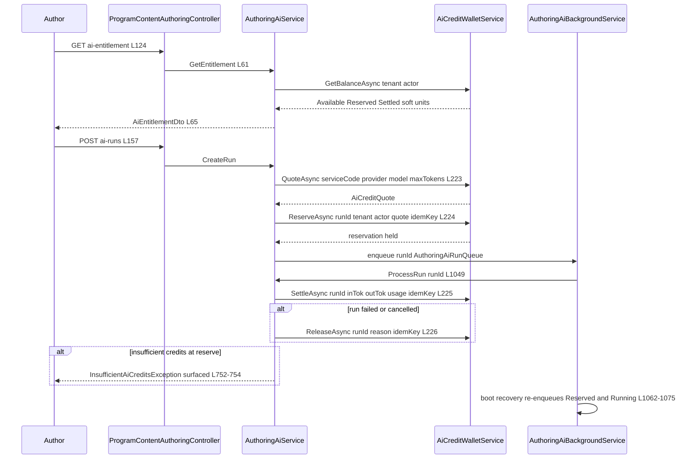
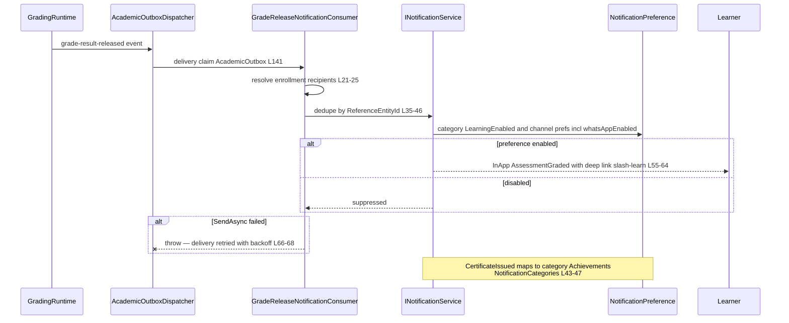
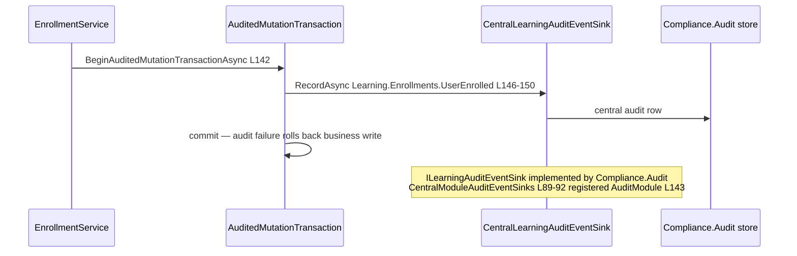
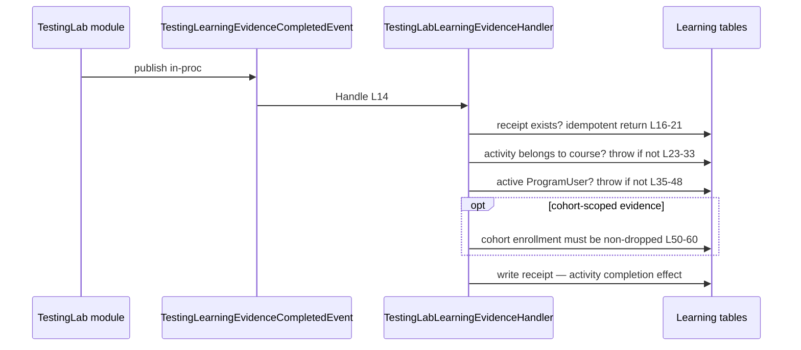

# Learning Cross-Module Sequences

> Learning family modules (`GameGuild.Learning.*`) · Documented against `develop` commit `ac959fd8f`.
> `sequenceDiagram` for every wired cross-module interaction, plus an explicit "not wired" register for the ones the family's feature flags imply.
> Mermaid labels contain no parentheses and no colons.

## 1. Learning ↔ Finance.Economy.AiCredits — AI authoring tutoring budget

The AI content-authoring assistant (`ProgramContentAuthoringController` `ai/*` surface) is metered by the Economy AI-credit wallet. This is the "AI-credits for tutoring" path — note it meters **authoring**, not learner tutoring; no learner-facing AI surface bills credits today.

Ports: `GameGuild.Finance.Economy.AiCredits/Integrations/AiCreditWallet.cs:220-227` (interface), consumer `Courses:/Authoring/AuthoringAiService.cs:52,61-65,747-754,999`. Fail-closed: a wallet outage blocks new runs; the background worker makes settlement crash-safe.

## 2. Learning ↔ Notifications — the learner notification surface

The `whatsAppEnabled` parameter family: `INotificationService.SendAsync` / preference upserts accept `bool? whatsAppEnabled` (`Modules/GameGuild.Notifications/Services/INotificationService.cs:141`, `INotificationPreferenceService.cs:26`, `NotificationPreferenceService.cs:53-55` → `NotificationPreference.SetWhatsAppEnabled` L147-149). Learning never passes it — the WhatsApp channel is a platform-level preference Learning inherits; Learning's own category is `LearningEnabled` (`Modules/GameGuild.Notifications/Commands/NotificationMutationCommands.cs:19,63`).

Additional Learning-side senders: course direct messages (`Courses:/Commands/SendCourseStudentMessage/SendCourseStudentMessageCommandHandler.cs:38-44`), assessment system notices (`Assessments:/Services/AssessmentService.cs:1120`). `NotificationType.CertificateIssued` exists (`Notifications/Entities/Notification.cs:381`) but **no Learning code sends it** — certificate issuance is silent (gap G-12).

## 3. Learning ↔ Compliance — audit is wired, FERPA is not

Certificates follow the identical pattern (`Certificates:/Services/CertificateService.cs:99-117`) and additionally stage compliance evidence for the EVM path (`_evidenceProducer.StageIssued` L102).

**FERPA is not wired.** `GameGuild.Compliance.FERPA` provides education-record registration, directory-information policy, disclosure consent and disclosure logging (`Modules/GameGuild.Compliance.FERPA/Services/FerpaService.cs:3-27` surface). Zero references to `IFerpaService` or any FERPA type exist anywhere in `GameGuild.Learning.*` — enrollments, submissions, grades, and gradebook projections (all FERPA "education records") are never registered, and instructor peek/disclosure surfaces (gradebook `course/{courseId}/gradebook/{enrollmentId}` L915, survey results L149, reflection responses L177) do not consult disclosure consents. Gap G-4.

## 4. Learning ↔ Gamification — declared, not wired

`Shared:/LearningConstants.cs:167` reserves the capability `learning:gamification`; `GameGuild.Gamification.Achievements` exists as a module; `Notifications` maps `CertificateIssued` to the "Achievements" category (`NotificationCategories.cs:47`). **No reference in either direction** — no Learning event reaches an achievement rule, and no achievement rule references Learning entities. The achievement hooks the feature flag promises are aspirational (gap G-14).

## 5. Learning ↔ TestingLab — evidence bridge (the "TestingLab-adjacent" learning part)

Source: `TestingLabBridge:/TestingLabLearningEvidenceHandler.cs:11-60`. The receipt table (`testing_lab_learning_evidence_receipts`) is the idempotency fence; a restart after a lost in-proc event loses the completion (documented in 04 §5).

## 6. Learning ↔ Identity.Authentication — LTI session + EVM ports

Two distinct ports: LTI launch mints a platform session through `IJwtTokenService.GenerateAccessTokenAsync` (`Lti:/Commands/LtiEndpointCommands.cs:103-107`) with `TokenVersion` honored — revocation-safe; and the certificate anchoring adapter consumes `IBlockchainCertificateService` / EVM RPC/signer ports defined in `Modules/GameGuild.Identity.Authentication/Abstractions/IEvmCertificate*.cs` (see flow 3 in `01-user-flows.md`).

## 7. Learning ↔ Commerce — paid enrollment gate

`SelfEnroll` rejects monetized courses with 402 (`Courses:/Controllers/ProgramCrudController.cs:319-331`); `CompleteCourseCheckoutCommand` (`Courses:/Controllers/CourseCheckoutController.cs:28-33`) returns `EntitlementId` + `EnrollmentIds` — the commerce side grants the entitlement and Learning performs the enrollment, idempotent with `AlreadyHadAccess`. `ProductProgramProvider` (`Courses:/Configuration/CoursesModule.cs:60`) reads the product-program linkage; `ProductProgram` entity lives in Courses (`Entities/ProductProgram.cs`, table `product_programs`).

## 8. Learning ↔ Assets — submission and content assets

`Assessments` registers `IAssetParentAuthorizationResolver` and `IAssetUsageGuard` for submissions (`Assessments:/AssessmentsModule.cs:42-43`, `Integrations/AssessmentSubmissionAssetAuthorizationResolver.cs:12`, `AssessmentSubmissionAssetUsageGuard.cs:15`); Courses does the same for content via `LearningAssetManifestService` (`Courses:/Configuration/CoursesModule.cs:36-38`). Asset deletion against in-use learning material fails closed through these guards.

## "Not wired" register

| Pair | Status | Evidence |
|------|--------|----------|
| Learning → Gamification.Achievements | not wired | only a capability constant `Shared:/LearningConstants.cs:167`; no references either direction |
| Learning → Compliance.FERPA | not wired | no `Ferpa` reference in `GameGuild.Learning.*` |
| Learning telemetry → Recommendations handlers | not wired (dead pipeline) | `Shared:/Events/LearningEvents.cs` has no publisher; handlers `Recommendations:/Handlers/LearningEventHandlers.cs` unregistered |
| Certificate issuance → `NotificationType.CertificateIssued` | not wired | type exists `Notifications/Entities/Notification.cs:381`; no Learning sender |
| LTI deep linking (message type DeepLinkRequest) | not implemented | `Lti:/Controllers/LtiController.cs` handles resource links only |
