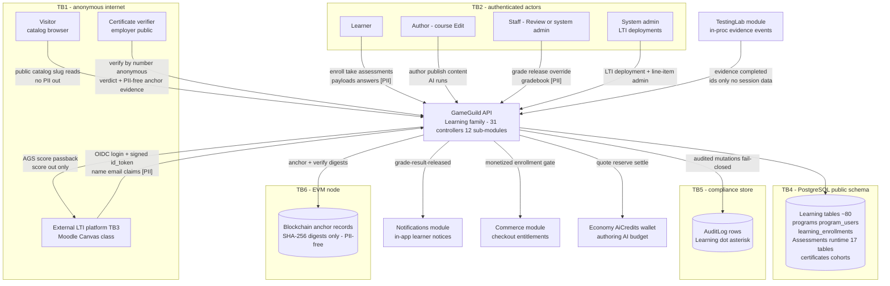
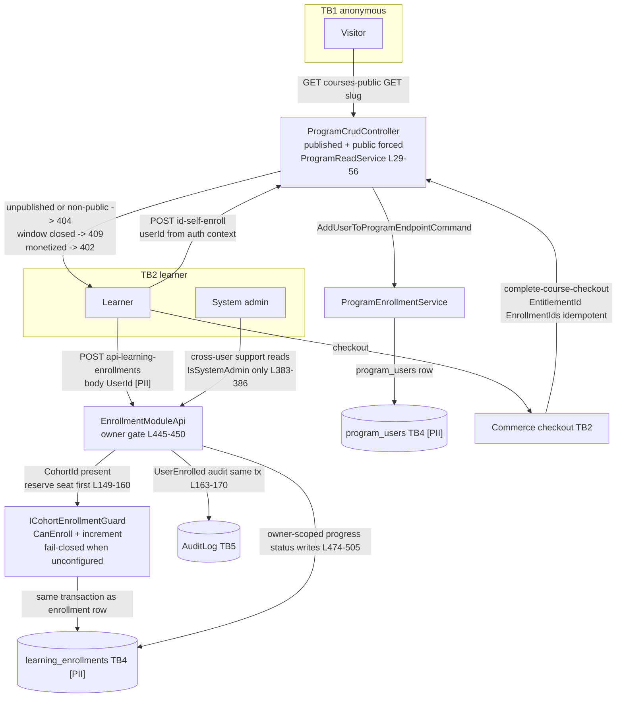
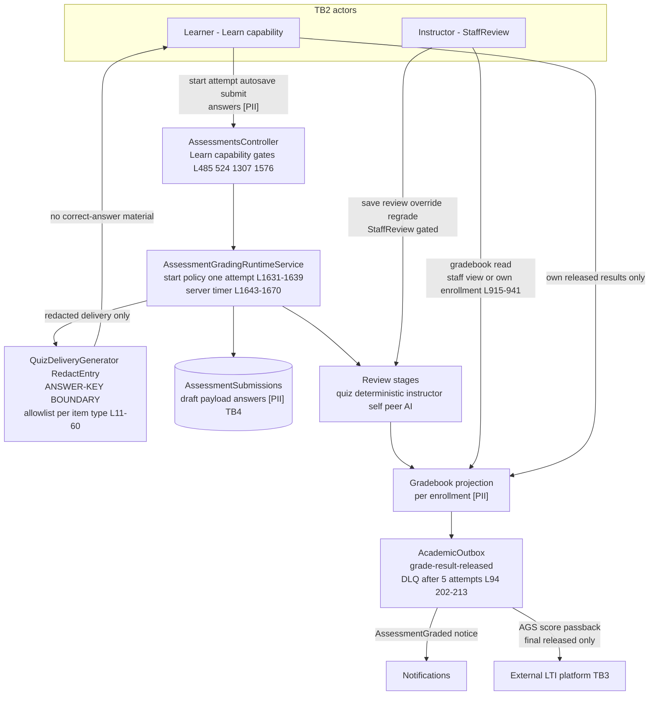
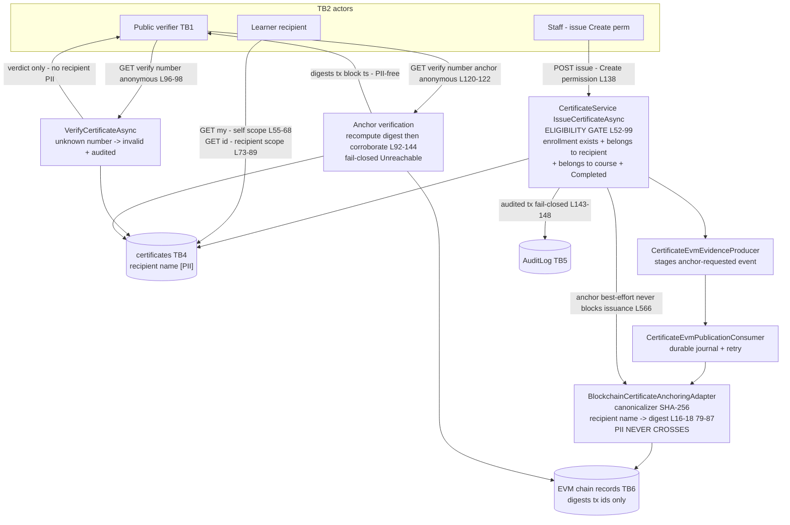
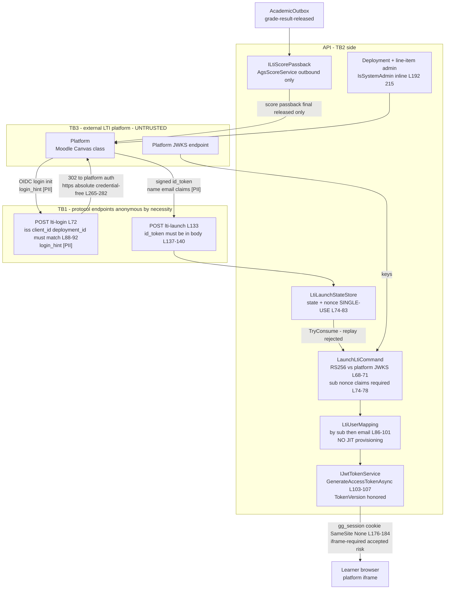

# Learning — Data-Flow Diagrams

> Learning family modules (`GameGuild.Learning.*`) · `develop` @ `ea4d1f91ce` (post-#1226 / post-#1275).
> L0 context + one L1 per major family (catalog/enrollment, assessment, certification, LTI). **Student PII is marked `[PII]`** on every flow that carries it — under FERPA these are education records (see the FERPA cross-ref in [`07-stride-threat-model.md`](07-stride-threat-model.md); the FERPA↔Learning handoff does not exist — `docs/compliance/10-cross-module-sequences.md:85-102`).
> Trust boundaries: **TB1** anonymous internet → API · **TB2** authenticated actor → API (JWT → `ActorContext`) · **TB3** external LTI platform ↔ API (the only external system; signed launches in, AGS scores out) · **TB4** API → PostgreSQL `public` schema · **TB5** mutation services → compliance `AuditLog` (same transaction, fail-closed) · **TB6** API → EVM blockchain node (PII-free digests only).
> Mermaid labels contain no parentheses and no colons (repo rendering constraint).

## L0 — Context

## L1-A — Catalog & enrollment

Covers `ProgramCrudController` public/self-enroll surfaces, `EnrollmentModuleApi`, the cohort guard, and the commerce checkout handoff. The #1226 N6 ownership gates and the #1275 cohort guard are drawn at their enforcement points.

PII on this diagram: `program_users` and `learning_enrollments` rows (userId, course, status, progress) are education records; the body `UserId` on enroll is identity data — now owner-gated post-#1275.

## L1-B — Assessment taking & grading

Covers the executable-definition runtime, the QuizAdapter redaction boundary, review stages, and the grade-release outbox. The answer-key redaction is the trust boundary **inside** the API between authoring material and learner delivery.

PII: submission payloads (the student's answers), drafts, and the gradebook projection are education records. The `RED` node is the anti-cheating control for answer leakage (STRIDE SL4); the server-side timer at `RT` is the anti-timing-attack control.

## L1-C — Certification & EVM anchoring

Covers the eligibility gate (post-#1226 N1), audited issuance, and the two-layer verification model. The digest canonicalizer is the privacy boundary at TB6.

PII: the certificate row holds the recipient name locally `[PII]`; **nothing PII crosses TB6** — the canonicalizer reduces the name to a SHA-256 digest before the adapter sees it. Verification responses to anonymous verifiers carry verdicts and PII-free evidence only.

## L1-D — LTI 1.3 (external platform trust boundary)

Covers the three anonymous protocol endpoints, the state/nonce fence, session minting, and outbound AGS. **TB3 is the hard trust boundary**: the platform is authenticated by its JWKS-signed `id_token`, not by network position.

PII: the launch carries platform-asserted `login_hint`, `sub`, and typically `name`/`email` claims `[PII]`; the local mapping consumes them but **never writes a new account** (no JIT). Outbound AGS carries scores keyed by platform user ids — grade data is education record on the Learning side and leaves through this boundary only after release.

## Data-store sensitivity summary

| Store | PII / education record | Exposure surface | Controls |
|---|---|---|---|
| `program_users`, `learning_enrollments` | userId + course + status + progress | owner-scoped reads/writes; roster staff-gated (post-#1275) | SL2 gates; FERPA gate absent (N5) |
| `AssessmentSubmissions` + drafts | student answers | Learn capability + owner checks | redacted delivery, immutable post-submit |
| Gradebook projection | grades per enrollment | instructor `StaffReview` or own enrollment (`AssessmentsController.cs:915-941`) | SL5; FERPA gate absent |
| `certificates` | recipient name | recipient-scoped by-id; anonymous number-verify verdicts only | SL6 gates; PII-free anchoring |
| LTI launch claims | name/email from platform | transient; mapping only | no JIT; single-use state/nonce |
| TestingLab receipts | ids only (userId) | internal | no session content crosses (SL8) |
| EVM chain records | **none by construction** | public chain | SHA-256 canonicalizer at TB6 |
