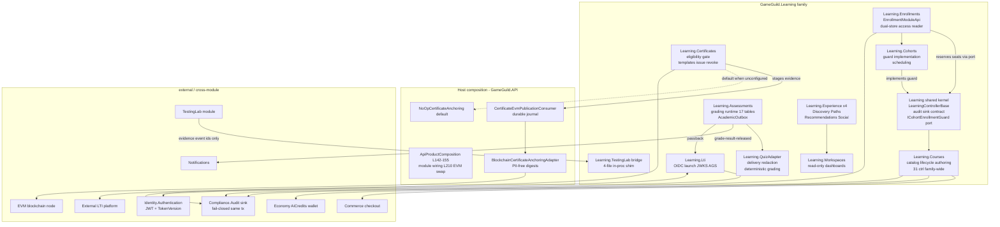
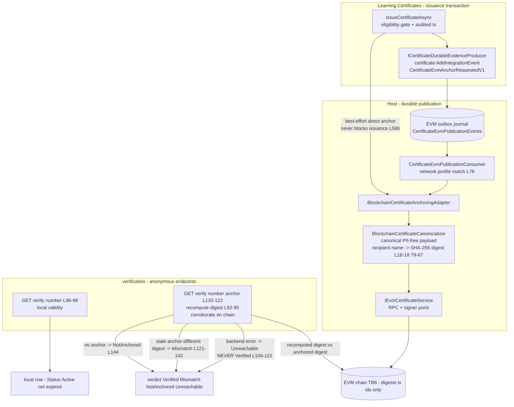
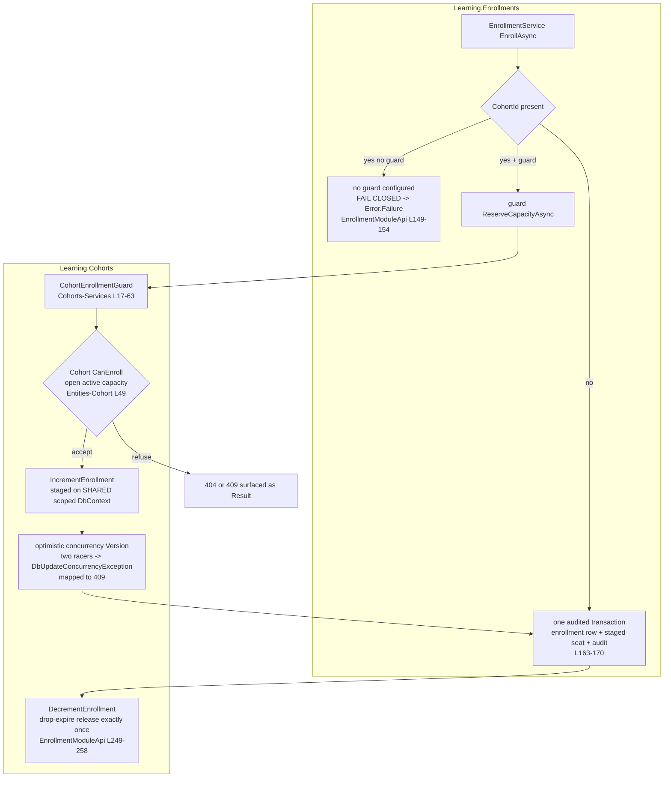

# Learning — Security Architecture

> Learning family modules (`GameGuild.Learning.*`) · `develop` @ `ea4d1f91ce` (post-#1226 / post-#1275).
> Component view plus the four security-relevant mechanisms this family is built around: the certificate eligibility gate (position, post-#1226 N1), the blockchain anchoring pipeline (PII-free digests, fail-closed verify), the cohort enrollment guard pattern (PR #1275), and the who-can-grade permission map.
> Citation shorthand as defined in [`01-user-flows.md`](01-user-flows.md). Mermaid labels contain no parentheses and no colons.

## 1. Component diagram



Security-relevant composition facts:

- The module family composes in the host's enabled-modules list at `Host:/Core/Setup/ApiProductComposition.cs:84-95` (all 12 Learning entries incl. the TestingLab bridge); the certificate anchoring adapter swap happens at `:238` (`AddScoped<ICertificateAnchoring, BlockchainCertificateAnchoringAdapter>`) with the EVM evidence/host composition at `:170-171` — NoOp default from `CertificatesModule`, EVM adapter when a provider is configured.
- The only **durable** event machinery is the academic outbox (`grade-result-released` → notification + LTI AGS); the EVM publication path has its own durable journal (`Host:/Core/Integration/CertificateEvmOutboxServiceRegistration.cs:31-34`). The telemetry pipeline is dead by design-baselines (K1) and carries no security weight.
- Everything mutating touches the audit sink in the same transaction (TB5, fail-closed — STRIDE SL12).

## 2. The eligibility gate — position matters (post-#1226 N1)

The pre-#1275 defect was positional: `CheckEligibilityAsync` existed as an **interactive query** (`Certificates:/Services/CertificateService.cs:455-510`) while the endpoint command called `IssueCertificateAsync` directly — a gate nobody walked through. The fix moved the gate **inside issuance**, so every caller inherits it:

```
IssueCertificateAsync(templateId, enrollmentId, userId, courseId)
  ├─ enrollment exists .................. 404 NotFound          (CertificateService.cs:59-66)
  ├─ enrollment.UserId == userId ........ 403 Forbidden          (:68-77)   anti-recipient-spoof
  ├─ enrollment.ProgramId == courseId .... 409 Conflict          (:79-88)   anti-course-mixup
  ├─ status Completed or CompletedWithCertificate . 409 Conflict (:90-99)   anti-forgery core
  ├─ duplicate enrollment+template ....... 409 Conflict          (:101-108)
  └─ template active ..................... 404 NotFound          (:110-115)
```

- Position: `Certificates:/Services/CertificateService.cs:52-115` — the first thing `IssueCertificateAsync` does, before `Certificate.Issue`, before the audited transaction (`:130-148`), before evidence staging (`:146`).
- Why this position: the endpoint command (`Certificates:/Commands/CertificateEndpointCommands.cs`) and any program-completion flow share one chokepoint; a per-call-site check is what failed before. The interactive `CheckEligibilityAsync` remains as a query surface, with a comment naming the authoritative gate (`:455-458`).
- Residual: the gate trusts the `learning_enrollments`/`ProgramEnrollment` store; owner-set `Completed` status (STRIDE SL2-E) and the unreconciled dual stores (N21) bound how much the gate proves. Auto-issue on completion is not wired (06 N12) — issuance is always an explicit staff call behind `RequireResourcePermission(Create)` (`Certificates:/Controllers/CertificatesController.cs:138`).

## 3. Blockchain anchoring pipeline — PII-free digests, fail-closed verify

Two trust layers: the local certificate row (source of truth) and an auxiliary on-chain anchor (tamper evidence). The pipeline never lets PII reach the chain and never lets chain unavailability fake a verification verdict.



Invariants (each pinned by the adapter code, `Host:/Core/Integration/BlockchainCertificateAnchoringAdapter.cs`):

1. **PII-free by construction** — the adapter publishes only the SHA-256 of a canonicalized payload; the recipient name is reduced to a digest **before leaving the class**, and the revocation reason is never published (`:16-18`, canonicalizer call at `:79-87`).
2. **Fail-closed verify** — backend errors surface `Unreachable`, never `Verified` (`:104-115`); digest mismatches surface `Mismatch` with both digests (`:121-142`); absence is distinct from mismatch (`NotAnchored`, `:144`).
3. **Issuance availability > anchoring** — the in-flow anchor is best-effort (`AnchorIssuedCertificateSafelyAsync`, `Certificates:/Services/CertificateService.cs:566`); durable publication continues through the journal + consumer (`CertificateEvmPublicationConsumer.cs:16-50`) with network-profile matching so an anchor lands on the configured chain only.
4. **Verification recomputes, never trusts stored digests alone** — the digest is recomputed from the current certificate (`:92-95`) so a local edit after anchoring is detectable (stale-anchor branch `:121-142`).
5. Anonymous verification responses expose verdicts and PII-free evidence only (digests, tx/network ids, block, timestamp — `CertificatesController.cs:110-118` remarks).

## 4. The cohort guard pattern (PR #1275, #1226 N17)

A **port-and-adapter seat reservation** that keeps the Enrollments module independent of cohort persistence while making ungated cohort enrollment structurally impossible:



Pattern properties worth copying (this is the reusable shape):

- **Dependency inversion** — the port `ICohortEnrollmentGuard` is declared in `Learning:/Abstractions/ICohortEnrollmentGuard.cs:17-39`, mirroring `ICourseEnrollmentAccessReader`'s existing inversion for Courses→Enrollments; the Cohorts module supplies the implementation (`Cohorts:/CohortsModule.cs` registration).
- **Shared-context atomicity** — the seat increment is staged on the shared scoped `DbContext`, so the caller's single `SaveChanges` persists enrollment + seat + audit atomically; there is no two-phase window to leak a seat.
- **Optimistic concurrency as the race control** — the entity `Version` bump turns last-seat racers into `DbUpdateConcurrencyException` for exactly one, mapped to a 409 capacity conflict (PR #1275 description; `Cohorts:/Services/CohortEnrollmentGuard.cs:14-16`).
- **Fail-closed default** — an unconfigured guard refuses the cohort path before any write (`Enrollments:/EnrollmentModuleApi.cs:149-154`).
- **Compensating release** — drop/expire frees the seat exactly once, best-effort, so a vanished cohort row cannot block a legitimate drop (`:249-258`).
- **Result-typed refusal channel** — `EnrollUserCommand` returns `Result<EnrollmentDto>` so guard refusals surface as 4xx rather than exceptions.

Residual: the guard covers the `Enrollments` store only; the `Courses` legacy `program_users` path has no cohort concept (N21 dual stores), and cohort state-machine escapes (N11) are outside the guard's scope.

## 5. Who-can-grade permission map

Consolidated from `docs/architecture/grading-authorization-matrix.md` (the planning-time authority), the controller capability helpers (`Assessments:/Controllers/AssessmentsController.cs:1694-1711`), and the runtime's review-stage handlers.

| Action | Who | Enforcement point | Audit |
|---|---|---|---|
| Author / prepare / publish assessment revision | course **Edit** (`Program.{id}.Edit`) | authoring routes + hash preflight `Assessments:/AssessmentsModule.cs:107-108` | `AssessmentRevisionPrepared/Published` |
| Start attempt / autosave / submit | enrolled learner (**Learn** capability + owner) | `HasCourseCapabilityAsync(…, Learn)` (`AssessmentsController.cs:485,524,1307,1576`) + start policy `AssessmentGradingRuntimeService.cs:1631-1639` | attempt draft/submitted events |
| Automated quiz grading | deterministic worker (service identity) | `QuizAutomatedReviewStageHandler` registration (`QuizAdapter:/QuizAdapterModule.cs:22-24`) — never user-facing | `ReviewStageExecuted` |
| AI review | external worker (service identity) | `AIReviewStageHandler`; exact provider/policy binding per matrix | `ExternalReviewStageExecuted` |
| Self review | the same learner, evidence draft-bound, single finalization | `SelfReviewStageHandler` (`AssessmentsController.cs` self-review L690) | `SelfReviewSubmitted` |
| Peer review claim/submit | a *different* enrolled learner holding an active claim; target group members excluded | claim L379 / submit L428 + stage handler | `PeerReviewClaimed/Submitted` |
| Instructor review save | course **StaffReview** (`Program.{id}.Review`) | `CanReviewCourseAsync` → `StaffReview` (`AssessmentsController.cs:1699-1700`) | `InstructorReviewSaved` |
| Override result / start regrade | course **StaffReview**, reason required (override) | runtime `ApplyRuntimeGrade(allowRegrade)` — manual `Grade` cannot touch graded submissions (`Assessments:/Entities/Assessment.cs:877-897`) | `GradeResultOverridden` / `GradeRegradeStarted` |
| Release result (manual / scheduled / immediate) | course **StaffReview** or release service identity | release route L751 / schedule L769 / finalize; `ResultReleaseMode` | `grade-result-released` (outbox, durable) |
| Read withheld result | course **StaffReview** | per matrix | `WithheldGradeResultRead` |
| Read released result | owning learner / group participants after projection | released-result reads, owner checks | observable per policy |
| Read gradebook projection | course **StaffReview** (any enrollment) **or** the enrollment's owner (own row only) | `AssessmentsController.cs:915-941` — `CanReviewCourseAsync` else `ResolveEnrollmentUserIdAsync` equality | read unaudited (disclosure ungated — N5) |
| Read course assessment analytics | course **Edit or StaffReview** | `CanEditOrReviewCourseAsync` (`:902-908,905-907`) | — |
| Certificate issue / revoke / renew | certificate resource **Create / Delete / Edit** permissions | `CertificatesController.cs:138,166,183` + eligibility gate §2 | audited transactions (`CertificateService.cs:143-148,344-349,407-411`) |

Invariants carried from the matrix (verified in-controller): authorization runs **before** idempotency returns an outcome; service identities never call authoring or instructor commands; `AuthorTest` personas never create official submissions or gradebook rows; overrides record actor + previous/new values + reason.

## 6. Security-relevant configuration

| Knob | Default | Effect |
|---|---|---|
| `BlockchainCertificates Provider` | unset → `NoOpCertificateAnchoring` (`CertificatesModule` L25) | anchoring off; verification reports `NotAnchored` rather than pretending |
| EVM provider configured | adapter swap at `Host:/Core/Setup/ApiProductComposition.cs:238` (composition `:170-171`) | enables §3 pipeline |
| `Learning:Courses:ScheduledPublish:Enabled` | on, 60 s poll (PR #1275) | honors `publishAt` via `PublishDueProgramsWorker`, Draft/Review sweep only — a stale schedule cannot resurrect Archived or re-publish Published (N10 fix) |
| Academic outbox `MaxAttemptsBeforeDeadLetter` | 5 (`AcademicOutbox.cs:94`) | terminal dead-letter + metrics + replay (`:202-213`; `GradingEntities.cs:1667`) |
| Cohort guard registration | required for cohort enrollment | unconfigured → fail-closed refusal (`EnrollmentModuleApi.cs:149-154`) |
| Rate limiting | **none family-wide** (N4) | platform default policy only — top mitigation priority in [`07-stride-threat-model.md`](07-stride-threat-model.md) |

## 7. Known-attack recap (links into the STRIDE model)

- Certificate forgery → eligibility gate (§2) + anchoring (§3) — STRIDE SL6.
- Self-enroll privilege escalation → owner gates + monetization window (STRIDE SL2) — post-#1275.
- Cheating (answer leakage / timing / mid-quiz hijack) → delivery redaction, server timers, Learn-capability + owner checks (STRIDE SL4); residual R-1 (no attempt-bound token).
- LTI launch forgery / grade-change → JWKS validation, single-use state/nonce, outbound-only AGS (STRIDE SL7).
- Cohort capacity races → guard pattern (§4).
- TestingLab session exfiltration → bridge carries ids only (STRIDE SL8).
- FERPA education records without a disclosure gate → structural finding, cross-module handoff absent (`docs/compliance/10-cross-module-sequences.md:85-102`, #1220 package; Learning gap N5).
