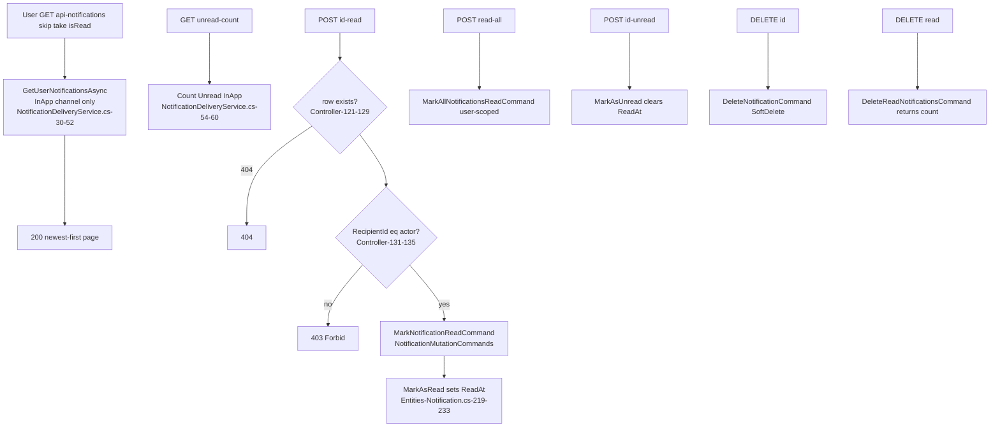
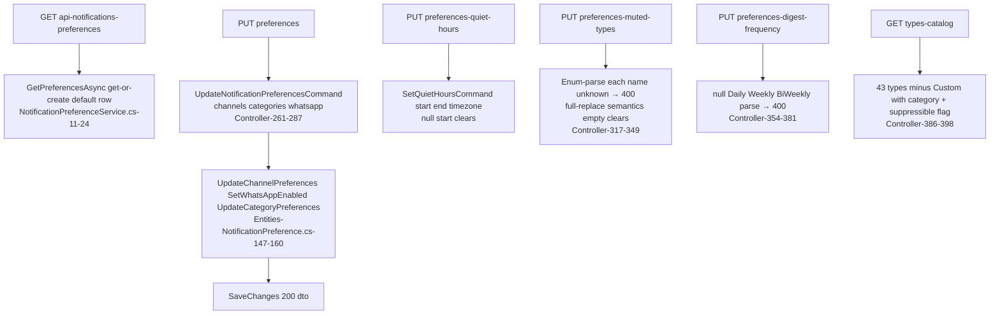
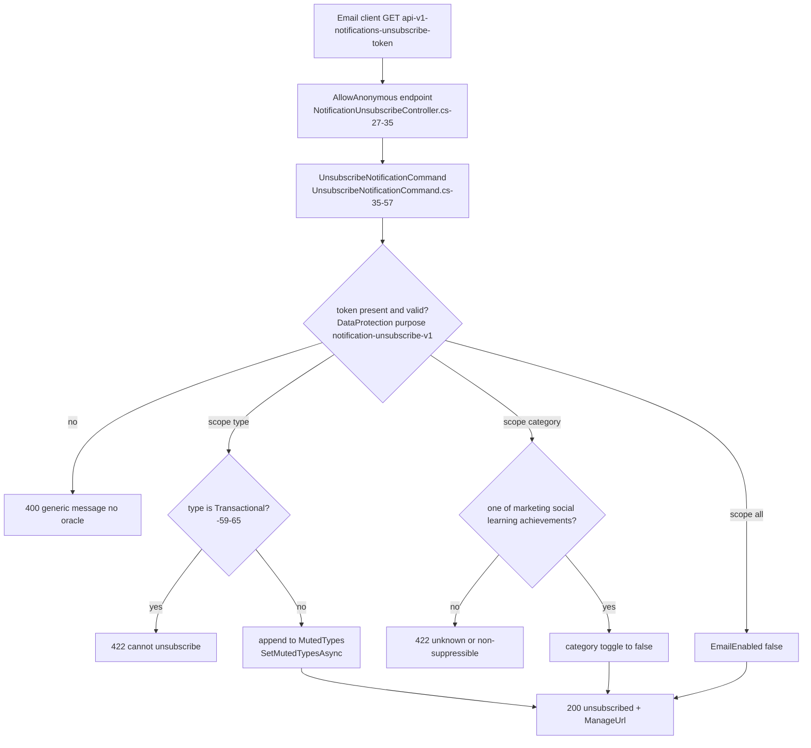
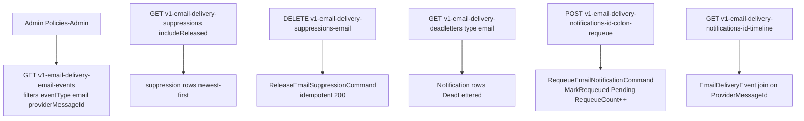
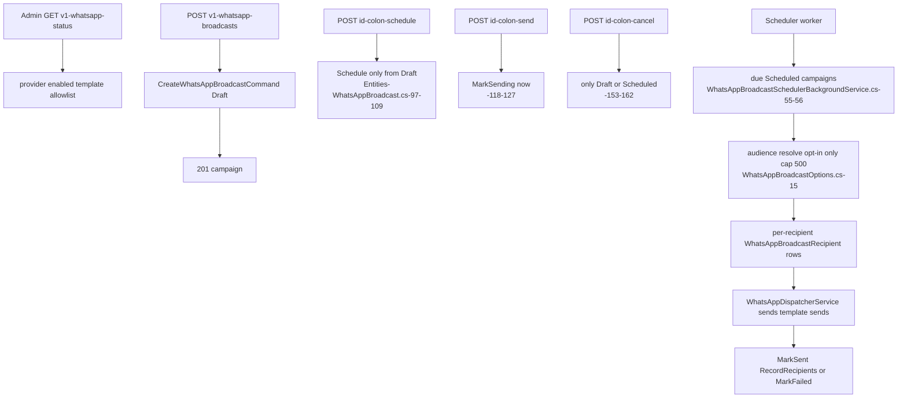

# Notifications — User flows

> Module `GameGuild.Notifications` · develop `ce31d5850c`. Shorthand `Notif:` = module root. Family numbering F1-F6 matches 07/08.

## F1 — Read and manage in-app notifications

Edge cases:

| Case | Behavior | Evidence |
|---|---|---|
| Non-InApp rows invisible to the list | `Channel == InApp` filter — email/push/SMS rows never appear in-app | `Notif:/Services/NotificationDeliveryService.cs:38, 57` |
| Ownership enforced per-row on read/unread/delete | explicit `RecipientId != userId → Forbid()` | `Notif:/Controllers/NotificationsController.cs:106-111, 131-135, 179-211` |
| `read-all` / `delete-read` need no row check | scoped by userId in the command | `:149-162, 225-238` |
| Unread of an already-read row | allowed (state flip back) | `Entities/Notification.cs:225-233` |

## F2 — Preference management (the self-service settings page)

Edge cases:

| Case | Behavior | Evidence |
|---|---|---|
| Preference row lazily created on first read | default: all channels on, WhatsApp **off**, quiet-hours bypass = Urgent | `Notif:/Entities/NotificationPreference.cs:118-123`; `Services/NotificationPreferenceService.cs:16-21` |
| Muted types stored as JSON names, case-insensitive | malformed JSON treated as empty (no crash) | `Entities/NotificationPreference.cs:214-227` |
| Transactional types flagged non-suppressible in the catalog | drives the UI; enforcement lives in the decision chain + unsubscribe guard | `Notif:/NotificationCategories.cs:14-27`; `Controller:397` |
| WhatsApp toggle is **explicit opt-in only** | default false; nothing auto-enables it | `Entities/NotificationPreference.cs:46`; 03 §4 |

## F3 — One-click unsubscribe (anonymous, signed token)

Edge cases:

| Case | Behavior | Evidence |
|---|---|---|
| Tokens never expire | recorded decision A5 — no expiry field at all | `Notif:/Services/Email/UnsubscribeTokenService.cs:10-12` |
| Tampered/malformed indistinguishable | single generic 400; catch-all | `:54-59` |
| Idempotent repeat clicks | re-applying the same toggle is a no-op write | handler shape `:59-116` |
| ManageUrl from config | `App:BaseUrl` + `/workspace/settings/notifications` | `:138-142` |

## F4 — Admin email deliverability console

Edge cases:

| Case | Behavior | Evidence |
|---|---|---|
| Payload never exposed raw | DTO carries parsed fields + 500-char preview | `Notif:/Controllers/EmailDeliveryAdminController.cs:218-221` |
| Requeue only from DeadLettered | entity guard; otherwise 409 shape via `FromError` | `Entities/Notification.cs:312-325`; `Controller:128-141` |
| Requeue keeps audit | `LastError`/`AttemptCount` deliberately retained | `Entities/Notification.cs:308-311` doc comment |
| Admin = platform-wide | `Policies.Admin` (`Authz:/Policies.cs:111`), no tenant scoping on the console | controller class attribute `:18` |

## F5 — WhatsApp broadcast campaign (admin author + scheduler)

Edge cases:

| Case | Behavior | Evidence |
|---|---|---|
| Campaign audience is opt-in filtered | resolver honors `WhatsAppEnabled` preferences (the #54/#55 saga) | `Notif:/Services/WhatsApp/WhatsAppBroadcastAudienceResolver.cs` |
| Bounded blast | `MaxRecipientsPerBroadcast = 500` default | `WhatsAppBroadcastOptions.cs:15` |
| Template allowlist | free-form send only when row lacks allowlisted template name | `WhatsAppDispatcherService.cs:109-116`; `WhatsAppSettings.cs:60` |
| Unconfigured provider | NoOp declines → campaign MarkFailed observably | `NotificationsModule.cs:63-75`; broadcast entity `:145-151` |

## F6 — Consumer-side flows (documented from the user's chair)

- **Receive an identity email** (verification / reset / magic-link / codes): producer handler → `SendAsync` → Email row → sweep → renderer (registered by Identity.Authentication) → SES → inbox; delivery events return via the webhook and build the timeline (F4).
- **Digest subscriber**: preference `EmailDigestFrequency` set → suppressible email rows quarantine `HeldForDigest` → digest engine fires daily / Monday-weekly / ISO-week-even Monday at user-local 08:00 → one bundled email; rows marked Sent with no single provider id (`Entities/Notification.cs:271-282`).
- **Quiet-hours user**: Email rows hold until window end (`NotificationDeliveryService.cs:105`); InApp drops (`NotificationPreferenceService.cs:229-241`).
