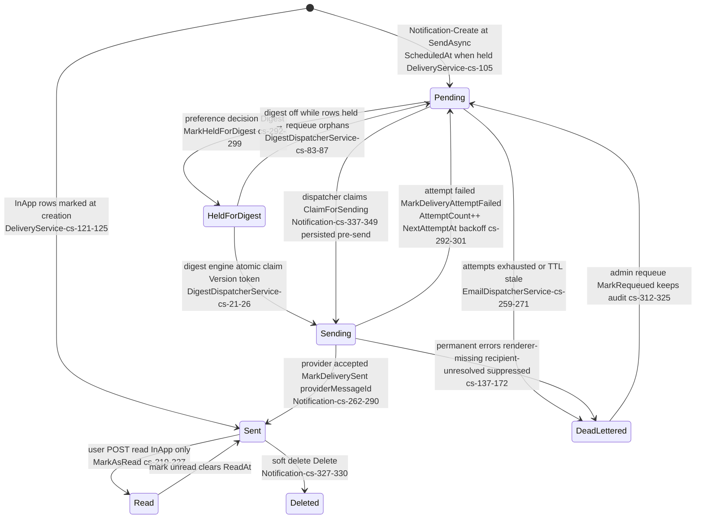
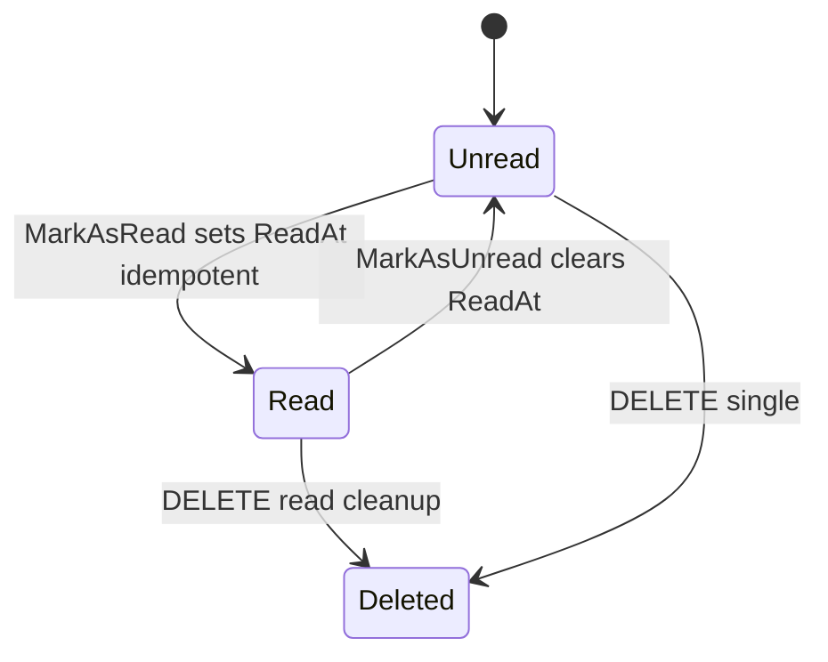
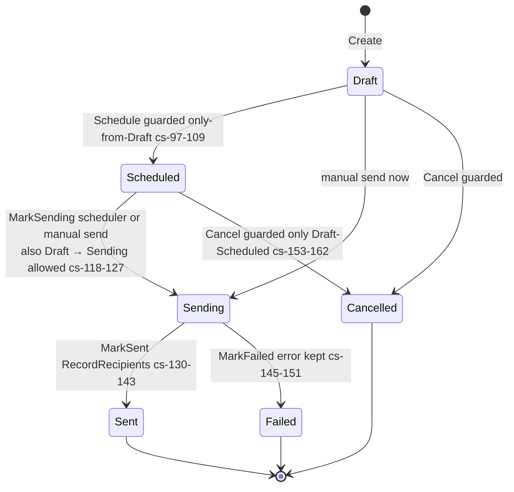
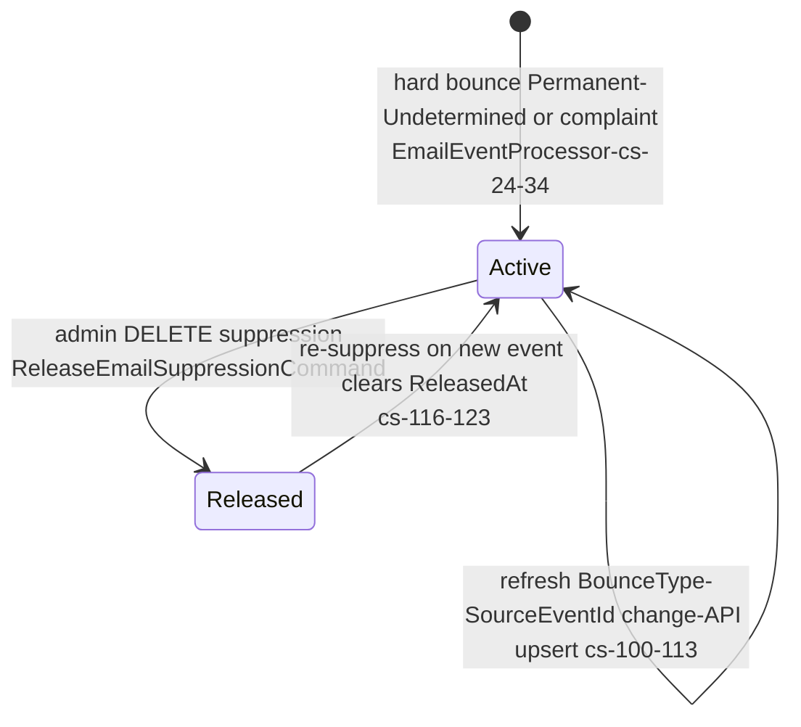

# Notifications — State machines

> Module `GameGuild.Notifications` · develop `ce31d5850c`. Shorthand `Notif:` = module root.

## 1. Notification row — delivery lifecycle (`NotificationDeliveryStatus`, `Entities/Notification.cs:501-523`)

The cross-channel queue→render→dispatch machine. InApp short-circuits it (born Sent); email/push/SMS/WhatsApp ride the full graph.

Machine honesty notes:

| # | Truth | Evidence |
|---|---|---|
| 1 | `Failed` enum value (3) is **never assigned** — failure writes return to `Pending` with `AttemptCount++`; the value is display-only | grep `NotificationDeliveryStatus.Failed` → declarations only (`Entities/Notification.cs:515-517`) |
| 2 | The dispatcher's quiet-hours hold writes `Pending` + `NextAttemptAt` through the EF change API (no domain method) because the entity has no Hold transition — interim, documented in-code | `Notif:/Services/Email/EmailDispatcherService.cs:273-289` |
| 3 | `Sending` rows older than 10 minutes are reclaimed into the sweep (crash between claim and send) | `EmailDispatcherService.cs:23-24, 53-54` |
| 4 | Holds must not consume retry attempts — hence the change-API bypass instead of `MarkDeliveryAttemptFailed` | `:275-277` doc |
| 5 | Requeue keeps `LastError`/`AttemptCount` deliberately (audit of the failure that dead-lettered) | `Entities/Notification.cs:308-311` |

## 2. Read/unread (InApp projection)

## 3. WhatsApp broadcast campaign (`WhatsAppBroadcastStatus`, `Entities/WhatsAppBroadcast.cs:166-173`)

Guards are real (InvalidOperationException on illegal transitions) — unlike several Social blind setters (N4 class).

## 4. Preference decision chain — the effective per-notification "state selector"

Not a persisted machine; `DecideDeliveryAsync` (`Notif:/Services/NotificationPreferenceService.cs:150-244`) picks the row's fate in fixed order:

| Step | Gate | Outcome |
|---|---|---|
| 0 | WhatsApp channel and (no pref row or WhatsAppEnabled false) | **Drop whatsapp-not-opted-in** — even Urgent/transactional |
| 1 | Transactional type set or priority Urgent | Send (bypass) |
| 2 | Type in muted set | Drop muted |
| 3 | Channel toggle off | Drop channel-disabled |
| 4 | Category toggle off (Marketing/Social/Learning/Achievements) | Drop category-disabled |
| 5 | Email and digest frequency set and priority < bypass | **Digest** (row HeldForDigest) |
| 6 | In quiet hours and priority < bypass | InApp → Drop quiet-hours; Email → **HoldUntil** window end; others Send |
| — | none hit | Send |

The **whatsAppEnabled saga** (#54/#55): explicit opt-in default-off at the preference (`Entities/NotificationPreference.cs:46,118,147-151`), fail-closed decision step 0, provider fail-closed (NoOp declines visibly, `NotificationsModule.cs:63-75`), settings `ValidateOnStart` refuses Enabled-without-credentials (`WhatsAppSettings.cs:118-123`), and the broadcast audience resolver filters opt-ins only — the channel cannot send a single message by accident or default.

## 5. Email suppression lifecycle (`EmailSuppression`, `Entities/EmailSuppression.cs`)

- "Permanent" and **"Undetermined"** bounces both suppress (`EmailEventProcessor.cs:64-67`) — conservative by design.
- Complaint suppression is the sender-reputation guard; release is admin-only and idempotent.
