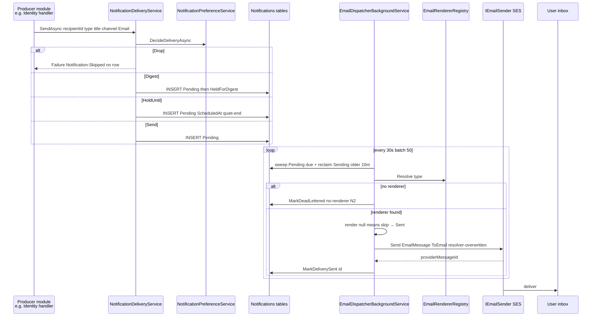
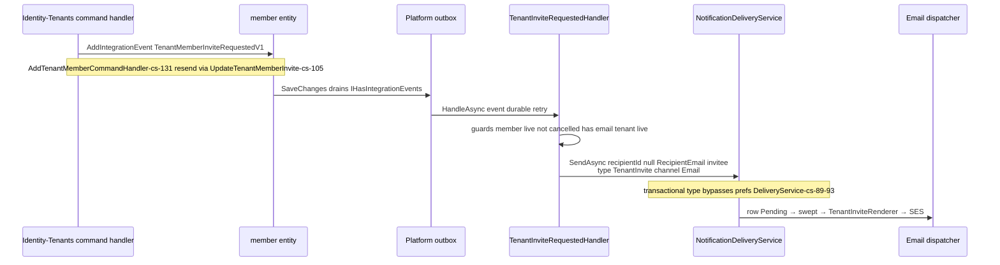
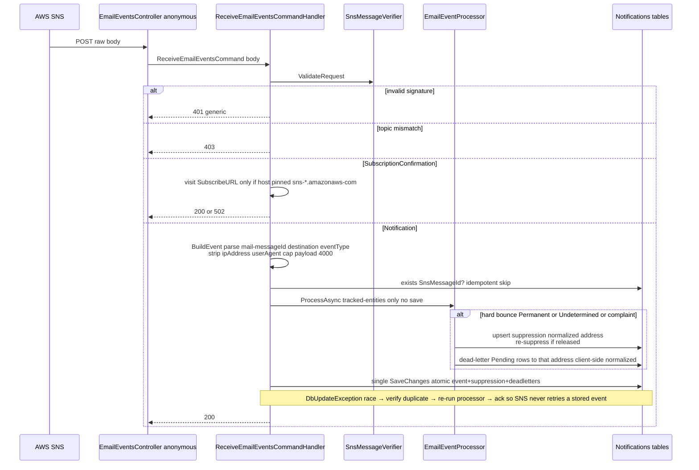
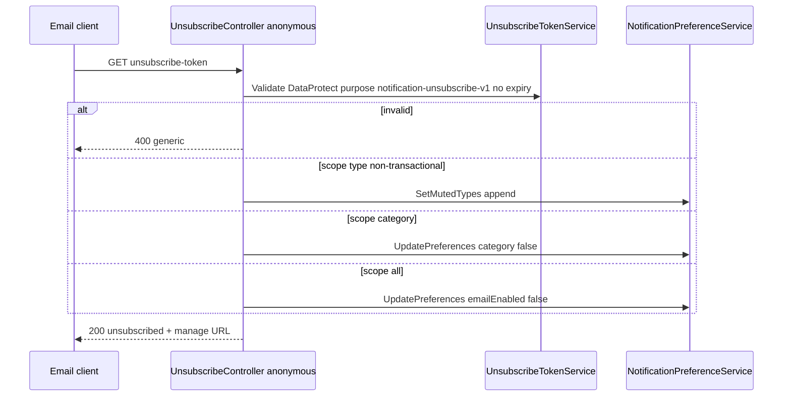
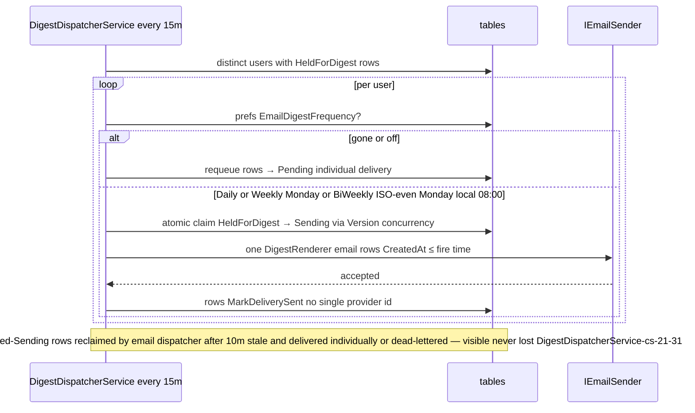
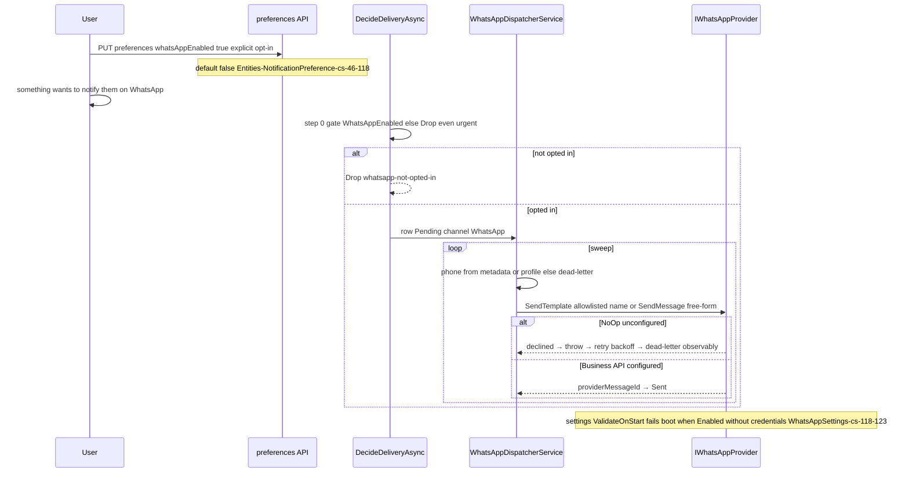

# Notifications — Cross-module sequences

> Module `GameGuild.Notifications` · develop `ce31d5850c`. Shorthand `Notif:` = module root.

## 1. Producer → row → renderer → provider → user (email happy path)

## 2. Tenant invite — the only outbox-driven producer

## 3. SES/SNS webhook ingest with suppression side effects

## 4. One-click unsubscribe

## 5. Digest bundling window

## 6. The WhatsApp saga end-to-end (fail-closed chain)

