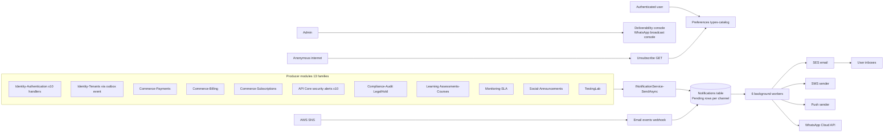
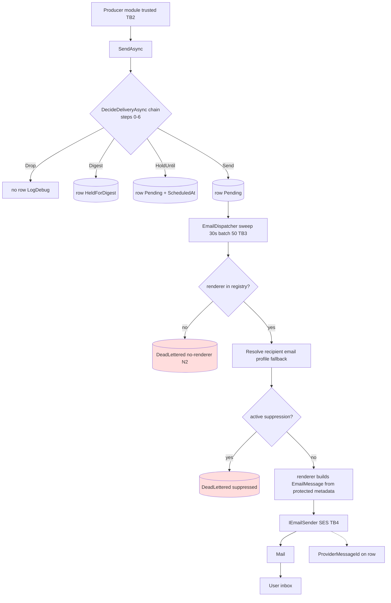
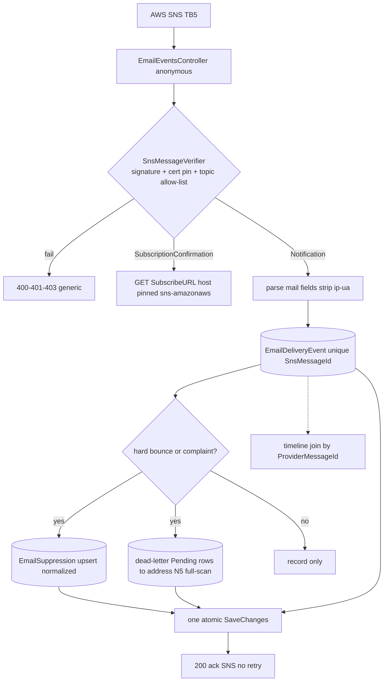
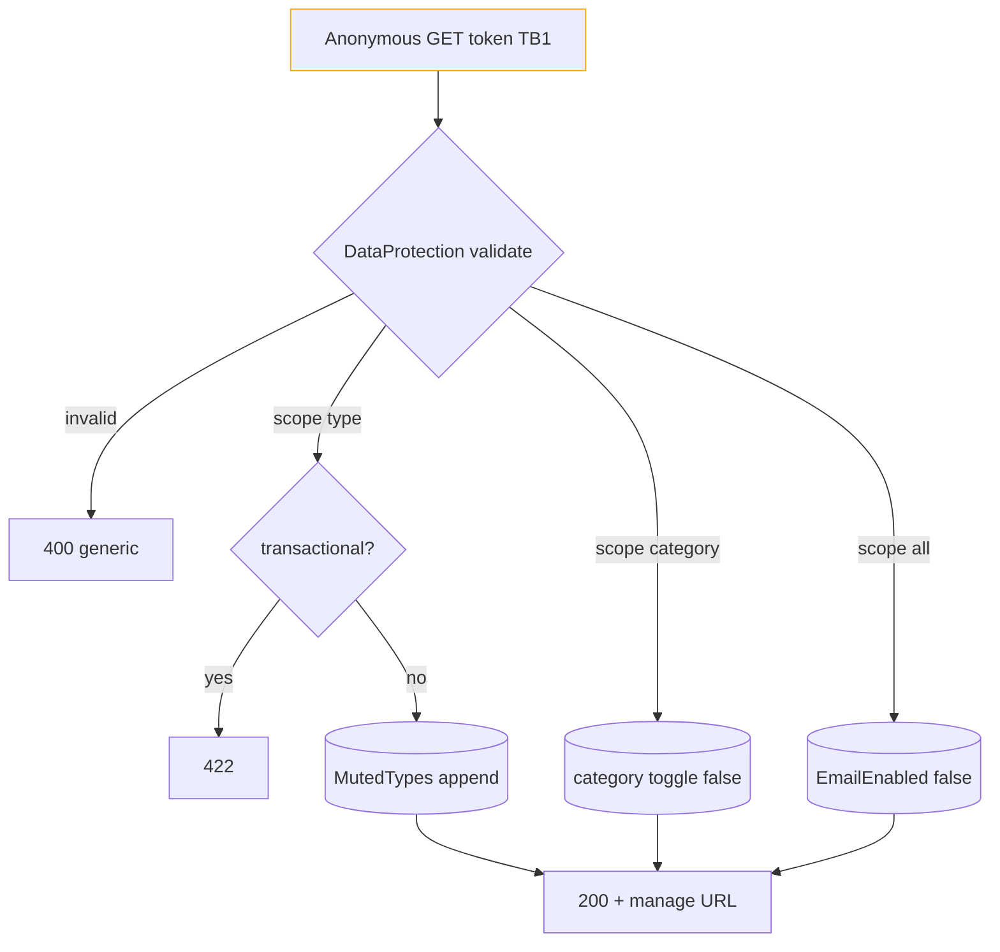
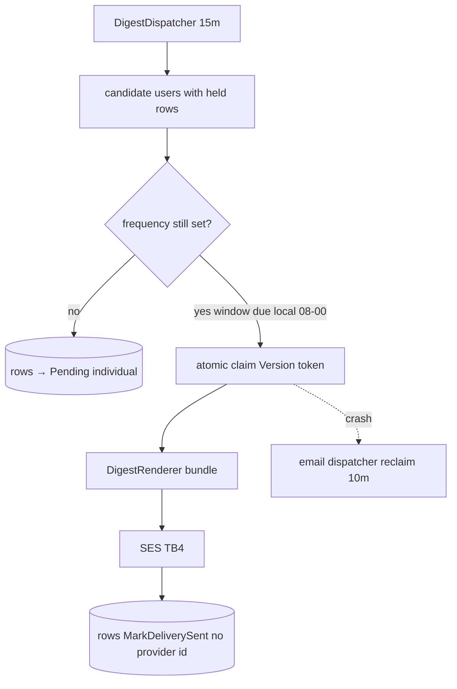
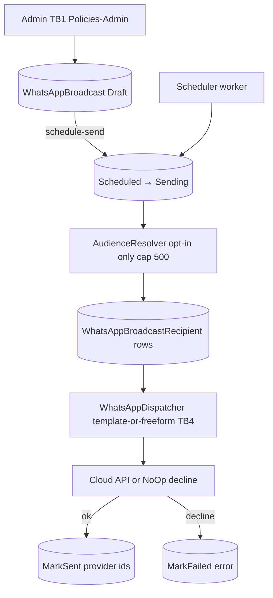

# Notifications — Data-flow diagrams

> Module `GameGuild.Notifications` · develop `ce31d5850c`. L0 context + L1 per family (numbering matches 01/07).

## L0 — Context (producer fan-in → dispatch fan-out)

Trust boundaries: TB1 internet→API (anonymous endpoints verified by signature/token, not authN), TB2 producer modules→SendAsync (in-process, trusted code), TB3 API→DB, TB4 API→external providers (SES/SMS/push/WhatsApp), TB5 AWS→webhook (SNS signature).

## L1-F1 — Producer → Email row → renderer → provider → user

## L1-F2 — SNS webhook ingest → suppression + timeline

## L1-F3 — Unsubscribe (public token mutator)

## L1-F4 — Digest engine

## L1-F5 — WhatsApp broadcast campaign

## Data stores summary

| Store | Written by | Read by |
|---|---|---|
| `Notifications` | producers via SendAsync, dispatchers lifecycle, digest engine, processor dead-letters, admin requeue | user routes, dispatchers, admin console |
| `NotificationPreferences` | preferences routes, unsubscribe, digest requeue checks | decision chain |
| `NotificationTemplates` | (seed/admin) | SendFromTemplateAsync |
| `EmailDeliveryEvents` | webhook ingest | admin feed, timeline |
| `EmailSuppressions` | processor upsert, admin release | dispatcher pre-send, admin |
| `WhatsAppBroadcast(Recipient)` | admin console, scheduler | admin console |
