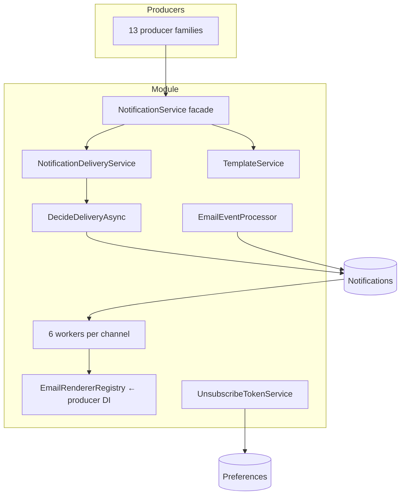

# Notifications — Security architecture

> Module `GameGuild.Notifications` · develop `ce31d5850c`.

## 1. Component view — the three named patterns

**Renderer registry pattern.** `IEmailRenderer` (one per `NotificationType`, `Notif:/Services/Email/IEmailRenderer.cs:10-33`) is registered by whichever module owns the email's content; `EmailRendererRegistry` (`EmailRendererRegistry.cs:9-15`) folds `IEnumerable<IEmailRenderer>` into a dictionary at resolution. Consequences: (a) adding an email = register a renderer in your module, zero dispatcher changes; (b) the module boundary is inverted — Notifications owns the *pipeline*, producers own *content*; (c) a missing renderer is a permanent config error, dead-lettered with the type name (`EmailDispatcherService.cs:137-144`); (d) duplicate type registration crashes DI (fail-fast). Footers are deliberately not part of the contract — injected later for suppressible types only (`IEmailRenderer.cs` remarks; `EmailFooterService`).

**Dispatch worker topology.** One hosted service per out-of-band channel — Email (30s/50), Digest (15m), Sms, Push (disabled-exits), WhatsApp, WhatsAppBroadcastScheduler (`NotificationsModule.cs:40,47,55,62,79,87`) — all following the same shape: scope-per-pass, sweep→claim(`Sending`, persisted pre-send)→send→`MarkDeliverySent`/backoff/dead-letter, 10-minute Sending-reclaim, exceptions logged without crashing (`EmailDispatcherBackgroundService.cs:19-71`). InApp needs no worker (marked Sent at creation). Channels Slack/Discord/Webhook have enum values but no worker (N10).

**Preference resolution chain.** Single entry `DecideDeliveryAsync` (`NotificationPreferenceService.cs:150-244`), fixed order gate-then-route: WhatsApp opt-in (fail-closed) → transactional/urgent bypass → per-type mute → channel toggle → category toggle → digest routing → quiet hours (channel-dependent outcome). `SendAsync` materializes the decision into row state (row absent on Drop; `ScheduledAt` on HoldUntil; `HeldForDigest` on Digest — `NotificationDeliveryService.cs:77-119`), so downstream components never re-evaluate preferences... except the email dispatcher's interim legacy re-check (N1) — the one place the chain is duplicated.

## 2. Permission map

| Surface | Gate | Notes |
|---|---|---|
| `api/notifications/*` user + preference routes (15) | `[Authorize]`, actor-scoped | ownership checked per-row on id-addressed mutations |
| `api/v1/email-delivery/*`, `api/v1/whatsapp/*` (14) | `[Authorize(Policy = Policies.Admin)]` | platform-wide; no tenant scoping (by design — deliverability is global) |
| `POST api/v1/notifications/email-events` | anonymous + SNS signature + topic allow-list | the only write-path anonymous endpoint |
| `GET api/v1/notifications/unsubscribe` | anonymous + DataProtection token | preference mutator; transactional types 422 |
| `api/v1/notifications/subscriptions*` (Commerce.Subscriptions) | `[Authorize]` + `RateLimitPolicies.Api` | outsider route family; resend 500-on-missing (N7) |

## 3. Integrity properties — and non-properties

**Properties held:**

1. At-most-once row creation per decision (Drop writes nothing; everything else exactly one row).
2. Crash-safe claim: `Sending` persisted before any external call; reclaim after 10m (`EmailDispatcherService.cs:23-24, 129-134`).
3. Webhook idempotency: unique `SnsMessageId` + pre-check + duplicate-race healing (`ReceiveEmailEventsCommand.cs:112-153`).
4. Suppression cannot be bypassed by requeue: pre-send check runs on every attempt (`:157-172`).
5. Security emails require rendered message **and** provider acceptance, else retry (`:174-202`).
6. WhatsApp cannot send without explicit opt-in even for Urgent (decision step 0).
7. Digest claim is single-winner via Version concurrency token (`DigestDispatcherService.cs:21-26`).

**Non-properties:**

1. **Producer trust is the email-injection boundary** — nothing sanitizes Title/Message/Metadata at `SendAsync`; a compromised/chatty producer renders arbitrary content into platform-branded mail (07 family 3).
2. **Delivery is at-least-once across retries**; the digest/no-provider-id rows cannot be correlated to a single SES message (`Entities/Notification.cs:271-277`).
3. **Preferences are not audit-logged** beyond the generic operation event — no who-changed-what history (07 family 2 R).
4. **Unsubscribe tokens are perpetual** (decision A5) — replay unbounded (N6).
5. **`Failed` is not a real state** (N4) — monitoring must key on `DeadLettered` + `AttemptCount`.

## 4. Fail verdicts (from 07)

| Family | Verdict | Blocking gap |
|---|---|---|
| F1 in-app access | pass | unbounded `take` (minor) |
| F2 preferences | pass | audit weakness |
| F3 email dispatch | pass-with-contract | producer-trust injection; N1 legacy gate; N2 renderer coverage |
| F4 public endpoints | **partial fail** | no rate limiting (DoS); token no-expiry (T) |
| F5 admin console | pass | — |
| F6 WhatsApp | pass | — |

## 5. Deployment invariants

1. `IDataProtectionProvider` (host) must be configured — unsubscribe tokens and metadata protection depend on it (`NotificationsModule.cs:95-97`; ring/key persistence per platform DataProtection cert env vars).
2. `Notifications:EmailDispatcher` / `DigestDispatcher` / `SmsDispatcher` / `PushDispatcher` / `WhatsApp:*` sections tune intervals, backoff `[1m,5m,30m,2h,8h]`, `MaxAttempts 5`, transactional staleness 24h, digest FireTime 08:00, broadcast cap 500 — changing backoff affects dead-letter latency guarantees.
3. SNS topic allow-list + classifier API key (`Assets:AutoModeration:Classifier:ApiKey` is a different setting — do not confuse) — the webhook rejects unconfigured topics with 403 (`SnsRejectionReason.TopicNotConfigured`).
4. `EmailDeliveryOptions.Enabled=false` disables the email worker entirely (startup no-op — broadcast-style silent freeze risk; the push worker inverse is #1218 G6 fixed).
5. `Notifications:WhatsApp:Enabled=true` requires `WHATSAPP_APP_ID`/`WHATSAPP_PHONE_NUMBER_ID`/`WHATSAPP_ACCESS_TOKEN` at boot (`WhatsAppSettings.cs:118-123`) — misconfiguration fails fast by design.
6. Any producer module introducing a new email type MUST register a renderer in its own DI (else guaranteed dead-letters, N2) — treat this as an architecture-review checklist item, and prefer adding the registry-coverage guard proposed in 06.
