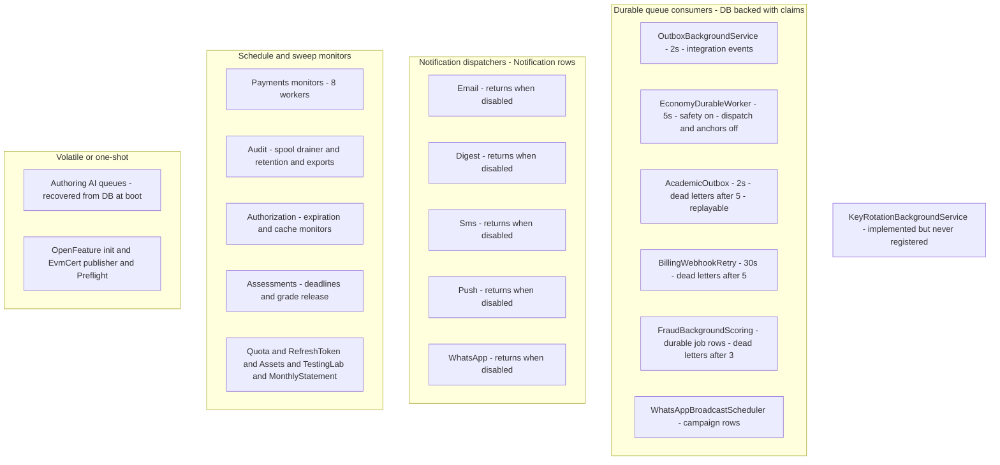

# Background worker inventory (operational reference)

Last audited: 2026-11-02 against `develop` (`ac959fd8f`); remediation log updated by
the #1218 worker-integrity fix (G1/G3/G5/G6 closed, G2 verified-open, G4/G7 open).
Scope: every class in
`apps/api/Source` implementing `BackgroundService` or `IHostedService`, plus every
registration site (`AddHostedService` / `TryAddEnumerable(IHostedService)`).
The audit ran against `74e9bba4c` and was re-verified after develop advanced
through PRs #1185–#1201 (docs packages + `feat/auth-security-batch1`): no
hosted-service implementation or registration changed — the 45 + 1 registrations
and 47 implementations below are current (45 registrations after the #1218 G1
removal of the Features no-op initializer).

Companion package documents (server-side wiring, merged alongside this one):
`docs/auth/wiring-matrix.md` (#1194), `docs/authorization/` (#1200),
`docs/commerce/billing-orders/` (#1201), `docs/commerce/payments/` (#1193).
Where a package gap register describes work that *no* worker performs, it is
cross-referenced below rather than restated.

**Headline numbers**

| Metric | Count |
| --- | --- |
| Hosted-service implementations found | 47 |
| Registered via `AddHostedService` | 45 |
| Registered via `TryAddEnumerable<IHostedService>` (conditional) | 1 |
| Conditionally registered (composition/config guarded) | 3 |
| **Never registered — dead worker code** | **1** |
| Repository cleanup methods with no production caller | 4 |
| Registered workers with operational holes (see Gaps) | 2 open (G4; G2 is the never-registered worker) — G1/G3/G5/G6 remediated by the #1218 worker-integrity PR |

All file paths below are relative to `apps/api/Source`. Line numbers reference the
`ExecuteAsync`/`StartAsync` implementation unless stated otherwise.

## How to read the tables

- **Cadence** — initial delay then loop interval; "one-shot" means `IHostedService.StartAsync`.
- **Default** — `on`/`off` reflects the options class default in code, not any deployed appsettings.
- **Idem.** — idempotent: can the same cycle re-run safely after a crash mid-cycle?
- **DLQ** — explicit poison/dead-letter terminal state (not just "log and skip").
- **HOLE?** — cross-references the Gaps section; blank = no known issue.

## Core (host)

| Worker | Module | Cadence (default) | What it does | Queue/table consumed | Idem. | DLQ | Shutdown | Retry/backoff | HOLE? |
| --- | --- | --- | --- | --- | --- | --- | --- | --- | --- |
| `OutboxBackgroundService` (`GameGuild.API/Core/Eventing/OutboxBackgroundService.cs:12`) | Core Eventing | 2 s idle; immediate re-poll while full batch | Dispatches durable integration events to all registered consumers, then retires completed payloads via `OutboxCleanupService` (8 batches, 500 ms cap) | `gameguild.integration.outbox_messages`, `inbox_receipts`, `outbox_delivery_receipts` | Yes — EventId inbox receipts, per-aggregate ordering, `FOR UPDATE SKIP LOCKED` claims (2 min lease) | Yes — `DeadLetteredAtUtc` after 5 attempts (`Eventing/InboxStore.cs:8,108-114`) | Token-aware; returns on cancel; in-flight item finishes or reclaim via lease expiry | `EventRetryPolicy.GetDelay` exponential backoff (`InboxStore.cs:114`) | |
| `EconomyDurableWorker` (`GameGuild.API/Core/HostedServices/EconomyDurableWorker.cs:36`, reg `Core/Setup/ApiProductComposition.cs:137`) | Core / Economy composite | 5 s poll (`Economy:Workers:PollInterval`) | Composite loop. Safety sub-jobs (default on): capability-policy activation, journal integrity increment (batch 1000), bounty expiration (batch 100), marketplace outbox (batch 100). Dispatch sub-jobs (default **off**): payout + admin-withdrawal dispatch outboxes. Anchor sub-jobs (default **off**): WORM publish/verify | `economy` schema journal/outbox tables per sub-job | Yes — each sub-job is claim/lease based and fail-closed (ADR 2026-08-21) | Per sub-job (outbox processors dead-letter exhausted rows) | Token-aware delay; sub-cycle `OperationCanceledException` propagates | Log + next poll; options-validated at start (`:131-161`) | |
| `QuotaReconciliationBackgroundService` (`GameGuild.API/Core/Quotas/QuotaReconciliationService.cs:107`, reg `Core/Setup/InfrastructureLayerExtensions.cs:246`) | Core Quotas | 5 min initial, 360 min interval (`QuotaReconciliation`) | Repairs tenant quota counters against measured asset-reference counts | `AssetReference` counts vs quota counters | Yes — reconcile-to-measured is naturally idempotent | n/a (repairs, no queue) | Token-aware | Log + next cycle | |
| `RefreshTokenCleanupWorker` (`GameGuild.API/Core/Security/RefreshTokenCleanupWorker.cs:13`, reg `Core/Setup/InfrastructureLayerExtensions.cs:406`) | Core Security | 2 min initial, 1 h interval, 1 min per-cycle timeout (`RefreshTokenCleanup`) | Deletes expired refresh tokens and sessions via `IRefreshTokenCleanupOperation`; emits metrics | Refresh-token + user-session tables | Yes — deletes are predicate-based | n/a (deletion) | Token-aware; per-cycle linked timeout | Log + metric + next cycle | |
| `OpenFeatureHostedInitializer` (`GameGuild.API/Core/WebApplication/OpenFeatureHostedInitializer.cs:7`, reg `Core/Extensions/InfrastructureServiceCollectionExtensions.cs:349`) | Core WebApplication | one-shot at start | Assigns the registered `FeatureProvider` to the OpenFeature `Api.Instance` | none | Yes | n/a | n/a — startup only | n/a — errors swallowed to not block boot | |
| ~~`OpenFeatureHostedInitializer` — Features copy~~ (removed — G1 remediated for #1218: the Features module registered a no-op duplicate whose `StartAsync` awaited `Task.CompletedTask`; it is deleted and `FeaturesModule` no longer registers any hosted service. Provider assignment is owned solely by the Core initializer above) | Features | — | — | — | — | — | — | — | G1 — **fixed** |

## Assets

| Worker | Cadence (default) | What it does | Queue/table consumed | Idem. | DLQ | Shutdown | Retry/backoff | HOLE? |
| --- | --- | --- | --- | --- | --- | --- | --- | --- |
| `VirusScanBackgroundService` (`Modules/GameGuild.Assets/BackgroundServices/VirusScanBackgroundService.cs:15`, reg `Extensions/AssetsModuleExtensions.cs:129`) | 5 s poll (`Assets:VirusScan`) | Scans pending uploads via `IAssetVirusScanProcessor` (batch 20) | `AssetContent` rows `VirusScanStatus = Pending` (`Repositories/AssetContentRepository.cs:42-49`) | Partial — status claim without lease; `Pending`-only pick means a crash mid-scan leaves the row Pending (retried) | No dead-letter; `ScanFailed` is terminal and needs the admin rescan endpoint | Token-aware | Log + next poll; `ScanFailed` does not auto-retry | G4 |
| `AssetGarbageCollectionService` (`.../BackgroundServices/AssetGarbageCollectionService.cs:21`, reg `Extensions/AssetsModuleExtensions.cs:130`) | 1 h (`Assets:GarbageCollection`) | Purges soft-deleted assets past grace period; reference-count double-check, legal-hold/`IsDeletable` safety | Soft-deleted asset rows + object storage | Yes — grace period + recheck | n/a | Token-aware | Log + next cycle | |
| `TransformedAssetCleanupService` (`.../BackgroundServices/TransformedAssetCleanupService.cs:48`, reg `Extensions/AssetsModuleExtensions.cs:131`) | 6 h, max-age 7 d, batch 100 (`Assets:TransformedAssetCleanup`) | Evicts stale transformed-asset cache entries (storage + row) | `TransformedAsset` rows unaccessed > max age | Yes — predicate-based | n/a | Token-aware | Per-item delete isolation; log + next cycle | |
| `ModerationClassificationWorker` (`.../BackgroundServices/ModerationClassificationWorker.cs:15`, reg `Extensions/AssetsModuleExtensions.cs:137`) | 5 s poll (`Assets:AutoModeration`) | Classifies pending assets via `IAssetModerationProcessor` (batch 10); unresolved classifier fails closed to `NeedsReview` | `AssetContent` rows virus-clean with `ModerationStatus` Pending **or Processing** (`Repositories/AssetContentRepository.cs:81-89`) | Partial — `Processing` rows are re-picked on every poll (no lease/claim timestamp) | Human queue instead: `NeedsReview` on every failure mode | Token-aware | Log + next poll; no attempt counter | G4 |

## Commerce — Payments

| Worker | Cadence (default) | What it does | Queue/table consumed | Idem. | DLQ | Shutdown | Retry/backoff | HOLE? |
| --- | --- | --- | --- | --- | --- | --- | --- | --- |
| `RefundWorkflowBackgroundService` (`Services/RefundWorkflowBackgroundService.cs:126`, reg `PaymentsModule.cs:70`) | 60 min poll; **default off** (`Payments:Refunds:Workflow`) | Executes approved refunds, retries failed ones (max 3 attempts) via `IRefundWorkflowWorker` | Refund workflow rows due | Yes — state-machine transitions | Rows exhaust retry budget (3) | Token-aware | Per-item isolation; next-cycle retry | |
| `DisputeDeadlineReminderBackgroundService` (`Services/DisputeDeadlineReminderBackgroundService.cs:23`, reg `PaymentsModule.cs:79`) | 24 h; **default off** + requires `TeamAlertEmails` (`Payments:Disputes`) | Emails the disputes team for `EvidenceDueBy` inside the reminder window | Open dispute rows | Yes — window predicate | n/a | Token-aware, per-item `ThrowIfCancellationRequested` | Log + next cycle | |
| `RevenueAnomalyDetectionBackgroundService` (`Services/RevenueAnomalyDetectionBackgroundService.cs:21`, reg `PaymentsModule.cs:99`) | configurable minutes; **default off** (`RevenueAuditing`) | Trailing-window anomaly detection on the global revenue aggregate; persists alerts | Revenue aggregate/alert tables | Yes — alerts persist idempotently | n/a | Token-aware | Log + next tick | |
| `FraudBackgroundScoringHostedService` (`Services/FraudDetection/FraudBackgroundScoringWorker.cs`, reg `PaymentsModule.cs`) | 15 s initial; `BackgroundRescoringPollIntervalSeconds` poll (default 5 s); batch 25 | Completes fraud provider signals deferred by the synchronous <200 ms decision budget | Durable `FraudBackgroundScoringJob` rows due-swept with a 5 min claim lease (G3 remediated for #1218; was an in-memory `DropWrite` channel) | Yes — persisted rows, leased claims, stale-lease reclaim | Yes — dead-letter after 3 attempts; corrupt payloads immediately | Token-aware | Exponential backoff `1 << min(attempt, 8)` capped at 300 s | |

The payments package gap register (PR #1193, `docs/commerce/payments/06-gaps.md`)
covers the *semantics* of the background re-score (K4: no-op persistence write —
fixed; K6: can only tighten an Allow, never loosen — deliberate). G3 below was the
complementary *transport* gap — a correct re-score was lost when the process recycled
mid-queue; it is now fixed by the durable job table.
| `PaymentRetryQueueBackgroundService` (`Services/PaymentRetryQueueWorker.cs:122`, reg `PaymentsModule.cs:163`) | 60 min poll; **default off** (`Payments:RetryQueue`) | Re-dispatches failed payments past their next-retry time via `RetryPaymentCommand` as the `PaymentRetryQueue` system actor | Payment rows due for retry | Yes — per-payment retry state | Payment retry schedule itself caps attempts | Token-aware | Per-item isolation; next-cycle retry | |
| `PaymentMethodExpiryMonitorBackgroundService` (`Services/PaymentMethodExpiryMonitorBackgroundService.cs:21`, reg `PaymentsModule.cs:271`) | 24 h (`PaymentMethodExpiry`, default on) | Card-expiry horizon notifications (30/14/7 d) and auto-expiry of passed cards | Payment-method rows | Yes — horizon predicate | n/a | Token-aware | Log + next tick | |
| `WalletBalanceAlertMonitorBackgroundService` (`Services/WalletBalanceAlertMonitorBackgroundService.cs:20`, reg `PaymentsModule.cs:280`) | configurable hours (`Wallets`, default on) | Low-balance notifications with re-arm after recovery | Wallet rows | Yes — re-arm state | n/a | Token-aware | Log + next tick | |
| `AccountCreditExpiryBackgroundService` (`Services/AccountCreditExpiryBackgroundService.cs:21`, reg `PaymentsModule.cs:348`) | 24 h (`AccountCredits`, default on) | Expires due credit grants and unredeemed gifts; metrics | Credit grant/gift rows | Yes — due predicate | n/a | Token-aware | Log + next tick | |
| `FxRateSyncBackgroundService` (`Services/Fx/FxRateSyncBackgroundService.cs:22`, reg `Services/Fx/FxRateSyncServiceCollectionExtensions.cs:83`) | daily at `FxRates:SyncTimeUtc` (00:00) or fixed minutes; 10 s boot pass; **default off** | Pulls provider FX snapshots so conversions have yesterday-close data | FX rate snapshot tables | Yes — snapshot upserts | n/a | Token-aware | Consecutive-failure counter; next scheduled pass | |

## Commerce — Billing, Products, Subscriptions

| Worker | Cadence (default) | What it does | Queue/table consumed | Idem. | DLQ | Shutdown | Retry/backoff | HOLE? |
| --- | --- | --- | --- | --- | --- | --- | --- | --- |
| `BillingWebhookRetryBackgroundService` (`Modules/GameGuild.Commerce.Billing/Services/BillingWebhookRetryWorker.cs:224`, reg `Extensions/ServiceCollectionExtensions.cs:59`) | 30 s poll, batch 50 (`Webhook:RetryWorker`, default on; also gated by retention settings) | Requeues failed webhook inbox events on exponential backoff; dead-letters exhausted rows with a security event; prunes raw-delivery retention | Billing webhook inbox/raw-delivery tables | Yes — per-event attempt state | **Yes** — `BillingWebhookDeadLetterService`, `MaxRetryAttempts = 5` (`Configuration/WebhookSettings.cs:149`) | Token-aware | Explicit exponential backoff gate | reference implementation |
| `PricingSchedulingBackgroundService` (`Modules/GameGuild.Commerce.Products/BackgroundServices/PricingSchedulingBackgroundService.cs:23`, reg `ProductsModule.cs:54`) | configurable minutes (`PricingScheduling`, default on) | Activates/deactivates price rules; starts/completes experiments | Price rule / experiment rows | Yes — due predicate | n/a | Token-aware | Log + next tick | |
| `MonthlyStatementDispatchBackgroundService` (`Modules/GameGuild.Commerce.Subscriptions/Services/MonthlyStatementDispatchBackgroundService.cs:27`, reg `Extensions/DependencyInjection.cs:175`) | 1 h poll; acts on day 1 of month; 1 s DB probe | Queues previous-month statements for every active subscription | Subscription + notification rows | **Yes — per-period guard**: skips if any `MonthlyStatement` notification already carries the period's `fromDate` metadata (`:90-105`); accepts a crash mid-run over re-publishing | n/a | Token-aware | Log + next tick; pauses when DB unreachable | |

Missing-worker note (from the billing-orders package, PR #1201): the invoice
lifecycle has **no background coverage at all** — nothing sweeps `DueDate`, so
`Invoice.MarkPastDue` / `MarkUncollectible` are unreachable in production
(`docs/commerce/billing-orders/gaps.md` G-2), and the manual invoice-retry
endpoint acknowledges an "accepted for local scheduling" that no scheduler or
worker ever performs (G-1, `Commands/RetryInvoicePayment/RetryInvoicePaymentHandler.cs:27-37`).
A dunning/aging worker is the natural fix for both; when it lands it belongs in
this table.

## Compliance — Audit

| Worker | Cadence (default) | What it does | Queue/table consumed | Idem. | DLQ | Shutdown | Retry/backoff | HOLE? |
| --- | --- | --- | --- | --- | --- | --- | --- | --- |
| `PiiRedactionRuleRefreshService` (`Modules/GameGuild.Compliance.Audit/Services/PiiRedaction/PiiRedactionRuleProvider.cs:242`, reg `Extensions/AuditModule.cs:110`) | 30 s | Warms the global PII-redaction rule cache | PII rule tables (cache warm) | Yes | n/a | Token-aware | Log + next cycle | |
| `SecurityEventSpoolDrainerBackgroundService` (`.../Services/SecurityEventSpoolDrainerBackgroundService.cs:23`, reg `Extensions/AuditModule.cs:121`) | 5 min (`SecurityEventPipeline:DrainInterval`) | Replays file-spooled security events into the audit DB after an outage; **stops at the first failing event, preserving order** | Security-event spool files | Yes — spool order kept until ack | n/a — head-of-line block is deliberate | Token-aware | Status-tracker records attempts; next cycle | |
| `SecurityLogRetentionBackgroundService` (`.../Services/SecurityLogRetentionBackgroundService.cs:24`, reg `Extensions/AuditModule.cs:125`) | 30 s initial, 24 h interval | Enforces every tenant's security-log retention policy; execution row per pass; never deletes under legal hold | Security log + policy tables | Yes — per-tenant execution rows | n/a | Token-aware | Log + next cycle | |
| `ScheduledAuditExportBackgroundService` (`.../Services/ScheduledAuditExportBackgroundService.cs:13`, reg `Extensions/AuditModule.cs:170`) | 1 min | Processes due scheduled audit exports and expires stale export files | Scheduled export rows | Yes | n/a | Token-aware | Log + next cycle | |

## Identity — Authentication

| Worker | Cadence | What it does | Queue/table consumed | Idem. | DLQ | Shutdown | Retry/backoff | HOLE? |
| --- | --- | --- | --- | --- | --- | --- | --- | --- |
| `EvmCertificatePublicationBackgroundService` (`Modules/GameGuild.Identity.Authentication/Services/Evm/EvmCertificatePublicationBackgroundService.cs:19`, reg `Data/Extensions/EvmCertificateWorkerServiceRegistration.cs:19`) | `PeriodicTimer(policy.CheckDelay)`; batch 20 | Publishes due EVM certificate anchoring batches via leased `EvmCertificatePublicationWorker`; `StartAsync` resolves the worker so missing persistence/signing/transport composition **fails startup** | EVM certificate outbox (leases fenced) | Yes — leased claims | Leased rows recoverable | Token-aware | Log without exception details (credential-safe); next tick | |
| `KeyRotationBackgroundService` (`Modules/GameGuild.Identity.Authentication/Services/KeyRotationBackgroundService.cs:27`) | would be hourly (`KeyRotationOptions.CheckInterval`) | Would initialize, rotate (7-day threshold) and clean up (30-day retention) `JwtSigningKey` rows | `JwtSigningKey` table | n/a | n/a | n/a (well-formed) | n/a | **G2 — never registered anywhere** (still open; see the G2 bullet — #1218 deliberately does not register it: `JwtTokenService` on develop still signs with HMAC secrets and nothing consumes rotated keys, and even `IKeyRotationService` has no DI registration) |

## Identity — Authorization

| Worker | Cadence | What it does | Queue/table consumed | Idem. | DLQ | Shutdown | Retry/backoff | HOLE? |
| --- | --- | --- | --- | --- | --- | --- | --- | --- |
| `PermissionExpirationWorker` (`Modules/GameGuild.Identity.Authorization/BackgroundServices/PermissionExpirationWorker.cs:19`, reg `Extensions/AuthorizationModuleExtensions.cs:310`) | options-driven (`PermissionExpiration`); per-cycle execution timeout | Deactivates expired permission grants; sends upcoming-expiration reminders | Permission grant rows | Yes — expiry predicate | n/a | Token-aware; per-cycle linked timeout | Log + next interval; config validated at start | |
| `PermissionCacheMetricsMonitor` (`.../Caching/PermissionCacheMetricsMonitor.cs:57`, reg `Caching/CachingServiceExtensions.cs:55`) | `PeriodicTimer(MetricsLoggingIntervalSeconds)`; gated by `EnableMetrics` | Logs permission-cache health snapshot and evaluates alert rules | in-process metrics | Yes | n/a | Token-aware (timer) | n/a | |
| `PermissionCacheMemoryPressureMonitor` (`.../Caching/PermissionCacheMemoryPressureMonitor.cs:75`, reg `Caching/CachingServiceExtensions.cs:64`) | `PeriodicTimer(L1MemoryPressureCheckIntervalSeconds)` | Watches process memory pressure and trims L1 permission cache | in-process memory counters | Yes | n/a | Token-aware (timer) | n/a | |
| `AutomaticPermissionCacheWarmupService` (`.../Caching/AutomaticPermissionCacheWarmupService.cs:52`, reg `Extensions/AuthorizationModuleExtensions.cs:147` — **only inside the caching-enabled branch**) | `PeriodicTimer(AutomaticWarmupIntervalSeconds)`; gated by `AutomaticWarmupEnabled` | Drains the popularity tracker and pre-warms hot permission-cache entries | in-process popularity tracker | Yes | n/a | Token-aware (timer) | Log + later cycle | |
| `RedisPermissionCacheInvalidationSubscriber` (`.../Caching/RedisPermissionCacheInvalidationSubscriber.cs:43`, reg `Caching/CachingServiceExtensions.cs:165-166` via `TryAddEnumerable(IHostedService)` — **only when Redis pub/sub invalidation is composed**) | event-driven subscribe; holds with infinite delay; 5 s reconnect | Applies cross-node permission-cache invalidations from the Redis channel | Redis pub/sub channel | Yes — idempotent cache invalidation | n/a | Token-aware; explicit `StopAsync` cleanup | 5 s reconnect loop | |

The authorization package (PR #1200) documents these workers in their runtime
context: grant expiry flow in
`docs/authorization/flows/permission-grant-lifecycle-flow.md` (lazy evaluation +
the `PermissionExpirationWorker` durable leg) and the best-effort invalidation
fan-out in `docs/authorization/event-flows.md` (Redis message loss self-heals via
the durable version row — which is why the subscriber needs no DLQ).

## Learning — Assessments, Courses; Social — Blog

| Worker | Cadence | What it does | Queue/table consumed | Idem. | DLQ | Shutdown | Retry/backoff | HOLE? |
| --- | --- | --- | --- | --- | --- | --- | --- | --- |
| `AssessmentExecutableVersionPreflightHostedService` (`Modules/GameGuild.Learning.Assessments/Grading/Persistence/AssessmentExecutableVersionPreflight.cs:123`, reg `AssessmentsModule.cs:104`) | one-shot at start | Validates pinned executable runtime versions; **throws to fail startup** on drift | none | n/a | n/a | n/a | n/a | |
| `AcademicOutboxBackgroundService` (`.../Grading/Persistence/AcademicOutbox.cs:213`, reg `AssessmentsModule.cs:105`) | 2 s idle; batch 25; claim timeout 5 min | Dispatches academic outbox deliveries to frozen consumers (`AcademicOutbox.cs:81-208`) | `AcademicOutboxMessage` / `AcademicOutboxDelivery` | Yes — claims with `DbUpdateConcurrencyException` guard | Yes (G5 remediated for #1218) — terminal `DeadLettered` state after 5 attempts, mirroring the core inbox; `ReplayAcademicOutboxEventCommand` requeues with a fresh attempt budget | Token-aware | 5 s error delay | |
| `ReviewStageDeadlineBackgroundService` (`.../Grading/Runtime/ReviewStageDeadlineProcessor.cs:69`, reg `AssessmentsModule.cs:106`) | 2 s idle | Applies due review-stage deadline transitions | Review stage rows | Yes — due predicate | n/a | Token-aware | 5 s error delay | |
| `ScheduledGradeReleaseBackgroundService` (`.../Grading/Runtime/GradeResultReleaseScheduleService.cs:663`, reg `AssessmentsModule.cs:107`) | 5 s idle | Releases grade results whose scheduled release time passed | Grade result rows | Yes — due predicate | n/a | Token-aware | 10 s error delay | |
| `AuthoringAiBackgroundService` (`Modules/GameGuild.Learning.Courses/Authoring/AuthoringAiService.cs:1040`, reg `Configuration/CoursesModule.cs:42`) | channel-driven; **startup recovery** re-enqueues `Reserved`/`Running` runs from DB (`:1062-1079`) | Processes AI authoring runs for course content | in-process channel + `AiAuthoringRun` table (durable via recovery) | Yes — recovery sweep at boot | Failed runs recorded on the row | Token-aware (channel read) | Log + next item | |
| `BlogAuthoringAiBackgroundService` (`Modules/GameGuild.Social.Blog/Authoring/BlogAuthoringAiService.cs:1387`, reg `BlogModuleApi.cs:26`) | channel-driven; startup recovery | Same pattern for blog authoring | in-process channel + `BlogAiRun` table | Yes | Same as above | Token-aware | Log + next item | |

## Notifications

| Worker | Cadence | What it does | Queue/table consumed | Idem. | DLQ | Shutdown | Retry/backoff | HOLE? |
| --- | --- | --- | --- | --- | --- | --- | --- | --- |
| `EmailDispatcherBackgroundService` (`Modules/GameGuild.Notifications/Services/Email/EmailDispatcherBackgroundService.cs:21`, reg `NotificationsModule.cs:40`) | 10 s initial, 30 s interval; **correctly returns when email disabled** | Sweeps due email notifications; suppression holds; renderer/recipient resolution | `Notification` rows channel=Email due | Yes — attempt state | **Yes** — `MarkDeadLettered` on max attempts, staleness TTL, missing renderer, unresolvable recipient, suppression (`EmailDispatcherService.cs:103-165,261-270`) | Token-aware | `MaxAttempts` + `BackoffSchedule` (`EmailDispatcherService.cs:261-270`) | |
| `DigestDispatcherBackgroundService` (`.../Email/DigestDispatcherBackgroundService.cs:21`, reg `NotificationsModule.cs:47`) | 30 s initial, 15 min interval; correctly returns when disabled | Builds and sends bundled digest notifications | Digest bundle rows | Yes — claim per bundle | Yes — dead-letters unresolvable/suppressed recipients (`DigestDispatcherService.cs:99-116`) | Token-aware | next-cycle retry | |
| `SmsDispatcherBackgroundService` (`.../Sms/SmsDispatcherBackgroundService.cs:23`, reg `NotificationsModule.cs:55`) | 15 s initial, interval per options; **returns when SMS disabled** (G6 remediated for #1218) | Sweeps due SMS notifications | `Notification` rows channel=Sms due | Yes | Yes — same pattern as email (`SmsDispatcherService.cs:34-53` sweep) | Token-aware | MaxAttempts + backoff schedule | |
| `PushDispatcherBackgroundService` (`.../Push/PushDispatcherBackgroundService.cs:23`, reg `NotificationsModule.cs:62`) | 20 s initial, interval per options; **returns when push disabled** (G6) | Sweeps due push notifications | `Notification` rows channel=Push due | Yes | Yes — staleness/token-resolution dead-letters (`PushDispatcherService.cs:87-105,164-170`) | Token-aware | MaxAttempts + backoff | |
| `WhatsAppDispatcherBackgroundService` (`.../WhatsApp/WhatsAppDispatcherBackgroundService.cs:22`, reg `NotificationsModule.cs:79`) | 15 s initial, interval per options; **returns when WhatsApp disabled** (G6) | Sweeps due WhatsApp notifications | `Notification` rows channel=WhatsApp due | Yes | Yes (`WhatsAppDispatcherService.cs:101,166-174`) | Token-aware | MaxAttempts + backoff | |
| `WhatsAppBroadcastSchedulerBackgroundService` (`.../WhatsApp/WhatsAppBroadcastSchedulerBackgroundService.cs:26`, reg `NotificationsModule.cs:87`) | 30 s initial, `SchedulerInterval`; **returns when WhatsApp disabled** (G6) | Sends scheduled broadcast campaigns (batch 10) | `WhatsAppBroadcast` rows Scheduled and due | Per-broadcast delivery tracking | Campaign failure logged per broadcast | Token-aware | Log + next tick | |

## Resources, TestingLab

| Worker | Cadence | What it does | Queue/table consumed | Idem. | DLQ | Shutdown | Retry/backoff | HOLE? |
| --- | --- | --- | --- | --- | --- | --- | --- | --- |
| `AwsCostAccountingBackgroundService` (`Modules/GameGuild.Resources/CostAccounting/AwsCostAccounting.cs:389`, reg `Extensions/DependencyInjectionInfrastructure.cs:139` — **only when `InternalCostAccounting:Aws:Enabled` is true, default off**) | 5 min initial, 360 min refresh | Imports AWS price rates, month-to-date actuals and forecast; values pending cost | Cloud cost tables | Yes — upserts | n/a | Token-aware | Log + next refresh | |
| `TestingEventReminderService` (`Modules/GameGuild.TestingLab/Services/TestingEventReminderService.cs:23`, reg `TestingLabModule.cs:20`) | 1 h | Sends event-start reminders (default offsets 4/2/1 days) to approved applicants | `TestingEvent` + application rows | Yes — offset predicates | n/a | Token-aware | Log + next hour | |

## In-flight (not yet on develop)

- **PR #1172** (`fix/auth-reliability-security`, open) adds
  `TrustedDeviceCleanupBackgroundService`
  (`Modules/GameGuild.Identity.Authentication/Services/TrustedDeviceCleanupBackgroundService.cs`):
  15-minute initial delay, 6-hour sweep, calls
  `ITrustedDeviceRepository.DeleteExpiredAsync`. It is the **first production caller**
  of a repository method that has been dead on develop — see G7.

## Summary diagram

## Gaps (holes) with file:line

> **Remediation log (#1218, fix/worker-integrity):** G1, G3, G5 and G6 are fixed in the
> #1218 worker-integrity PR. G2 is verified but deliberately left open (see its bullet).
> G4 and G7 remain open.

- **G1 — registered no-op worker. — FIXED (#1218).**
  `Modules/GameGuild.Features/Extensions/FeaturesModule.cs:99` registered
  `GameGuild.Features.OpenFeatureHostedInitializer`, whose `StartAsync` body awaited
  `Task.CompletedTask` — a hosted service that provably did nothing. The Features copy is
  deleted and the module registers no hosted service; the real provider assignment stays
  with the Core initializer registered at
  `GameGuild.API/Core/Extensions/InfrastructureServiceCollectionExtensions.cs:349`
  (`Core/WebApplication/OpenFeatureHostedInitializer.cs:13-28`). "Implementing" the
  Features copy's init responsibility was rejected: it would add a second
  provider-assignment writer racing the Core initializer at startup.

- **G2 — dead worker behind a live repository/service pair. — VERIFIED, deliberately not registered (#1218).**
  `Modules/GameGuild.Identity.Authentication/Services/KeyRotationBackgroundService.cs:11-87`
  implements scheduled JWT signing-key rotation (hourly check, 7-day rotation
  threshold, 30-day expired-key cleanup) but is **registered nowhere** — no
  `AddHostedService<KeyRotationBackgroundService>` exists in the repo. #1218 verified
  the prerequisites before wiring it and **left it unregistered on purpose**: #1164's
  content is NOT on develop — `JwtTokenService` still signs with HMAC secrets and has
  zero references to `JwtSigningKey`/`IKeyRotationService`, and even the service pair
  (`IKeyRotationService` → `KeyRotationService`) has no DI registration, so the manual
  `KeyRotationController` cannot resolve either. Registering the rotation loop now
  would churn `JwtSigningKey` rows no token path ever reads. Land #1164's
  JwtTokenService rotation (key consumption + `IKeyRotationService`/options
  registration) first, then wire the hosted service — that closes the third
  confirmation of #1189/#1141.

- **G3 — volatile fraud queue, drop-on-full, no persistence. — FIXED (#1218).**
  ~~`FraudDetection/FraudBackgroundScoringQueue.cs` was a bounded in-memory channel with
  `BoundedChannelFullMode.DropWrite`: deferred jobs were silently dropped when full and
  lost on process restart.~~ Replaced by the module-consistent durable handoff this
  inventory recommended: a persisted `FraudBackgroundScoringJob` row
  (migration 20261104115341) enqueued post-decision by
  `IFraudBackgroundScoringJobStore.TryEnqueueAsync`, swept due by the hosted worker with
  a 5-minute claim lease and stale-lease reclaim. The overflow policy keeps the old
  contract (enqueue can never block or reject the payment path) but is now explicit and
  measured: a failed persist logs, counts
  `gameguild_payments_fraud_rescoring_enqueue_abandoned_total` and returns false;
  exhausted jobs dead-letter after 3 attempts.

- **G4 — claimless status picks in Assets. — OPEN (not taken in #1218).**
  Virus scan selects `VirusScanStatus = Pending` and moderation selects
  `ModerationStatus In Pending, Processing`
  (`Modules/GameGuild.Assets/Repositories/AssetContentRepository.cs:42-49,81-89`)
  with no lease/claim timestamp, so two instances would double-process the same row
  (single-instance assumption is implicit), and a crash after the status flip but
  before completion self-heals only for Pending rows — `ScanFailed` is terminal with
  no automatic retry and no dead-letter distinction between "poison upload" and
  "scanner outage" (`BackgroundServices/AssetVirusScanProcessor.cs:40-53`).
  Remediation sketch for the fix that takes it: the CAS claims
  (`TryBeginVirusScanAsync` / `TryBeginModerationAsync`) already prevent concurrent
  double-processing; what is missing is a **scan/moderation lease timestamp column**
  on `AssetContent` so stuck `Scanning`/`Processing` rows past the lease are returned
  to `Pending` by the sweep (mirrors the Academic outbox claim-timeout reclaim), plus
  an attempt counter separating "poison upload" from "scanner outage". Left open in
  #1218 because it is a schema change on the hot asset-content table and deserves its
  own migration window.

- **G5 — academic outbox never dead-letters. — FIXED (#1218).**
  ~~`AcademicOutbox.cs` capped the retry delay at 300 s but had no attempt ceiling: a
  permanently failing consumer retried every 5 minutes forever.~~ Now mirrors the core
  inbox house pattern: `AcademicOutboxDeliveryStatus.DeadLettered` terminal state +
  `DeadLetteredAt` (migration 20261104111803) after `MaxAttemptsBeforeDeadLetter = 5`,
  excluded from the due sweep, counted by
  `gameguild_grading_outbox_deliveries_dead_lettered_total`, and requeueable through
  `ReplayAcademicOutboxEventCommand` (the twin of the core `ReplayOutboxEventCommand`)
  once an operator fixes the failing frozen consumer.

- **G6 — dormant dispatchers keep polling. — FIXED (#1218).**
  ~~`SmsDispatcherBackgroundService`, `PushDispatcherBackgroundService`,
  `WhatsAppDispatcherBackgroundService` and `WhatsAppBroadcastSchedulerBackgroundService`
  logged "is dormant because ... disabled" and then fell through into the poll loop.~~
  All four now `return` after the disabled log, mirroring
  `EmailDispatcherBackgroundService.cs:24-26` /
  `DigestDispatcherBackgroundService.cs:23-27`; a disabled channel makes zero DB calls
  per cycle (asserted by `DispatcherDormancyTests`).

- **G7 — repository methods whose worker never existed.**
  On develop these cleanup methods have **zero production callers** (grep
  `\.DeleteExpiredAsync(` — only tests and a different repository hit):
  - `Modules/GameGuild.Identity.Authentication/Repositories/TrustedDeviceRepository.cs:90`
    (`ITrustedDeviceRepository.cs:52`) — trusted-device rows grow unbounded until
    PR #1172 lands `TrustedDeviceCleanupBackgroundService` as the first caller.
  - `Modules/GameGuild.Identity.Authentication/Repositories/AuthenticationFlowStateRepository.cs:53`
    (`Abstractions/IAuthenticationFlowStateRepository.cs:31`) — orphaned; no worker,
    no command, only its unit test.
  - `Modules/GameGuild.Identity.Authentication/Services/SessionManagementService.cs:622-627`
    `CleanupExpiredSessionsAsync` (declared `Abstractions/ISessionManagementService.cs:62`)
    — orphaned; session cleanup actually happens through
    `GameGuild.API/Core/Security/RefreshTokenCleanupWorker.cs` via
    `IRefreshTokenCleanupOperation`.
  - `Modules/GameGuild.Identity.Authentication/Abstractions/ITokenRevocationService.cs:60`
    `CleanupExpiredAsync` — orphaned; expired revocations are never swept.

## Operational quick-reference

- **Default-on, always polling**: Core outbox (2 s), Economy safety (5 s), Quota
  reconciliation (6 h), Refresh-token cleanup (1 h), Assets all four, Payments
  expiry/wallet/credit monitors (daily) and fraud rescoring, Billing webhook retry
  (30 s), Pricing scheduling, Monthly statements (hourly), Audit all four,
  Authorization monitors, Assessments four, Courses/Blog AI queues, Notifications
  Email/Digest (when email enabled) + Sms/Push/WhatsApp loops (only while their channel
  is enabled — G6 fixed), TestingLab reminders (hourly), OpenFeature inits (Core only —
  the Features no-op copy was removed), EVM cert
  publisher, Assessments preflight.
- **Default-off (opt-in)**: Economy dispatch + anchor sub-jobs, Payments dispute
  reminders, revenue anomaly, payment retry queue, refund workflow, FX sync,
  AWS cost accounting, Automatic permission-cache warmup (options), Redis
  invalidation subscriber (composition), Notifications channels via delivery flags.
- **Shutdown**: every registered worker passes its `CancellationToken` into delays
  and honors `OperationCanceledException`; in-flight work items complete or are
  re-claimed via leases/claims on the next start. No worker was found blocking
  shutdown indefinitely.
- **Reference implementations to copy**: `BillingWebhookRetryWorker` (attempt cap +
  exponential backoff + dead-letter + security event) and the Core
  `OutboxDispatcher`/`InboxStore` pair (claims, ordering, dedupe, DLQ).
