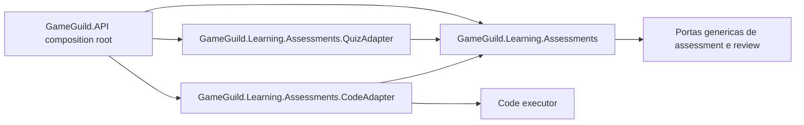

# Parte 2. Fronteira backend do adapter de code

Status: planejado.

## Objetivo

Retirar a implementacao especifica de coding do modulo generico
`GameGuild.Learning.Assessments` e criar
`GameGuild.Learning.Assessments.CodeAdapter`, seguindo a mesma direcao de
dependencia estabelecida por `QuizAdapter`.

O resultado deve permitir adicionar outro tipo de assessment sem editar o core
para reconhecer seu `contentType`, DTO, rubric ou feedback particular.

Pre-requisito: [`01`](./01-domain-contracts-and-typescript-adapter.md) concluido.

## Diagnostico atual

Codigo especifico esta hoje em:

- `Grading/Code/CodeAssessmentTypeAdapter.cs`;
- `Grading/Code/CodeGradingWorker.cs`;
- participants de publication/delete e rubric snapshot no mesmo diretorio;
- registros concretos dentro de `AssessmentsModule.cs`;
- condicionais de code em `AssessmentGradingRuntimeService.cs`;
- condicionais de code em `InstructorReviewStageHandler.cs`.

Esse desenho funciona para um unico tipo, mas faz o core crescer a cada novo
assessment. O modulo separado deve depender de Assessments; Assessments nao
deve depender do modulo separado.

## Escopo

- novo assembly `GameGuild.Learning.Assessments.CodeAdapter`;
- contratos e extension points genericos necessarios no core;
- adapter, worker, review handler, rubric e participants de code no novo modulo;
- registro no composition root da API;
- preservacao das versoes congeladas de adapter e handler;
- testes de contrato, seguranca, publicacao, execucao e arquitetura.

## Fora do escopo

- alterar a UI;
- adicionar linguagens;
- mudar a implementacao interna do Emception;
- mudar o modelo relacional sem passar pelo `SCHEMA-GATE`;
- remover migrations ou manifests historicos;
- generalizar workers de outros dominios sem necessidade do corte.

## Arquitetura alvo



O host conhece modulos concretos para compor o produto. O core resolve adapters
e stages por registry, chave e versao; ele nao usa `if (contentType == code)`.

## Regras de compatibilidade

- versoes de adapter/handler ja gravadas continuam resolviveis;
- a versao atual de autoria e unica, mas versoes `1`, `2` e `3` congeladas nao
  sao reescritas retroativamente;
- manifests, snapshots e evidencias existentes preservam chaves e semantica;
- a mudanca de assembly nao muda o contrato persistido por conveniencia;
- nao existe dual registration ambigua entre o modulo antigo e o novo;
- dead letter, retry e replay do academic outbox permanecem implementacoes
  genericas de `GameGuild.Learning.Assessments`;
- `AcademicOutboxReplayService`, o limite de tentativas e sua migration
  historica permanecem preservados e atendem todos os tipos de assessment;
- historico de migrations permanece intacto.

## Etapas

### `CODE-BE-01`. Caracterizar o runtime atual

Implementacao:

- mapear todos os tipos sob `Grading/Code` e seus consumidores;
- registrar testes por versao de adapter, publicacao, delete, rubric e worker;
- criar testes de arquitetura que hoje detectem referencias de code no core;
- capturar fixtures de authoring, delivery, response e grade result;
- caracterizar enqueue, retry, dead letter e replay dos eventos academicos
  produzidos pelo fluxo atual de code;
- verificar se algum dado persistido usa nome de tipo CLR ou assembly.

Gate:

- o corte de assembly esta provado como seguro para dados persistidos;
- toda referencia direta possui destino definido;
- comportamento de versoes congeladas tem teste antes da movimentacao.

### `CODE-BE-02`. Criar extension points estritamente genericos

Implementacao:

- substituir condicionais de code no runtime por contribuicoes do adapter;
- permitir que um adapter forneca somente os detalhes de author/grader que lhe
  pertencem por contrato opaco e versionado;
- mover a interpretacao de rubric e feedback de code para o handler concreto;
- manter score, stages, rounds, release e auditoria no core;
- manter dispatch, retry, dead letter e replay do academic outbox no core;
- resolver cada implementacao por `(contentType, adapterKey, version, context)`;
- rejeitar registros duplicados e versoes desconhecidas no startup/runtime.

Gate:

- os novos contratos nao mencionam code, compiler, files, tests ou toolchain;
- `AssessmentGradingRuntimeService` nao compara `ContentType` concreto;
- `InstructorReviewStageHandler` nao importa namespace de code;
- o novo extension point nao duplica fila, DLQ ou replay por tipo de assessment;
- a extensao serve, por contrato, a um futuro tipo sem nova condicional no core.

### `CODE-BE-03`. Criar o modulo `CodeAdapter`

Implementacao:

- criar projeto ao lado de `GameGuild.Learning.Assessments.QuizAdapter`;
- referenciar somente o modulo generico e dependencias tecnicas justificadas;
- mover adapter, worker, capabilities, stages e participants especificos;
- manter detalhes internos `internal` sempre que nao forem contratos publicos;
- registrar um metodo de modulo equivalente a `QuizAdapterModule`;
- adicionar o projeto a solution, host e projetos de teste pertinentes.

Gate:

- `GameGuild.Learning.Assessments` nao referencia `CodeAdapter` no csproj;
- o host registra o modulo concreto;
- nenhuma implementacao fica registrada duas vezes;
- `CodeAdapter` apenas produz efeitos pelos contratos genericos e nao registra
  outro dispatcher ou replay service;
- o modulo compila isoladamente.

### `CODE-BE-04`. Preservar execucao e seguranca

Implementacao:

- manter execucao autoritativa no servidor;
- validar limites de arquivo, payload, testes, output, tempo e memoria antes do
  worker;
- manter testes privados fora de DTOs learner e logs;
- sanitizar erros de processo, browser e toolchain;
- distinguir infrastructure failure, invalid submission e failed test;
- manter cancelamento, timeout e disposal do worker;
- garantir que actions novas ou movidas continuam com decisao de autorizacao.

Gate:

- learner nao consegue obter definicao privada por endpoint ou erro;
- falha tecnica nao vira nota zero;
- cross-tenant e actor context seguem as invariantes do `AGENTS.md`;
- nenhuma action fica sem `[Authorize]` ou `[AllowAnonymous]` revisado.

### `CODE-BE-05`. Cortar registros e remover vazamentos

Implementacao:

- trocar o composition root para o novo modulo;
- remover registros concretos de `AssessmentsModule`;
- mover testes especificos para um projeto do adapter ou manter no projeto
  atual apenas quando testarem uma porta do core;
- adicionar teste de dependencia que proiba code dentro do core;
- remover o diretorio antigo somente depois de todos os testes passarem.

Gate:

- uma busca no core generico nao encontra vocabulario ou namespaces de code;
- todas as versoes congeladas resolvem pelo novo modulo;
- quiz e outros adapters continuam passando sem alteracao comportamental;
- retry, dead letter e replay continuam operacionais para eventos de code pelo
  servico generico existente.

## `SCHEMA-GATE`

Este plano espera zero alteracao de tabela. Se a extracao revelar que backend,
adapter e versao nao podem ser representados pelo schema atual, interromper a
fase e produzir uma proposta separada contendo:

- necessidade e alternativas sem schema;
- entidade, coluna, indice e constraints afetados;
- migration incremental;
- teste de banco vazio e upgrade com historico;
- impacto em rollback, manifests e versoes congeladas.

Nao atualizar snapshot EF nem apagar migration para simplificar o corte.

## Validacao

```bash
dotnet build apps/api/GameGuild.sln
dotnet test apps/api/tests/GameGuild.Learning.Assessments.UnitTests/GameGuild.Learning.Assessments.UnitTests.csproj
dotnet test apps/api/tests/GameGuild.API.UnitTests/GameGuild.API.UnitTests.csproj
dotnet test apps/api/tests/GameGuild.API.IntegrationTests/GameGuild.API.IntegrationTests.csproj --filter FullyQualifiedName~Assessment
```

Se o novo modulo receber projeto de teste proprio, ele deve ser executado antes
da solution. Os testes de arquitetura devem verificar a direcao de dependencia,
nao apenas o comportamento feliz.
Os testes afetados tambem devem cobrir a transicao para dead letter e o replay
autorizado sem criar infraestrutura paralela no adapter.

## Criterios de conclusao

- code vive em modulo adapter separado;
- o core nao conhece tipos concretos de coding;
- host composition e registry resolvem todas as versoes necessarias;
- worker continua autoritativo e fail-closed;
- publicacao, delete, rubric e instructor review mantem comportamento;
- academic outbox, dead letter e replay permanecem genericos e funcionais;
- build e suites afetadas passam sem warnings;
- nenhuma migration ou fonte do Emception foi alterada.
