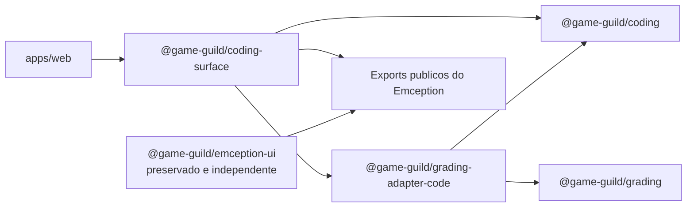

# Parte 3. Coding surface e integracao web

Status: implementacao funcional e consolidacao canonica concluidas localmente;
refundacao de produto 3.6 iniciada (`CODE-UX-01` parcial), com seis etapas
proprias antes da parte 4. O estado corrente esta no handoff da parte 3.

## Objetivo

Criar `@game-guild/coding-surface` como uma nova superficie React reutilizavel
e especifica para coding assessment e grading. A superficie deve compor as APIs
publicas do Emception, os contratos de coding e o adapter de grading sem assumir
responsabilidade por rota, sessao, autorizacao ou persistencia academica.

A superficie nao sera uma IDE generica exibida do mesmo modo para todo
exercicio. Ela fornecera uma base comum de editor, arquivos, terminal, resultados
de testes e preview visual, composta por um perfil tipado para cada formato de
exercicio suportado, como funcao no modelo LeetCode ou entrada e saida.

`@game-guild/emception-ui` permanece preservado e independente. Quando for
util, composicao GameGuild existente pode ser copiada para `coding-surface`,
desde que a origem, a divergencia e o commit-base sejam registrados. A parte 3
nao modifica, move, deprecia nem remove o package preservado.

Pre-requisitos:

- [`01`](./01-domain-contracts-and-typescript-adapter.md) concluido;
- [`02`](./02-backend-code-adapter-boundary.md) concluido;
- API publica do Emception necessaria ja disponivel.

## Por que esta parte foi dividida

O plano anterior reunia caracterizacao, criacao de package, evolucao de
contratos, duas experiencias de exercicio, quatro personas, migracao web,
regressao paralela e CI. Esses trabalhos possuem riscos e evidencias diferentes.
Executa-los como uma unica unidade tornaria dificil revisar decisoes, localizar
regressoes e retomar a implementacao depois de mudancas de contexto ou merges.

Os subplanos abaixo sao gates de implementacao, nao entregas independentes para
`develop`. A estrategia do roadmap continua sendo concluir as partes 01, 02, 03
e 04 antes do PR integrado.

## Sequencia obrigatoria

| Ordem | Subplano | IDs preservados | Resultado exigido |
| --- | --- | --- | --- |
| 3.1 | [`Caracterizacao e baseline de decisoes`](./03-coding-surface/01-characterization-and-decision-baseline.md) | `CODE-UI-01` | consumidores, contratos, copias e gaps conhecidos |
| 3.2 | [`Fundacao do coding-surface`](./03-coding-surface/02-coding-surface-foundation.md) | `CODE-UI-02` | package isolado, shell e API publica testados |
| 3.3 | [`Perfis de exercicio e fronteiras por persona`](./03-coding-surface/03-exercise-profiles-and-persona-boundaries.md) | `CODE-UI-03`, `CODE-UI-04` | `function` e `standard-io` completos nos quatro modos |
| 3.4 | [`Integracao web, estabilizacao e CI`](./03-coding-surface/04-web-integration-stabilization-and-ci.md) | `CODE-UI-05`, `CODE-UI-06`, `CODE-UI-07` | consumidores de grading migrados e regressao fechada |
| 3.5 | [`Consolidacao do contrato canonico de coding`](./03-coding-surface/05-canonical-coding-contract-consolidation.md) | `CODE-CONTRACT-CANONICALIZATION` | um unico contrato, adapter e runtime de code, sem compatibilidade artificial |
| 3.6 | [`Refundacao do coding-surface`](./03-coding-surface/06-authoring-information-architecture-and-teacher-ux.md) | `CODE-UX-01` a `CODE-UX-06` | modelo de produto, contratos/drafts, runtime, autoria, resolucao e aceite; seis subplanos internos |

Salvo as excecoes corretivas documentadas abaixo, um subplano so pode comecar
depois que o gate anterior estiver marcado como concluido em
[`IMPLEMENTATION-STATE.md`](./03-coding-surface/IMPLEMENTATION-STATE.md), com
evidencias reproduziveis. Marcar uma tarefa em um texto sem executar seu gate
nao autoriza o avanco.

A parte 3.5 foi uma excecao corretiva inserida durante a validacao da 3.4. Sua
implementacao e regressao local estao concluidas; `CODE-UI-07` permanece aberto
ate o lane `coding` executar o browser E2E com o artifact schema 2 exato.
The runner fixture now emits canonical `ExerciseType` and its focused test
passes; this does not close the real-browser gate.

A parte 3.6 refunda a experiencia com base em tarefas de instrutor e aluno e
referencias documentadas da concorrencia. A UI, os slots e os contratos nossos
podem mudar quando impedem esse modelo; o objetivo nao e preservar o wrapper
atual nem encaixar todos os formularios em um inspector fixo.

Assim como a 3.5, a 3.6 e uma excecao corretiva autorizada antes do fechamento
de `CODE-UI-07`, conforme `CS-ADR-013`. Isso nao marca esse gate como concluido
nem dispensa sua evidencia. Dentro da 3.6, cada `CODE-UX-*` depende do anterior;
a excecao nao permite pular contratos, runtime real ou aceite humano.

All of 3.6 now follows the mandatory
[Meta-Harness governance](./03-coding-surface/06-refoundation/GOVERNANCE.md)
and [terminal quality gates](./03-coding-surface/06-refoundation/QUALITY-GATES.md).
The critical prototype review requires
[3.6.1a](./03-coding-surface/06-refoundation/01a-prototype-workflows-and-critical-review.md)
inside `CODE-UX-01`. This design-only iteration can proceed while artifact or
compound-value decisions are pending; it neither approves the existing
specimen nor waives those independent obligations.

`CODE-UX-01` prepara a fixture canonica, artifact exato e preflight antes dos
testes reais da refundacao. Isso remove a dependencia circular com
[`4.0`](./04-end-to-end-validation/00-entry-baseline-and-part-3-closure.md), que
depois revalida a branch e fecha a evidencia oficial restante de `CODE-UI-07`.
`CODE-E2E-00` e o programa abrangente da parte 4 continuam depois de `CODE-UX-06`.

## Protocolo de contexto persistente

A implementacao nao pode depender da memoria da conversa ou de uma unica IA.
Qualquer IA ou pessoa que execute um subplano deve persistir as decisoes e o
checkpoint nos arquivos abaixo, em vez de apenas relata-los na conversa.
For part 3.6, apply tiered context: current state, invariants and active atomic
row first; then only relevant sections of the sources below. Do not reload the
entire historical record in every turn. These are the authoritative sources:

1. este indice e o subplano ativo;
2. [`IMPLEMENTATION-STATE.md`](./03-coding-surface/IMPLEMENTATION-STATE.md);
3. [`DECISIONS.md`](./03-coding-surface/DECISIONS.md);
4. [`CONSUMER-MAP.md`](./03-coding-surface/CONSUMER-MAP.md);
5. [`EMCEPTION-CAPABILITY-GAPS.md`](./03-coding-surface/EMCEPTION-CAPABILITY-GAPS.md);
6. [`DUPLICATION-REGISTER.md`](./DUPLICATION-REGISTER.md).

### Arquivos canonicos da execucao

| Arquivo | Conteudo | Regra de atualizacao |
| --- | --- | --- |
| `IMPLEMENTATION-STATE.md` | baseline, etapa ativa, evidencias, bloqueios e proxima acao | atualizar ao iniciar, interromper e concluir cada subplano |
| `DECISIONS.md` | decisoes arquiteturais aceitas, substituidas ou rejeitadas | registrar antes de implementar uma escolha com efeito entre subplanos |
| `CONSUMER-MAP.md` | consumidor atual, ownership, destino, estado e teste de regressao | atualizar em toda descoberta ou migracao de consumidor |
| `EMCEPTION-CAPABILITY-GAPS.md` | capabilities publicas ausentes e resolucao aprovada | atualizar somente com evidencia de um gap real |
| `DUPLICATION-REGISTER.md` | codigo copiado, origem, commit-base e divergencia | atualizar no mesmo commit que cria ou altera uma copia |

O codigo e os testes continuam sendo a fonte de verdade dos contratos
executaveis. Os arquivos acima preservam contexto, razoes e evidencias; eles nao
podem contradizer silenciosamente o repositorio. Quando houver divergencia, o
executor deve verificar o codigo, registrar a correcao documental e nao inferir
o estado desejado pela memoria da conversa.

### Checkpoint obrigatorio

Antes de encerrar uma sessao ou declarar um gate concluido:

- registrar o commit-base e o estado do worktree relevante;
- registrar arquivos e contratos alterados;
- registrar comandos executados e seus resultados, sem afirmar sucesso para
  comandos nao executados;
- registrar bloqueios, decisoes ainda abertas e o proximo passo exato;
- atualizar o mapa de consumidores, gaps e duplicacoes quando aplicavel;
- manter como `em andamento` qualquer subplano cujo gate esteja incompleto.

Decisoes triviais de implementacao local nao entram em `DECISIONS.md`. Entram
ali somente escolhas que alterem fronteiras, contratos publicos, ownership,
privacidade, compatibilidade, sequencia ou escopo de outro subplano.

## Fronteiras invariantes

- `coding-surface` pode depender de `@game-guild/coding`,
  `@game-guild/grading-adapter-code` e exports publicos do Emception;
- `coding-surface` nao depende de `@game-guild/emception-ui`, `apps/web`,
  Next.js, client gerado ou server actions;
- `apps/web` possui auth, tenant, fetch, mutations, conflitos, retry e
  navegacao;
- preview local nunca cria submission, score, gradebook ou release;
- a nota oficial e produzida somente pelo pipeline servidor de grading;
- politica de review pertence a `@game-guild/grading` e nao ao catalogo da UI;
- nenhum import por `src/**` ou alias privado do Emception e permitido;
- fontes do Emception e modulos de plataforma nao sao remodelados nesta parte;
- contratos e persistencia de dominio nossos podem evoluir na 3.6 quando o
  modelo exigir; mudanca fisica de banco exige `SCHEMA-GATE`, migration real e
  preservacao do historico, nunca uma alteracao especulativa.

Os entrypoints publicos inicialmente permitidos sao `emception`,
`@gameguild/emception-browser` e `@gameguild/emception-ide`. Outro package
publico do Emception exige uma capability concreta registrada; sua existencia
no workspace nao e justificativa suficiente para adiciona-lo.



## Fora do escopo transversal

- alterar componentes internos, defaults ou fontes do Emception;
- editar, mover, renomear, consolidar, depreciar ou remover
  `@game-guild/emception-ui`;
- remover seus aliases, testes ou consumidores fora do grading selecionado;
- criar outra implementacao de editor, terminal, filesystem, runtime grafico,
  toolchain ou runner; compor as bibliotecas e APIs existentes em paineis nossos
  e parte explicita da 3.6;
- adicionar linguagens;
- expor tipos futuros ou incompletos como opcoes desabilitadas;
- definir ou duplicar politicas de review;
- definir a UX futura do Code Studio ou preservar collections/assets antigos;
- colocar fetch, cookies, tenant ou router dentro do package;
- alterar tabelas sem necessidade demonstrada e `SCHEMA-GATE`, ou remover
  migrations historicas.

## Modelo da superficie

### Eixos independentes

O tipo de exercicio determina a experiencia de autoria e resolucao. Ele nao
deve ser confundido com:

- **toolchain ou linguagem:** C++, JavaScript, TypeScript, Ruby, SQL ou C#;
- **capability de execucao:** terminal, test runner, preview web, canvas ou
  result set;
- **persona ou modo:** author, author-test, learner ou grader;
- **politica de review:** propriedade integral de `@game-guild/grading`.

Uma experiencia de funcao pode aceitar mais de uma toolchain. Um preview visual
pode ser usado por exercicios diferentes sem se tornar um workflow de grading.

### Catalogo alvo

| Tipo | Experiencia principal | Evidencia apresentada pela superficie |
| --- | --- | --- |
| `function` | funcao com assinatura e casos de teste, no modelo LeetCode | casos publicos, resultado por caso e diagnostics |
| `standard-io` | programa que recebe entrada e produz saida | stdin, stdout, stderr, exit code e testes |
| `project` | workspace com multiplos arquivos e suite de testes | terminal, diagnostics e arvore de resultados |
| `sql-query` | consulta sobre schema e dados controlados | result set, diagnostics e comparacao esperada |

`debugging`, completar codigo e refatorar sao normalmente variantes pedagogicas
dos tipos acima. Canvas e um recurso de saida, nao um tipo automatico. Um
projeto interativo pode exigir um perfil proprio por seu contrato de interacao,
nao apenas por mostrar graficos. A matriz de capabilities da 3.6 verifica cada
combinacao de familia, ambiente, runtime e executor oficial antes de oferta-la.

Somente `function` e `standard-io` pertencem ao corte inicial obrigatorio. Cada
tipo adicional so se torna selecionavel quando possuir contrato canonico,
renderers dos quatro modos, evidencia executavel e testes E2E. Tipos
futuros nao aparecem como opcoes desabilitadas e nao recuam para outro tipo.

### Modos

| Modo | Dados recebidos | Acao permitida | Efeito academico |
| --- | --- | --- | --- |
| `author` | draft completo | editar e validar definicao | nenhum |
| `author-test` | revisao candidata completa | executar preview | nenhum |
| `learner` | delivery redigida | editar, executar preview publico e submeter | somente pela API oficial |
| `grader` | snapshot, submission e evidencias autorizadas | inspecionar e revisar | somente por comando da API |

O modo visual nao concede permissao. A aplicacao entrega apenas os dados que a
API autorizou para a persona. Modos e tipos de exercicio sao ortogonais e nenhum
deles escolhe uma politica de review.

### Commands e estado local

A superficie emite intencoes tipadas como `onDefinitionChange`, `onPreviewRun`,
`onSubmit` e `onReviewDecision`; ela nao chama endpoints. Workspace local pode
preservar arquivos de trabalho, mas nao substitui draft, submission ou grade no
servidor. A chave deve ser namespaced por tenant, assessment revision, actor e
attempt. Dados privados nunca entram no storage do learner.

## `EMCEPTION-GATE`

Se a superficie precisar de funcao ausente na API publica:

1. registrar a capability, caso de uso, consumidor e evidencia em
   `EMCEPTION-CAPABILITY-GAPS.md`;
2. provar que composicao pelos exports publicos nao resolve;
3. definir fallback ou reducao de escopo;
4. levar a proposta ao responsavel pelo Emception;
5. nao importar internals nem editar `tools/emception/**` nesta parte;
6. nao editar `@game-guild/emception-ui` para expor a capability;
7. aceitar evolucao upstream somente por decisao separada, aditiva e sujeita ao
   `EMCEPTION-NON-REGRESSION-GATE` do roadmap.

Encontrar um gap nao autoriza contorna-lo. O subplano permanece bloqueado no
ponto afetado enquanto outras tarefas independentes podem continuar.

## Validacao consolidada

Os subplanos definem seus testes incrementais. Antes de concluir toda a parte 3,
executar ao menos:

```bash
pnpm --filter @game-guild/coding-surface test
pnpm --filter @game-guild/coding-surface typecheck
pnpm --filter @game-guild/emception-ui test
pnpm --filter @game-guild/web test -- src/components/learning
pnpm --filter @game-guild/web test:browser:coding-cycle
pnpm --filter @game-guild/web build
```

O filtro Vitest deve corresponder aos arquivos realmente tocados. O teste
browser usa personas separadas quando cruza author, learner e grader.

## Criterios de conclusao

- os seis subplanos estao concluidos com evidencias no estado persistente;
- autoria, author test, learner e grader de code usam `coding-surface`;
- `function` e `standard-io` oferecem experiencias proprias sobre o mesmo shell;
- autoria e resolucao usam superficies orientadas a tarefa, configuracao por
  tipo e paineis adaptaveis, sem formularios injetados no output;
- os seis gates internos da 3.6 possuem evidencia da matriz `CS-REF-*`, incluindo
  recuperacao de drafts, privacidade, recursos de execucao e aceite humano;
- o catalogo aceita novos tipos sem acoplar linguagem, persona ou review;
- nenhuma informacao privada aparece no contexto learner;
- Emception e consumido somente por APIs publicas;
- app mantem ownership de API, auth e navegacao;
- `@game-guild/emception-ui`, seus aliases, consumidores fora de grading e
  testes permanecem funcionais;
- duplicacoes, divergencias, gaps e decisoes estao registrados;
- CI valida a nova superficie como consumidor sem redefinir release do
  Emception;
- fontes do Emception permanecem preservadas; qualquer mudanca necessaria de
  persistencia nossa passou por `SCHEMA-GATE`, migration e validacao de upgrade.
