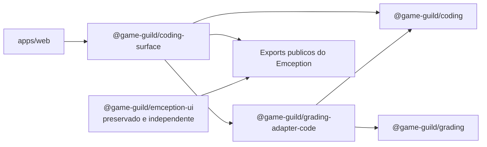

# Parte 3. Coding surface e integracao web

Status: planejado.

## Objetivo

Criar `@game-guild/coding-surface` como uma nova superficie React reutilizavel
e especifica para coding assessment e grading. A superficie deve compor as APIs
publicas do Emception, os contratos de coding e o adapter de grading sem assumir
responsabilidade por rota, sessao, autorizacao ou persistencia academica.

`@game-guild/emception-ui` nao sera a base compartilhada nem sera movido para o
novo package. Quando for util, seu codigo sera copiado para `coding-surface` e a
duplicacao sera mantida intencionalmente ate revisao futura com seu responsavel.

Pre-requisitos:

- [`01`](./01-domain-contracts-and-typescript-adapter.md) concluido;
- [`02`](./02-backend-code-adapter-boundary.md) concluido;
- API publica do Emception necessaria ja disponivel.

## Diagnostico atual

- `packages/infrastructure/ui-emception` possui uma superficie completa e ja
  utilizada, que deve permanecer inalterada;
- autoria de coding esta espalhada sob a rota de assessments;
- learner usa `coding-activity-client.tsx` e imports diretos do package atual;
- grader e SpeedGrader tambem importam `@game-guild/emception-ui`;
- DTOs, presets, storage, sessao e componentes estao acoplados no mesmo package;
- `apps/web/next.config.ts` contem aliases especificos para acomodar o package
  atual.

## Escopo

- novo package `packages/features/coding-surface`;
- componentes e controllers para `author`, `author-test`, `learner` e `grader`;
- composicao sobre exports publicos do Emception;
- migracao coordenada dos fluxos de grading selecionados: autoria de
  assessment, learner, assessment grader e SpeedGrader;
- separacao entre preview local e submission oficial;
- clonagem controlada das partes necessarias de `@game-guild/emception-ui`;
- atualizacao do registro de duplicacoes;
- testes unitarios, de browser e de privacidade da superficie.

## Fora do escopo

- alterar componentes internos do Emception;
- editar, mover, renomear, consolidar, depreciar ou remover
  `@game-guild/emception-ui`;
- remover seus aliases, testes ou consumidores fora do escopo de grading;
- criar outro editor, terminal, filesystem, canvas ou runner;
- novas linguagens;
- definir a UX futura do Code Studio;
- manter collections/assets do Code Studio antigo;
- alterar tabelas ou migrations;
- colocar fetch, cookies, tenant ou router dentro do package.

## Dependencias permitidas



O novo package pode usar `emception`, `@gameguild/emception-browser` e
`@gameguild/emception-ide` pelos entrypoints publicados. Outro package publico
do Emception so sera adicionado quando houver uma capability concreta. Imports
por `src/**` ou aliases para internals bloqueiam a fase. Copiar composicao
GameGuild existente de `emception-ui` e permitido, desde que a origem e a
divergencia sejam registradas e o package original nao seja modificado.
`coding-surface` deve adaptar sua composicao ao contrato publico existente. Ela
nao pode exigir que o Emception remova capabilities, altere defaults ou assuma
conceitos academicos para simplificar o fluxo de grading.

## Contrato da superficie

### Modos

| Modo | Dados recebidos | Acao permitida | Efeito academico |
| --- | --- | --- | --- |
| `author` | draft completo | editar e validar definicao | nenhum |
| `author-test` | revisao candidata completa | executar preview | nenhum |
| `learner` | delivery redigida | editar arquivos, rodar preview publico e submeter | somente pela API oficial |
| `grader` | snapshot, submission e evidencias autorizadas | inspecionar, reexecutar quando permitido e revisar | somente por comando da API |

O modo visual nao concede permissao. A aplicacao entrega apenas os dados que a
API autorizou para a persona.

### Callbacks e commands

A superficie emite intencoes tipadas como `onDefinitionChange`, `onPreviewRun`,
`onSubmit` e `onReviewDecision`. Ela nao chama endpoints por conta propria. A
aplicacao fornece handlers que usam o client gerado e trata loading, conflito,
retry e navegacao.

### Estado local

Workspace local pode preservar arquivos de trabalho, mas nao substitui draft,
submission ou grade no servidor. A chave de storage deve ser namespaced por
tenant, assessment revision, actor e attempt para impedir colisao ou vazamento
entre personas. Dados privados nunca entram no storage do learner.

## Etapas

### `CODE-UI-01`. Caracterizar a superficie atual

Implementacao:

- listar todos os imports de `@game-guild/emception-ui`;
- registrar os modos e props realmente usados;
- capturar testes para arquivos read-only, public/private tests, score preview,
  workspace storage e callbacks;
- classificar cada arquivo atual como candidato a copia, referencia somente ou
  fora do escopo;
- registrar aliases e workarounds de bundler que pertencem ao package
  preservado e nao podem ser removidos;
- preencher o mapa inicial em
  [`DUPLICATION-REGISTER.md`](./DUPLICATION-REGISTER.md).

Gate:

- todo consumidor de grading selecionado possui destino no corte;
- consumidores fora desse escopo continuam associados ao package preservado;
- testes nao consagram bugs conhecidos como contrato;
- nenhum requisito e inferido a partir do Code Studio antigo.

### `CODE-UI-02`. Criar `@game-guild/coding-surface`

Implementacao:

- criar package em `packages/features/coding-surface`;
- copiar ou reimplementar apenas a composicao GameGuild necessaria ao grading;
- usar os tipos canonicos de `@game-guild/coding`;
- separar controllers puros, componentes React, presets e exports de testing;
- oferecer extensoes visuais para resultados e comandos de assessment;
- manter dimensoes estaveis, acessibilidade de teclado e estados de loading,
  erro, vazio e read-only;
- registrar o arquivo de origem e o commit-base de cada copia.

Gate:

- package testa e typechecka isoladamente;
- nao importa `apps/web`, Next.js, client gerado ou server actions;
- nao duplica o IDE, VFS, terminal ou toolchain internos do Emception; a
  duplicacao aceita limita-se a composicao GameGuild sobre suas APIs publicas;
- nao depende de `@game-guild/emception-ui`;
- o diff em `packages/infrastructure/ui-emception/**` permanece vazio;
- API publica tem teste de exports.

### `CODE-UI-03`. Fechar as fronteiras por persona

Implementacao:

- author recebe definicao completa e produz draft validado;
- author test executa sem enrollment, attempt, gradebook ou release;
- learner recebe somente delivery e public tests;
- preview learner e rotulado como local e nao produz nota oficial;
- grader recebe somente snapshot e evidencias autorizadas;
- commands de submission, review e release permanecem no host web;
- estado e mensagens distinguem teste falho, erro de executor e resultado ainda
  nao publicado.

Gate:

- teste de learner prova ausencia de private tests no DOM, props e storage;
- author test nao cria efeitos academicos;
- refresh da rota reidrata a fonte do servidor, nao um grade local;
- UI nao permite inferir permissao por simples escolha de modo.

### `CODE-UI-04`. Migrar `apps/web`

Implementacao:

- migrar o editor de definicao e preview autoral pertencente ao grading;
- migrar a atividade learner de coding assessment;
- migrar assessment grader e SpeedGrader de code;
- manter rotas responsaveis por auth, tenant, fetch, mutation e navegacao;
- atualizar testes e mocks para os novos entrypoints;
- preservar aliases e configuracao de `@game-guild/emception-ui`;
- nao migrar consumidor alheio ao grading apenas para reduzir duplicacao.

Gate:

- todos os quatro modos usam a mesma superficie publica;
- os fluxos migrados usam os contratos do novo package;
- consumidores preservados continuam usando `emception-ui` sem alteracao;
- server components nao importam modulo browser-only por acidente;
- `dev:fast` e build web resolvem os entrypoints sem alias privado.

### `CODE-UI-05`. Estabilizar as superficies paralelas

Implementacao:

- confirmar com `rg` que cada fluxo de grading selecionado importa
  `@game-guild/coding-surface`;
- manter os testes originais de `@game-guild/emception-ui` onde estao;
- copiar e adaptar testes necessarios para a nova superficie, sem move-los;
- registrar contratos, componentes, styles, fixtures e testes duplicados;
- documentar divergencias intencionais de UX e grading;
- executar as duas suites para detectar quebra acidental de dependencias.

Gate:

- `@game-guild/emception-ui` continua presente e funcional;
- `coding-surface` nao o importa nem o reexporta;
- o registro cobre todas as copias conhecidas;
- testes unitarios e browser dos consumidores de ambas as superficies passam;
- nenhuma abstracao compartilhada foi introduzida sem a revisao futura.

### `CODE-UI-06`. Classificar a nova superficie no CI

Implementacao:

- incluir os paths de `coding`, `grading-adapter-code`, `coding-surface`,
  `CodeAdapter` e dos consumidores web no escopo que executa o ciclo de coding;
- manter separado o escopo produtor que recompila, empacota e publica artifacts
  do Emception;
- permitir que uma mudanca apenas de consumidor use o artifact Emception
  validado sem simular uma alteracao upstream;
- adicionar testes para a classificacao de paths e atualizar workflow e helper
  de aquisicao de release de forma coerente.

Gate:

- uma mudanca isolada em `coding-surface` dispara a regressao browser de coding;
- a mesma mudanca nao cria changeset, artifact ou release do Emception;
- uma mudanca real no Emception continua acionando seus gates completos;
- nenhum path novo fica sem classificacao explicita.

## `EMCEPTION-GATE`

Se a superficie precisar de funcao que nao existe em API publica:

1. registrar capability, caso de uso e consumidor;
2. provar que composicao pelos exports publicos nao resolve;
3. definir fallback ou reducao de escopo;
4. levar a proposta ao responsavel pelo Emception;
5. nao importar internals nem editar `tools/emception/**` nesta fase;
6. nao editar `@game-guild/emception-ui` para expor a capability ao novo
   package; registrar a divergencia e resolver em `coding-surface`;
7. se uma evolucao upstream for aprovada, aceitar somente uma extensao aditiva
   que passe pelo `EMCEPTION-NON-REGRESSION-GATE` do roadmap.

## Validacao

```bash
pnpm --filter @game-guild/coding-surface test
pnpm --filter @game-guild/coding-surface typecheck
pnpm --filter @game-guild/emception-ui test
pnpm --filter @game-guild/web test -- src/components/learning
pnpm --filter @game-guild/web test:browser:coding-cycle
pnpm --filter @game-guild/web build
```

O filtro Vitest deve ser ajustado aos arquivos efetivamente tocados, sem
transformar um path amplo em desculpa para ignorar falha. O teste browser deve
usar personas separadas quando cruzar author, learner e grader.

## Criterios de conclusao

- autoria, author test, learner e grader usam `coding-surface`;
- nenhuma informacao privada aparece no contexto learner;
- Emception e consumido somente por APIs publicas;
- app mantem ownership de API, auth e navegacao;
- `@game-guild/emception-ui`, seus aliases e testes permanecem inalterados;
- duplicacoes e divergencias estao registradas;
- UI cobre estados operacionais sem alterar workflow academico;
- CI valida a nova superficie como consumidor sem redefinir o escopo de release
  do Emception;
- nenhuma tabela, migration ou fonte do Emception foi alterada.
