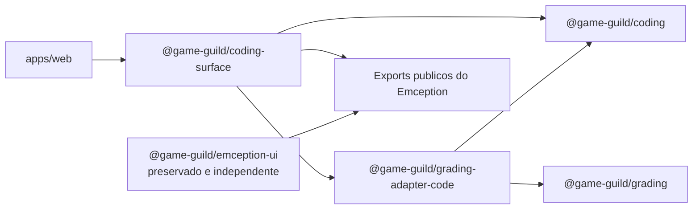

# Parte 3. Coding surface e integracao web

Status: planejado.

## Objetivo

Criar `@game-guild/coding-surface` como uma nova superficie React reutilizavel
e especifica para coding assessment e grading. A superficie deve compor as APIs
publicas do Emception, os contratos de coding e o adapter de grading sem assumir
responsabilidade por rota, sessao, autorizacao ou persistencia academica.

A superficie nao sera uma IDE generica exibida do mesmo modo para todo
exercicio. Ela fornecera uma base comum de editor, arquivos, terminal, resultados
de testes e preview visual, composta por um perfil tipado para cada formato de
exercicio suportado, como funcao no modelo LeetCode, entrada e saida, projeto,
depuracao ou resultado visual.

`@game-guild/emception-ui` nao sera a base compartilhada nem sera movido para o
novo package. Quando for util, seu codigo sera copiado para `coding-surface` e a
duplicacao sera mantida intencionalmente ate revisao futura com seu responsavel.

Pre-requisitos:

- [`01`](./01-domain-contracts-and-typescript-adapter.md) concluido;
- [`02`](./02-backend-code-adapter-boundary.md) concluido;
- API publica do Emception necessaria ja disponivel.

## Diagnostico atual

- `packages/infrastructure/ui-emception` possui uma superficie completa e ja
  utilizada, que deve permanecer inalterada;
- autoria de coding esta espalhada sob a rota de assessments;
- learner usa `coding-activity-client.tsx` e imports diretos do package atual;
- grader e SpeedGrader tambem importam `@game-guild/emception-ui`;
- DTOs, presets, storage, sessao e componentes estao acoplados no mesmo package;
- `apps/web/next.config.ts` contem aliases especificos para acomodar o package
  atual.

## Escopo

- novo package `packages/features/coding-surface`;
- componentes e controllers para `author`, `author-test`, `learner` e `grader`;
- shell comum para enunciado, editor, arquivos, terminal, testes e preview;
- registro exaustivo de perfis de exercicio, sem condicionais espalhadas pela
  arvore React;
- experiencias de autoria, resolucao e inspecao adequadas ao tipo de exercicio;
- composicao sobre exports publicos do Emception;
- migracao coordenada dos fluxos de grading selecionados: autoria de
  assessment, learner, assessment grader e SpeedGrader;
- separacao entre preview local e submission oficial;
- clonagem controlada das partes necessarias de `@game-guild/emception-ui`;
- atualizacao do registro de duplicacoes;
- testes unitarios, de browser e de privacidade da superficie.

## Fora do escopo

- alterar componentes internos do Emception;
- editar, mover, renomear, consolidar, depreciar ou remover
  `@game-guild/emception-ui`;
- remover seus aliases, testes ou consumidores fora do escopo de grading;
- criar outro editor, terminal, filesystem, canvas ou runner;
- novas linguagens;
- implementar antecipadamente tipos de exercicio sem contrato e capability
  executavel;
- expor na UI tipos futuros ou indisponiveis como opcoes desabilitadas;
- definir ou duplicar politicas de review pertencentes a `@game-guild/grading`;
- definir a UX futura do Code Studio;
- manter collections/assets do Code Studio antigo;
- alterar tabelas ou migrations;
- colocar fetch, cookies, tenant ou router dentro do package.

## Dependencias permitidas



O novo package pode usar `emception`, `@gameguild/emception-browser` e
`@gameguild/emception-ide` pelos entrypoints publicados. Outro package publico
do Emception so sera adicionado quando houver uma capability concreta. Imports
por `src/**` ou aliases para internals bloqueiam a fase. Copiar composicao
GameGuild existente de `emception-ui` e permitido, desde que a origem e a
divergencia sejam registradas e o package original nao seja modificado.
`coding-surface` deve adaptar sua composicao ao contrato publico existente. Ela
nao pode exigir que o Emception remova capabilities, altere defaults ou assuma
conceitos academicos para simplificar o fluxo de grading.

## Tipos de exercicio

### Eixos independentes

O tipo de exercicio determina a experiencia de autoria e resolucao. Ele nao deve
ser confundido com:

- **toolchain ou linguagem:** C++, JavaScript, TypeScript, Ruby, SQL ou C#;
- **capability de execucao:** terminal, test runner, preview web, canvas ou
  result set;
- **politica de review:** pertence integralmente a `@game-guild/grading` e nao
  integra o catalogo nem o estado da `coding-surface`.

Uma mesma experiencia de funcao pode aceitar mais de uma toolchain. Da mesma
forma, um preview visual pode ser usado por exercicios diferentes sem se tornar
um novo workflow de grading.

### Catalogo alvo

| Tipo | Experiencia principal | Evidencia apresentada pela superficie |
| --- | --- | --- |
| `function` | funcao com assinatura e casos de teste, no modelo LeetCode | casos publicos, resultado por caso e diagnostics |
| `standard-io` | programa que recebe entrada e produz saida | stdin, stdout, stderr, exit code e testes |
| `project` | workspace com multiplos arquivos e suite de testes | terminal, diagnostics e arvore de resultados |
| `debugging` | codigo inicial com falha que deve ser corrigido | falha inicial, execucoes e testes de regressao |
| `visual` | programa com saida web, DOM ou canvas | preview isolado, console e validacoes disponiveis |
| `sql-query` | consulta sobre schema e dados controlados | result set, diagnostics e comparacao esperada |

Esse catalogo e uma direcao de extensao, nao uma lista que deve aparecer inteira
na primeira entrega. As primitivas de teste `function` e `stdio` ja existem nos
contratos V1 e sustentam o corte inicial obrigatorio de exercicios `function` e
`standard-io`. Elas nao constituem, por si so, o tipo do exercicio. Cada tipo
adicional so se torna selecionavel quando possuir contrato canonico versionado,
renderer de autoria, renderer learner, evidencia de execucao e testes
end-to-end. Tipos ainda nao implementados nao aparecem na interface.

### Contrato de extensao

- dados persistidos ou enviados pela API pertencem a unions discriminadas e
  versionadas em `@game-guild/coding`, nunca a um schema privado da UI;
- o tipo do exercicio e um discriminante explicito da definicao e da delivery;
  ele nao e inferido de `tests[].kind`, extensao de arquivo, linguagem ou
  toolchain;
- tipos de teste descrevem como uma expectativa e executada e podem ser
  combinados quando o contrato do exercicio permitir; tipos de exercicio
  descrevem a experiencia oferecida ao autor e ao learner;
- `coding-surface` mantem um registro exaustivo que associa cada tipo suportado
  aos seus componentes `author`, `author-test`, `learner` e `grader`, paineis e
  capabilities publicas requeridas;
- novos tipos nao podem ser representados por uma estrutura unica com muitos
  campos opcionais nem por verificacoes de string espalhadas nos componentes;
- um tipo conhecido pelo contrato, mas sem renderer registrado, falha de forma
  explicita e nao recua para a experiencia de outro tipo;
- terminal, test results e preview visual sao paineis compostos conforme as
  capabilities do tipo; a superficie nao recria runners nem considera o output
  do browser uma nota oficial;
- a superficie produz submission e evidencia tipadas. A conversao dessas
  evidencias em item e score continua em `@game-guild/grading-adapter-code`.

## Contrato da superficie

### Modos

| Modo | Dados recebidos | Acao permitida | Efeito academico |
| --- | --- | --- | --- |
| `author` | draft completo | editar e validar definicao | nenhum |
| `author-test` | revisao candidata completa | executar preview | nenhum |
| `learner` | delivery redigida | editar arquivos, rodar preview publico e submeter | somente pela API oficial |
| `grader` | snapshot, submission e evidencias autorizadas | inspecionar, reexecutar quando permitido e revisar | somente por comando da API |

O modo visual nao concede permissao. A aplicacao entrega apenas os dados que a
API autorizou para a persona.

Os modos e os tipos de exercicio sao ortogonais. Selecionar `learner`, por
exemplo, muda os dados e comandos permitidos, enquanto selecionar `function` ou
`visual` muda a composicao da experiencia. Nenhum dos dois escolhe uma politica
de review.

### Callbacks e commands

A superficie emite intencoes tipadas como `onDefinitionChange`, `onPreviewRun`,
`onSubmit` e `onReviewDecision`. Ela nao chama endpoints por conta propria. A
aplicacao fornece handlers que usam o client gerado e trata loading, conflito,
retry e navegacao.

### Estado local

Workspace local pode preservar arquivos de trabalho, mas nao substitui draft,
submission ou grade no servidor. A chave de storage deve ser namespaced por
tenant, assessment revision, actor e attempt para impedir colisao ou vazamento
entre personas. Dados privados nunca entram no storage do learner.

## Etapas

### `CODE-UI-01`. Caracterizar a superficie atual

Implementacao:

- listar todos os imports de `@game-guild/emception-ui`;
- registrar os modos e props realmente usados;
- capturar testes para arquivos read-only, public/private tests, score preview,
  workspace storage e callbacks;
- classificar cada arquivo atual como candidato a copia, referencia somente ou
  fora do escopo;
- registrar aliases e workarounds de bundler que pertencem ao package
  preservado e nao podem ser removidos;
- preencher o mapa inicial em
  [`DUPLICATION-REGISTER.md`](./DUPLICATION-REGISTER.md).

Gate:

- todo consumidor de grading selecionado possui destino no corte;
- consumidores fora desse escopo continuam associados ao package preservado;
- testes nao consagram bugs conhecidos como contrato;
- nenhum requisito e inferido a partir do Code Studio antigo.

### `CODE-UI-02`. Criar `@game-guild/coding-surface`

Implementacao:

- criar package em `packages/features/coding-surface`;
- copiar ou reimplementar apenas a composicao GameGuild necessaria ao grading;
- usar os tipos canonicos de `@game-guild/coding`;
- separar controllers puros, componentes React, presets e exports de testing;
- oferecer extensoes visuais para resultados e comandos de assessment;
- criar o shell estavel de enunciado, workspace, terminal, resultados e
  preview, ativando somente os paineis requeridos pelo perfil atual;
- manter dimensoes estaveis, acessibilidade de teclado e estados de loading,
  erro, vazio e read-only;
- registrar o arquivo de origem e o commit-base de cada copia.

Gate:

- package testa e typechecka isoladamente;
- nao importa `apps/web`, Next.js, client gerado ou server actions;
- nao duplica o IDE, VFS, terminal ou toolchain internos do Emception; a
  duplicacao aceita limita-se a composicao GameGuild sobre suas APIs publicas;
- nao depende de `@game-guild/emception-ui`;
- o diff em `packages/infrastructure/ui-emception/**` permanece vazio;
- API publica tem teste de exports.

### `CODE-UI-03`. Implementar o catalogo extensivel de exercicios

Implementacao:

- evoluir de forma versionada os contratos de `@game-guild/coding` para carregar
  o discriminante explicito do exercicio, sem fallback heuristico sobre os
  testes existentes;
- definir o registro tipado e exaustivo de perfis suportados;
- implementar `function` com UX orientada a enunciado, assinatura, casos
  publicos, editor focado e resultados por caso;
- implementar `standard-io` com UX orientada a stdin, stdout, stderr, exit code
  e comparacao de testes;
- caracterizar `project`, `debugging`, `visual` e `sql-query` contra os contratos
  e capabilities existentes, sem expor os que ainda nao estiverem completos;
- compor terminal e resultados para os dois tipos iniciais;
- compor preview web ou canvas somente quando o perfil e a API publica do
  Emception declararem a capability correspondente;
- manter fixtures separadas por tipo e modo;
- registrar qualquer necessidade de novo contrato em `@game-guild/coding` e de
  capability publica no `EMCEPTION-GATE` antes de implementar o tipo.

Gate:

- fixtures provam que o tipo do exercicio sobrevive ao roundtrip
  definition-delivery-submission sem ser deduzido da toolchain ou dos testes;
- `function` e `standard-io` possuem testes de autoria, author test, learner e
  grader;
- trocar o tipo nao troca toolchain, persona ou politica de review
  implicitamente;
- tipos nao registrados falham com diagnostico explicito;
- o bundle nao inclui renderers futuros por uma lista de opcoes desabilitadas;
- nenhum renderer le ou emite `AIReview`, `InstructorReview`, `PeerReview` ou
  outra politica de grading;
- adicionar um tipo suportado exige um novo membro tipado, renderer, fixture e
  teste, sem editar um switch central em varios componentes.

### `CODE-UI-04`. Fechar as fronteiras por persona

Implementacao:

- author recebe definicao completa e produz draft validado;
- author test executa sem enrollment, attempt, gradebook ou release;
- learner recebe somente delivery e public tests;
- preview learner e rotulado como local e nao produz nota oficial;
- grader recebe somente snapshot e evidencias autorizadas;
- commands de submission, review e release permanecem no host web;
- estado e mensagens distinguem teste falho, erro de executor e resultado ainda
  nao publicado.

Gate:

- teste de learner prova ausencia de private tests no DOM, props e storage;
- author test nao cria efeitos academicos;
- refresh da rota reidrata a fonte do servidor, nao um grade local;
- UI nao permite inferir permissao por simples escolha de modo.

### `CODE-UI-05`. Migrar `apps/web`

Implementacao:

- migrar o editor de definicao e preview autoral pertencente ao grading;
- substituir a experiencia atual de IDE generica pelo perfil correspondente ao
  tipo do exercicio;
- migrar a atividade learner de coding assessment;
- migrar assessment grader e SpeedGrader de code;
- manter rotas responsaveis por auth, tenant, fetch, mutation e navegacao;
- atualizar testes e mocks para os novos entrypoints;
- preservar aliases e configuracao de `@game-guild/emception-ui`;
- nao migrar consumidor alheio ao grading apenas para reduzir duplicacao.

Gate:

- todos os quatro modos usam a mesma superficie publica;
- os fluxos migrados usam os contratos do novo package;
- consumidores preservados continuam usando `emception-ui` sem alteracao;
- server components nao importam modulo browser-only por acidente;
- `dev:fast` e build web resolvem os entrypoints sem alias privado.

### `CODE-UI-06`. Estabilizar as superficies paralelas

Implementacao:

- confirmar com `rg` que cada fluxo de grading selecionado importa
  `@game-guild/coding-surface`;
- manter os testes originais de `@game-guild/emception-ui` onde estao;
- copiar e adaptar testes necessarios para a nova superficie, sem move-los;
- registrar contratos, componentes, styles, fixtures e testes duplicados;
- documentar divergencias intencionais de UX e grading;
- executar as duas suites para detectar quebra acidental de dependencias.

Gate:

- `@game-guild/emception-ui` continua presente e funcional;
- `coding-surface` nao o importa nem o reexporta;
- o registro cobre todas as copias conhecidas;
- testes unitarios e browser dos consumidores de ambas as superficies passam;
- nenhuma abstracao compartilhada foi introduzida sem a revisao futura.

### `CODE-UI-07`. Classificar a nova superficie no CI

Implementacao:

- incluir os paths de `coding`, `grading-adapter-code`, `coding-surface`,
  `CodeAdapter` e dos consumidores web no escopo que executa o ciclo de coding;
- manter separado o escopo produtor que recompila, empacota e publica artifacts
  do Emception;
- permitir que uma mudanca apenas de consumidor use o artifact Emception
  validado sem simular uma alteracao upstream;
- adicionar testes para a classificacao de paths e atualizar workflow e helper
  de aquisicao de release de forma coerente.

Gate:

- uma mudanca isolada em `coding-surface` dispara a regressao browser de coding;
- a mesma mudanca nao cria changeset, artifact ou release do Emception;
- uma mudanca real no Emception continua acionando seus gates completos;
- nenhum path novo fica sem classificacao explicita.

## `EMCEPTION-GATE`

Se a superficie precisar de funcao que nao existe em API publica:

1. registrar capability, caso de uso e consumidor;
2. provar que composicao pelos exports publicos nao resolve;
3. definir fallback ou reducao de escopo;
4. levar a proposta ao responsavel pelo Emception;
5. nao importar internals nem editar `tools/emception/**` nesta fase;
6. nao editar `@game-guild/emception-ui` para expor a capability ao novo
   package; registrar a divergencia e resolver em `coding-surface`;
7. se uma evolucao upstream for aprovada, aceitar somente uma extensao aditiva
   que passe pelo `EMCEPTION-NON-REGRESSION-GATE` do roadmap.

## Validacao

```bash
pnpm --filter @game-guild/coding-surface test
pnpm --filter @game-guild/coding-surface typecheck
pnpm --filter @game-guild/emception-ui test
pnpm --filter @game-guild/web test -- src/components/learning
pnpm --filter @game-guild/web test:browser:coding-cycle
pnpm --filter @game-guild/web build
```

O filtro Vitest deve ser ajustado aos arquivos efetivamente tocados, sem
transformar um path amplo em desculpa para ignorar falha. O teste browser deve
usar personas separadas quando cruzar author, learner e grader.

## Criterios de conclusao

- autoria, author test, learner e grader usam `coding-surface`;
- `function` e `standard-io` oferecem experiencias proprias sobre o mesmo shell;
- o catalogo aceita novos tipos sem acoplar linguagem, persona ou review;
- tipos indisponiveis nao sao exibidos nem tratados como outro tipo;
- nenhuma informacao privada aparece no contexto learner;
- Emception e consumido somente por APIs publicas;
- app mantem ownership de API, auth e navegacao;
- `@game-guild/emception-ui`, seus aliases e testes permanecem inalterados;
- duplicacoes e divergencias estao registradas;
- UI cobre estados operacionais sem alterar workflow academico;
- CI valida a nova superficie como consumidor sem redefinir o escopo de release
  do Emception;
- nenhuma tabela, migration ou fonte do Emception foi alterada.
