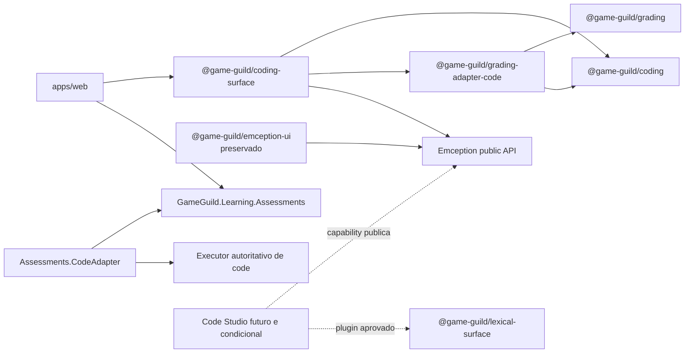

# Coding assessment, grading adapter e refundacao do Code Studio

Status: planejado.

Data: 2026-11-06.

Atualizado: 2026-11-09.

## Objetivo

Este conjunto de planos organiza a evolucao de exercicios de codigo sem
misturar tres produtos diferentes:

1. o dominio de coding e sua integracao com grading;
2. a superficie de autoria, execucao e revisao baseada no Emception;
3. um possivel Code Studio para uso dentro do Lexical.

O trabalho parte do fluxo de coding assessment que ja existe. Ele nao parte do
Code Studio antigo e nao transforma o Emception em codigo de propriedade deste
projeto. Cada parte pode evoluir sem fazer grading depender de um tipo concreto
de assessment e sem obrigar o Lexical a conhecer regras academicas.

## Decisoes que governam todos os planos

- `@game-guild/grading` permanece independente de quiz, code, Emception e UI.
- `@game-guild/coding` sera o dominio TypeScript de exercicios de codigo, sem
  React, Next.js, browser, armazenamento ou workflow academico.
- `@game-guild/grading-adapter-code` traduzira coding para os contratos
  genericos de grading. Ele nao sera uma IDE e nao executara codigo no browser
  como autoridade academica.
- `GameGuild.Learning.Assessments.CodeAdapter` sera o modulo backend especifico
  de code, equivalente arquitetural ao modulo `QuizAdapter`.
- `@game-guild/coding-surface` sera a superficie React reutilizavel por autoria,
  test run, tentativa learner e revisao. Rotas, autorizacao e persistencia
  continuam na aplicacao.
- O Emception sera consumido somente por seus exports publicos documentados.
  Nada em `tools/emception/**` sera alterado por estes planos sem uma decisao
  separada com o responsavel pelo produto.
- Toda evolucao aprovada no Emception por causa deste programa deve ser
  aditiva, opt-in e retrocompativel. Adicionar uma linguagem, toolchain,
  runtime ou extension point e permitido; remover, renomear, restringir ou
  mudar o default de uma capability existente nao e.
- Coding e grading se adaptam ao contrato publico do Emception. Uma
  conveniencia de grading nunca justifica retirar exports, toolchains, run
  types, configuracoes, demos ou comportamentos usados pelos consumidores
  atuais do Emception.
- O pacote atual `@game-guild/emception-ui` sera preservado onde esta, com seus
  contratos, componentes, testes e aliases. Estes planos nao o movem, editam,
  consolidam, depreciam nem removem. Somente consumidores pertencentes
  explicitamente ao novo fluxo de grading poderao adotar `coding-surface`;
  demais consumidores permanecem como estao.
- `@game-guild/coding-surface` sera uma implementacao paralela para grading.
  Ela pode copiar codigo de `@game-guild/emception-ui`, mesmo que isso produza
  duplicacao intencional. Nao deve depender do package preservado nem transforma-lo
  em base compartilhada durante este programa.
- Toda duplicacao criada ou encontrada sera registrada em
  [`DUPLICATION-REGISTER.md`](./DUPLICATION-REGISTER.md) para decisao posterior
  com o responsavel pelo Emception.
- O Code Studio antigo e evidencia historica, nao especificacao. Collections,
  assets, runners, layouts, JSON e UX antigos nao sao requisitos implicitos.
- Um Code Studio novo, caso seja aprovado, sera um plugin do Lexical para
  experimentar codigo. Ele nao sera um assessment e nao usara
  `grading-adapter-code`.
- Scores, pesos e percentuais academicos usam inteiros escalados conforme o
  contrato de grading. Nenhum contrato novo introduzira `float`, `double` ou
  `decimal` como fonte academica de verdade.
- Nao ha mudanca de tabela prevista. Se surgir necessidade real, a fase para no
  `SCHEMA-GATE`; uma alteracao aprovada deve incluir migration real e preservar
  todo o historico existente.
- Versoes congeladas de adapters e migrations historicas nunca serao removidas
  sob o argumento de que sao legacy.

## Baseline consolidada apos o merge da `develop`

A implementacao incorporada pelo merge `7bd88df57d` da `develop`, em
2026-11-09, passa a ser a baseline inicial de compatibilidade deste programa.
Cada fase ainda deve reconfirmar seu commit-base pelo `BASELINE-GATE`. Em
especial:

- contratos, packages, toolchains, supply chain, CI e suites atuais do
  Emception sao upstream autoritativo e nao serao remodelados por grading;
- o ciclo browser de coding ja existente e sua infraestrutura de build web
  isolado e observacao causal sao testes de regressao a preservar e evoluir;
- dead letter e replay do academic outbox pertencem ao core generico de
  assessments e nao ao futuro `CodeAdapter`;
- versionamento e publicacao do Emception seguem o processo existente do
  repositorio e nao sao uma entrega deste roadmap;
- o worker de publicacao agendada nao substitui os comandos explicitos usados
  pelos cenarios de validacao de coding.

As partes sob ownership deste programa se adaptam a essa baseline. Uma
divergencia encontrada no Emception vira proposta ao seu responsavel; nao vira
rollback ou refatoracao oportunista dentro de coding/grading.

## Fronteiras alvo

| Componente | Responsabilidade | Nao pode possuir |
| --- | --- | --- |
| `@game-guild/grading` | contratos, value objects, registry e workflow genericos | code, quiz, UI ou Emception |
| `@game-guild/coding` | definicao, respostas, resultados e validacao de coding | React, API, storage ou nota oficial |
| `@game-guild/grading-adapter-code` | traducao entre coding e grading | UI, rotas, banco ou runner concreto |
| `Assessments.CodeAdapter` | adapter servidor, worker e stages especificos de code | regras de quiz ou alteracoes no core por tipo |
| `@game-guild/coding-surface` | UI e sessao local de preview sobre APIs publicas do Emception | sessao autenticada, attempt, autorizacao ou persistencia academica |
| `@game-guild/emception-ui` | superficie existente preservada | ser alterada ou removida por este programa |
| `apps/web` | composicao de rotas, personas, API e navegacao | regras academicas escondidas em componentes de rota |
| Emception | IDE, workspace, toolchains e execucao neutra | regras de grading da GameGuild ou reducao de capabilities existentes para acomodar grading |
| Code Studio futuro | experiencia Lexical de codigo, se aprovada | grading, assessment ou requisitos herdados automaticamente |

## Arquitetura pretendida

As setas representam dependencia de quem esta na origem para quem esta no
destino. O core de grading nao aponta para code. O core backend de assessments
conhece somente suas portas genericas; o host registra o adapter concreto.

## Ordem obrigatoria de execucao

O documento preparatorio
[`00`](./00-legacy-code-studio-build-unblock.md) e um desbloqueio operacional
independente: remove uma dependencia legada que quebra o ambiente web, mas nao
inicia o dominio de coding nem a refundacao do Code Studio. Ele recebe PR
proprio para `develop` e deve ser integrado antes do smoke real e do PR de
AIReview.

| Ordem | Plano | Entrega | Pre-requisito para avancar |
| --- | --- | --- | --- |
| 1 | [`01`](./01-domain-contracts-and-typescript-adapter.md) | dominio coding e adapter TypeScript | contratos e testes de conformidade fechados |
| 2 | [`02`](./02-backend-code-adapter-boundary.md) | modulo backend separado e core sem code | build, testes e arquitetura backend verdes |
| 3 | [`03`](./03-coding-surface-and-web-integration.md) | coding-surface paralela e composicao web de grading | autoria, learner e grader de grading usando a nova superficie; emception-ui preservado |
| 4 | [`04`](./04-end-to-end-validation-and-cutover.md) | E2E, auditoria de capabilities e cutover | fluxo oficial e negativos de acesso aprovados |
| 5 | [`05`](./05-emception-capability-and-language-review.md) | orquestracao da expansao aditiva de linguagens | baseline comum aprovada e decisao independente por linguagem |
| 6 | [`06`](./06-code-studio-discovery-and-refoundation.md) | descoberta e eventual refundacao do Code Studio | decisao explicita de produto e arquitetura |

Nao se inicia a fase 2 enquanto a fase 1 estiver apenas parcialmente definida.
As fases 5 e 6 nao bloqueiam o fluxo inicial de coding assessment nas linguagens
ja suportadas. Elas nao autorizam por si mesmas mudancas no Emception.

A parte 5 e executada por subplanos. O baseline comum precede todos; JavaScript
precede TypeScript; Ruby, SQL e C# podem avancar independentemente depois da
baseline. Suporte no Emception, preview GameGuild e grading oficial possuem
gates distintos.

## Estrategia de integracao em `develop`

As partes 01, 02, 03 e 04 formam uma unica entrega integrada. Elas permanecem
na mesma linha de trabalho ate o fechamento do catalogo E2E da parte 04. Somente
depois de todos os gates dessas quatro partes passarem sera aberto um PR unico
para `develop`, contendo dominio, adapters, backend, superficie e validacao.

A parte 05 usa outra cadencia: cada linguagem e uma entrega independente. O
suporte e implementado e validado integralmente em sua propria branch; depois,
abre-se um PR exclusivo dessa linguagem para `develop`. JavaScript deve estar
integrado antes de iniciar o PR de TypeScript. Ruby, SQL e C# podem avancar em
paralelo depois da baseline, mas nenhuma branch pode depender de codigo ainda
nao integrado de outra linguagem.

Se o subplano 5.0 exigir codigo compartilhado, essa fundacao recebe um PR
preparatorio separado para `develop` e deve ser integrada antes dos PRs de
linguagem. O processo posterior de release da `main` permanece fora deste
roadmap; cada PR apenas cumpre o requisito de changeset vigente quando ele for
aplicavel.

Documento transversal:
[`DUPLICATION-REGISTER.md`](./DUPLICATION-REGISTER.md) registra todas as copias
aceitas entre a superficie preservada e os novos packages. Ele deve acompanhar
as partes 1, 3, 4 e 5.

## Matriz de preservacao do Emception

| Plano | Relacao permitida com Emception | Alteracao destrutiva permitida |
| --- | --- | --- |
| 1 | contratos GameGuild descrevem identidades e reports sem importar Emception | nenhuma |
| 2 | backend recebe reports por portas proprias; nao altera o runtime browser | nenhuma |
| 3 | `coding-surface` compoe somente APIs publicas e se adapta a elas | nenhuma |
| 4 | o cutover troca apenas consumidores de grading explicitamente selecionados | nenhuma |
| 5 | pode propor novas capabilities e linguagens de forma aditiva | nenhuma; breaking change fica fora deste programa |
| 6 | Code Studio futuro consome capabilities publicas existentes | nenhuma |

Nesta matriz, "aditiva" significa que packages, exports, toolchains, run types,
defaults, demos e consumidores existentes continuam validos. Duplicar uma
composicao para `coding-surface` e preferivel a modificar o produto Emception
para satisfazer uma necessidade exclusiva de grading.

## Gates globais

### `BASELINE-GATE`

Antes de editar, cada fase registra o commit, os consumidores atuais, os testes
que caracterizam o comportamento e os defeitos ja conhecidos. Um teste novo nao
pode converter um defeito conhecido em comportamento desejado sem decisao.

### `ARCH-GATE`

Cada package e assembly respeita a direcao de dependencia deste documento.
Imports privados, aliases para internals ou condicionais de `contentType` no
core bloqueiam a fase.

### `CI-SCOPE-GATE`

O CI distingue dois impactos que nao podem ser confundidos:

- mudancas em coding, `grading-adapter-code`, `coding-surface`, `CodeAdapter` ou
  seus consumidores executam o ciclo de coding como validacao de consumidor;
- somente mudancas reais nas fontes, build, empacotamento ou release do
  Emception entram no escopo produtor de artifact e publicacao do Emception.

Uma mudanca de grading nao deve forcar uma nova release do Emception apenas
para obter cobertura E2E. Da mesma forma, o novo package nao pode ficar fora do
ciclo browser por nao viver sob `tools/emception/**`. A classificacao e seus
testes fazem parte da entrega que introduzir esses paths.

### `SCHEMA-GATE`

Qualquer necessidade de tabela, coluna, indice ou alteracao de tipo interrompe
a implementacao. A proposta deve explicar por que os contratos e tabelas atuais
nao bastam, listar bancos afetados e incluir migration, criacao limpa, upgrade e
rollback operacional. Nao se altera snapshot sem migration correspondente.

### `EMCEPTION-GATE`

Ausencia de uma API publica do Emception vira um achado, nao um patch local.
Somente uma decisao do responsavel pelo produto pode abrir um plano upstream.
Enquanto isso, o escopo do novo consumidor permanece bloqueado ou e reduzido
explicitamente; a capability existente do Emception nao e alterada.

### `EMCEPTION-NON-REGRESSION-GATE`

Mesmo depois de uma evolucao upstream ser aprovada, ela so pode entrar neste
programa quando:

- for aditiva e opt-in, preservando o comportamento default;
- mantiver packages, exports, toolchains, run types e configuracoes publicas
  existentes;
- nao levar politica, DTO ou workflow academico para dentro do Emception;
- mantiver verdes os testes, demos e consumidores atuais, inclusive
  `@game-guild/emception-ui`;
- possuir testes proprios da nova capability e testes do novo consumidor.

Uma mudanca incompativel exige decisao de produto e plano de versionamento do
proprio Emception, independente deste roadmap. Ela nao pode ser justificada nem
executada como parte do grading.

### `CUTOVER-GATE`

O cutover deste programa troca somente os fluxos de grading explicitamente
selecionados para `coding-surface`. Ele nao autoriza remover ou modificar
`@game-guild/emception-ui`, seus aliases, testes ou demais consumidores. Codigo
substituido dentro dos fluxos novos so e removido depois que os consumidores
desse escopo foram migrados e os testes adjacentes passaram.

### `DUPLICATION-GATE`

Copias entre `emception-ui` e `coding-surface` sao permitidas e nao bloqueiam a
entrega. Cada copia deve registrar origem, destino, motivo, divergencias e
responsavel no registro de duplicacoes. Nenhuma sincronizacao ou abstracao
compartilhada sera criada sem revisao posterior com o responsavel pelo
Emception.

### `DISCOVERY-GATE`

Nenhum package novo de Code Studio sera iniciado antes das perguntas e provas
do plano 06. O resultado valido da descoberta pode ser inclusive nao criar o
package.

## Regra de validacao

Cada fase executa primeiro os testes de menor custo e amplia somente depois:

1. fixtures, parsers e contratos;
2. testes unitarios do package ou modulo tocado;
3. typecheck e testes de arquitetura;
4. integracao API/web;
5. Playwright por persona;
6. build amplo quando o escopo justificar.

Falhas externas ou preexistentes devem ser classificadas com evidencia. Elas
nao autorizam reduzir a cobertura da parte alterada. Mudancas que afetem quiz,
review, release ou resultado learner tambem seguem
[`docs/testing/quiz-grading/AGENT_PROTOCOL.md`](../../testing/quiz-grading/AGENT_PROTOCOL.md).

## Estado do programa

| ID | Estado inicial | Evidencia de conclusao |
| --- | --- | --- |
| `CODE-FOUNDATION` | pendente | plano 01 concluido |
| `CODE-BACKEND` | pendente | plano 02 concluido |
| `CODE-SURFACE` | pendente | plano 03 concluido |
| `CODE-E2E` | pendente | plano 04 concluido |
| `EMCEPTION-BASELINE` | pendente | subplano 5.0 aprovado |
| `EMCEPTION-JAVASCRIPT` | bloqueado por baseline | subplano 5.1 classificado |
| `EMCEPTION-TYPESCRIPT` | bloqueado por baseline e JavaScript | subplano 5.2 classificado |
| `EMCEPTION-RUBY` | bloqueado por baseline | subplano 5.3 classificado |
| `EMCEPTION-SQL` | bloqueado por baseline | subplano 5.4 classificado |
| `EMCEPTION-CSHARP` | bloqueado por baseline | subplano 5.5 classificado |
| `CODE-STUDIO-DISCOVERY` | pendente | decisao registrada pelo plano 06 |
| `DUPLICATION-REGISTER` | inventario inicial | atualizado a cada copia e revisado na parte 5 |

O estado desta tabela deve ser atualizado ao final de cada fase, junto com os
comandos executados e os blockers restantes. Um plano so recebe estado
`concluido` quando seu gate final estiver integralmente satisfeito.

O registro de duplicacoes e um documento vivo e deve ser atualizado no mesmo
commit que introduzir, remover ou fizer divergir uma copia.
