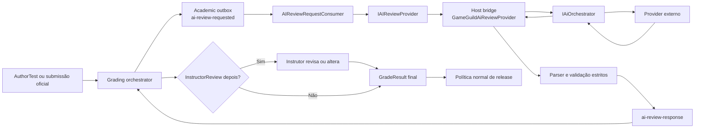

# AIReview com provider real e validação end-to-end

Status: implementado em 2026-10-28; promoção canônica e smoke com provider
real permanecem dependentes de execução e revisão humana explícitas.

Data: 2026-10-28.

## Objetivo

Tornar `AIReview` uma capacidade executável do grading, usando a infraestrutura
existente de `GameGuild.AI`, sem acoplar o domínio de assessments a um fornecedor
de IA, a quiz ou ao formato de uma questão específica.

Ao final deste plano:

- o instrutor poderá selecionar `AIReview` quando houver provider configurado;
- `AIReview` e `AIReview,InstructorReview` funcionarão em `AuthorTest` e em
  submissões oficiais;
- a resposta da IA será convertida em `GradeResultV1` por um contrato estrito;
- falhas transitórias permanecerão pendentes e serão retentadas, sem nota zero;
- o aluno verá apenas resultados liberados pela política acadêmica normal;
- testes determinísticos cobrirão o fluxo sem consumir uma API paga no CI;
- um teste opt-in permitirá confirmar a integração com a credencial local.

Este documento não lê, copia nem valida o valor atualmente colocado no `.env`.
Somente os nomes das variáveis e o diagnóstico sanitizado serão tratados.

## Estado atual

O núcleo de grading já possui a maior parte da infraestrutura necessária:

| Área | Estado atual |
| --- | --- |
| Método `AIReview` | Existe nos contratos e workflows permitidos |
| Porta de provider | `IAIReviewProvider` e `IAIReviewProviderRegistry` existem |
| Execução durável | `AIReviewStageHandler` publica `ai-review-requested` no outbox |
| Recepção | `AIReviewRequestConsumer` valida correlação e grava evidência |
| Autoria | Publicação falha fechada quando o provider não está disponível |
| Provider real | Ausente; somente providers controlados de teste existem |
| UI | Exibe `AIReview`, mas impede sua seleção |
| Módulo geral de IA | `GameGuild.AI` já suporta OpenAI, Anthropic e Google |
| Validação | `QG-REVIEW-AI-001` permanece `external-blocker` |

A chave no `.env`, isoladamente, não registra um provider de grading. Ainda são
necessários configuração, composição no host, contexto de execução, prompt,
parser estruturado, idempotência e exposição da capability para a UI.

## Decisões arquiteturais

### Limites de módulos

1. `GameGuild.Learning.Assessments` continua dono do workflow, dos contratos de
   grading, da persistência acadêmica e da porta `IAIReviewProvider`.
2. `GameGuild.AI` continua dono de credenciais, seleção de fornecedor/modelo,
   quotas, moderação, histórico e chamada externa.
3. A ponte concreta entre os dois pertence ao host `GameGuild.API`, que já
   referencia ambos os módulos.
4. `GameGuild.Learning.Assessments` não ganha referência para `GameGuild.AI`.
5. A ponte não referencia quiz. Ela recebe apenas snapshot, delivery, response e
   contratos genéricos de grading.
6. Traduções específicas de quiz permanecem em
   `GameGuild.Learning.Assessments.QuizAdapter`.

Nome de trabalho da ponte:

```text
GameGuild.API/Core/Integration/GradingAIReviewProvider.cs
```

O nome e o diretório podem ser ajustados ao padrão de composição vigente no
host, mas a direção de dependência acima é obrigatória.

### Identidade do provider

O `ProviderKey` congelado no assessment identifica a integração acadêmica, não
o fornecedor externo. O valor inicial recomendado é `gameguild-ai`.

O fornecedor e o modelo concretos são resolvidos pelo `IAiOrchestrator`. Dessa
forma, trocar OpenAI por Anthropic ou Google não altera contratos do grading.
O resultado registra o provider/modelo realmente resolvidos para auditoria.

### Política versionada

`ProviderPolicyVersion` congela o comportamento que afeta a nota:

- versão do prompt de sistema;
- schema de saída;
- regras de parsing e validação;
- estratégia de temperatura e limite de tokens;
- interpretação de itens não avaliáveis;
- seleção explícita ou política de resolução do modelo.

Uma alteração semântica cria uma nova versão de política. Uma revisão publicada
continua executando a versão congelada, sem acompanhar silenciosamente o prompt
mais recente.

## Arquitetura alvo



## Configuração e segredo

### Convenção de ambiente

O plano deve documentar e validar, no mínimo:

```dotenv
AI__Enabled=true
AI__DefaultProvider=OpenAi
AI__Providers__OpenAi__BaseUrl=https://your-ai-server.example
AI__Providers__OpenAi__ApiKey=...
AI__Providers__OpenAi__DefaultModel=your-served-model-id
Grading__AIReview__Enabled=true
Grading__AIReview__ProviderKey=gameguild-ai
Grading__AIReview__PolicyVersion=v1
```

Neste exemplo, `OpenAi` identifica o adaptador do protocolo OpenAI-compatible,
e não o fornecedor ou a família do modelo. Um modelo GLM exposto por vLLM usa
esse adaptador normalmente e deve informar em `DefaultModel` o ID publicado
pelo servidor. A `BaseUrl` é a raiz do servidor, sem `/v1`, pois o adaptador
acrescenta `/v1/chat/completions`.

Os nomes finais da seção `Grading__AIReview` devem seguir o padrão de options do
host. A implementação atualizará apenas `.env.example`, com placeholders; o
segredo local não será lido, copiado ou commitado.

No primeiro corte, a aceitação usa credencial administrada pela plataforma. O
suporte já existente de `GameGuild.AI` a overrides por tenant deve continuar
compatível, mas UI de BYOK e gestão de credenciais por tenant ficam fora deste
plano.

### Readiness fail-closed

O provider de grading só é registrado como disponível quando:

- `AI:Enabled` está ativo;
- `Grading:AIReview:Enabled` está ativo;
- o provider configurado existe no `GameGuild.AI`;
- base URL, chave e modelo obrigatório estão configurados;
- a política solicitada existe;
- o contexto é suportado.

Diagnósticos podem informar `provider-disabled`, `credential-missing`,
`model-missing` ou `policy-unsupported`, mas nunca retornar chave, token, header
ou conteúdo sensível.

Drafts podem ser salvos sem provider. Publicar uma revisão com `AIReview` deve
continuar bloqueado enquanto a capability não estiver pronta.

## Contexto confiável da chamada

`IAiOrchestrator.GenerateForActorAsync` exige `TenantId` e `UserId` derivados no
servidor. O contrato atual de `AIReviewProviderRequestV1` não carrega contexto
suficiente para construir esse ator com segurança.

Antes da ponte, implementar um contexto de invocação que:

- obtenha `TenantId` da `GradingExecution`/mensagem de outbox;
- use, em submissão oficial, o ator persistido da submissão;
- use, em `AuthorTest`, o instrutor persistido no test run;
- nunca aceite tenant ou ator enviados pelo browser como fonte de verdade;
- preserve `AIReviewProviderRequestV1` como payload acadêmico genérico.

A forma preferida é adicionar ao boundary uma estrutura efêmera, por exemplo
`AIReviewProviderInvocationV1`, contendo request e ator server-derived. Se for
necessário versionar o payload durável, a mudança deve ser aditiva e coberta por
teste de round-trip. Não se deve inserir identidade de fornecedor ou segredo no
evento.

Como `IAiOrchestrator` é scoped, a ponte e o registry de providers também devem
ter lifetime scoped. A implementação precisa testar que nenhum singleton captura
serviços scoped.

## Prompt e resposta estruturada

### Entrada

O prompt recebe somente dados necessários à avaliação:

- critérios e limites do snapshot publicado;
- itens avaliáveis, IDs e máximos em unidades inteiras;
- resposta entregue pelo sujeito;
- resultado da etapa anterior, quando aplicável;
- instruções da política versionada.

Conteúdo e resposta do aluno são dados não confiáveis. Devem ser delimitados no
prompt e nunca tratados como instrução de sistema. O prompt não inclui segredo,
cookies, tokens ou dados de outras submissões.

### Saída

O provider deve solicitar JSON estrito e convertê-lo para `GradeResultV1`. A
validação rejeita integralmente respostas com:

- JSON inválido ou texto adicional incompatível;
- item ausente, duplicado ou desconhecido;
- score negativo ou acima do máximo;
- score fracionário fora da unidade inteira adotada pelo grading;
- totais divergentes dos itens;
- correlação, snapshot, provider ou policy divergentes;
- modelo/provider resolvido ausente na auditoria.

Não haverá clamp, parsing tolerante ou fallback para zero. Um item que a IA não
consegue avaliar permanece pendente/unsupported conforme o contrato do workflow.
Em `AIReview,InstructorReview`, o instrutor resolve ou altera o resultado na
última etapa. Em `AIReview` isolado, ausência de resolução mantém a execução
incompleta e visível operacionalmente; não publica uma nota inventada.

O score continua em unidades inteiras: `100` representa `1.00` ponto, `50`
representa `0.50` e `33` representa `0.33`.

## Idempotência, retry e auditoria

`RequestId` é a chave idempotente da chamada. O mesmo request deve produzir a
mesma resposta sem duplicar evidência ou cobrança acadêmica.

Antes de alterar schema, a implementação deve avaliar se a combinação atual de:

- academic outbox;
- `ReviewEvidence` com chave determinística;
- `GradingCommandReceipt`;
- correlação por `ReviewStageId`;

é suficiente para armazenar/reutilizar a resposta após uma chamada externa bem
sucedida. O risco a cobrir é o processo cair depois da resposta externa e antes
de persistir a evidência.

Falhas são classificadas assim:

| Falha | Resultado |
| --- | --- |
| timeout, rate limit, indisponibilidade | retry com backoff; stage pendente |
| resposta malformada ou incompatível | falha observável; sem nota |
| policy/provider não disponível | publicação bloqueada ou execução pendente |
| correlação divergente | rejeição terminal e auditoria |
| retry/entrega duplicada | mesma evidência sem nova conclusão acadêmica |

Logs e diagnósticos usam request ID, execution ID, provider/model, policy,
latência e categoria do erro. Não registram chave nem prompt/resposta completos.

## Autoria e UX

A UI não deve manter uma lista estática dizendo que `AIReview` está sempre
indisponível. Ela deve consumir capabilities autorizadas do assessment/curso.

O contrato de capability deve expor somente:

- método disponível;
- provider key;
- policy versions/contextos suportados;
- estado de readiness;
- código de diagnóstico sanitizado.

O endpoint ou projeção deve exigir permissão de edição/publicação do curso ou
SystemAdmin. Não pode ser público nem revelar configuração sensível.

Com provider pronto:

- `AIReview` torna-se selecionável como review primário;
- `InstructorReview` pode ser adicionado como etapa final;
- provider e policy são congelados na revisão candidata;
- o `Assessment Test Run` exibe etapa, resultado e diagnóstico;
- a publicação revalida a capability sem depender de saúde transitória da API
  externa para invalidar uma revisão já publicada.

Sem provider pronto, a opção permanece desabilitada com um diagnóstico útil e
a publicação falha fechada.

## Estratégia de testes

### 1. Contratos e domínio, sem rede

- registry resolve key, policy e contexto corretos;
- policy desconhecida falha fechada;
- parser aceita somente o schema esperado;
- score usa unidades inteiras e respeita máximo;
- item não resolvido não vira zero;
- correlação divergente é rejeitada;
- `AIReview` conclui com provider controlado;
- `AIReview,InstructorReview` entrega o resultado provisório ao instrutor;
- regrade, collective subject, retry e evidência duplicada permanecem
  idempotentes.

### 2. Ponte do host, sem rede

Usar um `IAiOrchestrator` fake para provar:

- composição de prompt e política;
- ator/tenant derivados do servidor;
- mapeamento de provider/modelo resolvidos;
- tratamento de erro do orchestrator;
- limites de temperatura/tokens;
- ausência de segredo nos logs e exceptions.

### 3. Integração HTTP + PostgreSQL

- draft com AI pode ser salvo sem provider;
- publicação é bloqueada sem capability;
- publicação funciona com provider registrado;
- `AuthorTest` percorre AI e produz resultado inspecionável;
- submissão oficial percorre AI, release e learner result;
- `AIReview,InstructorReview` não libera antes da revisão final;
- autorização impede aluno/outsider de consultar readiness de autoria;
- retry não cria dois resultados nem duas projeções de gradebook.

### 4. Web e Playwright

Adicionar cenários separados e um cenário agregado:

```text
ai-review
ai-instructor-review
review-matrix (inclui AI quando a capability controlada está ativa)
```

Os testes automáticos usam provider controlado e determinístico. O CI padrão não
faz chamada externa nem depende da chave local.

Cobrir as personas:

- instrutor configura, testa, publica e revisa quando aplicável;
- aluno responde e vê somente o resultado liberado;
- outsider não acessa assessment nem resultado;
- SystemAdmin é usado somente para preparação administrativa do lab.

O lifecycle humano continua exclusivamente em
`/workspace/learning/grading-validation`. A página deve indicar provider,
policy, modelo e estado operacional sem mostrar segredo ou prompt bruto.

### 5. Smoke real opt-in

Criar um caso manual/opt-in, fora do gate padrão de CI, que:

- exige uma variável explícita, como `GRADING_AI_LIVE_TEST=1`;
- usa no máximo uma execução curta e limites baixos de tokens;
- não imprime credencial, prompt integral ou resposta sensível;
- produz evidência sanitizada;
- pula com motivo claro quando a configuração não está pronta.

Esse teste comprova integração com o provider real, mas não substitui os testes
determinísticos.

## Sequência de implementação

### AI-01. Configuração e readiness

1. Criar options do host para `Grading:AIReview`.
2. Completar `.env.example` com placeholders para enablement, provider e modelo.
3. Implementar validação sanitizada da configuração.
4. Testar configuração completa, desabilitada e incompleta.

**Saída:** o sistema sabe distinguir segredo presente, integração pronta e
integração indisponível sem expor valores.

### AI-02. Gate de contexto e idempotência

1. Definir a origem autoritativa de tenant e ator em cada contexto.
2. Introduzir o contexto efêmero de invocação ou versionar o evento, se
   estritamente necessário.
3. Tornar registry/provider scoped.
4. Provar a estratégia de idempotência com estruturas existentes.
5. Executar o gate de schema descrito abaixo.

**Saída:** uma chamada externa pode ser feita com identidade correta e repetida
com segurança.

### AI-03. Ponte `GameGuild.API` -> `GameGuild.AI`

1. Implementar `GameGuildAiReviewProvider` no composition root.
2. Mapear policies versionadas para prompt/schema/model strategy.
3. Chamar `IAiOrchestrator.GenerateForActorAsync`.
4. Validar JSON e construir `AIReviewProviderResponseV1`.
5. Registrar a ponte somente quando a configuração estiver habilitada.

**Saída:** `IAIReviewProviderRegistry` resolve um provider concreto sem inverter
a direção das dependências.

### AI-04. Capabilities e autoria

1. Expor readiness autorizada e sanitizada.
2. Substituir o bloqueio estático de `AIReview` na UI por capability dinâmica.
3. Permitir `AIReview` e `AIReview,InstructorReview`.
4. Congelar provider/policy na revisão candidata.
5. Manter publicação fail-closed.

**Saída:** o instrutor consegue configurar e testar AI apenas quando ela está
realmente disponível.

### AI-05. Runtime e operação

1. Implementar retry/backoff e classificação de falhas.
2. Garantir replay idempotente após falha entre provider e persistência.
3. Expor diagnósticos operacionais no test run e no lab.
4. Confirmar release, gradebook, regrade e auditoria.

**Saída:** falhas externas não geram notas incorretas nem duplicadas.

### AI-06. Validação automatizada e humana

1. Adicionar providers controlados nos testes.
2. Adicionar cenários `ai-review` e `ai-instructor-review`.
3. Integrar casos ao capability catalog com IDs estáveis.
4. Adicionar smoke real opt-in.
5. Executar a regressão adjacente de Automated/Instructor/Self/Peer.

**Saída:** AIReview possui evidência reproduzível sem tornar o CI dependente de
rede ou custo externo.

### AI-07. Promoção da capability

1. Revisar evidências conforme `AGENT_PROTOCOL.md`.
2. Gerar relatório candidato.
3. Promover `QG-REVIEW-AI-001` de `external-blocker` somente após revisão humana.
4. Documentar operação, limites e resposta a incidentes.

**Saída:** o estado canônico reflete capacidade comprovada, não apenas código
presente.

## Gate de schema e migrations

A expectativa deste plano é **não alterar tabelas**. Configuração e credenciais
ficam fora do banco, e as estruturas atuais de outbox, evidence e receipts devem
ser reutilizadas.

Antes de qualquer mudança relacional:

1. demonstrar por teste o caso que as estruturas atuais não conseguem cobrir;
2. registrar por que uma extensão de contrato não resolve;
3. apresentar a tabela/coluna, invariantes, índices e política de retenção;
4. obter decisão explícita antes da implementação;
5. se aprovada, criar migration forward real e preservar todas as migrations
   históricas.

Não haverá edição manual de migration histórica, exclusão de migrations ou
mudança de modelo sem migration correspondente.

## Arquivos e áreas prováveis

### Grading genérico

- `apps/api/Source/Modules/GameGuild.Learning.Assessments/Grading/Abstractions/ExecutionPorts.cs`
- `apps/api/Source/Modules/GameGuild.Learning.Assessments/Grading/Runtime/AIReviewStageHandler.cs`
- `apps/api/Source/Modules/GameGuild.Learning.Assessments/Grading/Capabilities/ReviewCapabilityRegistry.cs`
- testes de `GameGuild.Learning.Assessments.UnitTests`

Somente contratos genéricos e contexto de invocação pertencem aqui.

### Composition root

- `apps/api/Source/GameGuild.API/Core/Integration/`
- setup/DI do `GameGuild.API`
- options e testes da ponte

A dependência simultânea de assessments e `GameGuild.AI` pertence aqui.

### Web

- `apps/web/src/lib/learning/assessment-grading-methods.ts`
- editor de assessments e client de capabilities
- grading validation lab

### Validação

- `apps/web/src/lib/grading-scenarios/adapters/quiz/capability-catalog.mjs`
- `docs/testing/quiz-grading/capability-status.md`
- `e2e/learning/quiz-grading/`

## Não objetivos

- criar um novo SDK de fornecedor;
- chamar diretamente OpenAI/Anthropic/Google a partir de assessments;
- ensinar grading sobre tipos de questão de quiz;
- implementar BYOK ou UI de credenciais por tenant;
- permitir que browser envie tenant, ator, provider secret ou nota final;
- usar IA para questões determinísticas quando `AutomatedReview` é suficiente;
- tornar teste real externo obrigatório no CI;
- alterar schema sem passar pelo gate deste plano.

## Segurança, privacidade e custo

Antes de habilitar produção, deve existir decisão explícita sobre quais dados de
submissão podem sair para cada provider. O ambiente local pode validar a
integração, mas a ativação produtiva exige política de dados aprovada.

Controles mínimos:

- menor payload necessário;
- timeout, token limit e concorrência limitados;
- segredo somente no servidor;
- redaction de logs, traces e relatórios;
- provider/modelo auditáveis;
- respostas tratadas como não confiáveis;
- proteção contra prompt injection;
- métricas de latência, retry, falha e consumo;
- possibilidade de desabilitar AIReview sem afetar outros workflows.

## Critérios de conclusão

- [x] A aplicação reconhece corretamente a configuração local sem expor a chave.
- [x] `GameGuild.Learning.Assessments` não referencia `GameGuild.AI`.
- [x] A ponte concreta existe apenas no host e não referencia quiz.
- [x] Tenant e ator são derivados de estado persistido no servidor.
- [x] Provider e registry têm lifetimes compatíveis com `IAiOrchestrator`.
- [x] Draft sem provider é permitido e publicação com AI é bloqueada.
- [x] Com provider pronto, AI torna-se selecionável por capability dinâmica.
- [x] Saída malformada, incompleta ou acima do máximo nunca gera nota.
- [x] Retry e entrega duplicada não duplicam evidência, resultado ou gradebook.
- [x] `AIReview` completa somente quando todos os itens exigidos estão resolvidos.
- [x] `AIReview,InstructorReview` sempre aguarda a decisão final do instrutor.
- [x] O aluno vê somente resultado liberado pela política normal.
- [x] CI usa provider controlado e não consome a credencial real.
- [x] Smoke real é opt-in, limitado e sanitizado.
- [x] `QG-REVIEW-AI-001` só muda de status após revisão humana da evidência.
- [x] Nenhuma tabela é alterada sem decisão explícita e migration correspondente.

## Validação final

Executar, conforme o escopo tocado:

```bash
dotnet build apps/api/GameGuild.sln
dotnet test apps/api/tests/GameGuild.Learning.Assessments.UnitTests/GameGuild.Learning.Assessments.UnitTests.csproj
dotnet test apps/api/tests/GameGuild.API.IntegrationTests/GameGuild.API.IntegrationTests.csproj --filter FullyQualifiedName~AssessmentGrading
pnpm grading:validation:contracts
pnpm grading:validation:ai
pnpm grading:validation:smoke
pnpm grading:validation:full
```

O smoke contra provider real é executado separadamente com
`pnpm grading:validation:ai:live`, possui opt-in explícito e não faz parte do
gate padrão de merge.

## Registro de implementação

Em 2026-10-28, passaram os contratos de grading, os testes do runtime de
assessments, os testes unitários da ponte do host, os testes do editor/lab e o
typecheck do web. A execução browser determinística foi iniciada, mas o
bootstrap compartilhado da branch falhou antes dos casos de AI por ausência da
tabela `MutationValueSnapshots` no histórico de migrations disponível e por
rejeição das credenciais do SystemAdmin local. Nenhum desses bloqueios autoriza
alterar schema ou autenticação como parte deste plano.

Assim, o código e o harness de `AIReview` estão implementados, enquanto a
evidência browser e o smoke real continuam pendentes. Os casos canônicos
permanecem `external-blocker` até essas execuções serem concluídas e revisadas.
