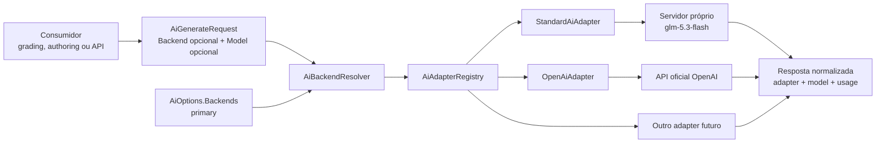

# StandardAiAdapter e backends de IA genéricos

Status: implementado; validação browser e smoke real pendentes de ambiente.

Data: 2026-10-28.

## Resultado da implementação

- backend, adapter, modelo e credencial agora são identidades separadas;
- `StandardAiAdapter` e `OpenAiAdapter` compartilham somente o cliente interno
  do protocolo OpenAI-compatible, preservando políticas de credencial distintas;
- o catálogo genérico alimenta o orquestrador, o status da API e o readiness de
  `AIReview` sem expor segredo;
- contratos públicos, cliente TypeScript, authoring e UI do laboratório de
  grading foram atualizados para backend;
- não houve alteração de tabela, snapshot de banco ou migration;
- testes unitários, contratos de grading, typecheck web e analyzers dos projetos
  tocados passaram;
- `grading:validation:ai` foi executado, mas o ambiente local bloqueou a preparação
  antes do grading porque a base existente não possui `MutationValueSnapshots`;
  o seed do admin falhou e o login retornou `401`;
- `grading:validation:ai:live` permanece opt-in e não foi executado.

## Objetivo

Separar a identidade operacional de um backend de IA do protocolo usado para
acessá-lo, do modelo executado e da credencial. A configuração deve permitir
trocar um modelo ou servidor sem alterar código e exigir um novo adapter somente
quando o protocolo realmente mudar.

O primeiro backend próprio usará o modelo `glm-5.3-flash` por meio do contrato
OpenAI-compatible exposto pelo servidor atual. O adapter desse contrato será
chamado `StandardAiAdapter`.

Ao final:

- `OpenAiAdapter` continuará representando a integração oficial com OpenAI;
- `StandardAiAdapter` atenderá servidores próprios que implementem o contrato
  padrão adotado pela plataforma;
- `primary`, `fallback` ou outro nome configurável identificarão backends;
- o modelo será somente dado de configuração;
- credenciais poderão ser obrigatórias, opcionais ou ausentes conforme o
  adapter;
- grading continuará conhecendo apenas a porta `gameguild-ai`, sem depender de
  GLM, OpenAI, vLLM ou de qualquer adapter concreto;
- adicionar outro protocolo exigirá implementar e registrar um novo adapter,
  sem alterar o orquestrador ou consumidores como grading;
- nenhuma tabela ou migration será necessária.

## Problema atual

Hoje `GameGuild.AI` usa `AiProvider` para responsabilidades diferentes:

1. selecionar o adapter HTTP;
2. identificar a configuração em `AI__Providers__*`;
3. escolher o destino em cada request;
4. localizar modelo e credencial;
5. identificar a execução em status, histórico e billing.

Essa sobreposição faz `OpenAi` parecer o fornecedor do modelo mesmo quando o
destino é um servidor próprio com GLM. Também obriga o orquestrador a conhecer
todos os providers por enum, parser e `switch`, aumentando o trabalho para
adicionar protocolos.

O readiness criado para `AIReview` também verifica diretamente
`AiOptions.Providers` e presume que todo provider exige chave. Isso não é válido
para um servidor próprio que aceite chamadas sem autenticação.

## Vocabulário alvo

| Conceito | Exemplo | Responsabilidade |
| --- | --- | --- |
| Backend | `primary` | destino lógico selecionado pela aplicação |
| Adapter | `StandardAi` | protocolo HTTP e formato de request/response |
| Base URL | `http://ai.internal:8000` | servidor concreto, configurado somente no servidor |
| Model | `glm-5.3-flash` | identificador publicado pelo backend |
| Credential | bearer opcional | autenticação exigida pelo destino |
| Grading provider | `gameguild-ai` | integração acadêmica estável, independente do backend |

`StandardAi` não significa um padrão universal de IA. Neste projeto ele nomeia
explicitamente o contrato de chat completions adotado pela plataforma e
implementado pelo servidor próprio atual.

## Configuração alvo

```dotenv
AI__Enabled=true
AI__DefaultBackend=primary

AI__Backends__primary__Adapter=StandardAi
AI__Backends__primary__BaseUrl=http://your-ai-server:8000
AI__Backends__primary__ApiKey=
AI__Backends__primary__DefaultModel=glm-5.3-flash

Grading__AIReview__Enabled=true
Grading__AIReview__ProviderKey=gameguild-ai
Grading__AIReview__PolicyVersion=v1
# Empty values use AI__DefaultBackend and that backend's default model.
Grading__AIReview__Backend=
Grading__AIReview__Model=
```

Regras:

- nomes de backend são case-insensitive para resolução e preservados em forma
  canônica nos diagnósticos;
- `BaseUrl`, `ApiKey` e adapter nunca vêm do browser;
- requests podem selecionar apenas um backend previamente configurado e somente
  quando a política do tenant permitir override;
- `DefaultModel` recebe o ID exato exposto pelo servidor;
- `StandardAiAdapter` exige `BaseUrl` explícita;
- `OpenAiAdapter`, `AnthropicAdapter` e `GoogleAiAdapter` podem continuar com
  seus endpoints oficiais padrão;
- `StandardAiAdapter` omite o header `Authorization` quando `ApiKey` estiver
  vazia e envia `Bearer` quando ela estiver configurada;
- adapters oficiais continuam falhando fechados sem credencial.

## Arquitetura alvo



## Contratos do módulo de IA

### Options

Substituir a configuração baseada em provider por:

```csharp
public sealed class AiOptions
{
    public bool Enabled { get; set; }
    public string? DefaultBackend { get; set; }
    public bool AllowTenantOverrides { get; set; } = true;
    public Dictionary<string, AiBackendOptions> Backends { get; set; }
}

public sealed class AiBackendOptions
{
    public string? Adapter { get; set; }
    public string? ApiKey { get; set; }
    public string? BaseUrl { get; set; }
    public string? DefaultModel { get; set; }
}
```

`AI__DefaultProvider` e `AI__Providers__*` serão substituídos atomicamente por
`AI__DefaultBackend` e `AI__Backends__*`. Como o produto ainda não foi lançado,
não haverá dual-read, aliases permanentes ou fallback silencioso para o formato
antigo. Todos os call sites e ambientes versionados do repositório serão
atualizados no mesmo corte.

### Adapter extensível

O registry não deve depender de enum ou `switch` central. O contrato interno
deve expor uma chave estável:

```csharp
internal interface IAiAdapter
{
    string Key { get; }
    AiAdapterDescriptor Descriptor { get; }
    Task<Result<AiAdapterExecutionResult>> CompleteAsync(...);
    Task<Result<AiAdapterExecutionResult>> CompleteStreamingAsync(...);
}
```

O descriptor informa pelo menos:

- chave do adapter;
- necessidade de `BaseUrl` explícita;
- política de credencial: `Required`, `Optional` ou `None`;
- endpoint padrão, quando existir;
- suporte a streaming.

O registry deve rejeitar chaves duplicadas no startup. Adicionar um protocolo
passa a exigir apenas uma implementação de `IAiAdapter`, seu teste e seu
registro em DI.

### Request e resolução

Renomear semanticamente a seleção feita pelos consumidores de `Provider` para
`Backend` nos contratos públicos de chat/generate/template. A resolução segue:

1. backend solicitado, se overrides forem permitidos;
2. backend padrão do tenant;
3. `AI__DefaultBackend` da plataforma;
4. backend configurado resolve `Adapter`, URL, modelo e credencial;
5. registry resolve o adapter pela chave;
6. adapter executa e retorna resultado normalizado.

O browser nunca escolhe adapter diretamente. Ele pode, quando autorizado,
selecionar somente uma chave de backend existente no catálogo permitido.

### Identidade de execução

O resultado deve distinguir três identidades sem mudar a semântica financeira
existente:

- backend solicitado/resolvido, para roteamento, status e diagnóstico;
- adapter executado, como identidade de `Provider` para auditoria e billing;
- modelo retornado pelo servidor, para auditoria e billing.

Assim, `Provider` continua significando a família técnica que executou a
requisição, agora identificada pela chave do adapter (`OpenAi`, `StandardAi`,
`Anthropic` ou `Google`). `Model` continua contendo o modelo efetivo. O novo
`Backend` é a identidade de roteamento (`primary`) e pode ser incluído nos DTOs
de resolução/completion e nos logs, mas não exige uma nova coluna neste corte.
Os registros persistidos existentes permanecem com adapter em `Provider` e
modelo em `Model`, preservando a chave esperada pelo catálogo de custos.

Se a auditoria demonstrar que backend e adapter precisam ser persistidos em
colunas independentes, essa extensão fica bloqueada pelo gate de schema ao
final deste documento e não será incluída automaticamente.

## StandardAiAdapter

O contrato inicial do `StandardAiAdapter` é:

- `POST {BaseUrl}/v1/chat/completions`;
- mensagens `system`, `user` e `assistant`;
- `model`, `temperature`, `max_tokens` e `stream`;
- resposta `choices[].message.content`;
- streaming por eventos `data:` e marcador `[DONE]`;
- usage por `prompt_tokens`, `completion_tokens` e `total_tokens`;
- modelo efetivo lido da resposta quando fornecido;
- bearer opcional;
- timeout, retry transitório e erros sanitizados;
- nenhuma suposição sobre GLM no código do adapter.

O codec comum do protocolo pode ser extraído de `OpenAiAdapter` para evitar
duplicação real, mas as políticas permanecem distintas:

- `OpenAiAdapter`: integração oficial, credencial obrigatória;
- `StandardAiAdapter`: endpoint próprio explícito, credencial opcional.

O helper compartilhado deve permanecer interno e orientado ao formato do
protocolo, sem criar herança entre adapters.

## Tenant, secrets e segurança

`TenantSettings.IntegrationSettingsJson` já é um envelope JSON opaco. Sua forma
de IA será atualizada para backend:

```json
{
  "ai": {
    "enabled": true,
    "defaultBackend": "primary",
    "allowRequestOverride": false,
    "backends": {
      "primary": {
        "enabled": true,
        "defaultModel": "glm-5.3-flash"
      }
    }
  }
}
```

Credenciais de tenant, quando permitidas, usam a identidade lógica do backend,
por exemplo `ai:backend:primary`. A identidade do tenant nunca fornece
`BaseUrl` ou nome do adapter; ambos permanecem no allowlist server-side.

Como não existem dados de produção, a forma antiga não será mantida. Dados
locais anteriores deverão ser recriados ou reconfigurados, sem migration de
conteúdo e sem parser legado.

Controles obrigatórios:

- validar URL e aceitar somente `http`/`https` configurados no servidor;
- não registrar chave, header, prompt completo ou resposta completa;
- nunca retornar `ApiKey` em status/readiness;
- não aceitar URL arbitrária por request ou por configuração de tenant;
- readiness deve validar a política de credencial declarada pelo adapter;
- uma chave vazia em `StandardAi` não é erro quando o adapter declara
  credencial opcional;
- uma chave vazia em adapters oficiais permanece erro;
- erros externos devem ser mapeados para códigos sanitizados por adapter.

## Impacto no AIReview

`GameGuild.Learning.Assessments` não será alterado para conhecer backend ou
adapter. A ponte do host será ajustada:

- `GradingAIReviewOptions.Provider` passa a `Backend`;
- `ProviderKey=gameguild-ai` permanece inalterado, pois identifica a integração
  acadêmica;
- readiness deixa de inspecionar `AiOptions.Providers` diretamente e usa o
  resolver/catálogo genérico do módulo de IA;
- `Model` continua sendo override opcional;
- o resultado de grading registra adapter/modelo efetivamente resolvidos sem
  expor credencial;
- o provider controlado de E2E permanece separado e não usa rede.

Nenhum tipo de quiz entra em `GameGuild.AI` ou na ponte. Quiz continua apenas
como adapter de assessment nos cenários de validação.

## Sequência de implementação

### SAI-01. Congelar contratos e impactos

1. Adicionar testes de caracterização para OpenAI, Anthropic e Google.
2. Cobrir resolução atual de provider, modelo, URL, credencial e tenant.
3. Mapear consumidores de `AiChatRequest`, `AiGenerateRequest`, status,
   templates, history e billing.
4. Fixar por teste a semântica que billing espera para provider/modelo.

**Gate:** nenhuma refatoração começa sem caracterização dos contratos externos
e da integração de custos.

### SAI-02. Introduzir backend e registry de adapters

1. Criar `AiBackendOptions` e `DefaultBackend`.
2. Criar `IAiAdapter`, descriptor e registry por chave string.
3. Fazer o orquestrador resolver backend antes do adapter.
4. Rejeitar backend desconhecido, adapter desconhecido e registros duplicados.
5. Remover switches centrais necessários apenas para extensão de adapters.

**Gate:** adapters existentes passam pelo registry e mantêm o comportamento
caracterizado.

### SAI-03. Implementar StandardAiAdapter

1. Extrair o codec comum de chat completions quando isso reduzir duplicação.
2. Implementar requests normais e streaming.
3. Permitir bearer opcional.
4. Exigir BaseUrl explícita e normalizá-la sem duplicar `/v1`.
5. Validar respostas, usage e modelo efetivo.
6. Mapear timeout, rate limit, 5xx, JSON inválido e resposta vazia.

**Gate:** servidor fake confirma chamadas com e sem chave e não há dependência
de um modelo específico.

### SAI-04. Trocar configuração atomicamente

1. Atualizar `.env.example` para `DefaultBackend` e `Backends`.
2. Configurar `primary` com `Adapter=StandardAi` e modelo de exemplo
   `glm-5.3-flash`.
3. Atualizar configurações versionadas de desenvolvimento e testes.
4. Atualizar o JSON de tenant e suas chaves lógicas.
5. Remover leitura de `DefaultProvider`/`Providers` após todos os call sites
   estarem convertidos.

**Gate:** pesquisa no repositório não encontra configuração executável antiga,
exceto documentação histórica explicitamente marcada.

### SAI-05. Atualizar contratos e consumidores

1. Alterar seleção por request de provider para backend.
2. Atualizar controllers, prompt templates e serviços de authoring.
3. Atualizar status para listar backend, adapter, modelo e readiness sem chave.
4. Atualizar web/client gerado apenas depois do contrato da API estabilizar.
5. Preservar quotas, moderação, history e billing.

**Gate:** chamadas sem override usam `primary`; overrides não autorizados falham
fechados.

### SAI-06. Adaptar grading

1. Atualizar `GradingAIReviewOptions` para `Backend`.
2. Fazer readiness consultar o catálogo genérico.
3. Confirmar `AIReview` e `AIReview,InstructorReview` com `StandardAi`.
4. Confirmar que provider/modelo resolvidos aparecem na evidência e auditoria.
5. Manter testes determinísticos com `ControlledGradingAIReviewProvider`.

**Gate:** grading não referencia `StandardAiAdapter`, GLM ou vLLM.

### SAI-07. Validar módulo de plataforma

1. Atualizar o espelho byte-for-byte do módulo em produtos irmãos, com apenas
   renomes de namespace quando aplicável.
2. Executar os testes de pureza e direção de dependência.
3. Garantir que nenhum vocabulário de quiz, learning ou grading entrou em
   `GameGuild.AI`.
4. Atualizar documentação pública do módulo e exemplos de configuração.

**Gate:** analyzers e testes de arquitetura passam sem nova dívida conhecida.

### SAI-08. Validar integração real

1. Executar unit tests do módulo com servidor HTTP fake.
2. Executar contratos e cenários controlados de grading.
3. Executar smoke opt-in contra o backend `primary`.
4. Confirmar no resultado o modelo efetivo `glm-5.3-flash`.
5. Revisar evidência humana antes de promover capability canônica.

**Gate:** chamada real é opt-in, limitada e não faz parte do CI padrão.

## Testes obrigatórios

### GameGuild.AI

- backend padrão e override autorizado;
- backend inexistente;
- adapter inexistente e duplicado;
- modelo por request, tenant e plataforma;
- `StandardAi` sem chave;
- `StandardAi` com bearer;
- `OpenAi` sem chave falha fechado;
- BaseUrl sem `/v1` e endpoint final correto;
- resposta normal, streaming, usage e modelo resolvido;
- timeout, 429, 5xx, JSON inválido e conteúdo vazio;
- moderação, quota, history e billing sem regressão;
- status não expõe segredo.

### Grading

- readiness disponível com `StandardAi` sem chave;
- readiness indisponível sem backend, adapter, URL ou modelo;
- seleção dinâmica no editor;
- `AuthorTest` com AIReview;
- submissão oficial com AIReview;
- AIReview seguido de InstructorReview;
- retry/idempotência sem evidência duplicada;
- release normal ao aluno.

### Comandos mínimos

```bash
dotnet test apps/api/tests/GameGuild.AI.UnitTests/GameGuild.AI.UnitTests.csproj
dotnet test apps/api/tests/GameGuild.API.UnitTests/GameGuild.API.UnitTests.csproj --filter FullyQualifiedName~GradingAIReviewProviderTests
dotnet test apps/api/tests/GameGuild.Learning.Assessments.UnitTests/GameGuild.Learning.Assessments.UnitTests.csproj
dotnet build apps/api/GameGuild.sln
pnpm grading:validation:contracts
pnpm grading:validation:ai
```

O smoke real continua separado:

```bash
pnpm grading:validation:ai:live
```

## Gate de schema e migrations

A implementação prevista não altera tabelas:

- backends e adapters são configuração;
- credenciais permanecem em configuração segura ou no envelope existente;
- tenant AI settings continuam dentro de `IntegrationSettingsJson`;
- history e billing já armazenam identificadores como strings.

Se durante SAI-01 for demonstrado que backend e adapter precisam ser
persistidos separadamente para auditoria ou custo:

1. interromper a implementação dessa parte;
2. apresentar a coluna, semântica, índice e retenção necessários;
3. obter decisão explícita;
4. criar migration forward real;
5. preservar todas as migrations históricas.

Não editar snapshots manualmente, não alterar migration histórica e não
introduzir coluna apenas para simplificar código.

## Arquivos e áreas prováveis

### Plataforma AI

- `apps/api/Source/Modules/GameGuild.AI/Configuration/AiOptions.cs`
- `apps/api/Source/Modules/GameGuild.AI/Models/AiContracts.cs`
- `apps/api/Source/Modules/GameGuild.AI/Services/AiAbstractions.cs`
- `apps/api/Source/Modules/GameGuild.AI/Services/AiOrchestrator.cs`
- `apps/api/Source/Modules/GameGuild.AI/Services/OpenAiAdapter.cs`
- novo `Services/StandardAiAdapter.cs`
- `apps/api/Source/Modules/GameGuild.AI/ServiceCollectionExtensions.cs`
- `apps/api/Source/Modules/GameGuild.AI/Controllers/AiController.cs`
- `apps/api/tests/GameGuild.AI.UnitTests/`

### Host e grading

- `apps/api/Source/GameGuild.API/Core/Integration/GradingAIReviewOptions.cs`
- `apps/api/Source/GameGuild.API/Core/Integration/GradingAIReviewProvider.cs`
- testes da ponte no `GameGuild.API.UnitTests`

### Web e validação

- `.env.example`
- client gerado após estabilizar OpenAPI
- grading validation lab e adapter de quiz somente para exibir backend/modelo
- documentação em `docs/testing/quiz-grading/`

## Não objetivos

- criar adapter específico para GLM;
- codificar `glm-5.3-flash` como default em código de produção;
- aceitar URL ou segredo enviados pelo browser;
- implementar fallback automático entre backends;
- alterar o workflow acadêmico de AIReview;
- mover grading para dentro de `GameGuild.AI`;
- criar tabela de providers/backends;
- manter permanentemente os nomes antigos de configuração.

## Critérios de conclusão

- [x] `OpenAiAdapter` permanece disponível e coberto por regressão.
- [x] `StandardAiAdapter` funciona com servidor próprio compatível.
- [x] `AiOptions` usa backend nomeado separado do adapter.
- [x] O orquestrador não usa enum/switch para registrar novos adapters.
- [x] `primary` executa `glm-5.3-flash` apenas por configuração.
- [x] StandardAi funciona com ou sem bearer conforme configuração.
- [x] Adapters oficiais continuam exigindo credencial.
- [x] Trocar modelo ou URL não exige recompilar.
- [x] Adicionar protocolo exige somente novo adapter, registro e testes.
- [x] Status/readiness mostram backend, adapter e modelo sem segredo.
- [x] Tenant não consegue fornecer URL ou adapter arbitrário.
- [x] Quota, moderação, history e billing continuam funcionando.
- [x] AIReview usa o backend genérico sem conhecer o adapter.
- [x] Testes controlados não acessam a credencial real.
- [ ] Smoke real confirma `glm-5.3-flash` e permanece opt-in.
- [x] Nenhuma tabela ou migration é alterada sem o gate explícito.
- [x] Módulo permanece puro; não existe cópia irmã de `GameGuild.AI` neste workspace.
