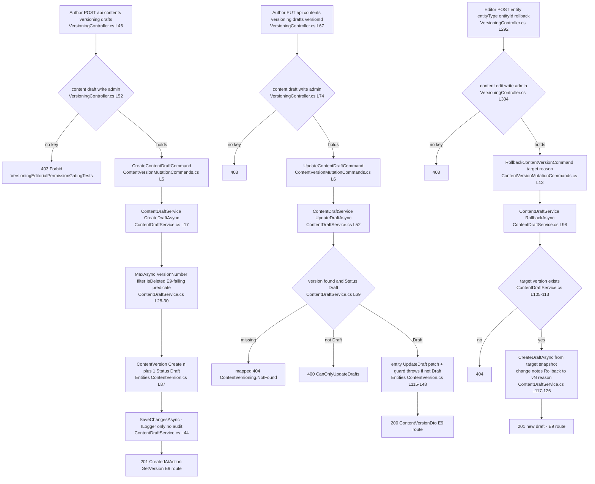
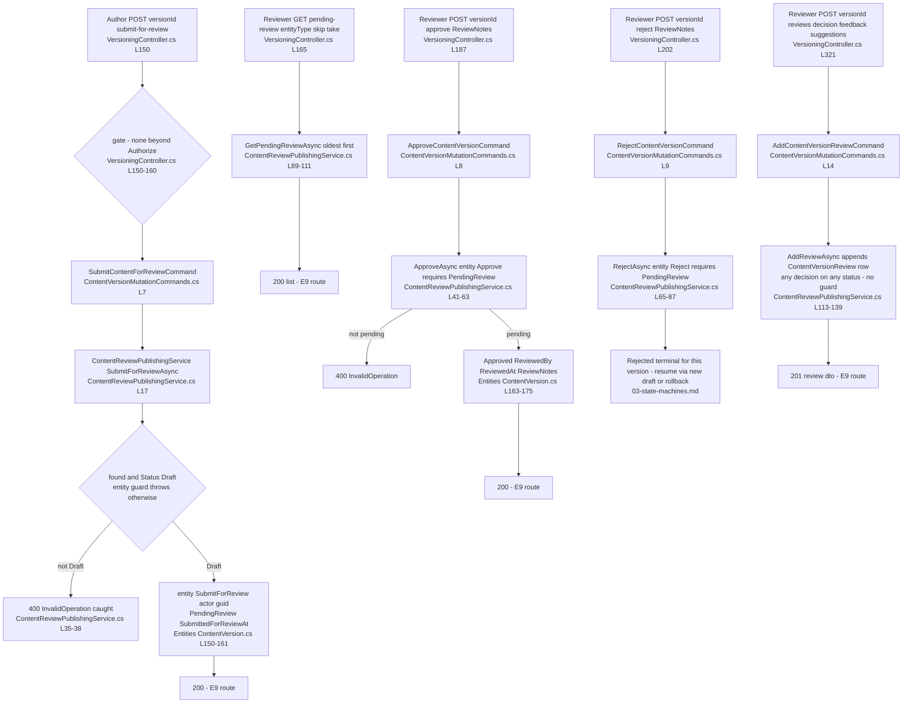
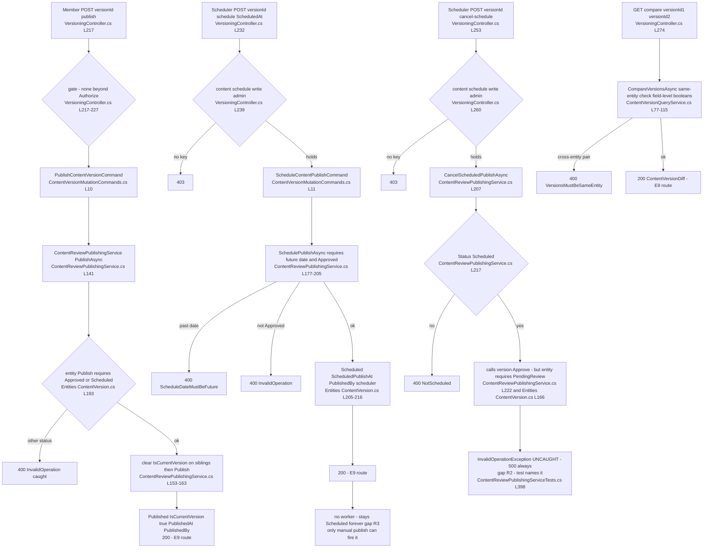
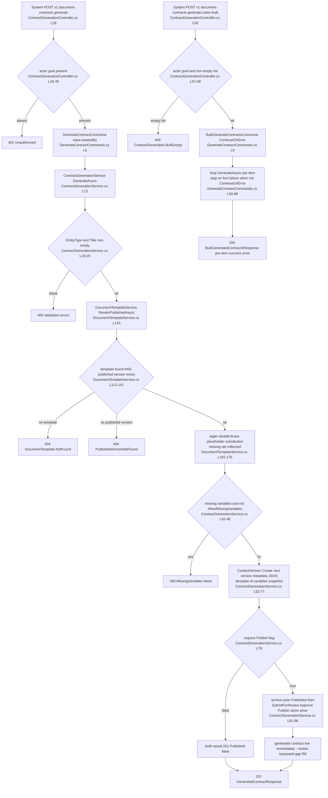

# Resources.Contents — User Flows

> Module `GameGuild.Resources.Contents` · `develop` @ `ce31d5850c`. Shorthand `Contents:` = `apps/api/Source/Modules/GameGuild.Resources.Contents/`. Actors: **Author** (`content:draft` family), **Scheduler** (`content:schedule` family), **Editor** (`content:edit` family), **Reviewer/Member** (authenticated, no content permission — per the wiring, they can still drive several transitions), **System** (contract-generation caller).
> Reality check carried through every flow: 16 of these routes are **baselined as 500-at-runtime** (E9 / #1278) — the flows document intended behavior, with the runtime-dead steps flagged `E9`.

## F1 — Draft authoring (create, update, rollback)

### F1 edge-case matrix

| Case | Behavior | Citation |
|---|---|---|
| Concurrent draft creation | two racing `MaxAsync` reads can mint the same `VersionNumber` (index is non-unique) | `Services/ContentDraftService.cs:28-30`; `Configuration/ContentVersionEntityConfiguration.cs:43`; gap R7 |
| Draft for unknown entity | no existence check on `(EntityId, EntityType)` — drafts can attach to anything, including nonexistent entities | `Services/ContentDraftService.cs:17-50` |
| `CreatedBy` from payload | draft authorship is the **request body's** `CreatedBy` (`CreateDraftRequest`, `Controllers/VersioningController.cs:341`), not the actor — spoofable attribution | gap R6 |
| Update of a non-draft | service returns `CanOnlyUpdateDrafts` 400 (entity would also throw) | `Services/ContentDraftService.cs:69-72`; `Entities/ContentVersion.cs:117-119` |
| Rollback semantics | rollback = new draft from snapshot; the published current version is untouched until the new draft clears review | `Services/ContentDraftService.cs:98-137` |
| Rollback to a draft/rejected version | allowed — target need only exist | `Services/ContentDraftService.cs:105-110` |
| Get the draft for an entity | `GetDraftAsync` exists in the facade but has **no route** (`02-cqrs-wiring-matrix.md` §3) | `Services/ContentVersioningService.cs:26-27` |

## F2 — Review workflow (submit, pending queue, approve/reject, review comments)

### F2 edge-case matrix

| Case | Behavior | Citation |
|---|---|---|
| Who may submit/approve/reject | **any authenticated caller** — no editorial key on submit/approve/reject/reviews (only drafts/schedule/rollback are gated) | `Controllers/VersioningController.cs:150-212,321-332`; gap R5 |
| Self-review | submitter and approver can be the same guid — no separation check | `Services/ContentReviewPublishingService.cs:29,53` |
| Actor fallback | actor guid defaults to `Guid.Empty` when the subject is not a guid (`:15`) — approvals attributable to the empty guid | gap R6 |
| Review rows vs state | `ContentVersionReview` rows are advisory annotations; only `Approve`/`Reject` move state — an Approve-decision review row does not approve | `Entities/ContentVersion.cs:272-307` |
| Review on any status | `AddReviewAsync` has no status precondition | `Services/ContentReviewPublishingService.cs:113-139` |
| Reviewer attribution | `ReviewerId` = actor context guid (not payload) | `:128-133` |

## F3 — Publishing (publish, current-version swap, schedule, cancel)

### F3 edge-case matrix

| Case | Behavior | Citation |
|---|---|---|
| Publish without approval | entity guard blocks (Draft/PendingReview/Rejected → 400) — the review gate is the entity, not a permission | `Entities/ContentVersion.cs:193-195` |
| Current-version swap | siblings' `IsCurrentVersion` cleared in the same save; no uniqueness constraint enforces single-current (concurrent publishes can leave none/dupes) | `Services/ContentReviewPublishingService.cs:153-161`; gap R7 |
| Schedule→publish path | entity allows Scheduled→Published directly (manual rescue of the worker-less state) | `Entities/ContentVersion.cs:193` |
| Cancel-schedule | **broken by construction** — see R2 | `Services/ContentReviewPublishingService.cs:222` |
| Scheduled publish execution | `ProcessScheduledPublishingAsync` exists, publishes due versions and attributes `PublishedBy ?? Guid.Empty` — but has **no caller** (R3) | `:230-272,256` |
| Diff fidelity | `BodyDiff` is the literal string "Body changed" — no line-level diff; `TitleDiff` interpolates old→new | `Services/ContentVersionQueryService.cs:106-108` |

## F4 — Contract generation (single + bulk from document templates)

### F4 edge-case matrix

| Case | Behavior | Citation |
|---|---|---|
| Templates in real environments | no create/update/list API, no seeder — the 404 branches are the only production outcome (R4) | `Services/DocumentTemplateService.cs`; gap R4 |
| Placeholder syntax | `{{ key }}` letters/digits/dot/dash/underscore, case-insensitive variable match | `Services/DocumentTemplateService.cs:155-159,179-180` |
| `keepUnknownPlaceholders` | parameter exists but both branches return the raw match — dead flag | `Services/DocumentTemplateService.cs:169` |
| `AllowMissingVariables` | validation moves from 400 to a `MissingVariables` list on the 201 | `Services/ContractGenerationService.cs:42-48`; `Controllers/ContractGenerationController.cs:100` |
| Auto-publish chain | submit→approve→publish executed synchronously by the generating actor — no reviewer involvement; prior published versions archived | `Services/ContractGenerationService.cs:93-95`; gap R8 |
| `EntityId` omitted | a fresh random GUID is minted — the contract becomes its own entity | `Services/ContractGenerationService.cs:51` |
| Bulk partial failure | `ContinueOnError=false` stops at first error; response always 200 with counts | `Commands/GenerateContractCommands.cs:62-81` |
| Duplicate `TemplateKey` | unique index + pre-check → conflict error (`DocumentTemplate.DuplicateKey`) — service-only path | `Services/DocumentTemplateService.cs:49-54,183-188` |
