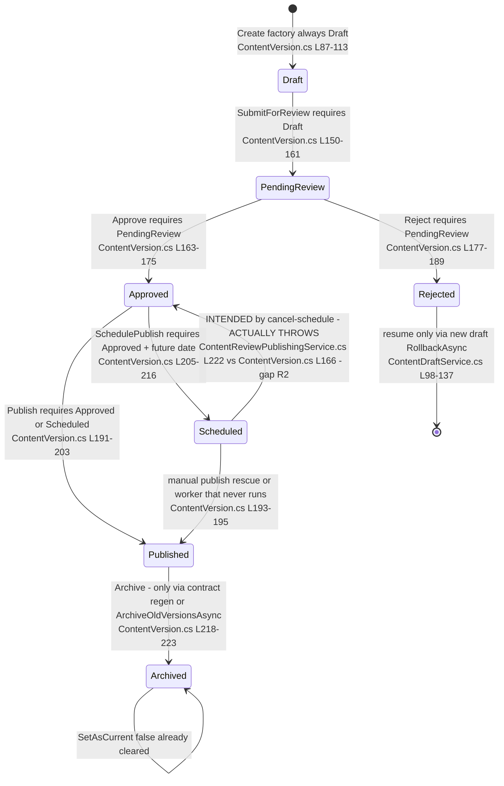
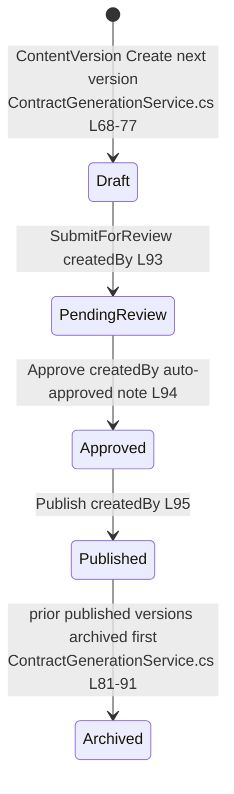

# Resources.Contents — State Machines

> Module `GameGuild.Resources.Contents` · `develop` @ `ce31d5850c`. Unlike Content.Pages, this module's transitions are **entity-guarded** (`Entities/ContentVersion.cs` throws `InvalidOperationException` on illegal moves; services catch and map to 400 except where noted). Enum `ContentVersionStatus` at `Entities/ContentVersion.cs:235-257`.

## 1. `ContentVersion.Status` — the editorial lifecycle

Guard inventory (all in `Entities/ContentVersion.cs`):

| Method | Requires | Sets | Notes |
|---|---|---|---|
| `UpdateDraft` (`:115-148`) | `Status == Draft` | content fields, `UpdatedAt` | service pre-checks too (`ContentDraftService.cs:69-72`) |
| `SubmitForReview` (`:150-161`) | `Draft` | `PendingReview`, `SubmittedBy/At` | submitter = actor guid (`ContentReviewPublishingService.cs:29`) |
| `Approve` (`:163-175`) | `PendingReview` | `Approved`, `ReviewedBy/At`, `ReviewNotes` | also the (broken) cancel path's target — R2 |
| `Reject` (`:177-189`) | `PendingReview` | `Rejected`, `ReviewedBy/At` | terminal for the version |
| `Publish` (`:191-203`) | `Approved` or `Scheduled` | `Published`, `PublishedBy/At`, `IsCurrentVersion=true` | siblings cleared by the service first (`ContentReviewPublishingService.cs:153-161`) |
| `SchedulePublish` (`:205-216`) | `Approved` | `Scheduled`, `ScheduledPublishAt`, `PublishedBy=scheduler` | future-date check at the service (`:187-190`) |
| `Archive` (`:218-223`) | none | `Archived`, `IsCurrentVersion=false` | called by contract regen (`ContractGenerationService.cs:81-91`) and the route-less pruner |
| `SetAsCurrent` (`:225-229`) | none | toggles `IsCurrentVersion` | publish-time sibling clearing |

### Unreachable / dead-end states

- **Scheduled is a dead end by wiring**: the only automated exit (`ProcessScheduledPublishingAsync`) has no caller (R3); the designed exit `cancel-schedule` throws (R2). A scheduled version leaves its state only via manual `POST …/publish` (entity-legal).
- **Archived has no inbound route**: `Archive()` is reachable only from contract regeneration with `Publish=true` and from the route-less `ArchiveOldVersionsAsync` — an operator cannot archive through the API.
- **`IsCurrentVersion` without `Status == Published`**: `GetCurrentVersionAsync` filters `IsCurrentVersion` only (`ContentVersionQueryService.cs:60-67`); contract regen's auto-publish sets current properly, but nothing prevents a hand-seeded current draft from being served by the (currently 500-ing) anonymous route.

## 2. Contract-generation auto-publish chain (state shortcut)

One synchronous chain, single actor (`createdBy`), no reviewer — the review workflow is bypassed by design for generated contracts (gap R8). The chain relies on the same entity guards, so it cannot fail on ordering.

## 3. `ContentReviewDecision` (`Entities/ContentVersion.cs:312-325`)

`Pending | Approve | RequestChanges | Reject` — the vocabulary of `ContentVersionReview` annotation rows. State machine: **none**. Rows are append-only (`ContentVersionReview.Create`, `:290-306`), attach to any version in any status (`ContentReviewPublishingService.cs:113-139`), and nothing consumes them — they are commentary, not gates.

## 4. `DocumentTemplate` (no state machine)

- Lifecycle is CRUD-only: `Create` (`Entities/DocumentTemplate.cs:20-42`) / `Update` (`:44-66`) with `Touch()`. There is no status column; "published" means *a `ContentVersion` with `EntityType = "DocumentTemplate"` and `Status == Published` exists for the template id* (`Services/DocumentTemplateService.cs:125-133`).
- Because neither the versioning routes (E9-dead) nor any template controller exist, in practice templates cannot reach "published" outside tests — see gaps R1/R4.
