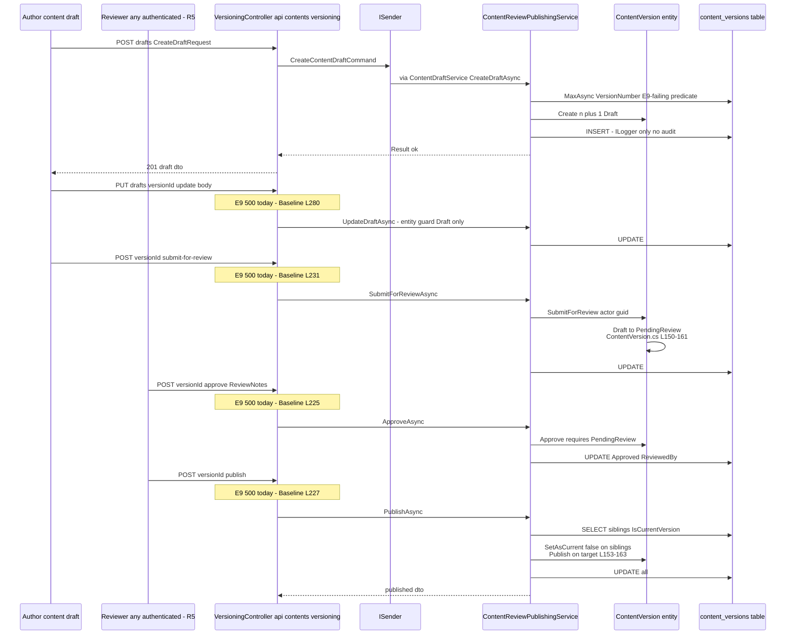
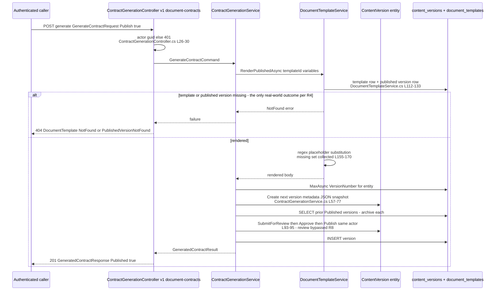
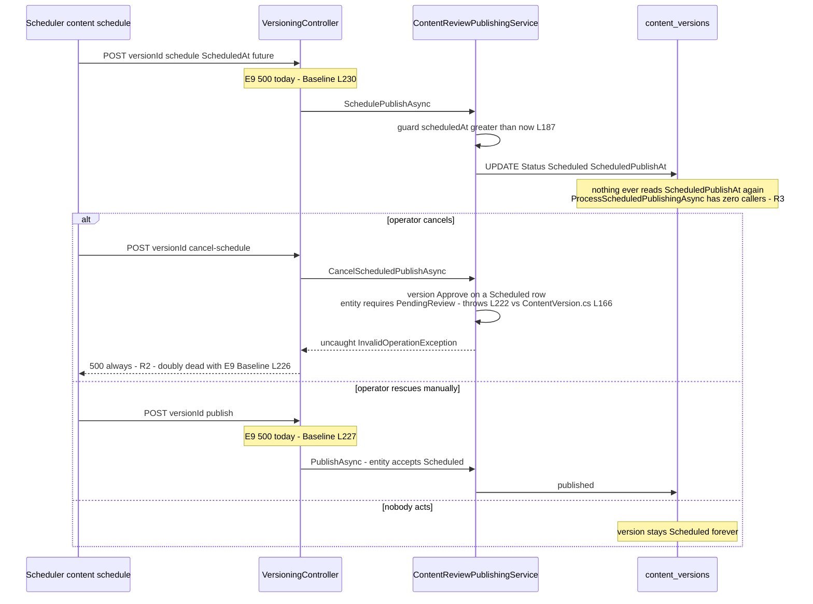
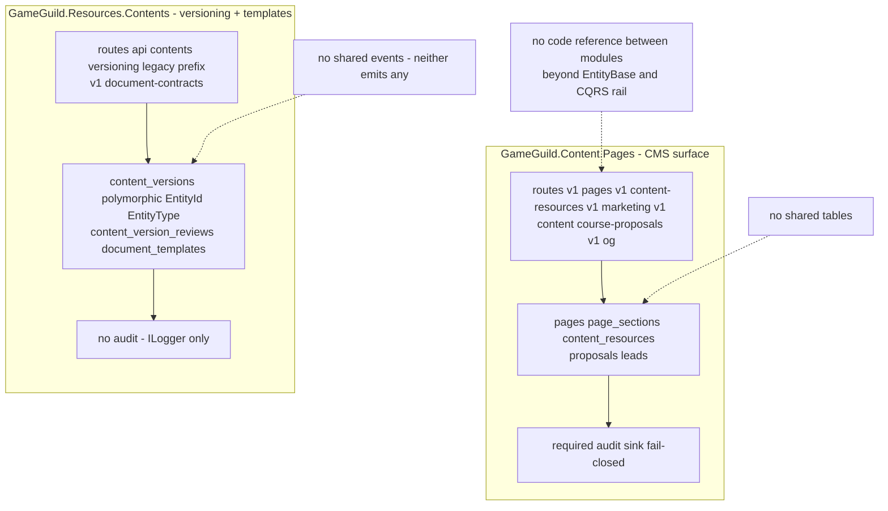

# Resources.Contents — Cross-Module Sequences

> Module `GameGuild.Resources.Contents` · `develop` @ `ce31d5850c`. All interactions are synchronous request/response — the module emits no events (see `04-event-inventory.md`). E9-dead steps are flagged inline.

## 1. Editorial happy path — draft → review → publish (intended; currently E9-dead past step 2)

## 2. Contract generation — template render → content version (auto-publish chain)

Bulk variant loops the same service per item, `ContinueOnError` stops at the first failure when false (`Commands/GenerateContractCommands.cs:50-89`).

## 3. The scheduled-publish dead end (no worker)

## 4. Boundary contract — Resources.Contents vs Content.Pages (do not merge)

- **Two content models**: Content.Pages is the *rendered-website* model (slug-addressed, SEO, overwrite-in-place, published flag); Resources.Contents is the *revision-history* model (polymorphic `(EntityId, EntityType)` snapshots, review workflow, rollback). Nothing versions a `Page` and nothing slug-addresses a `ContentVersion`.
- **Two route conventions**: `v{version}/…` everywhere in Content.Pages; `api/contents/versioning` is the one legacy-prefix island (plus `v1/document-contracts` in this module).
- **Two audit postures**: fail-closed required audit (Pages) vs none (this module).
- **Both are platform-global** (no tenant predicates) and both emit zero integration events — publishing in either is invisible to the other.
