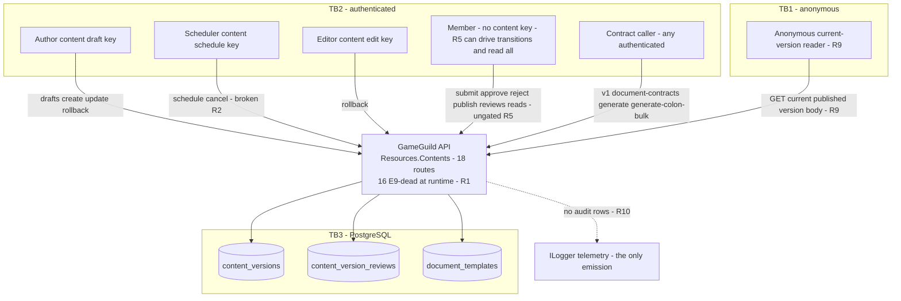
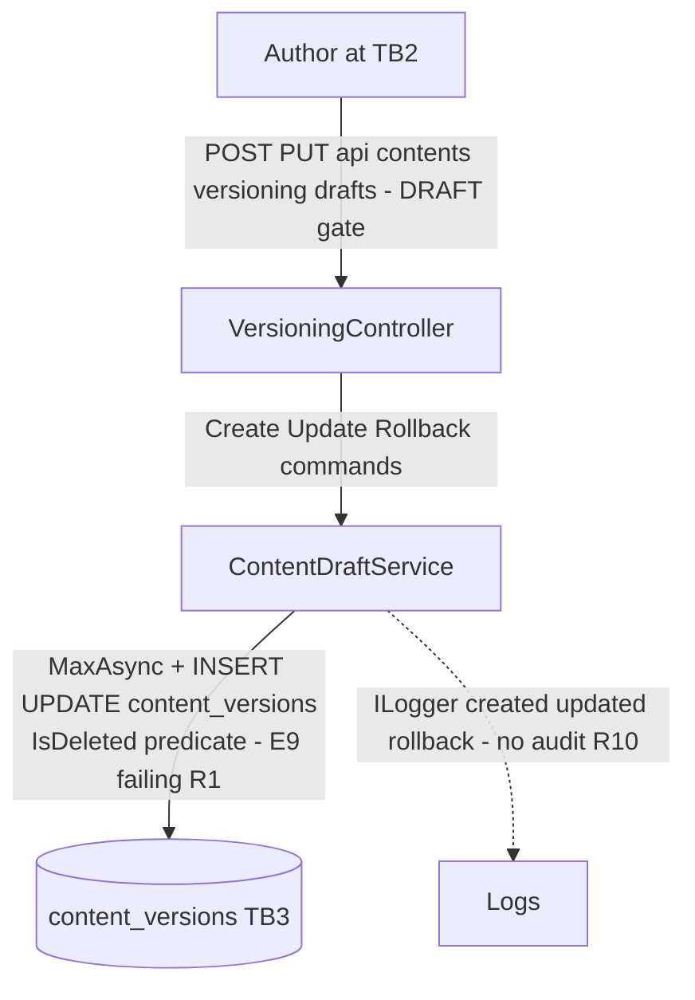
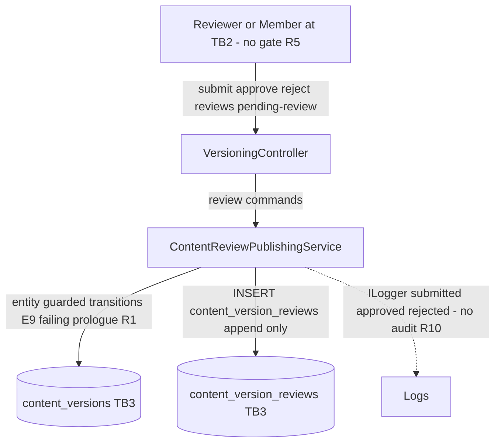
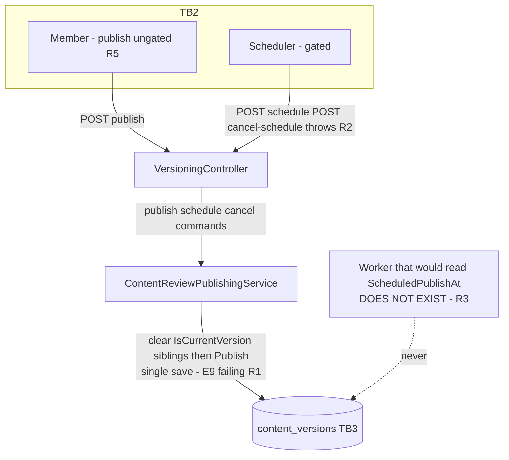
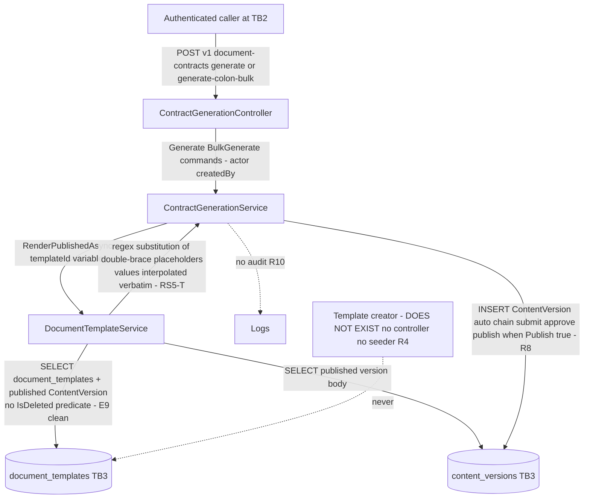
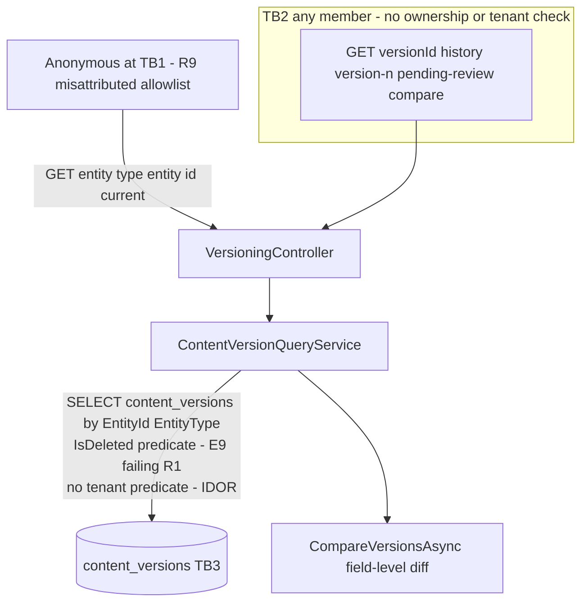

# Resources.Contents — Data-Flow Diagrams

> Module `GameGuild.Resources.Contents` · `develop` @ `ce31d5850c`. Trust boundaries: **TB1** anonymous internet → API (current-version route only, allowlisted); **TB2** authenticated actors (author/editor/scheduler/reviewer-or-member) → API; **TB3** API services → PostgreSQL tables `content_versions`, `content_version_reviews`, `document_templates`. **There is no audit store boundary** — mutations flow to ILogger only (R10).

## L0 — Context

## L1-F1 — Draft authoring

## L1-F2 — Review workflow

## L1-F3 — Publishing and scheduling

## L1-F4 — Contract generation

## L1-RS4 — Reads (incl. anonymous current)

## Data-store sensitivity summary

| Store | Sensitivity | Notes |
|---|---|---|
| `content_versions` | polymorphic content bodies (`Body` text, `Metadata` jsonb incl. contract variables snapshot, `ReviewNotes`, actor guids) | readable by any member and — for current published — anonymously (RS4); no tenant scoping |
| `content_version_reviews` | reviewer feedback + suggestions jsonb | append-only annotations, never consumed |
| `document_templates` | template bodies with `{{placeholder}}` holes + `PlaceholderSchema` jsonb | unreachable lifecycle (R4); rendered output must be treated as untrusted (RS5-T) |
| logs | version ids/numbers only | telemetry, not audit (R10) |
