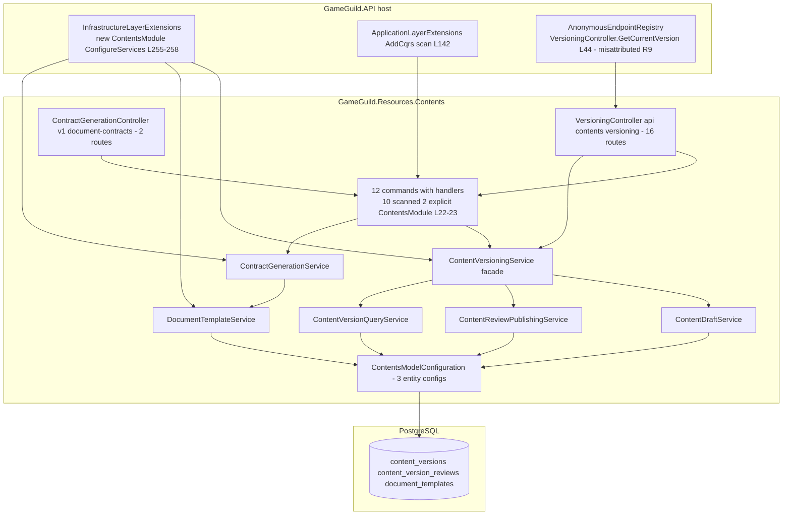

# Resources.Contents — Security Architecture

> Module `GameGuild.Resources.Contents` · `develop` @ `ce31d5850c`.

## 1. Component view

Wiring chain: enabled in `CommonEnabledModules` (`API:/Core/Setup/ModuleConfiguration.cs:37`) → legacy `IModule` registration (`API:/Core/Setup/InfrastructureLayerExtensions.cs:255-258` → `Contents:/ContentsModule.cs:17-32`) → 10 versioning handlers via CQRS scan (`API:/Core/Setup/ApplicationLayerExtensions.cs:142`) + 2 contract handlers explicitly (`ContentsModule.cs:22-23`) → model via `ContentsModelConfiguration` assembly-scanned (`API:/Database/ApplicationDbContext.cs:866-883`) → tables materialized by `20260814193823_ReconcileApplicationModel` / `20260824180312_AddEconomyProductionPlatform`.

## 2. Permission map

| Capability | Gate | Where | Gap note |
|---|---|---|---|
| Create/update drafts | `content:draft` \| `content:write` \| `content:admin` | `Controllers/VersioningController.cs:22,52,74` | the module's enforced boundary |
| Schedule / cancel | `content:schedule` \| `content:write` \| `content:admin` | `:23,239,260` | cancel structurally broken (R2) |
| Rollback | `content:edit` \| `content:write` \| `content:admin` | `:24,304` | — |
| Submit / approve / reject / publish / add-review | **none beyond `[Authorize]`** | `:150,187,202,217,321` | R5 |
| All version reads incl. bodies, diffs, pending queue | **none beyond `[Authorize]`** | `:89,103,121,136,165,274` | RS4-I IDOR (no tenant/ownership predicate) |
| Current published version | `[AllowAnonymous]` + registry L44 | `:122`; `API:/Security/AnonymousEndpointRegistry.cs:44` | R9 misattributed justification |
| Contract generate / bulk | `[Authorize]` + actor-guid 401 | `Controllers/ContractGenerationController.cs:13,26,57` | no content key (R5 family) |
| Template lifecycle | n/a | no routes | R4 |
| Admin bypass | `ActorContext` semantics per the controller's own doc comment | `Controllers/VersioningController.cs:17-21` | pinned by `VersioningEditorialPermissionGatingTests.cs` |

Rate limiting: `global` policy on all 18 routes (no `[EnableRateLimiting]`). No ASP.NET policies; all checks are code-level permission-array membership.

## 3. Integrity properties (and non-properties)

**Properties held:**

1. Lifecycle discipline lives in the entity — `ContentVersion` rejects illegal transitions with thrown exceptions (`Entities/ContentVersion.cs:115-216`), and the services catch and map them to typed 400s on submit/approve/reject/publish/schedule (`Services/ContentReviewPublishingService.cs:27-39,51-63,75-87,151-175,192-205`).
2. Review is a hard precondition of publish — only `Approved`/`Scheduled` rows can become `Published` (`Entities/ContentVersion.cs:193-195`).
3. Rollback is non-destructive — it authors a new draft from the target snapshot rather than mutating history (`Services/ContentDraftService.cs:98-137`).
4. Compare is same-entity enforced (`Services/ContentVersionQueryService.cs:92-95`).
5. Template rendering collects missing variables and (by default) refuses to generate with holes (`Services/ContractGenerationService.cs:42-48`); `TemplateKey` is unique (`Configuration/ContentVersionEntityConfiguration.cs:104-105`).
6. Contract generation attribution comes from the actor context, 401 without a guid subject (`Controllers/ContractGenerationController.cs:26-34`).

**Non-properties (do not rely on):**

1. The route surface does not execute — 16 of 18 routes 500 on the `IsDeleted` predicate (R1); until fixed, the module's live surface is `POST drafts` + the contract pair.
2. Cancel-schedule never succeeds (R2); scheduled publishing never fires (R3); templates cannot be created or published (R4).
3. Version numbers are not unique per entity and "current" is not exclusive — both are best-effort under concurrency (R7).
4. No audit trail exists for any editorial decision (R10).
5. No tenant scoping — the polymorphic store is readable/mutable across tenants by any member (RS4-I, R5).
6. Draft authorship is client-supplied; actor guids degrade to `Guid.Empty` (R6).
7. Review can be bypassed by the contract path (R8) and by any member exercising ungated transitions (R5).

## 4. Fail verdicts (guards)

- **E9 route smoke**: **16 baselined 5xx** — `Baseline:170-176,225-232,280`, all `EF query translation failure (unmapped member)`, tracked to the `#1184`-family inventory and surfaced by #1278 (class 2). This is the module's defining verdict: routes exist, handlers resolve, requests 500.
- **G1/G7 (handler registration/resolution)**: clean — no baseline entries; all 12 request types resolve (10 via the module-assembly scan, 2 explicitly).
- **G2 (table materialization)**: clean — all three tables exist in migrations.
- **G4 (dead domain events)**: clean — nothing declared.
- **G8**: clean — no planned-unavailable commands advertised.
- **Anonymous-surface guard**: structurally satisfied (`VersioningController.GetCurrentVersion` matches registry key L44) but the justification text does not describe the endpoint (R9) — the guard checks membership, not truth.

## 5. Deployment invariants

1. Migrations `20260814193823_ReconcileApplicationModel` and `20260824180312_AddEconomyProductionPlatform` must precede routing this module (tables + the `(EntityId, EntityType, VersionNumber)` and unique-`TemplateKey` indexes).
2. The module is self-contained: no cross-module service dependency (no audit sink to register — that absence is R10). It can be disabled without affecting other modules.
3. `MapEndpoints` is a no-op (`ContentsModule.cs:35-39`) — route changes are attribute-only; the legacy `api/contents/versioning` prefix (R11) must be preserved verbatim for any client that ever integrated against it.
4. Fixing R1 requires a matching baseline edit: the ratchet fails on stale entries (`WiringGapBaseline.AssertNoStaleEntries`), so the 16 `E9|` lines must be removed in the same change that fixes the predicate.
5. If R4 is fixed by seeding system templates, the seeds must include a *published* `DocumentTemplate` content version, or generation still 404s (`PublishedVersionNotFound`).
6. OpenAPI grouping relies on the namespace tag mapping (`API:/Core/Extensions/OpenApiExtensions.cs:646` → `resources/contents`); renames must keep tags aligned.
