# Authentication Data Flow Diagrams

Closes #1137.

Status: living document, current as of 2026-11-02 against `origin/develop` (a96679c7a).

Companion documents: [auth-security-architecture.md](auth-security-architecture.md) (#1135) for trust boundaries B1-B8 and the controls catalog, [auth-stride-threat-model.md](auth-stride-threat-model.md) (#1136) for per-flow STRIDE analysis.

## 1. Notation and conventions

Mermaid flowchart is used with standard DFD shapes:

- External entity — rectangle: `E1["User browser"]`
- Process — stadium: `P1(["1.0 Sign in"])`
- Data store — cylinder: `D1[("PostgreSQL auth database")]`
- Data flow — labeled arrow: `P1 -->|"credentials"| D1`
- Trust boundary — subgraph per zone (client, API, external services)

Processes are numbered per flow family F1-F12, matching the twelve user-flow issues #1096-#1107 (batch 1 and 2 of the authentication user-flow documentation effort). Those user-flow documents are not yet merged to `develop` (issues open at time of writing); this document is the first data-flow rendering of the same twelve families and should be kept consistent with them when they land. Credential-only families analyzed in the STRIDE document (password sign-in, federated sign-in, passwordless, password reset, token refresh) get DFDs in section 4 because they carry the highest-risk data flows; their flow-issue coverage is the STRIDE document's scope.

Paths are relative to the repository root. `Auth/` abbreviates `apps/api/Source/Modules/GameGuild.Identity.Authentication/`; `Host/` abbreviates `apps/api/Source/GameGuild.API/`.

## 2. Level 0 — context diagram

The authentication module as a single process with all external actors and stores.

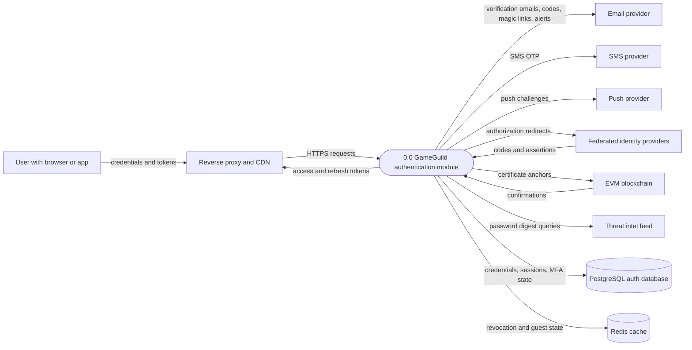

Trust boundaries crossed at level 0: B1 internet to proxy, B2 proxy to API, B3 PostgreSQL, B4 Redis, B5 IdPs, B6 delivery providers, B7 blockchain, B8 threat intel (architecture document, section 3).

## 3. Level 1 — the twelve flow families of issues #1096-#1107

### F1 — Sign-Up flow (issue #1096)

Registration with email and password, email verification, guest upgrade. Entry `POST /v1/auth/sign-up` (`Auth/Controllers/AuthController.cs:33`); engine `Auth/Services/LocalAuthService.cs:594-723`; verification `Auth/Services/EmailVerificationService.cs`; guest upgrade `Auth/Guest/GuestSessionUpgradeIntegration.cs`.

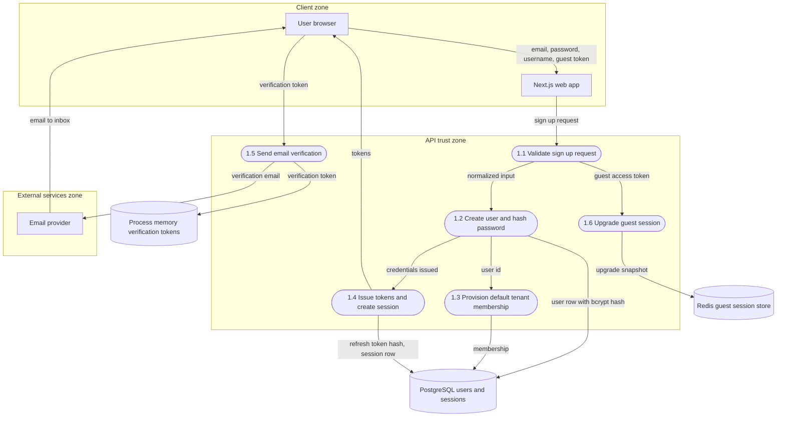

Notes: strength validation and duplicate handling at `Auth/Services/LocalAuthService.cs:605-628`; token store is process-local (gap #1151); CAPTCHA is enforced only in the web layer (gap #1150).

### F2 — MFA Enrollment flow (issue #1097)

TOTP, SMS, push enablement, QR provisioning, backup codes. Controller `Auth/Controllers/MfaController.cs`; coordinator `Auth/Services/MfaService.cs:30-64`; TOTP `Auth/Services/TotpMfaService.cs:27-70`; backup codes hashed at `Auth/Services/MfaService.cs:35-44`.

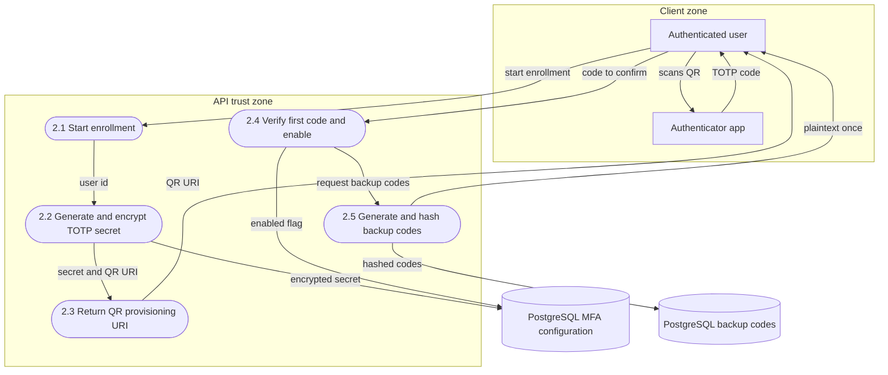

Notes: secrets encrypted AES-256-GCM (`Auth/Services/EncryptionService.cs`); disable requires password re-verification (`Auth/Services/MfaService.cs:107-134`); email-method enrollment endpoint gap #1152; push-device registration without re-verification gap #1153.

### F3 — MFA Recovery flow (issue #1098)

Lost device, recovery codes usage, re-enrollment, account recovery via contacts. Controllers `Auth/Controllers/MfaRecoveryController.cs`, `Auth/Controllers/AccountRecoveryController.cs`; handlers `Auth/Handlers/MfaRecoveryCommandHandlers.cs`, `Auth/Handlers/AccountRecoveryRequestHandlers.cs`, `Auth/Handlers/CompleteAccountRecoveryResetCommandHandler.cs`; threshold `Auth/Services/AccountRecoveryThresholdEvaluator.cs`.

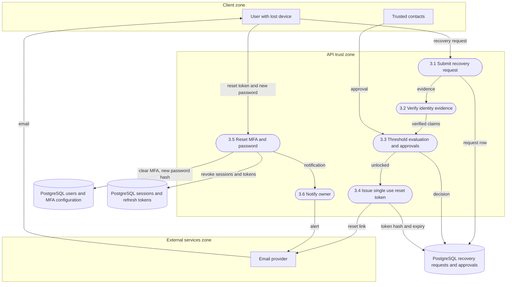

Notes: reset tokens hashed with fixed-time compare (`Auth/Handlers/CompleteAccountRecoveryResetCommandHandler.cs:46-56`); recovery for unverified email is a takeover vector (gap #1124); recovery emails bypass the durable queue (gap #1155).

### F4 — WebAuthn FIDO2 flow (issue #1099)

Biometric and security-key registration and authentication. Controller `Auth/Controllers/WebAuthnController.cs`; registration `Auth/Services/WebAuthnRegistrationService.cs`; authentication `Auth/Services/WebAuthnAuthenticationSubService.cs`; ceremony sessions `Auth/Services/DistributedCacheWebAuthnSessionStore.cs`.

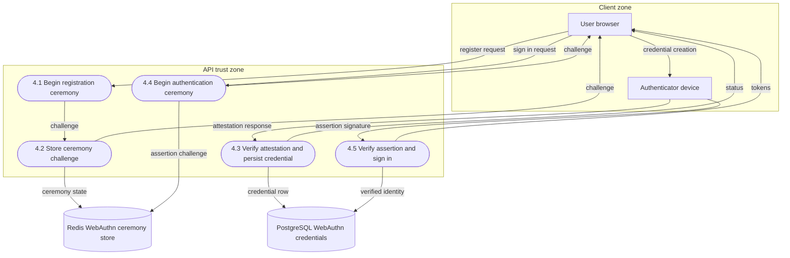

Notes: attestation conveyance `None` and persisted `UserVerified = true` (gap #1143, `Auth/Services/WebAuthnRegistrationService.cs:64`, `155`).

### F5 — Session Management flow (issue #1100)

List, terminate, rename, terminate-others, per-session security analysis. Controller `Auth/Controllers/SessionController.cs`; engine `Auth/Services/SessionManagementService.cs` (create 41, refresh 155, terminate 277, terminate-others 312, analysis 629).

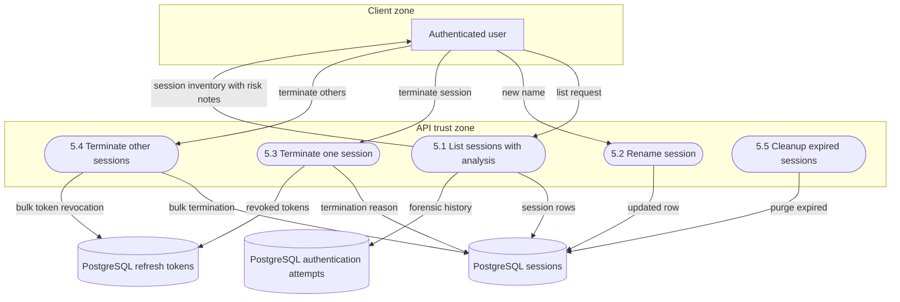

Notes: terminate-others notification gap #1091; concurrent session limit gap #1086; tenant deletion orphaning gap #1120.

### F6 — Sign-Out flow (issue #1101)

Single-session and all-sessions sign-out, token cleanup. Revoke endpoint `POST /v1/auth/tokens:revoke` (`Auth/Controllers/AuthController.cs:708`); revocation `Auth/Services/LocalAuthService.cs:1073`, `Auth/Services/JwtTokenService.cs:408-454`; handler `Auth/Handlers/LogoutHandler.cs` (dead code, gap #1154).

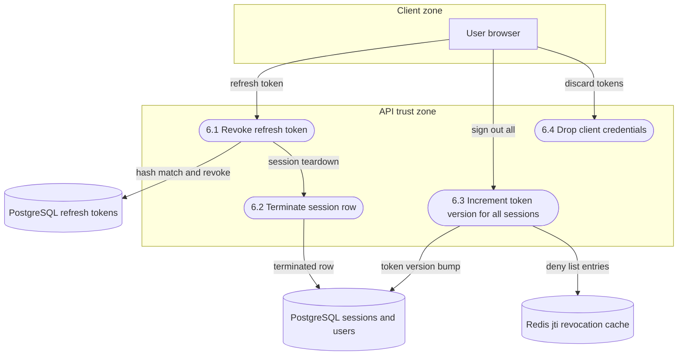

Notes: no dedicated sign-out endpoint on the API today (gap #1154); access-token invalidation for other sessions relies on the token-version middleware (`Auth/Middleware/TokenRevocationMiddleware.cs:91-103`).

### F7 — API Key flow (issue #1102)

Creation, listing, revocation, scope management, usage tracking. Controller `Auth/Controllers/ApiKeyController.cs`; handler `Auth/Services/ApiKeyAuthenticationHandler.cs`; entity `Auth/Entities/ApiKey.cs`; lifecycle `Auth/Configuration/ApiKeyLifecycleOptions.cs`.

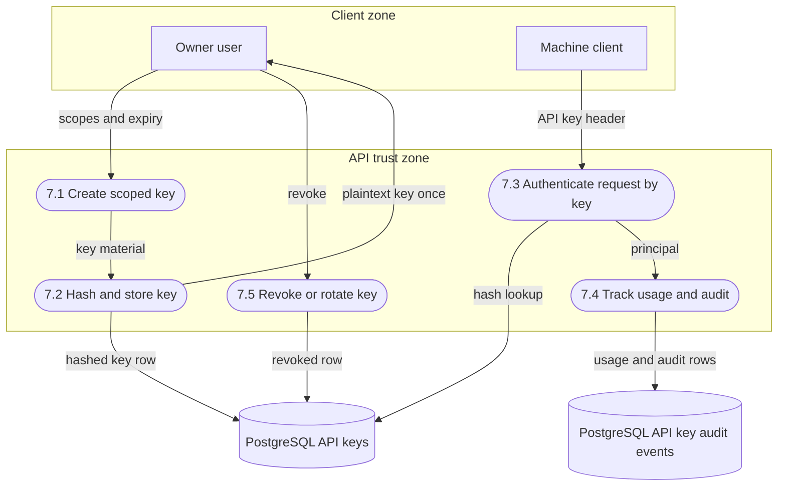

Notes: mid-request expiry semantics gap #1122; audit sink abstraction `Auth/Abstractions/IApiKeyAuditEventSink.cs`.

### F8 — Key Rotation flow (issue #1103)

Manual and scheduled JWT signing-key rotation. Controller `Auth/Controllers/KeyRotationController.cs`; engine `Auth/Services/KeyRotationService.cs` (catalog at line 23, rotation at line 40); background cleanup `Auth/Services/KeyRotationBackgroundService.cs`; entity `Auth/Entities/JwtSigningKey.cs`.

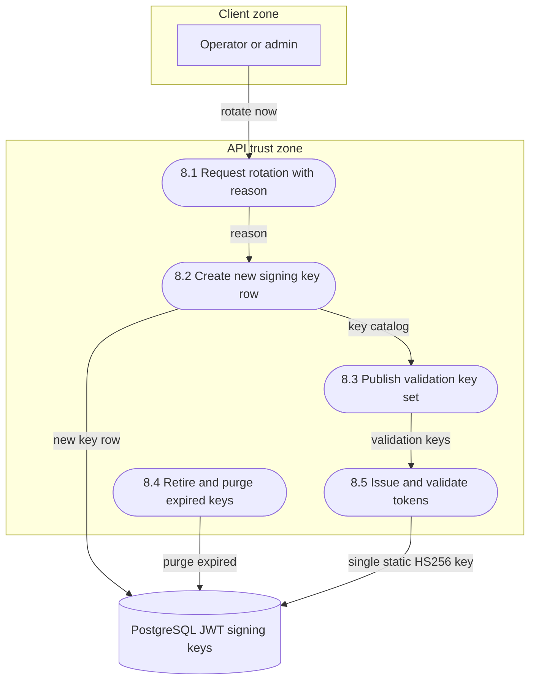

Notes: the issuance and validation paths currently use the single static symmetric key and do not consume the rotation catalog (`Auth/Services/JwtTokenService.cs:193-196`; `Host/Core/Extensions/SecurityServiceCollectionExtensions.cs:84-114`) — wiring gap #1141, mass-disconnect concern #1123. Diagram shows the catalog path as designed; the wired path today is P5 with the static key only.

### F9 — Service Account flow (issue #1104)

Machine-to-machine token issuance and scope management. Controllers `Auth/Controllers/ServiceAccountCrudController.cs`, `Auth/Controllers/ServiceAccountTokenController.cs`, `Auth/Controllers/ServiceAccountOperationsController.cs`; engine `Auth/Services/ServiceAccountService.cs`; token issuance `Auth/Services/JwtTokenService.cs:459-537`.

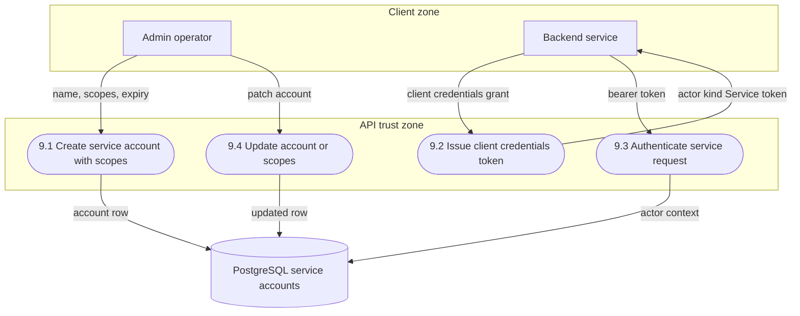

Notes: PATCH persistence bug gap #1142; service tokens are distinguishable from user tokens via `actor_kind` claim (`Auth/Services/JwtTokenService.cs:490-492`) and immutable actor construction (`apps/api/Source/Modules/GameGuild.Identity.Context/Actors/ActorContextBuilder.cs`).

### F10 — Step-Up Authentication flow (issue #1105)

High-risk challenge with timeout, retry and cancellation. Controller `Auth/Controllers/StepUpController.cs`; contracts `Auth/StepUp/StepUpContracts.cs:52-73`; trigger `Auth/Services/LocalAuthService.cs:183-199`; challenge reuse in sign-in MFA (`Auth/SignInMfa/SignInMfaService.cs`).

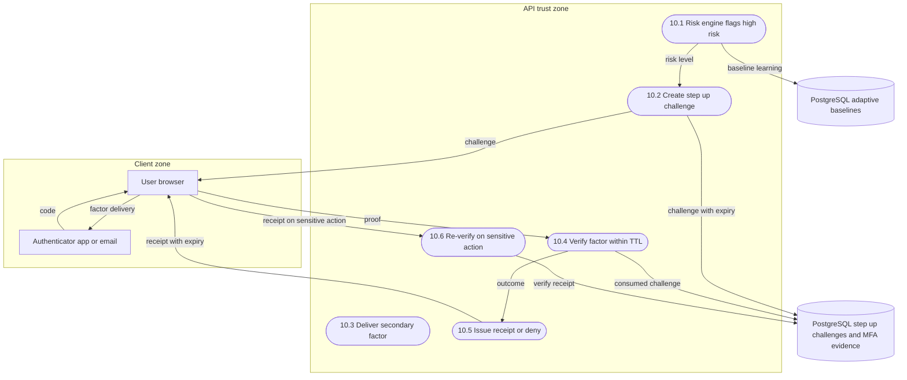

Notes: risk thresholds from `Auth/Services/AdaptiveAnomalyDetectionService.cs:122-140`; heuristic layer `Auth/Services/AuthenticationAnomalyDetectionService.cs`; timezone false-positive gap #1115.

### F11 — Trusted Devices flow (issue #1106)

Device registration, trust decision, expiry, management. `Auth/Services/SessionManagementService.cs:366-530` (trust 366, check 432, list 454, revoke 506, rename 530); entity `Auth/Entities/TrustedDevice.cs`.

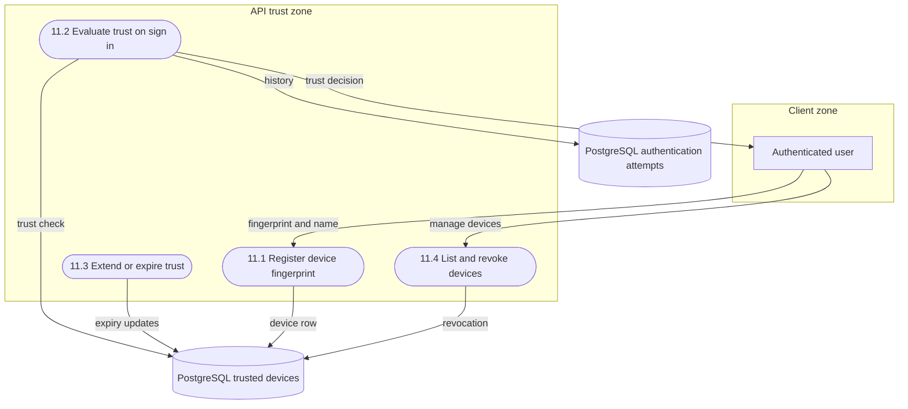

Notes: fresh-verification prerequisite and expired-row pruning gap #1144.

### F12 — Trusted Contacts flow (issue #1107)

Contact addition, verification, recovery via contacts. Controller `Auth/Controllers/TrustedContactsController.cs`; entity `Auth/Entities/TrustedContact.cs`; recovery interaction with F3.

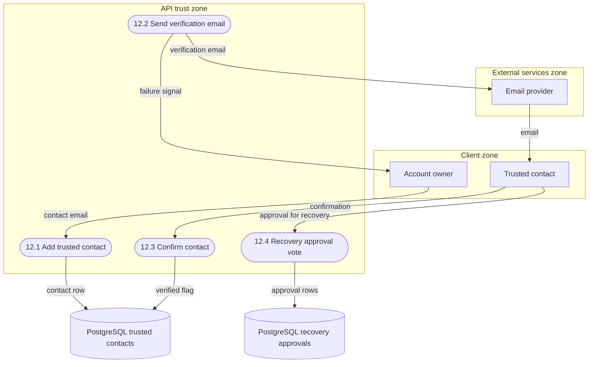

Notes: email delivery failures abort the command without an outbox (gap #1145).

## 4. Credential flow DFDs (STRIDE scope cross-reference)

These families are the STRIDE document's flow list (its sections 2, 5-10); DFDs are included here because they carry the primary credential flows.

### C1 — Password and federated sign-in (STRIDE flows 1, 2, 4)

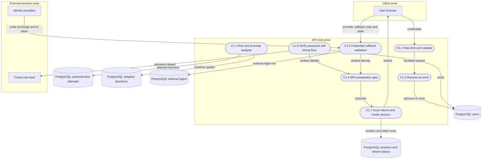

### C2 — Passwordless entry (magic link, email code, Web3; STRIDE flows 5-7)

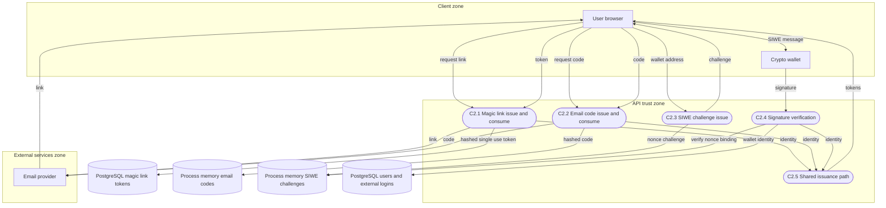

### C3 — Password reset and token refresh (STRIDE flows 8, 9)

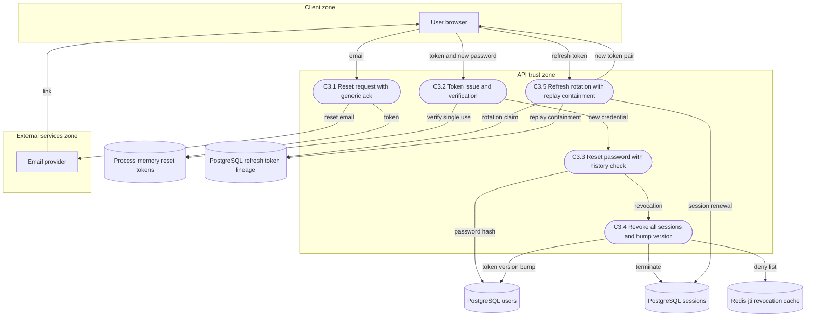

## 5. Coverage matrix

| Authentication flow | DFD section | Flow issue | STRIDE section |
| --- | --- | --- | --- |
| Sign-up | F1 | #1096 | 3 |
| MFA enrollment | F2 | #1097 | 4 |
| MFA recovery | F3 | #1098 | 4 |
| WebAuthn FIDO2 | F4 | #1099 | 4 |
| Session management | F5 | #1100 | 11 |
| Sign-out | F6 | #1101 | 11 |
| API key | F7 | #1102 | 12 cross-cutting |
| Key rotation | F8 | #1103 | 12 cross-cutting |
| Service account | F9 | #1104 | 12 cross-cutting |
| Step-up authentication | F10 | #1105 | 2, 4 |
| Trusted devices | F11 | #1106 | 11 |
| Trusted contacts | F12 | #1107 | 3 of STRIDE doc context |
| Password and federated sign-in | C1 | none yet | 2, 4 |
| Passwordless entry | C2 | none yet | 5, 6, 7 |
| Password reset and token refresh | C3 | none yet | 8, 9 |

Flow families #1108-#1114 (batch 3: password change, external login link/unlink, permission evaluation, orchestrated auth, guest lifecycle, token lifecycle, account provisioning) are open issues; their DFDs should extend this document when those issues are picked up. Permission evaluation itself is documented in [PERMISSION_EVALUATION_POLICY.md](PERMISSION_EVALUATION_POLICY.md) and the authorization audit trail in [AUTHORIZATION_PRECEDENCE_AUDIT.md](AUTHORIZATION_PRECEDENCE_AUDIT.md).

## 6. Maintenance rules

1. When a flow's code path moves (controller, handler, service split or merge), update the affected diagram and its citations in the same PR.
2. When a gap issue closes (for example #1141 wiring the rotation catalog), re-draw the affected diagram to show the wired path rather than the designed path, and drop the gap note.
3. New flows get a new family letter and an entry in the coverage matrix; do not silently redraw an existing family to cover two families.
4. Keep Mermaid labels free of parentheses, colons and slashes — the renderer used by the docs site rejects them.
