# Authentication Module Security Architecture

Closes #1135.

Status: living document, current as of 2026-11-02 against `origin/develop` (a96679c7a).

Companion documents:

- [auth-stride-threat-model.md](auth-stride-threat-model.md) (#1136) — STRIDE analysis per authentication flow.
- [auth-dfds.md](auth-dfds.md) (#1137) — data flow diagrams, level 0 and level 1 per flow.
- Related prior art: [IDENTITY_SECURITY_AUDIT_REPORT.md](IDENTITY_SECURITY_AUDIT_REPORT.md), [JWT_TOKEN_VERSION.md](JWT_TOKEN_VERSION.md), [MIDDLEWARE_ORDER.md](MIDDLEWARE_ORDER.md), [deny-by-default-adversarial-validation.md](deny-by-default-adversarial-validation.md).

## 1. Purpose and scope

This document describes the security architecture of the GameGuild authentication stack as implemented in code. Every control is cited with `file:line` so reviewers can verify the claim against the tree. The scope is the three identity modules of the API:

| Module | Path | Responsibility |
| --- | --- | --- |
| GameGuild.Identity.Authentication | `apps/api/Source/Modules/GameGuild.Identity.Authentication` | Sign-in, sign-up, MFA, OAuth/OIDC/SAML federation, Web3, magic link, email code, guest sessions, sessions, API keys, service accounts, step-up, anomaly detection, trusted devices/contacts |
| GameGuild.Identity.Authorization | `apps/api/Source/Modules/GameGuild.Identity.Authorization` | Permission registry, ABAC/DAC policy evaluation, roles, deny-by-default authorization rules |
| GameGuild.Identity.Context | `apps/api/Source/Modules/GameGuild.Identity.Context` | Immutable `ActorContext` construction, security audit logger, middleware order validation |

Host-level wiring (JWT bearer schemes, pipeline order, rate limiting, DataProtection) lives in the API host project `apps/api/Source/GameGuild.API` and is covered where it forms part of the authentication security boundary.

## 2. Component diagram

```mermaid
flowchart TB
    subgraph EXT["External entities and providers"]
        CLIENT["Browser or Next.js client"]
        MOBILE["Mobile client"]
        GOOGLE["Google IdP"]
        GITHUB["GitHub IdP"]
        DISCORD["Discord IdP"]
        OIDCP["OIDC providers"]
        SAMLIDP["SAML IdPs"]
        MAIL["Email provider"]
        SMS["SMS provider"]
        FCM["FCM push"]
        CHAIN["EVM blockchain"]
        THREATFEED["Threat intel feed"]
    end

    subgraph EDGE["Edge trust boundary"]
        PROXY["Reverse proxy and CDN"]
    end

    subgraph HOST["API host cross cutting security"]
        PIPE["Request pipeline"]
        RL["Rate limiter"]
        BEARER["JWT bearer schemes"]
        REVOCMW["Token revocation middleware"]
        TENANT["Tenant resolution"]
        ACTORMW["Actor context middleware"]
        AUTHZMW["Authorization middleware"]
        DP["DataProtection key ring"]
    end

    subgraph AUTHMOD["Identity Authentication module"]
        CTRL["Auth API controllers"]
        HANDLERS["CQRS commands and handlers"]
        LOCAL["LocalAuthService sign in and refresh"]
        OAUTHS["OAuthAuthService and OAuthService"]
        OIDCS["OidcFederationService"]
        SAMLS["SamlFederationService"]
        WEB3["Web3Service and Web3AuthService"]
        MFASVC["MfaService TOTP SMS push backup codes"]
        SIGNMFA["SignInMfaService challenge store"]
        WAUTHN["WebAuthn services"]
        MAGIC["MagicLinkTokenStore"]
        EMAILCODE["EmailCodeService"]
        PWDSVC["PasswordService and PasswordHasher"]
        SESSION["SessionManagementService"]
        GUEST["GuestSessionService and GuestTokenService"]
        STEPUP["StepUp challenge service"]
        APIKEY["ApiKeyAuthenticationHandler"]
        SVCACCT["ServiceAccountService"]
        KEYROT["KeyRotationService"]
        ANOMALY["AdaptiveAnomalyDetectionService"]
        RISK["Heuristic anomaly and behavioral analysis"]
        ATTEMPT["AuthAttemptService forensics"]
        ENUM["UserEnumerationProtectionService"]
    end

    subgraph AUTHZMOD["Identity Authorization module"]
        PERMREG["PermissionRegistry"]
        ABAC["ABAC policy evaluation"]
        DAC["DAC and owner override rules"]
    end

    subgraph CTXMOD["Identity Context module"]
        ACTOR["ActorContext builder"]
        AUDITLOG["SecurityAuditLogger"]
    end

    subgraph DATA["Data stores"]
        PG[("PostgreSQL")]
        REDIS[("Redis")]
    end

    CLIENT --> PROXY
    MOBILE --> PROXY
    PROXY --> PIPE

    PIPE --> RL --> BEARER --> REVOCMW --> TENANT --> ACTORMW --> AUTHZMW --> CTRL
    CTRL --> HANDLERS
    HANDLERS --> LOCAL
    HANDLERS --> OAUTHS
    HANDLERS --> WEB3
    HANDLERS --> PWDSVC
    HANDLERS --> SESSION

    LOCAL --> MFASVC
    LOCAL --> SIGNMFA
    LOCAL --> ANOMALY
    LOCAL --> RISK
    LOCAL --> ATTEMPT
    LOCAL --> ENUM
    LOCAL --> SESSION
    OAUTHS --> OIDCS
    OAUTHS --> SAMLS
    MFASVC --> WAUTHN
    HANDLERS --> MAGIC
    HANDLERS --> EMAILCODE
    HANDLERS --> GUEST
    HANDLERS --> STEPUP
    HANDLERS --> APIKEY
    HANDLERS --> SVCACCT
    HANDLERS --> KEYROT
    MFASVC --> SMS
    MFASVC --> FCM
    MAGIC --> MAIL
    EMAILCODE --> MAIL
    OAUTHS --> GOOGLE
    OAUTHS --> GITHUB
    OAUTHS --> DISCORD
    OIDCS --> OIDCP
    SAMLS --> SAMLIDP
    WEB3 --> CHAIN
    RISK --> THREATFEED
    ATTEMPT --> AUDITLOG

    LOCAL --> PG
    SIGNMFA --> PG
    SESSION --> PG
    MAGIC --> PG
    REVOCMW --> REDIS
    GUEST --> REDIS
    APIKEY --> PG
    ANOMALY --> PG
    ACTORMW --> ACTOR
    AUTHZMW --> PERMREG
    AUTHZMW --> ABAC
    AUTHZMW --> DAC
    DP --> HOST
```

Component inventory behind the boxes:

- Controllers: `apps/api/Source/Modules/GameGuild.Identity.Authentication/Controllers/` — 30 controllers. The central one is `AuthController.cs` (1,100 lines) exposing sign-up (line 33), sign-in (67), MFA complete (91), polymorphic sign-in (115), Google (143), magic link (169, 199), GitHub (227, 988), email code (247, 275), Discord (308, 338), OIDC (397, 427, 474, 494), SAML (534, 563, 609, 636), refresh (675), revoke (708), session state (735), Web3 (791, 1046), email verification (821, 842), password reset and change (878, 905, 938).
- Services: `apps/api/Source/Modules/GameGuild.Identity.Authentication/Services/` (~90 classes), `SignInMfa/`, `StepUp/`, `Guest/`, `OAuth/`.
- Authorization: `apps/api/Source/Modules/GameGuild.Identity.Authorization/PermissionRegistry.cs`, `Policies.cs`, `Requirements/`, `Rules/`, `Providers/`.
- Context: `apps/api/Source/Modules/GameGuild.Identity.Context/Actors/ActorContext.cs`, `Actors/SecurityAuditLogger.cs`, `Middleware/MiddlewareOrderValidator.cs`.

## 3. Trust boundaries

The authentication stack is crossed by eight trust boundaries. Each boundary lists the controls that enforce it.

### B1 — Internet to edge proxy

Untrusted client traffic terminates at the reverse proxy. HSTS is applied in production (`apps/api/Source/GameGuild.API/Core/Setup/PipelineExtensions.cs:48-57`, HSTS at line 283), HTTPS redirection for external traffic only (lines 52-57), security headers including CSP and X-Frame-Options (lines 78-82). Forwarded headers are consumed only from the trusted proxy via `UseForwardedHeaders` at the top of the pipeline (line 46); IP resolution for forensics deliberately reads `Connection.RemoteIpAddress` and never raw `X-Forwarded-For` (`apps/api/Source/Modules/GameGuild.Identity.Authentication/Services/AuthAttemptService.cs:104-114`).

### B2 — Proxy to API host

Cross-cutting host defenses run before any controller: RFC 7807 exception handling (`PipelineExtensions.cs:40`), correlation ID (line 60), Serilog request logging with redaction (line 63), CORS after routing (line 89), the global limiter plus per-endpoint policies (`PipelineExtensions.cs:122-130`, policy definitions in `apps/api/Source/GameGuild.API/Core/Extensions/RateLimitingServiceCollectionExtensions.cs:87-107` global, `152-172` authentication policy). All auth endpoints carry `[EnableRateLimiting(RateLimitPolicies.Authentication)]` (`Controllers/AuthController.cs:20`).

### B3 — API host to PostgreSQL

The API requires three separate connection strings at boot (`DefaultConnection`, `AuthenticationDb`, `MigrationConnection`) validated by `apps/api/Source/GameGuild.API/Core/Setup/OperationalStartupConfiguration.cs:18`. Authentication state stores: refresh tokens, sessions, MFA configurations, sign-in MFA challenges, TOTP replay state, magic link tokens, external logins, API keys, service accounts, authentication attempts, adaptive baselines (`Entities/` — `RefreshToken.cs`, `UserSession.cs`, `UserMfaConfiguration.cs`, `SignInMfaChallenge.cs`, `TotpReplayState.cs`, magic-link entity in `StepUp/MagicLinkTokenStore.cs:7`, `ExternalLogin.cs`, `ApiKey.cs`, `ServiceAccount.cs`, `AuthenticationAttempt.cs`, `AdaptiveBehaviorBaseline.cs`).

### B4 — API host to Redis

Redis backs distributed auth state when enabled: token revocation cache (`Services/DistributedCacheTokenRevocationService.cs`), guest session store with absolute TTL keyed to expiry (`Guest/DistributedCacheGuestSessionStore.cs:31-46`), distributed rate-limit partitions (`RateLimitingServiceCollectionExtensions.cs:163`), WebAuthn ceremony session store (`Services/DistributedCacheWebAuthnSessionStore.cs`). Operational startup requires Redis in protected environments (`OperationalStartupConfiguration.cs:37-42`).

### B5 — API to external identity providers

Outbound federation to Google, GitHub, Discord, arbitrary OIDC and SAML IdPs. All IdP interaction is server-side; the client only ever receives authorize URLs and codes. OIDC discovery documents are validated: issuer must equal the configured authority (`Services/OidcFederationService.cs:382`), endpoints must be absolute HTTPS without embedded credentials (lines 397-406). SAML metadata is config-pinned, never fetched over the network, and unsigned responses are refused (`Services/SamlFederationService.cs:15-18`, fail-closed certificate loading at lines 132-136).

### B6 — API to delivery providers

Email, SMS (Twilio adapter) and push (FCM) delivery of verification codes, magic links and security alerts. WhatsApp credentials are read from environment variables only, never from configuration files (`apps/api/Source/GameGuild.API/Program.cs:79-95`).

### B7 — API to blockchain nodes

Web3 verification is local EIP-4361 (SIWE) challenge/signature verification (`Services/Web3Service.cs:17`); certificate anchoring is behind `LocalBlockchainCertificateService` / `DisabledBlockchainCertificateService`.

### B8 — API to threat intelligence

Breached-password digest matching for credential stuffing defense. `LocalFileThreatIntelligenceProvider` and `NullThreatIntelligenceProvider` implement the port; the candidate password SHA-256 digest is computed at the sign-in boundary and never persisted or logged (`Services/LocalAuthService.cs:66-69`).

## 4. Session and token design

### 4.1 Access token (JWT)

Issued by `Services/JwtTokenService.cs`:

- Algorithm: HS256 with a symmetric key from `JwtOptions.SecretKey`, KeyId `GameGuild-jwt-key` (`JwtTokenService.cs:193-196`; validation side `apps/api/Source/GameGuild.API/Core/Extensions/SecurityServiceCollectionExtensions.cs:84-114`). Algorithm confusion is blocked in both directions: the bearer handler pins `ValidAlgorithms = [HmacSha256]` (`SecurityServiceCollectionExtensions.cs:108`) and the service re-checks the header algorithm on every synchronous validation (`JwtTokenService.cs:627-634`).
- Claims: `sub`, `email`, `jti`, `iat`, `auth_time`, `token_version` (`JwtTokenService.cs:143-154`), role claims as the canonical short `role` claim (line 159), `tenant_id` (162), session id `sid` (191), group ids (179-189), and for MFA-bound tokens `amr` plus `mfa_verified` and `mfa_time` backed by a server-side proof object (lines 113-123, 169-177).
- Lifetime: 60 minutes by default (`apps/api/Source/Modules/GameGuild.SharedKernel/Configuration/ApplicationLayer/JwtOptions.cs:33`).
- Reserved-claim firewall: callers cannot inject reserved claim types through additional claims (`JwtTokenService.cs:35-48`, `605-625`).
- Service account tokens are distinct: `actor_kind=Service`, `client_id`, `grant_type=client_credentials`, per-scope claims (`JwtTokenService.cs:459-537`).

### 4.2 Refresh token

- 64 cryptographically random bytes plus timestamp/user entropy, base64-encoded (`JwtTokenService.cs:248-266`); only the hash is persisted — `RefreshToken.Token` stores `RefreshTokenHasher.HashToken` output (`JwtTokenService.cs:269-282`; entity `Entities/RefreshToken.cs:23`).
- Lifetime 30 days standard, 30 days persistent by default, sliding expiration configurable, replay containment scope default `Family` (`JwtOptions.cs:39-55`).
- Rotation (`Services/LocalAuthService.cs:725-932`): validates hash lookup (742-758), rejects revoked/already-rotated tokens as replay (760-776), rejects expired tokens (778-787), re-validates the user, tenant access and token version (790-807), mints the replacement, and claims rotation atomically via `TryRevokeForRotationAsync` (886-901) with concurrent-claim loss treated as replay. Rotation lineage is recorded (903-904).
- Replay containment (`LocalAuthService.cs:934-972`): family-scope revocation through the lineage repository, else account scope — revoke all refresh tokens, terminate all sessions, increment the user's `TokenVersion` (969-971).
- Refresh of an MFA session re-reads the persisted MFA proof and reissues an MFA-bound access token rather than silently downgrading (`LocalAuthService.cs:818-857`).

### 4.3 Revocation and token version

Two independent mechanisms, both enforced by `Middleware/TokenRevocationMiddleware.cs` (`InvokeAsync` at line 45):

1. jti/deny-list revocation via `ITokenRevocationService` (distributed cache or in-memory implementation) checked per request (`TokenRevocationMiddleware.cs:72-79`).
2. `token_version` claim compared against the user's current `TokenVersion`; stale versions are rejected (`TokenRevocationMiddleware.cs:91-103`). Password change and replay containment increment the version (`LocalAuthService.cs:969-971`; password-change revocation in `Services/PasswordChangeRevocationService.cs`). Design rationale: [JWT_TOKEN_VERSION.md](JWT_TOKEN_VERSION.md).

Endpoint-level revocation: `POST /v1/auth/tokens:revoke` (`Controllers/AuthController.cs:708`) revokes a presented refresh token (`Services/LocalAuthService.cs:1073`).

### 4.4 Key handling

- The signing secret is resolved from configuration with fallbacks `Jwt:Secret`, `Jwt:SecretKey`, `JwtSettings:SecretKey`, `Authentication:JwtSecretKey` (`apps/api/Source/Modules/GameGuild.SharedKernel/Configuration/ApplicationLayer/JwtOptionsResolver.cs:15`) and overlaid onto the module's `JwtOptions` (`SecurityServiceCollectionExtensions.cs:60-82`). Protected environments must supply a 32-plus-character, non-placeholder secret or startup fails (`OperationalStartupConfiguration.cs:20-26`); `JwtOptions.Validate` enforces the same (`JwtOptions.cs:100-115`).
- Guest credentials are structurally separated: the guest bearer scheme validates the same issuer and key but audience `GameGuild.Guests` (`Guest/GuestAccessDefaults.cs:22`; scheme at `SecurityServiceCollectionExtensions.cs:164-187`), so a guest token is invalid on the user scheme and vice versa — fail closed by construction.
- Key rotation: `Services/KeyRotationService.cs` manages `JwtSigningKey` entities and exposes `GetValidationKeysAsync` (line 23) plus a background cleanup service (`Services/KeyRotationBackgroundService.cs`) and controller surface (`Controllers/KeyRotationController.cs`). Open gap: the active issuance and validation paths still use the single static symmetric key and do not consume the rotation catalog — tracked in issue #1141, with operational concerns in #1123.
- DataProtection key ring is bootstrapped from environment-only material `DATAPROTECTION_CERTIFICATE_BASE64` / `DATAPROTECTION_CERTIFICATE_KEY_BASE64` (`apps/api/Source/GameGuild.API/Core/Setup/DataProtectionStartupConfiguration.cs:50-51`).
- At-rest secret protection for TOTP seeds uses AES-256-GCM with a fail-closed key resolution — no built-in fallback key (`Services/EncryptionService.cs:9-37`; startup guard `OperationalStartupConfiguration.cs:29-35`).

## 5. MFA design

Coordinator `Services/MfaService.cs` delegates to method sub-services:

| Method | Implementation | Security properties |
| --- | --- | --- |
| TOTP | `Services/TotpMfaService.cs` | 160-bit base32 secret encrypted at rest (lines 27-60); verification matches within a configured clock-skew window and records the matched step in a replay store so a code is single-use per authenticator (lines 136-145); constant-time comparison (line 245); replay state persisted in `Entities/TotpReplayState.cs` |
| Backup codes | `Services/BackupCodeMfaService.cs` | Generated at enrollment, stored hashed (`MfaService.cs:35-44`) |
| SMS OTP | `Services/SmsMfaService.cs` | Twilio REST adapter behind `ISmsSender` port |
| Push | `Services/PushMfaService.cs` | Challenge-id driven with TTL, no typed code (`MfaService.cs:80-86`) |
| Email | `Services/EmailCodeService.cs` | Codes stored as SHA-256 digests only (lines 62-63); 10-minute lifetime (line 23); at most five wrong-code attempts then invalidation (lines 29, 116-127); single-use; dummy-digest timing equalizer against unknown accounts (lines 38, 91-92) |
| WebAuthn/FIDO2 | `Services/WebAuthnService.cs`, `WebAuthnRegistrationService.cs`, `WebAuthnAuthenticationSubService.cs`, `WebAuthnCredentialManagementService.cs` | Challenge ceremonies through `DistributedCacheWebAuthnSessionStore`; credentials in `Entities/UserWebAuthnCredential.cs` |

Sign-in MFA is challenge-based, not claim-forwarding: after first-factor success the server stores an expiring challenge row (5-minute TTL, `SignInMfa/SignInMfaService.cs:63`) in PostgreSQL (`SignInMfa/PostgreSqlSignInMfaChallengeStore.cs`) bound to subject, tenant, token version and authentication time. Completion consumes the challenge exactly once (`PostgreSqlSignInMfaChallengeStore.cs:26-46` — `ConsumedAt`/`RevokedAt` guards), and the issued tokens carry `amr`/MFA claims derived from the proof, never from client input (`JwtTokenService.cs:113-123`). Endpoint: `Controllers/AuthController.cs:91`.

Lockout: MFA failed attempts are tracked per user and lock the account out at `MfaOptions.MaxFailedAttempts` (`Services/MfaAttemptTrackingService.cs:328`, `370`).

Enrollment protection: disabling MFA requires re-verification of the account password; possession of a live TOTP code alone is insufficient, and passwordless accounts cannot disable MFA this way (`Services/MfaService.cs:107-134`, issue #244).

Known MFA gaps tracked elsewhere: email-MFA enrollment endpoint missing (#1152), email verification tokens held in process-local memory (#1151), backup-code regeneration and push-device registration without password re-verification (#1153), WebAuthn attestation conveyance `None` and persisted `UserVerified = true` regardless of authenticator flag (`WebAuthnRegistrationService.cs:64`, `155`; issue #1143), MFA recovery email notifications bypassing the durable queue (#1155), concurrent enrollment/sign-in race (#1117).

## 6. Anomaly detection and risk engine

Two layers run on every local sign-in (`Services/LocalAuthService.cs:180-181`):

1. Adaptive learned layer — `Services/AdaptiveAnomalyDetectionService.cs`. Per-subject EWMA baselines over three features: hour-of-day (circular mean, lines 97-102), IP novelty as information content of a decayed per-subject IP distribution (104-110), and attempt cadence in log-seconds (112-120). Scoring is z-score based with a configurable threshold (122-140); learning updates run on every observation and persist to `Entities/AdaptiveBehaviorBaseline.cs` (155-226, 228-258). Cold start abstains below the minimum observation count (55-64). Privacy: the subject key is a SHA-256 over tenant plus user id or identifier digest (267-273); stored IPs are truncated digests (347-348). Fail-open containment: if learning throws, the assessment degrades to the heuristic-only analysis rather than blocking sign-in (71-84).
2. Heuristic and behavioral layer — `AuthenticationAnomalyDetectionService`, `BehavioralAnalysisService`, `LoginAttemptAnalysisService`, `GeoVelocity` (impossible travel), `ThreatDetectionService` with `LocalFileThreatIntelligenceProvider`/`NullThreatIntelligenceProvider` for breached-password digest matching (`LocalAuthService.cs:66-69`).

Risk outcomes drive step-up: risk level `High` or above forces a step-up/MFA challenge before credentials are issued (`LocalAuthService.cs:183-199`), and confirmed signals (impossible travel, brute force that eventually succeeded) publish owner alerts (`LocalAuthService.cs:344-354`; publishers `Services/SuspiciousLoginAlertPublisher.cs`, `Services/NewLoginAlertPublisher.cs`). All risk decisions are audited as `Authentication.ThreatDetected`, `Authentication.StepUpRequired` events (`LocalAuthService.cs:186-195`, `328-340`).

Every sign-in attempt, success or failure, is recorded for forensics with IP normalization (IPv4-mapped IPv6 collapsed), optional geo enrichment that fails open, sanitized failure reasons and hashed identifiers (`Services/AuthAttemptService.cs:24-102`, `116-160`, `180-214`), and forwarded to the central audit sink without ever blocking authentication (`AuthAttemptService.cs:216-243`).

Known detection gaps tracked elsewhere: timezone whitelist for travel false positives (#1115), threat-intel feed is file-based or null only, geo-fencing option for enterprise tenants (#1087).

## 7. Lockout and CAPTCHA

- API rate limiting: every auth endpoint uses the `Authentication` policy — fixed window, per-IP for anonymous and per-user when authenticated, Redis-partitioned when enabled, with an allowlist escape hatch (`Controllers/AuthController.cs:20`; `apps/api/Source/GameGuild.API/Core/Extensions/RateLimitingServiceCollectionExtensions.cs:152-172`).
- Enumeration throttling: 10 attempts per 15-minute window per identifier triggers throttling (`Services/UserEnumerationProtectionService.cs:91-116`).
- Timing equalization: monotonic authentication timing floor that compensates for whether credential work actually ran (dummy hashing for unknown accounts) so response timing does not reveal account existence (`UserEnumerationProtectionService.cs:32-76`, `140-150`; driven from `LocalAuthService.cs:413-419`).
- Generic failures: all failure paths return the enumeration-safe generic message (`LocalAuthService.cs:170`, `UserEnumerationProtectionService.cs:77-84`).
- MFA lockout: `MfaAttemptTrackingService.cs:328`, `370` as above.
- Email-code guessing cap: five attempts (`EmailCodeService.cs:29`, `116-127`).

Known gaps tracked elsewhere (all still open): CAPTCHA challenge after N failed sign-ins (#1082), API-level CAPTCHA on sign-up — Turnstile is enforced only in the Next.js layer (#1150), progressive delay on repeated failures (#1084), account lockout notification email (#1083), new-device sign-in alert rollout (#1085), concurrent session limit (#1086), per-IP rate limit on magic-link and email-code requests (#1090), IP blocklist (#1089).

## 8. Secrets handling

Environment-only policy, enforced at boot:

- JWT secret and encryption key must be 32-plus characters and non-placeholder in protected environments (`apps/api/Source/GameGuild.API/Core/Setup/OperationalStartupConfiguration.cs:20-35`).
- DataProtection certificate material comes only from `DATAPROTECTION_CERTIFICATE_BASE64` / `DATAPROTECTION_CERTIFICATE_KEY_BASE64` environment variables (`DataProtectionStartupConfiguration.cs:50-51`).
- Delivery-provider credentials (WhatsApp and siblings) are read from the environment only (`Program.cs:79-95`).
- The TOTP encryption service fails closed with no built-in fallback key (`Services/EncryptionService.cs:15-37`).
- Passwords never persist outside BCrypt/PBKDF2 hashes (`Services/PasswordHasher.cs:11`, work factor clamped 10-16 at lines 34-42; long inputs use versioned PBKDF2 `LongPasswordHash`).
- Refresh tokens and backup codes are stored only as hashes (`JwtTokenService.cs:269-282`; `MfaService.cs:35-44`).
- Sign-in candidate passwords exist only as a transient SHA-256 digest for threat-intel matching, never persisted or logged (`LocalAuthService.cs:66-69`).
- Logs redact identifiers via `LogRedaction` (`JwtTokenService.cs:244`, `467-469`) and hash emails in audit output (`AuthAttemptService.cs:245-249`); PII redaction policy documented in [pii-redaction-token-vault.md](pii-redaction-token-vault.md).

## 9. Supporting subsystems

- Sessions: `Services/SessionManagementService.cs` — create (41), refresh (155), terminate (277), terminate-all (312), trust device (366), security analysis per session (629), expired cleanup (622). Per-session MFA evidence in `Entities/SessionMfaEvidence.cs`.
- Guest access: opaque guest sessions with their own audience (`Guest/GuestAccessDefaults.cs:22`), Redis store with absolute TTL (`Guest/DistributedCacheGuestSessionStore.cs:31-46`), one-time upgrade on sign-up/sign-in (`Guest/GuestSessionUpgradeIntegration.cs`). Expiry-during-active-use is a known open gap (#1128).
- Step-up authentication: challenge/receipt contracts with expiry (`StepUp/StepUpContracts.cs:52-73`), controller `Controllers/StepUpController.cs`.
- API keys: `Controllers/ApiKeyController.cs`, `Services/ApiKeyAuthenticationHandler.cs`, entity `Entities/ApiKey.cs` with lifecycle options (`Configuration/ApiKeyLifecycleOptions.cs`). Mid-request expiry is tracked in #1122.
- Service accounts: `Controllers/ServiceAccountTokenController.cs`, `Services/ServiceAccountService.cs`, token issuance in `JwtTokenService.cs:459-537`. PATCH persistence bug tracked in #1142.
- Account recovery: `Controllers/AccountRecoveryController.cs`, `Services/AccountRecoveryTokens.cs`, `AccountRecoveryThresholdEvaluator.cs`, entities `AccountRecoveryRequest.cs` / `RecoveryApproval.cs` / `TrustedContact.cs`. Unverified-email takeover vector tracked in #1124; trusted-contact email failures without outbox in #1145.
- External login linking: `Controllers/ExternalLoginsController.cs` and `Commands/ExternalLoginCommands.cs`. Email case-sensitivity conflict (#1118) and multi-OIDC same-email conflict (#1121) are open.
- Compliance gate at sign-in (issue #267): evaluated after credential validation but before any token or session exists (`LocalAuthService.cs:223-276`; decision evaluation `991-1064` with fail-closed only in Enforce mode).
- Authorization enforcement (module `GameGuild.Identity.Authorization`): permission registry (`PermissionRegistry.cs`), policies (`Policies.cs`), deny-by-default validation per [deny-by-default-adversarial-validation.md](deny-by-default-adversarial-validation.md). Tenant membership is re-validated server-side during sign-in and refresh — caller-supplied tenant ids are advisory only (`LocalAuthService.cs:1066-1072`, `216`).
- Actor context: immutable `ActorContext` built from claims plus resolved tenant after authentication and before authorization (`PipelineExtensions.cs:111-114`; `Identity.Context/Actors/ActorContextBuilder.cs`), with middleware order validated at startup (`Identity.Context/Middleware/MiddlewareOrderValidator.cs`).

## 10. Security controls catalog

| Control | Category | Code |
| --- | --- | --- |
| HS256 algorithm pinning | Anti-algorithm-confusion | `Services/JwtTokenService.cs:627-634`; `SecurityServiceCollectionExtensions.cs:108` |
| Reserved-claim firewall | Anti-token-forgery | `Services/JwtTokenService.cs:35-48`, `605-625` |
| Refresh token hashing at rest | Secret storage | `Services/JwtTokenService.cs:269-282` |
| Refresh rotation with atomic claim | Replay prevention | `Services/LocalAuthService.cs:886-901` |
| Family/account replay containment | Breach containment | `Services/LocalAuthService.cs:934-972` |
| Token version invalidation | Global session kill | `Middleware/TokenRevocationMiddleware.cs:91-103` |
| Distributed jti revocation | Per-token kill | `Middleware/TokenRevocationMiddleware.cs:72-79` |
| MFA-bound tokens via server-side proof | Anti-claim-injection | `Services/JwtTokenService.cs:113-123`; `SignInMfa/SignInMfaChallenge.cs` |
| Single-use MFA challenge rows | Anti-replay MFA | `SignInMfa/PostgreSqlSignInMfaChallengeStore.cs:26-46` |
| TOTP single-use steps | Anti-replay OTP | `Services/TotpMfaService.cs:136-145` |
| Encrypted TOTP secrets | Secret storage | `Services/TotpMfaService.cs:27-60`; `Services/EncryptionService.cs` |
| MFA disable password re-verification | Anti-factor-stripping | `Services/MfaService.cs:107-134` |
| OAuth state validation | Anti-CSRF | `Services/OAuthService.cs:61-65`; `Services/OidcFederationService.cs:56-59` |
| OIDC issuer and HTTPS endpoint validation | Anti-evil-IdP | `Services/OidcFederationService.cs:382`, `397-406` |
| SAML unsigned-response refusal | Anti-forgery | `Services/SamlFederationService.cs:15-18`, `132-136` |
| Google audience pinning | Token validation | `Services/GoogleIdTokenVerifier.cs:29-50` |
| Generic error messages | Anti-enumeration | `Services/UserEnumerationProtectionService.cs:26`, `77-84` |
| Monotonic timing floor | Anti-timing-enumeration | `Services/UserEnumerationProtectionService.cs:32-76` |
| Enumeration throttling | Anti-enumeration | `Services/UserEnumerationProtectionService.cs:91-116` |
| Breached-password digest match | Credential stuffing | `Services/LocalAuthService.cs:66-69` |
| Adaptive EWMA baselines | Anomaly detection | `Services/AdaptiveAnomalyDetectionService.cs:42-140` |
| Geo velocity / impossible travel | Anomaly detection | `Services/GeoVelocity.cs`; `LocalAuthService.cs:344-348` |
| Risk-driven step-up | Adaptive auth | `Services/LocalAuthService.cs:183-199` |
| Sign-in compliance gate | Policy gate | `Services/LocalAuthService.cs:223-276` |
| Verified-email sign-in policy | Account hygiene | `Services/LocalAuthService.cs:219-221` |
| Tenant membership re-validation | Anti-tenant-hijack | `Services/LocalAuthService.cs:1066-1072`, `216` |
| Deleted/version-check before issue | Account hygiene | `Services/LocalAuthService.cs:209-213` |
| Email-code attempt cap | Anti-brute-force | `Services/EmailCodeService.cs:11-13`, `120` |
| Magic link hashed single-use tokens | Anti-replay | `StepUp/MagicLinkTokenStore.cs:36`, `69`, `93` |
| Guest audience separation | Privilege separation | `Guest/GuestAccessDefaults.cs:22`; `SecurityServiceCollectionExtensions.cs:164-187` |
| Per-endpoint auth rate limiting | Anti-brute-force | `Controllers/AuthController.cs:20`; `RateLimitingServiceCollectionExtensions.cs:152-172` |
| Environment-only secrets | Secret management | `OperationalStartupConfiguration.cs:20-35`; `DataProtectionStartupConfiguration.cs:50-51` |
| Log redaction | Data protection | `Services/AuthAttemptService.cs:245-249`; `JwtTokenService.cs:244` |
| JWT validation audit events | Auditability | `SecurityServiceCollectionExtensions.cs:116-160` |

## 11. Known open gaps

This document deliberately does not re-derive open findings. Tracked in the issue tracker: #1082-#1091 (sign-in hardening backlog — CAPTCHA, lockout notices, progressive delay, alerts, session limits, geo-fencing, password age, IP blocklist, magic-link/email-code per-IP limits, session-terminated notices), #1115-#1128 (edge-condition backlog — timezone false positives, provider downtime, races, email case sensitivity, ghost sessions, tenant deletion, OIDC email conflicts, mid-request key expiry, rotation mass-disconnect, unverified-email recovery, guest expiry), #1141-#1155 (implementation bugs — unwired key rotation, service-account PATCH, trusted-contact outbox, trusted-device verification, mTLS surface, WebAuthn attestation/UV, session fixtures, sign-out endpoint, durable-queue bypass, email verification cache, email-MFA enrollment, re-verification gaps). See [auth-stride-threat-model.md](auth-stride-threat-model.md) for the threat-to-issue mapping.
