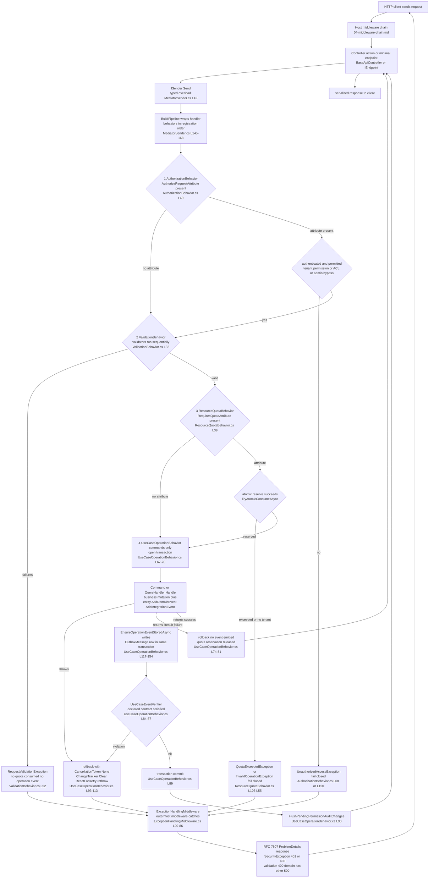

# CQRS Pipeline Anatomy — the behavior chain every request traverses

Audit base: `origin/develop` @ `43603cb5b` (2026-11-03). All paths relative to repo root; API sources live under `apps/api/Source/`.

## 1. What the "mediator" actually is

GameGuild does **not** use the MediatR NuGet package. It ships a home-grown, API-compatible
mediator in the SharedKernel (`GameGuild.CQRS` namespace, `apps/api/Source/Modules/GameGuild.SharedKernel/CQRS/`):

| Piece | File | Notes |
|---|---|---|
| Facade | `Modules/GameGuild.SharedKernel/CQRS/Implementation/Mediator.cs:9` | `IMediator = ISender + IPublisher`; splits into `MediatorSender` + `MediatorPublisher` |
| Dispatch | `Modules/GameGuild.SharedKernel/CQRS/Implementation/MediatorSender.cs:42-137` | Three `Send` overloads (typed, `Unit`, object/dynamic); all route through the same pipeline so behaviors always execute |
| Pipeline build | `Modules/GameGuild.SharedKernel/CQRS/Implementation/MediatorSender.cs:145-168` | `BuildPipeline` wraps the terminal handler with behaviors **in DI registration order — first registered = outermost** (loop at `:160-165` iterates backwards) |
| Behavior resolution | `Modules/GameGuild.SharedKernel/CQRS/Implementation/MediatorSender.cs:173-197` | Resolves `IEnumerable<IPipelineBehavior<TRequest,TResponse>>` from the service provider, so DI registration order is chain order |
| Behavior contract | `Modules/GameGuild.SharedKernel/CQRS/Abstractions/Pipeline.cs:8` | `IPipelineBehavior<in TRequest, TResponse>` where `TRequest : IRequestBase` |
| Registration API | `Modules/GameGuild.SharedKernel/CQRS/Extensions/ServiceCollectionExtensions.cs:46-75` | `AddCqrs(assemblies)` scans handlers/validators; `AddPipelineBehavior<TBehavior>` at `:250-271` |
| Perf | `Modules/GameGuild.SharedKernel/CQRS/Implementation/MediatorSender.cs:18-23` + `CQRS/Infrastructure/ExpressionTreeCompiler.cs` | `ConcurrentDictionary` caches + compiled expression trees → O(1) dispatch after first call |

Host wiring: `GameGuild.API/Core/Setup/ApplicationLayerExtensions.cs:133-145` calls
`services.AddCqrs(cqrsAssemblies)` over every **enabled module assembly** (module discovery at
`:110-128`, `ModuleAssemblyCatalog`), so one shared mediator instance dispatches all modules'
commands and queries. DI lifetimes (documented at `ServiceCollectionExtensions.cs:13-19`):
handlers `Transient`, validators `Scoped` (may take `DbContext`/`HttpContext`),
mediator `Scoped`, notification publisher `Singleton`.

Fail-closed dispatch extras:

- **Unavailable use-case handlers** — `ServiceCollectionExtensions.cs:77-111` registers
  `UnavailableCommandHandler<,>` stubs for commands whose assembly declares
  `[UseCaseEventContract(..., UnavailableReason = ...)]`. A command that a disabled module
  cannot serve resolves to a handler that fails explicitly instead of a DI resolution error.
- Missing handler → `InvalidOperationException` at `MediatorSender.cs:271-275` ("Handler not
  found for …") — fail-closed, no silent `null`.

## 2. The behavior chain (outermost → innermost)

Four `IPipelineBehavior<,>` registrations exist in the host. Their DI **registration order**
determines the chain; the cites below are where each registration executes during
`AddInfrastructureLayer` (`GameGuild.API/Core/Setup/InfrastructureLayerExtensions.cs`):

| # | Behavior | Registration cite | Position | What it does | Failure semantics |
|---|---|---|---|---|---|
| 1 | `AuthorizationBehavior<,>` | registered `Modules/GameGuild.Identity.Authorization/Extensions/AuthorizationModuleExtensions.cs:352` (inside `AddPermissionServices`, invoked from `InfrastructureLayerExtensions.cs:219`) | **outermost** — runs before validation | Honors `[AuthorizeRequest]` on the request type (typed resolution only, `Behaviors/AuthorizationBehavior.cs:55-58`); tenant-level capability check via `ActorContext.HasPermission` (`:145`), resource-level ACL check via `IAccessControlListService.HasAccessAsync` (`:136-139`), `RequireSystemAdmin`/`RequireTenantAdmin` flags (`:81-99`), system-admin bypass (`:72-75`) | **Fail-closed.** Unauthenticated → `UnauthorizedAccessException` (`:66-69`); unknown permission pattern → throws instead of defaulting the access level (`:228-231`); missing resource id → denied (`:118-120`); tenant context required for ACL checks (`:124-125`) |
| 2 | `ValidationBehavior<,>` | `InfrastructureLayerExtensions.cs:240` | second | Runs all FluentValidation validators **sequentially** (scoped services like `DbContext` are not thread-safe — `CQRS/Behaviors/ValidationBehavior.cs:24-27`); aggregates failures; throws `RequestValidationException` (`:50-54`) | **Fail-closed.** Any validation failure short-circuits before quota consumption and before the operation transaction opens. The ordering rationale is written at `InfrastructureLayerExtensions.cs:235-239`: invalid commands must not consume quotas nor emit operation events |
| 3 | `ResourceQuotaBehavior<,>` | `Modules/GameGuild.Resources/Extensions/ResourcesServiceCollectionExtensions.cs:20` (invoked as `AddResourceQuotaBehavior()` from `InfrastructureLayerExtensions.cs:241`) | third | For commands decorated `[RequiresQuota]`: atomically reserves quota **before** executing (`Behaviors/ResourceQuotaBehavior.cs:77-115` via `TryAtomicConsumeAsync`), advisory check when `RecordUsage=false` (`:141-159`), releases the reservation when the handler reports a failed `Result` (`:166-176`) or throws (`:193-225`) | **Fail-closed.** No tenant context → rejected (`:47-58`, prevents quota bypass); quota service unavailable → request rejected (`:226-241`) |
| 4 | `UseCaseOperationBehavior<,>` | `InfrastructureLayerExtensions.cs:242` | **innermost** — wraps only the handler | Commands only (`IsCommand` at `Core/Eventing/UseCaseOperationBehavior.cs:156-159`; queries pass straight through). Opens an EF execution-strategy + transaction (`:67-70`), runs the handler, rolls back on `Result` failure (`:74-81`), stages the `UseCaseOperationOccurredV1` outbox row **inside the same transaction** (`:83` + `EnsureOperationEventStoredAsync` `:117-154`), verifies the command's declared event contract (`:84-87`), flushes pending permission-audit snapshots after commit (`:90`), and on exception rolls back with `CancellationToken.None` so cleanup cannot be cancelled by the request's own cancellation (`:93-113`) | **Fail-closed with compensation.** Handler exception → rollback + `ChangeTracker.Clear()` + `operationContext.ResetForRetry()` then rethrow (`:106-112`); rollback failure is logged by error type only — authentication command data is never logged (`:104`) |

There is **no CQRS-level logging, idempotency, or retry behavior** registered:

- Logging/telemetry: `ObservabilityBehavior` exists (`CQRS/Behaviors/ObservabilityBehavior.cs:26`,
  logging + timing + slow-request warning threshold `ObservabilityOptions.WarningThresholdMs`,
  default 3000 ms) but is **never registered anywhere** — see `07-gaps.md` gap N1. HTTP-level
  observability is instead provided by `UseSerilogRequestLogging` and `CostTelemetryMiddleware`
  (see `04-middleware-chain.md`).
- Idempotency: handled outside the pipeline — Economy commands carry an `IdempotencyKey` value
  object (e.g. `GameGuild.API/Core/Controllers/EconomyBountiesController.cs:61`), and the
  SharedKernel's `IdempotencyMiddleware` is not wired into the host (gap N2).
- Retry: no behavior-level retry. Retries live at the outbox consumer layer (5 attempts,
  exponential backoff — `03-outbox-core.md`) and in EF Core execution strategies
  (`UseCaseOperationBehavior.cs:67`, `OutboxDispatcher.cs:48`).

Notification fan-out (the `Publish` half) is separate: `MediatorPublisher` +
`ForeachAwaitPublisher` default (`CQRS/Publishers/ForeachAwaitPublisher.cs`, chosen at
`ServiceCollectionExtensions.cs:63`), with `TaskWhenAllPublisher`/`NoWaitPublisher` available.

## 3. One request's full journey

Exception mapping detail (`Modules/GameGuild.SharedKernel/Middlewares/ExceptionHandlingMiddleware.cs:26-85`):
`SecurityException` → its declared status with a safe public message; `RequestValidationException`
→ 400 with the error list; `DomainException` → mapped 4xx; anything else → 500 with no internal
detail. Every branch checks `Response.HasStarted` first (`:35-39` etc.) — a response that already
streamed cannot be rewritten, so the middleware logs and returns instead of corrupting the stream.

## 4. Positional invariants (why this order)

1. **Authorization before validation** — an unauthorized caller must not be able to probe
   validation rules (error shapes reveal schema). Registration order enforces this because
   `AddPermissionServices` runs at `InfrastructureLayerExtensions.cs:219`, before the behaviors
   registered at `:240-242`.
2. **Validation before quota** — invalid input must not burn quota; explicit comment at
   `InfrastructureLayerExtensions.cs:235-239`.
3. **Validation before the operation transaction** — invalid commands emit **no** outbox
   operation event (the event is the audit/cost-accounting contract; emitting one for a rejected
   command would corrupt usage ledgers).
4. **Quota outside the transaction** — the reservation is a separate atomic counter
   (`TryAtomicConsumeAsync`) so concurrent requests cannot both pass a check-then-act window
   (`ResourceQuotaBehavior.cs:77-79`); the EF transaction only wraps business writes.
5. **Operation behavior innermost** — the transaction must open after all early-exit behaviors
   so rollbacks never cover authorization/validation/quota work.
