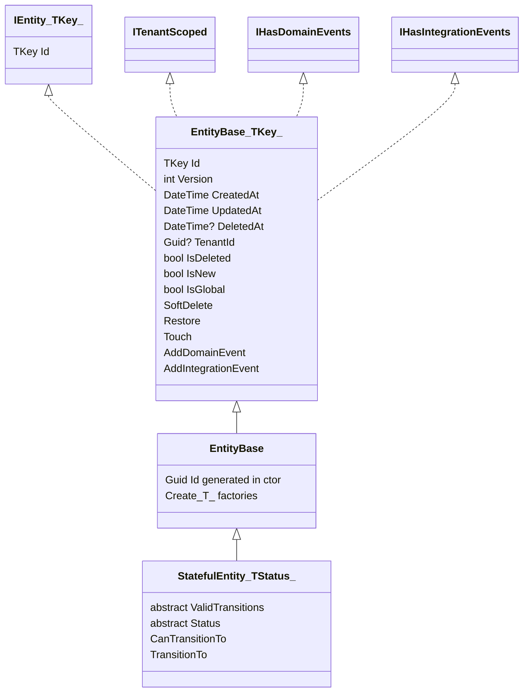

# EntityBase + the Soft-Delete Contract

Audit base: `origin/develop` @ `43603cb5b` (2026-11-03).

## 1. The EntityBase hierarchy

All entity types live in `apps/api/Source/Modules/GameGuild.SharedKernel/Entities/`.

### 1.1 EntityBase<TKey> — `Entities/EntityBase.cs:13`

| Member | Line | Contract |
|---|---|---|
| `Id` (key, identity) | `:52-54` | `[Key] [DatabaseGenerated(Identity)]`; setter public only for EF materialization |
| `Version` | `:61-62` | Optimistic concurrency via `[ConcurrencyCheck]` (portable across Postgres/SQLite/SQL Server — no rowversion dependency) |
| `CreatedAt` | `:68-69` | `[Required]`, defaults `SystemClock.UtcNow` |
| `UpdatedAt` | `:75-76` | Updated through `Touch()` (`:87`) — also bumped by `SetProperties` for non-`CreatedAt` changes (`:217-233`) |
| `DeletedAt` | `:82` | **The soft-delete marker.** `null` = live; non-null = soft-deleted at that instant |
| `TenantId` | `:123` | Nullable — `null` means platform-global (`IsGlobal`, `:30`) |
| `IsDeleted` | `:40` | Computed: `DeletedAt.HasValue` — no separate flag column to drift |
| `IsNew` | `:35` | `Version == 0` — not yet persisted |
| Domain events | `:42-46, 151-168` | In-memory `IDomainEvent` list; collected by `ApplicationDbContext` on save |
| Integration events | `:46, 160-166` | `IDurableIntegrationEvent` list; collected into the shared outbox on save (see `03-outbox-core.md`) |

### 1.2 SoftDelete / Restore — the mutation contract

- `SoftDelete()` (`Entities/EntityBase.cs:93-107`): idempotent (already deleted → no-op);
  **refuses to soft-delete an unpersisted entity** (`Version == 0` → `InvalidOperationException`,
  `:100-103`) — you cannot tombstone a row that does not exist; sets `DeletedAt` and `Touch()`es.
- `Restore()` (`:112-121`): idempotent inverse — clears `DeletedAt`, bumps `UpdatedAt`.
- Both go through the public surface only; there is no "hard delete" helper anywhere in the
  base — physical deletes are module-specific operational decisions (e.g. outbox retirement in
  `03-outbox-core.md`).

### 1.3 EntityBase (Guid) — `Entities/EntityBase.cs:241`

Client-GUID identity generated in the constructor (`EnsureIdGenerated`, `:264-270`) plus
`Create<T>(partial)` / `Create<T>()` factories (`:278-296`) that route property copying through
`EntityPropertyMapper` with the non-virtual constructor-safe path (`:185-203` — avoids virtual
member calls in constructors).

### 1.4 StatefulEntity<TStatus> — `Entities/StatefulEntity.cs:9`

Adds a declarative state machine over `EntityBase`: abstract `ValidTransitions` map (`:16`) and
`Status` (`:21`); `CanTransitionTo` (`:28-36`) and `TransitionTo` (`:43-57`) which throws
`InvalidStateTransitionException` on illegal moves, always `Touch()`es, and invokes the
`OnStatusChanged` hook (`:65-68`) where derived entities raise domain events.

## 2. The soft-delete convention across the schema

Measured on this tree (`docs/schema.dbml`):

- **550 tables** total; **364 `DeletedAt` columns** — roughly two thirds of the schema carries
  the soft-delete marker, inherited from `EntityBase` wherever a module maps an entity off the
  base class. (Earlier audits quoted ~351 live tables; the schema has grown — the durable
  statement is "the DeletedAt convention is the default, hard-delete tables are the exception".)
- **Query filters**: 31 `HasQueryFilter(...)` registrations referencing the soft-delete marker
  in module configurations, e.g. `Modules/GameGuild.Assets/Configuration/AssetLibraryConfiguration.cs:21,37`
  and `Modules/GameGuild.AI/Configuration/AiModelConfiguration.cs:34,57`. **Two predicate forms
  coexist**: `e => e.DeletedAt == null` and `e => !e.IsDeleted`
  (`Modules/GameGuild.Resources.Contents/Configuration/ContentVersionEntityConfiguration.cs:44`
  vs `:76` in the same file). Both compile to the same SQL given `IsDeleted` is computed, but the
  mixed style is a consistency hazard (see `07-gaps.md` gap N7).
- **Important consequence**: filters are per-entity opt-in, not global. A table can have
  `DeletedAt` (inherited) without a query filter — those entities return soft-deleted rows
  unless the query filters explicitly (the auth grant-load predicate is one place that does this
  by hand; see `docs/authorization/` for the authorization-package audit).

## 3. Partial-index strategy (post-#1177 / #1170)

Problem: a soft-delete convention means every "live rows" index carries dead rows forever, and
unique constraints must decide whether tombstones collide with live rows. The fix landed as
**filtered partial indexes** on hot tables:

- Migration `GameGuild.API/Database/Migrations/20261102054159_AddSoftDeletePartialIndexesHotTables.cs`
  adds **17 partial indexes** named `*_live`, each with `filter: "\"DeletedAt\" IS NULL"`,
  covering the hottest query paths, e.g.:
  - `ix_wallet_transactions_wallet_created_live` — `(WalletId, CreatedAt)` where live
  - `ix_user_notifications_user_created_live` — `(UserId, CreatedAt)` where live
  - `ix_testing_requests_status_created_live` — `(Status, CreatedAt)` where live
  - `ix_social_blog_posts_status_published_live` — `(Status, PublishedAt, Id)` where live
  - `ix_team_members_user_tenant_live` — `(UserId, TenantId)` where live
- Model-side, the same pattern is expressed with `HasFilter("\"DeletedAt\" IS NULL")` on unique
  indexes — e.g. `Modules/GameGuild.Identity.Users/Entities/UserNotificationConfiguration.cs:31`
  — so uniqueness is enforced **among live rows only**: a soft-deleted row never blocks
  re-creating the same natural key.
- The strategy pairs with the query filters from §2: the filter predicate (`DeletedAt IS NULL`)
  matches the index predicate, so the planner can actually use the partial index for the default
  read path. A module that uses `!IsDeleted` in C# still emits `DeletedAt IS NULL` SQL (computed
  property), which is why both forms remain planner-compatible today.

Rules of thumb extracted from the codebase:

1. Every new hot read path over a soft-deletable table gets a `*_live` partial index whose
   columns are exactly the filter+sort shape of the query.
2. Every natural-key unique constraint on a soft-deletable table uses `HasFilter` rather than a
   plain unique index, so tombstones don't collide.
3. `SoftDelete()` is the only tombstone writer; importers must not set `DeletedAt` by hand
   (they'd skip the `IsNew` guard and the `Touch`).

## 4. CSV / export locale hazard (invariant-culture gaps)

`UseRequestLocalization` (`GameGuild.API/Core/Setup/PipelineExtensions.cs:72`) sets the current
culture per request. Any export path that formats values with default interpolation therefore
emits **locale-dependent** output (a `pt-BR` request can produce `1.234,56` where the ingest
expects `1,234.56`). The codebase's discipline is currently mixed:

**Correct — explicit invariant everywhere:**

- `Modules/GameGuild.Compliance.Audit/Services/AuditCsvExporter.cs:11-27` — every column
  formatted with `CultureInfo.InvariantCulture` (`"D"` GUIDs, `"O"` timestamps).
- `Modules/GameGuild.Analytics/Queries/ProductMetricsQueries.cs:376` —
  `Convert.ToString(row.Value, CultureInfo.InvariantCulture)` for CSV numeric cells.
- `Modules/GameGuild.Compliance.Audit/Controllers/AuditController.cs:380,500-504,601-603` —
  invariant for filename stamps and pagination headers.

**Gaps — default-culture formatting remains:**

- `Modules/GameGuild.Assets/Queries/ExportAssetStatisticsQuery.cs:74` — CSV row built with bare
  `Append(metric).Append(',').Append(value)`; today's values are `long`s and `"O"` timestamps
  (`ToRows`, `:122`) which happen to be culture-stable, but the pattern silently breaks the
  moment someone adds a `decimal`/`double` metric.
- `Modules/GameGuild.AI/Controllers/AiController.cs:353` and `TenantAiController.cs:162` — CSV
  builders interpolate usage/token counts with default formatting.
- `Modules/GameGuild.Analytics/Queries/ProductMetricsQueries.cs:334` — export filename stamp
  `ToString("yyyyMMddHHmmss")` without an explicit culture (calendar-system sensitive in
  principle).

**Why tests call this out:** integration tests pin the invariant expectation — e.g.
`apps/api/tests/GameGuild.API.IntegrationTests/AuditExportPostgreSqlHttpTests.cs:400` constructs
the expected CSV with `new StringWriter(CultureInfo.InvariantCulture)`. An export path that
drifts to current-culture formatting passes under the CI locale and fails (or silently corrupts
ingests) under any other request locale. The audit exporter is the reference implementation;
new exports should copy its discipline. Tracked as gap N4 in `07-gaps.md`.
