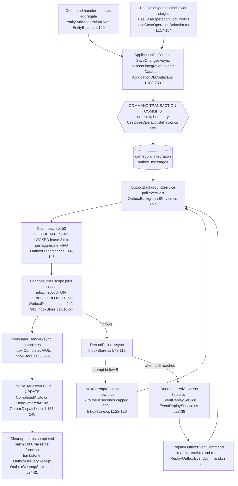

# Outbox Core — the shared durable-event transport

Audit base: `origin/develop` @ `43603cb5b` (2026-11-03). Host implementation:
`apps/api/Source/GameGuild.API/Core/Eventing/`. This document supersedes nothing — it is the
cross-cutting companion to `docs/auth/event-flows.md` (which audits the auth events riding this
transport with the same numbers).

## 1. Primitives

Two tables in the `gameguild.integration` schema (`GameGuild.API/Database/EventTransportModelConfiguration.cs:18`),
entities at `Core/Eventing/EventTransportEntities.cs`:

| Entity | Fields | Role |
|---|---|---|
| `OutboxMessage` (`EventTransportEntities.cs:3-22`) | `EventId` (PK), `TenantId`, `ActorId`, `EventName`, `EventType` (stable type name), `SourceModule`, `AggregateType`/`AggregateId`, `CorrelationId`/`CausationId`, `OccurredAtUtc`, `SchemaVersion`, `Payload` (serialized), `CreatedAtUtc`, `ClaimedUntilUtc`, `CompletedAtUtc`, `DeadLetteredAtUtc` | One durable integration event |
| `InboxReceipt` (`EventTransportEntities.cs:24-34`) | `(EventId, ConsumerName)` key, `AttemptCount`, `NextAttemptAtUtc`, `CompletedAtUtc`, `DeadLetteredAtUtc`, `LastError` (truncated 4000) | Per-consumer delivery tracking + retry state |
| `OutboxDeliveryReceipt` (`Core/Eventing/OutboxDeliveryReceipt.cs`) | tombstone of a retired delivery | Keeps audit evidence after cleanup deletes the payload |

Registration: `Core/Eventing/EventTransportServiceCollectionExtensions.cs:11-42`
(`AddDurableEventTransport`, invoked at `Core/Setup/InfrastructureLayerExtensions.cs:136`)
registers `TimeProvider.System`, the contract registry/verifier, the producer, all host bridge
consumers, `InboxStore`, `OutboxDispatcher`, `OutboxCleanupService`, `EventReplayService`, and
the `OutboxBackgroundService` hosted service.

**Write side (in-transaction):**

- `UseCaseOperationBehavior.EnsureOperationEventStoredAsync`
  (`Core/Eventing/UseCaseOperationBehavior.cs:117-154`) stages the generic
  `UseCaseOperationOccurredV1` row inside the command transaction.
- `ApplicationDbContext.SaveChangesAsync` (`GameGuild.API/Database/ApplicationDbContext.cs:183-230`)
  collects `IHasIntegrationEvents` entities' `IntegrationEvents` into `OutboxMessage` rows,
  deduplicates by `EventId`, and **rejects already-completed event ids** (replay guard).
- Direct producer: `IDurableEventProducer.RecordAsync` (`Core/Eventing/DurableEventProducer.cs:8-46`)
  for callers outside an entity aggregate (e.g. login alerts).
- Serialization/validation: `DurableEventSerializer` + `DurableIntegrationEventValidator`
  (stable type names, schema version, `[NonPersonalEventData]` PII gates).

**Read side (poll loop):**

| Mechanic | Value | Cite |
|---|---|---|
| Poll interval | **2 s** | `Core/Eventing/OutboxBackgroundService.cs:57` |
| Backlog drain | when a cycle dispatches a full batch, skip the delay | `OutboxBackgroundService.cs:44,55-58` |
| Batch size | **50** | `OutboxDispatcher.cs:16` (`internal const int BatchSize`) |
| Claim lease | **2 minutes** (`ClaimedUntilUtc`) | `OutboxDispatcher.cs:17` |
| Claim SQL | `FOR UPDATE SKIP LOCKED` in a transaction (Postgres path) | `OutboxDispatcher.cs:51-91` |
| FIFO | per aggregate: an event is claimable only if no earlier incomplete sibling exists for the same `(TenantId, AggregateType, AggregateId)` ordered by `(OccurredAtUtc, EventId)` | `OutboxDispatcher.cs:80-87` |
| Inbox gating | an event whose receipts are all complete/dead-lettered is not re-dispatched; a pending retry receipt delays the event until `NextAttemptAtUtc` | `OutboxDispatcher.cs:65-79` |
| Retry budget | **5 attempts** per consumer | `Core/Eventing/InboxStore.cs:8` (`MaxAttempts`) |
| Backoff | exponential `2^attemptCount` seconds, **capped at 900 s** | `InboxStore.cs:122-126` (`EventRetryPolicy.GetDelay`) |
| Dead letter | `InboxReceipt.DeadLetteredAtUtc` and, when every consumer is terminal with at least one DLQ, `OutboxMessage.DeadLetteredAtUtc` | `InboxStore.cs:108-111`, `OutboxDispatcher.cs:229-232` |
| Replay | `EventReplayService.ReplayAsync` (`Core/Eventing/EventReplayService.cs:39-101`) behind `ReplayOutboxEventCommand` (`Core/Eventing/ReplayOutboxEventCommand.cs:3-14`) — re-arms consumer receipts for one event/consumer | admin surface, CQRS command |
| Consumer isolation | each consumer runs in its own DI scope + transaction with an inbox `TryLockAsync` (`ON CONFLICT DO NOTHING` upsert then `FOR UPDATE SKIP LOCKED` select) | `OutboxDispatcher.cs:242-343`, `InboxStore.cs:10-64` |
| Finalization | serialized by `FOR UPDATE` on the parent row to survive expired-claim double-dispatch | `OutboxDispatcher.cs:190-211` |
| Cleanup | completed messages retired in batches of **1000** (`OutboxCleanupService.cs:9`), ≤8 batches / ≤500 ms per cycle (`OutboxBackgroundService.cs:28`), via the Postgres function `retire_completed_outbox_messages` which atomically writes delivery tombstones, deletes child receipts, then payloads | `OutboxCleanupService.cs:24-31` |
| Transport failure | dispatch-level exceptions (deserialize/handler-resolution) are recorded against the synthetic consumer `GameGuild.EventTransport` and follow the same 5-attempt/DLQ path | `OutboxDispatcher.cs:345-375` |

A non-Postgres (InMemory/test) fallback exists for every SQL path (`OutboxDispatcher.cs:93-133`,
`InboxStore.cs:36-53`, `OutboxCleanupService.cs:33-92`) — same semantics without `SKIP LOCKED`,
so integration tests can run the real loop.

## 2. Module census — who reuses the shared outbox vs hand-rolls

**Reusers (events flow through `gameguild.integration.outbox_messages`):**

| Consumer/producer | Cite |
|---|---|
| All auth durable events (`NewLoginDetectedV1`, `SuspiciousLoginDetectedV1`, `RefreshTokenReplayContainedV1`, `AccountLockoutDetectedV1`, `SessionEvictionDetectedV1`, `NewDeviceSignInDetectedV1`, `UserCreatedEvent`, `UseCaseOperationOccurredV1` for every contracted command) | `docs/auth/event-flows.md` §2; handlers registered `EventTransportServiceCollectionExtensions.cs:18-32` |
| Billing wallet credit on paid invoices (`BillingInvoicePaidV1`) | `EventTransportServiceCollectionExtensions.cs:35` |
| Commerce.Billing operational reads over the shared outbox (`IBillingOutboxEventReader`) | `GameGuild.API/Core/Integration/BillingOutboxEventReader.cs:68-81` reads `OutboxMessage`/`InboxReceipt` directly |
| Certificate EVM anchoring (`CertificateEvmAnchorRequestedV1` / `CertificateEvmRevocationRequestedV1`) | `GameGuild.API/Core/Integration/CertificateEvmOutboxServiceRegistration.cs:28-36` (producer + consumers composed host-side) |

**Hand-rolled (module-local queues with their own claim loops, NOT the shared retry/DLQ/replay):**

| # | Queue | Cite | Notes |
|---|---|---|---|
| 1 | `economy_marketplace_outbox` | `Modules/GameGuild.Finance.Economy.Marketplace/Persistence/MarketplaceModelConfiguration.cs:331` + `PostgreSqlMarketplaceOutboxProcessor.cs` | own processor; dispatch claims guarded by migration `20260825014847_AddMarketplaceOutboxDispatchClaims` |
| 2 | `economy_payout_dispatch_outbox` | `Modules/GameGuild.Finance.Economy.Payouts/PostgreSqlPayoutDispatchOutbox.cs:172-200` | raw SQL `SELECT … FOR UPDATE SKIP LOCKED` + `UPDATE` |
| 3 | `economy_admin_withdrawal_dispatch_outbox` | `Modules/GameGuild.Finance.Economy.Treasury/PostgreSqlAdminWithdrawalDispatchOutbox.cs:196` | same shape as #2 |
| 4 | `economy_ad_reward_pending_claims` | `Modules/GameGuild.Finance.Economy.AdRewards/Persistence/AdRewardsModelConfiguration.cs:333`; duplicate-guard migration `20260825201500_PreventDuplicateAdRewardOutbox` | outbox-shaped claim table drained by `DurableAdRewardCompletionService` |
| 5 | `economy_bounties` work queue | `Modules/GameGuild.Finance.Economy.Bounties/DurableBountyExpirationWorkflow.cs:57-93` | `FOR UPDATE SKIP LOCKED` over the bounty table itself — expiration claims rows directly, no dedicated outbox table |
| 6* | Learning.Assessments academic outbox | `Modules/GameGuild.Learning.Assessments/Grading/Persistence/AcademicOutbox.cs:34,81,209` (`AcademicOutboxWriter`/`Dispatcher`/`BackgroundService`) | module-local academic delivery queue — the one non-Economy hand-roll |

\* The Economy family's five are the canonical "hand-rolled 5"; the academic outbox is the
sixth module-local queue found by this audit.

**Gaps created by the split** (detail in `07-gaps.md` N6):

- The hand-rolled queues duplicate claim/lease/FIFO mechanics but **not** the retry budget,
  backoff cap, dead-letter bookkeeping, or the replay command — each has its own (smaller)
  failure story; there is no `ReplayOutboxEventCommand` equivalent for them.
- Operational dashboards reading `gameguild.integration` see only shared-transport health;
  Economy queue depth is invisible there.

## 3. Lifecycle of one durable event

