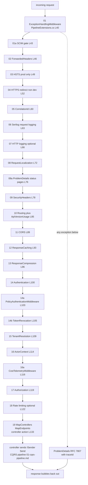

# Host Middleware Chain — the full Use order

Audit base: `origin/develop` @ `43603cb5b` (2026-11-03). The entire chain is configured in one
method: `ConfigurePipeline` — `apps/api/Source/GameGuild.API/Core/Setup/PipelineExtensions.cs:33-188`,
reached from `Program.cs:117` → `ApiHostLifecycle.RunAsync`
(`Core/Setup/ApiHostLifecycle.cs:15-20`) → `configuredApp.ConfigurePipeline()`.

## 1. The actual order

| # | Middleware | Registration cite | Guarantees |
|---|---|---|---|
| 01 | `ExceptionHandlingMiddleware` | `PipelineExtensions.cs:40` | Outermost catcher; every unhandled exception becomes RFC 7807 `ProblemDetails` (`Modules/GameGuild.SharedKernel/Middlewares/ExceptionHandlingMiddleware.cs:26-85`); `Response.HasStarted` guarded per branch |
| 01a | SCIM feature gate | `PipelineExtensions.cs:43` | `/scim` routes 404 unless `Scim:Enabled` |
| 02 | `UseForwardedHeaders` | `PipelineExtensions.cs:46` | Proxy/LB `X-Forwarded-*` honored; must precede anything that reads the remote IP (rate limiting, geolocation) |
| 03 | HSTS | `PipelineExtensions.cs:49` (`ConfigureHsts` `:279-285`) | Production only |
| 04 | HTTPS redirection | `PipelineExtensions.cs:52-57` | Non-dev; gated by `ShouldRedirectToHttps` (`:276-277`) — loopback and `/health`,`/ready`,`/live` exempt so probes never redirect |
| 05 | `UseCorrelationId` | `PipelineExtensions.cs:60` | Reads/generates `X-Correlation-Id` (`Modules/GameGuild.SharedKernel/Middlewares/CorrelationIdMiddleware.cs`) |
| 06 | `UseSerilogRequestLogging` | `PipelineExtensions.cs:63` | Structured request/response logs with enrichment — the real HTTP-level observability layer |
| 07 | `UseHttpLogging` | `PipelineExtensions.cs:66-69` | Only when `PresentationLayer:EnableHttpLogging` |
| 08 | `UseRequestLocalization` | `PipelineExtensions.cs:72` | Culture/language resolution — sets request culture (see the CSV hazard, `02-entity-softdelete.md` §4) |
| 08a | `UseProblemDetailsStatusCodePages` | `PipelineExtensions.cs:76` (`:255-274`) | Empty error status codes (routing 404s, minimal-API results) rendered by the same ProblemDetails writer as exceptions |
| 09 | Security headers | `PipelineExtensions.cs:78-82` | `X-Content-Type-Options`, `X-Frame-Options`, CSP, `Referrer-Policy` from `SecurityHeadersOptions` (validated before use) via `Modules/GameGuild.SharedKernel/Middlewares/SecurityHeadersMiddleware.cs` |
| 10 | `UseRouting` + `ApiVersionUsageMiddleware` | `PipelineExtensions.cs:85-86` | Endpoint matching before auth (required); API-version usage telemetry |
| 11 | `UseCors` | `PipelineExtensions.cs:89` | After routing so named policies can match endpoints |
| 12 | `UseResponseCaching` | `PipelineExtensions.cs:93` | In-code warning at `:92`: JWT + multi-tenant demands correct `Vary` headers or restriction to public endpoints |
| 13 | `UseResponseCompression` | `PipelineExtensions.cs:96` | gzip/brotli |
| 14 | `UseAuthentication` | `PipelineExtensions.cs:100` | Identifies the user from JWT/cookies — the principal everything below depends on |
| 14a | `PolicyAuthenticationMiddleware` | `PipelineExtensions.cs:103` | Explicit/static policy schemes resolve to the **same principal** used by revocation, tenant membership and actor checks (`GameGuild.API/Core/Security/PolicyAuthenticationMiddleware.cs`) |
| 14b | `UseTokenRevocation` | `PipelineExtensions.cs:105` | Rejects revoked JWT state **before** it can establish tenant membership or an actor (extension `Modules/GameGuild.Identity.Authentication/Middleware/TokenRevocationMiddlewareExtensions.cs:23`) |
| 15 | `UseTenantResolution` | `PipelineExtensions.cs:109` | Tenant from header > domain > query > route > authenticated claim > anonymous default; validates authenticated membership, hence the explicit dependency on authentication (`Modules/GameGuild.Identity.Tenants/Middleware/TenantMiddleware.cs:439`) |
| 16 | `UseActorContext` | `PipelineExtensions.cs:114` | Immutable `ActorContext` from claims + tenant (`Modules/GameGuild.Identity.Authorization/Extensions/ActorContextExtensions.cs:41`); must precede authorization because policy handlers read it |
| 16a | `CostTelemetryMiddleware` | `PipelineExtensions.cs:116` | Wraps the endpoint in cost telemetry; emits `ApiRequestMeasuredEventV1` in a `finally` with a bounded independent write (`GameGuild.API/Core/CostAccounting/CostTelemetryMiddleware.cs:14-60+`) |
| 17 | `UseAuthorization` | `PipelineExtensions.cs:119` | Endpoint policy enforcement over the fully built context |
| 18 | Rate limiting | `PipelineExtensions.cs:122-130` | Conditional on `PresentationLayer:EnableRateLimiting`: `RateLimitAccessControlMiddleware` (deny-list 403s first, `GameGuild.API/Core/Middleware/RateLimitAccessControlMiddleware.cs:12-35`) → `UseRateLimiter` → optional `RedisEndpointRateLimitingMiddleware` when `Redis:Enabled` |
| 19+ | `MapControllers` / GraphQL (opt-in, `RequireAuthorization`) / `MapEndpoints` / Swagger (dev+staging) | `PipelineExtensions.cs:133-185` | Terminal endpoint mappings |

## 2. The chain as a picture

## 3. Ordering hazards — what each adjacency protects

1. **ExceptionHandling outermost** — if any middleware below throws (including auth
   middleware), the client still gets RFC 7807, not a Kestrel 500 stack. Swapping it later in
   the chain leaks framework error pages for everything above it.
2. **ForwardedHeaders before IP consumers** — rate limiting and geolocation read the client
   IP; without `:46` first they see the proxy address and throttle/locate the proxy.
3. **Localization before ProblemDetails-writers and controllers** — error messages and any
   culture-sensitive formatting resolve against the request culture; see the CSV invariant
   hazard (`02-entity-softdelete.md` §4) for where that bites.
4. **Routing before auth** — `[Authorize]` metadata is endpoint metadata; authorizing before
   routing authorizes against "no endpoint" and fails every request.
5. **Authentication → PolicyAuthentication → TokenRevocation → Tenant → ActorContext → Authorization**
   — the security-critical spine, with in-code comments at `PipelineExtensions.cs:98-113`:
   - *TokenRevocation after authentication but before tenant/actor*: a revoked token must not
     be able to materialize a tenant membership or an `ActorContext` — otherwise revocation
     would only bite at policy evaluation, leaving tenant-scoped work observable.
   - *Tenant after authentication*: tenant resolution validates authenticated membership, so it
     needs the `ClaimsPrincipal` first.
   - *ActorContext after tenant*: built from claims **plus** tenant; earlier placement builds it
     with a null tenant (fail-everything) or, worse, without membership validation.
   - *Authorization after ActorContext*: policy handlers read `ActorContext`; earlier placement
     evaluates policies against an incomplete context.
   This exact order is also encoded as a runtime guard —
   `Modules/GameGuild.Identity.Context/Middleware/MiddlewareOrderValidator.cs:33-106` throws
   with fix messages for each violation. **However, that validator is never invoked by the
   host** (referenced only in XML docs at `IdentityContextModule.cs:44-55`) — see gap N3.
6. **Rate limiting AFTER authorization** (actual order, `:122` vs `:119`) — deliberate
   authenticated throttling: limits key on user/tenant identity, so abusers are throttled as
   themselves and anonymous endpoints (sign-in, webhooks) still get per-IP limiter partitions.
   The trade-off: an unauthenticated flood reaches the authentication machinery (JWT signature
   validation, token-store lookups) before any limiter rejects it. Mitigations in-tree: the
   deny-list middleware (`RateLimitAccessControlMiddleware`) runs first inside the block, and
   guest issuance is strictly per-IP rate limited (`AnonymousEndpointRegistry` entry for
   `GuestSessionController.Issue`). Moving rate limiting **before** authentication instead
   would throttle unauthenticated floods but make per-user limits impossible (all anonymous
   keys collapse into IP buckets shared behind NATs).
7. **ResponseCaching after CORS/auth-adjacent middleware but before auth** — with JWTs and
   multi-tenancy the in-code warning (`:92`) flags the classic hazard: a cached response keyed
   without tenant/user variance serves one user's data to another. Only public anonymous
   endpoints (`AnonymousEndpointRegistry` catalog surface) may rely on it.
8. **CostTelemetry between ActorContext and Authorization** — it needs the actor for
   attribution but wraps the endpoint execution (including authorization outcomes) so the
   measured status code reflects the final one; its `finally` bounded write means a telemetry
   outage cannot take requests down.

## 4. Stub / orphan history — and the guard

History: the wiring-gap guards were introduced after dead wiring was found in production code
(#1154 dead `LogoutCommand`, #1158 configs without tables, #1180 ABAC header stubs, #1182
single-producer events, #1184 dead configs/events/options). Today `apps/api/tests/GameGuild.API.UnitTests/Architecture/wiring-gap-baseline.txt`
ratchets six guards (G1–G6):

- **G6 — no-op stub middleware** (`Architecture/StubMiddlewareGuardTests.cs:26-80`): a Roslyn
  shape check flags any `Invoke`/`InvokeAsync` body with <4 statements that neither calls
  `next` nor writes a response — registered dead weight that hangs or silently falls through.
  The baseline currently lists **zero** G6 entries: no known no-op middleware remains. The ABAC
  header-stub copies that *do* forward to `next()` are deliberately out of G6's crude scope and
  tracked by #1180.
- Orphan middleware that *does* full work but is never wired is a different failure mode G6
  cannot see. Two such cases exist today and are documented as gaps N2/N3:
  `IdempotencyMiddleware` (SharedKernel, complete implementation, zero host call sites —
  `Modules/GameGuild.SharedKernel/Middlewares/IdempotencyMiddleware.cs:31`, extension `:220`)
  and `MiddlewareOrderValidator` (complete, zero invocations).
