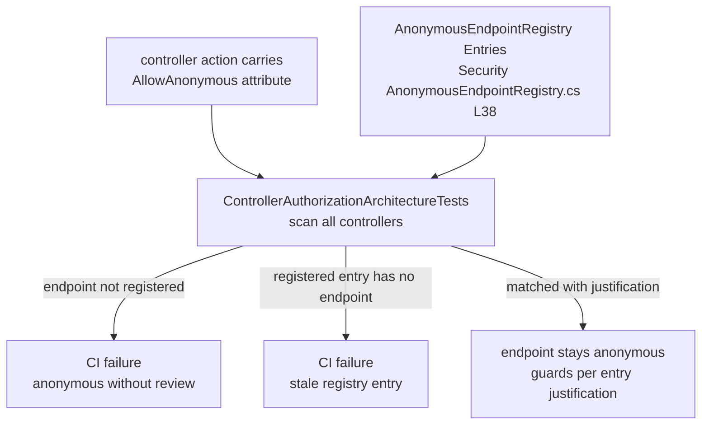

# Security Primitives — hashing, redaction, DataProtection, secrets, anonymous surface

Audit base: `origin/develop` @ `43603cb5b` (2026-11-03).

## 1. Password hashing (BCrypt parameters)

`Modules/GameGuild.Identity.Authentication/Services/PasswordHasher.cs`:

- **Work factor: default 12, hard-bounded [10, 16]** — resolved on *every* operation so
  configuration reloads cannot drift (`ResolveBCryptWorkFactor`, `Services/PasswordHasher.cs:34-44`),
  reading `PresentationLayer:Authentication:PasswordPolicy:BCryptWorkFactor` (plus two legacy
  locations) before falling back to `12`. Out-of-range values throw
  `InvalidOperationException` — you cannot silently weaken hashing via config.
- **Stored-hash shape is validated** before verification: `\$2[abxy]\$` with cost `04`–`16` and
  53 base64-ish chars (`BcryptHashPattern`, `:27-29`, non-backtracking culture-invariant regex).
  Malformed/unsupported/weak hashes route to rehash-on-login upgrade paths rather than plain
  verify (`Abstractions/IPasswordHasher.cs:38`).
- **Long passwords use versioned full-length PBKDF2** — BCrypt truncates at 72 bytes, so the
  hasher selects the algorithm by UTF-8 byte length (`Abstractions/IPasswordHasher.cs:6-11`).
- **Timing equality for unknown users** — `Abstractions/AuthenticationTiming.cs` performs an
  equivalent dummy BCrypt verification at the configured work factor so "no such user" costs
  the same as a failed verify (user-enumeration protection).
- Legacy callers hash with the same library directly
  (`GameGuild.API/Database/PlatformIdentitySeeder.cs:98,118` for the seeded platform admin).

## 2. Token hashing

`Modules/GameGuild.Identity.Authentication/Services/RefreshTokenHasher.cs`:

- Refresh/session/magic-link/recovery tokens are **SHA-256 hashed before storage**; verify
  re-hashes and compares (`Services/RefreshTokenHasher.cs:47-60`).
- The rationale is documented at `:17-22`: tokens are high-entropy random strings (unlike
  passwords), so a fast hash is sufficient — slow hashing would only add latency to every
  refresh. The same interface pattern (`IAccountRecoveryStore`, `IMfaRecoveryRequestStore`,
  `ITrustedContactStore`, …) stores only digests.

## 3. LogRedaction

`Modules/GameGuild.SharedKernel/Diagnostics/LogRedaction.cs`:

- **Process-local random key** (32 bytes, `:15`) — fingerprints correlate events within one
  process only, never across hosts or restarts.
- `ProtectIdentifier` (`:18-29`) — keyed HMAC-style fingerprint for GUID/string identifiers
  (normalizes alternate GUID forms first).
- `RedactId(Guid?/string?, prefix)` (`:42-65`) — first 8 hex chars of **unkeyed** SHA-256 with
  a prefix (`tid:…`, `uid:…`); deterministic for cross-line correlation, irreversible.
- `ProtectContact` (`:75+`) — opaque keyed fingerprint for emails; no address characters,
  domain suffixes or lengths reach the output; `"none"`/`"invalid"` sentinels.
- `Sanitize` — used on every path/message that reaches exception logs
  (`Middlewares/ExceptionHandlingMiddleware.cs:31,47,62`).
- Consumers use it on **log call sites**, not via a logging pipeline enrichment — discipline is
  per-call-site (the exception middleware and idempotency middleware are the reference users).

## 4. DataProtection with a certificate

`GameGuild.API/Core/Setup/DataProtectionStartupConfiguration.cs` — wired first thing in
`Program.cs:28`, before any other service:

- **Env-only, fail-fast**: both `DATAPROTECTION_CERTIFICATE_BASE64` and
  `DATAPROTECTION_CERTIFICATE_KEY_BASE64` must be present or the process refuses to start
  (`:53-58`). Comment at `:32-34`: an unavailable key must never silently select plaintext —
  this holds for Development and CI too.
- **Certificate validation** (`:60-73`): PEM-decoded via `X509Certificate2.CreateFromPem`;
  rejected unless RSA ≥ 2048 bits and the validity window straddles now. Invalid/unusable
  material throws a dedicated `InvalidOperationException` (`:75-80`).
- Keys are persisted through `CertificateProtectedKeyRepository`
  (`Core/Setup/CertificateProtectedKeyRepository.cs`), installed as the `XmlRepository`
  (`:38-43`), with `ProtectKeysWithCertificate(certificate)` (`:37`) and a stable
  `SetApplicationName` for shared-key rings across replicas.

## 5. Env-only secret conventions (Mimosa constraints)

The repo convention enforced across providers: **credentials are read from the environment
only — never from configuration files.** Examples:

- WhatsApp Business API: `WHATSAPP_APP_ID` / `WHATSAPP_PHONE_NUMBER_ID` / `WHATSAPP_ACCESS_TOKEN`
  via `WhatsAppCredentials.FromEnvironment()`, with the no-op default failing closed
  (`Program.cs:79-95`).
- DataProtection cert (§4) is environment-only by construction.
- Twilio SMS and FCM push follow the same fail-closed port pattern: no-op senders that decline
  every send when unconfigured, so notification rows retry → dead-letter instead of pretending
  to deliver (`Program.cs:50-77`).

Operational corollary (from the fleet brief): booting the API needs the three connection
strings **plus** the two DataProtection env vars; missing any of the five is a startup failure
by design.

## 6. AnonymousEndpointRegistry — the reviewed public-surface contract

`GameGuild.API/Security/AnonymousEndpointRegistry.cs:27`:

- **What it is**: the host-side allowlist of every intentionally anonymous endpoint, keyed
  `Controller.Action` or `Controller.*` (whole-controller), each with a one-line justification
  (`Entries`, `:38-226`). ~150 entries grouped: infrastructure probes (health, metrics,
  versioning), auth entry points (all sign-in/MFA/recovery/OAuth/SAML/Web3 ceremonies), public
  catalog/marketing reads (published-only content), public community reads, mentorship/blog,
  intake forms, asset delivery (signed expiring tokens), provider webhooks (signature verified
  inside the handler), LTI protocol entries, and token-based self-service (unsubscribe).
- **The contract**: the controller-authorization architecture tests
  (`apps/api/tests/GameGuild.API.UnitTests/Architecture/ControllerAuthorizationArchitectureTests.cs`)
  fail on any `[AllowAnonymous]` endpoint **not** registered, and on any registered entry whose
  endpoint no longer exists (`AnonymousEndpointRegistry.cs:10-16`). The registry therefore
  cannot rot: deleting an action without deleting its entry fails CI, and adding an anonymous
  action without a justification fails CI.
- **"Anonymous is not unguarded"** (`:22-25`): most entries delegate the real decision to a
  signed/expiring token, a provider signature, or a published-only status filter — the registry
  documents *which* for each entry.

