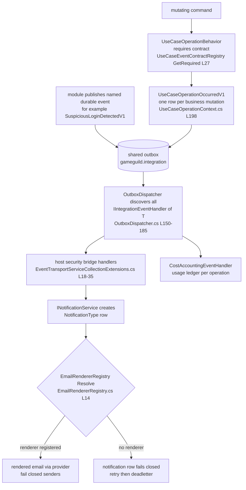

# Event / Bridge Registries — host security bridge, renderer registry, UseCaseOperationOccurredV1

Audit base: `origin/develop` @ `43603cb5b` (2026-11-03).

## 1. The host-side security bridge

Modules must not reference each other; cross-module reactions to durable events are composed
**host-side**. The bridge is a plain DI registration list in
`GameGuild.API/Core/Eventing/EventTransportServiceCollectionExtensions.cs:11-42`
(`AddDurableEventTransport`, invoked at `Core/Setup/InfrastructureLayerExtensions.cs:136`):

| Durable event | Host bridge handler | Registered at | Effect |
|---|---|---|---|
| `RefreshTokenReplayContainedV1` | `Core/Security/RefreshTokenReplayAlertHandler.cs:14` | `:18` | critical `NotificationType.Security` row + audit |
| `SuspiciousLoginDetectedV1` | `Core/Security/SuspiciousLoginAlertHandler.cs:22` | `:19` | urgent owner alert email |
| `SuspiciousLoginDetectedV1` (second consumer) | `Core/Security/RiskEventSessionRevocationHandler.cs:52` | `:20` | revokes sessions + all user tokens, audits |
| `AccountLockoutDetectedV1` (#1083) | `Core/Security/AccountLockoutAlertHandler.cs` | `:23` | lockout reason + unlock timeline email |
| `SessionEvictionDetectedV1` (#1086) | `Core/Security/SessionEvictionAlertHandler.cs` | `:26` | concurrent-session-limit eviction notice |
| `NewDeviceSignInDetectedV1` (#1085) | `Core/Security/NewDeviceSignInAlertHandler.cs` | `:29` | first-seen-device sign-in alert |
| `NewLoginDetectedV1` (#278) | `Core/Security/NewLoginAlertHandler.cs:33` | `:32` | opt-in (default off) sign-in notice, preference evaluated host-side fail-closed |
| `BillingInvoicePaidV1` (#406) | host billing wallet credit | `:35` | idempotent wallet credit per provider event id |

The pattern: the module publishes a durable event into the shared outbox (see
`03-outbox-core.md`); the **host** registers `IIntegrationEventHandler<T>` implementations that
call into other modules' public services (`INotificationService`, billing wallets). The
dispatcher discovers handlers generically (`OutboxDispatcher.DispatchAsync:150-185`), dedupes
by type full name, and delivers per consumer with inbox receipts — so adding a reaction is a
one-line host registration with full retry/DLQ/replay semantics for free.

## 2. Notification renderer registry

Notifications owns a parallel registry for **rendering**: one `IEmailRenderer` per
`NotificationType`.

- Contract: `Modules/GameGuild.Notifications/Services/Email/IEmailRenderer.cs` +
  `IEmailRendererRegistry.cs`.
- Registry: `EmailRendererRegistry` (`Services/Email/EmailRendererRegistry.cs:5-15`) — built
  from DI-registered renderers into a `Dictionary<NotificationType, IEmailRenderer>`; unknown
  types resolve to `null` (the dispatcher then fails that notification row closed rather than
  sending a blank email).
- Consumers: `EmailDispatcherService` (`Services/Email/EmailDispatcherService.cs`) resolves per
  row; module registration in `NotificationsModule.cs`.
- Extension pattern: Commerce.Billing and Commerce.Subscriptions contribute renderers from
  their own assemblies (`Modules/GameGuild.Commerce.Billing/Services/Email/Renderers/InvoiceIssuedEmailRenderer.cs`,
  `TrialWillEndEmailRenderer.cs`; `Modules/GameGuild.Commerce.Subscriptions/Services/Email/Renderers/MonthlyStatementRenderer.cs`)
  — the same "modules contribute, host/module registry composes" shape as the event bridge.

## 3. UseCaseOperationOccurredV1 — the generic operation contract

- Event record: `Modules/GameGuild.SharedKernel/Events/UseCaseOperationContext.cs:198-204` —
  `platform.use-case-operation.occurred.v1`, `SourceModule = "Platform"`, payload is just
  `[NonPersonalEventData] string OperationCode` + `CommandType` (PII-free by construction).
- Emission: for **every mutating command**, `Core/Eventing/UseCaseOperationBehavior.cs:134`
  stages one row when the command observed a business mutation
  (`EnsureOperationEventStoredAsync`, `:117-154`); `ApplicationDbContext.cs:262` is the
  save-time collector hook.
- Consumer: Resources cost accounting records an internal usage-ledger entry per operation
  (`Modules/GameGuild.Resources/CostAccounting/CostAccountingEventHandler.cs:20-21`, registered
  `Modules/GameGuild.Resources/Extensions/DependencyInjectionInfrastructure.cs:149`).

### 3.1 The contract registry that governs it

`Core/Eventing/UseCaseEventContractRegistry.cs` (registered singleton at
`EventTransportServiceCollectionExtensions.cs:15`):

- Every assembly-level `[UseCaseEventContract(typeof(XCommand), "operation-code", …)]`
  attribute across `GameGuild.*` assemblies is loaded into a `ConcurrentDictionary`
  (`:13-24, 55-75`).
- **A mutating command without a contract is a runtime error** — `GetRequired` throws
  (`:27-34`), so `UseCaseOperationBehavior` cannot silently skip the operation event.
- Validation at load: no duplicate contracts per command (`:57-61`), non-empty operation code
  (`:63-67`), and each contract must declare expected event types, conditional event types, or
  an explicit `NoDomainEventReason` (`:69-73`).
- `IUseCaseEventVerifier` (`Core/Eventing/`, registered `:16`) cross-checks the declared
  contract against what the command actually emitted inside the transaction
  (`UseCaseOperationBehavior.cs:84-87`).
- **Scale**: **1,161 contracts** declared platform-wide on this tree — 258 hand-written
  `[UseCaseEventContract(typeof…)]` attributes plus 903 generated
  `[assembly: global::GameGuild.UseCaseEventContractAttribute(typeof…)]` lines across 45
  generated `UseCaseEventContracts.g.cs` files (e.g. the host's own
  `GameGuild.API/Architecture/UseCaseEventContracts.g.cs:2` for `ReplayOutboxEventCommand` →
  `api.replay-outbox-event`). The auth slice is 164: 58 in
  `Modules/GameGuild.Identity.Authentication/Architecture/AuthenticationUseCaseEventContracts.cs`
  + 3 in `StepUpEventContracts.cs` + 103 in that module's generated
  `UseCaseEventContracts.g.cs`. (`docs/auth/event-flows.md` quotes "~65 contracted auth
  commands" — that audit counted the hand-written set at its base commit; the generated set
  has since grown.)
- Unavailable-module commands additionally resolve to fail-closed handler stubs through the
  same attribute (`UnavailableReason`, wired at
  `Modules/GameGuild.SharedKernel/CQRS/Extensions/ServiceCollectionExtensions.cs:77-111`).

## 4. How the three registries compose

In one sentence: the **contract registry** guarantees every command's observability event
exists, the **host bridge registrations** give cross-module reactions delivery guarantees, and
the **renderer registry** maps notification types to module-contributed templates — three
ratchets that make "silently missing wiring" a load-time or CI failure instead of a runtime
surprise.
