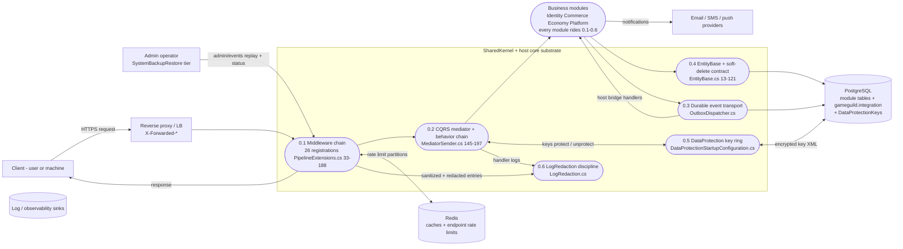
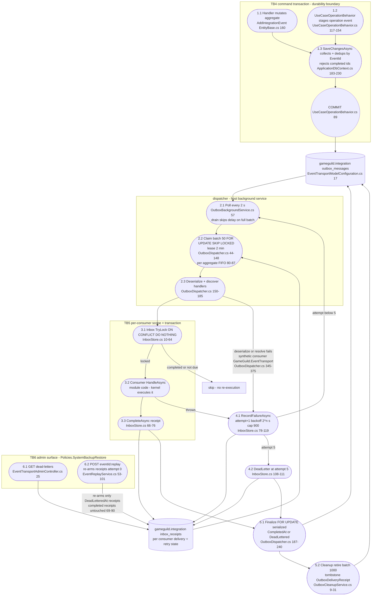
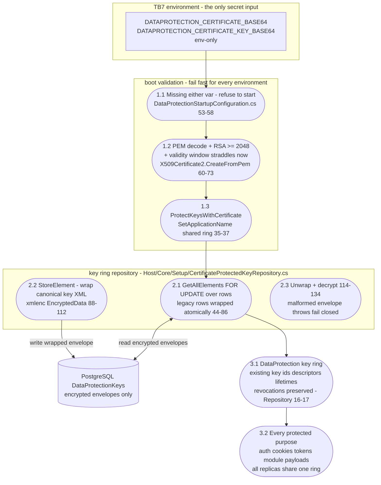

# SharedKernel Data Flow Diagrams — the substrate every module sits on

> Surfaces: `GameGuild.SharedKernel` + API host core (`apps/api/Source/GameGuild.API/Core/`) · Documented against `origin/develop` @ `ce31d5850c` (2026-11-05); docs 01–07 were cut at `43603cb5b` and their cites re-verified at this base.
> Level-0 (the kernel as substrate) plus the three commissioned level-1 DFDs: **one request's full journey** through all 26 middleware registrations and the CQRS behavior chain, **the outbox write→lease→dispatch→DLQ→replay flow**, and **the DataProtection key derivation chain**. Notation follows `docs/authorization/08-dfds.md`: external entities as rectangles, processes as stadiums, stores as cylinders, trust boundaries as subgraphs. STRIDE cross-reference: each flow's threat analysis lives in [`08-stride-threat-model.md`](08-stride-threat-model.md) (trust boundaries TB1–TB8 defined there §1).
> Path convention: `file:line` relative to `apps/api/Source/`. `SK/` = `Modules/GameGuild.SharedKernel/`, `Host/` = `GameGuild.API/`.

## 1. Level 0 — the kernel as substrate

Trust boundaries (definitions and STRIDE analysis in `08-stride-threat-model.md` §1): TB1
proxy→host edge, TB2 middleware→pipeline, TB3 behavior↔request, TB4 transaction→outbox, TB5
dispatcher→consumer code, TB6 DLQ↔replay admin, TB7 key material↔DB/env, TB8 process→log sinks.

## 2. Level 1 — one request's full journey (26 middleware steps as trust boundaries)

Every request traverses the same 26 registrations before it reaches a controller action; the
numbering below is the `Use` order in `Host/Core/Setup/PipelineExtensions.cs` (conditional steps
marked ⚙). The bands are the trust boundaries: what a request has *not yet* established when it
passes each band is the security meaning of the order (`04-middleware-chain.md` §3).

```mermaid
flowchart TD
    IN["incoming request"] --> S01

    subgraph EDGE["TB1 edge band - untrusted input"]
        S01["01 ExceptionHandlingMiddleware<br/>PipelineExtensions.cs 40"]
        S02["01a SCIM feature gate 43"]
        S03["02 ForwardedHeaders 46"]
        S04["03 HSTS 49 prod only"]
        S05["04 HTTPS redirect 52-57 non dev"]
    end

    subgraph OBS["observability + localization band"]
        S06["05 CorrelationId 60"]
        S07["06 Serilog request logging 63"]
        S08["07 HttpLogging 66-69 optional"]
        S09["08 RequestLocalization 72"]
        S10["08a ProblemDetails status pages 76"]
    end

    subgraph HARD["hardening band - still unauthenticated"]
        S11["09 SecurityHeaders 78-82"]
        S12["10 UseRouting 85"]
        S13["10b ApiVersionUsageMiddleware 86"]
        S14["11 CORS 89"]
        S15["12 ResponseCaching 93"]
        S16["13 ResponseCompression 96"]
    end

    subgraph SPINE["TB2 security spine - identity materializes here"]
        S17["14 Authentication 100"]
        S18["14a PolicyAuthenticationMiddleware 103"]
        S19["14b TokenRevocation 105"]
        S20["15 TenantResolution 109"]
        S21["16 ActorContext 114"]
        S22["16a CostTelemetryMiddleware 116"]
        S23["17 Authorization 119"]
    end

    subgraph THROTTLE["throttle band - after auth by design"]
        S24["18 RateLimitAccessControl 124<br/>deny list 403 first"]
        S25["18b UseRateLimiter 125"]
        S26["18c RedisEndpointRateLimiting 128<br/>only when Redis enabled"]
    end

    S01 --> S02 --> S03 --> S04 --> S05 --> S06 --> S07 --> S08 --> S09 --> S10
    S10 --> S11 --> S12 --> S13 --> S14 --> S15 --> S16 --> S17 --> S18 --> S19 --> S20 --> S21
    S21 --> S22 --> S23 --> S24 --> S25 --> S26

    S26 --> EP["19 MapControllers endpoint 133<br/>controller action"] --> SEND

    subgraph PIPE["TB3 CQRS pipeline - behaviors in DI registration order"]
        SEND["ISender Send<br/>MediatorSender.cs 42-137"] --> B1["1 AuthorizationBehavior<br/>outermost AuthorizationModuleExtensions.cs 352"]
        B1 --> B2["2 ValidationBehavior<br/>InfrastructureLayerExtensions.cs 240"]
        B2 --> B3["3 ResourceQuotaBehavior 241"]
        B3 --> B4["4 UseCaseOperationBehavior 242<br/>innermost - opens the transaction"]
        B4 --> HND["command or query handler<br/>module business logic"]
    end

    HND --> RESP["response bubbles back out<br/>ExceptionHandlingMiddleware renders RFC 7807 on any throw"]
```

Flows of note:

- **Steps 17–23 are the spine** (`PipelineExtensions.cs:98-119`): revocation before tenant, tenant
  before actor, actor before authorization — the order the un-armed `MiddlewareOrderValidator`
  exists to police (gap N3 / #1248; STRIDE §4).
- **Steps 24–26 run after authorization** — the authenticated-throttling trade-off: per-user
  limits need identity, at the cost of pre-auth floods reaching step 17 (STRIDE §4).
- **Step 15 (ResponseCaching) precedes authentication** — only the `AnonymousEndpointRegistry`
  surface may rely on shared cache entries (`05-security-primitives.md` §6).
- **Inside TB3, position is the trust decision**: any behavior registered before
  `AuthorizationBehavior` in DI executes for unauthenticated requests too (STRIDE §2).
- ⚙ conditional steps: 03 (production), 04 (non-dev, non-loopback, non-probe), 07 (config),
  18–18c (config; 18c additionally Redis) — the *positions* are fixed; only participation varies.

## 3. Level 1 — outbox write → lease → dispatch → DLQ → replay

Flows of note:

- **2.2's FIFO subquery exempts only `CompletedAtUtc IS NULL` siblings** — a dead-lettered event
  keeps `CompletedAtUtc = NULL` and therefore **blocks every later event of the same aggregate**
  until replayed or completed: the poison-message blast radius (STRIDE S2-a, `OutboxDispatcher.cs:80-87`).
- **4.1 persists `exception.ToString()`** (truncated 4000, `InboxStore.cs:106`) into
  `inbox_receipts.LastError`, served by 6.1 — the durable unredacted-exception exposure (STRIDE S2-b).
- **6.2 is the DLQ's only exit** and is gated at the backup/restore tier
  (`EventTransportAdminController.cs:14-17`); it resets `AttemptCount` to 0 and clears both
  terminal timestamps on the parent message (`EventReplayService.cs:82-94`).
- **5.1 survives expired claims**: double-dispatch after a crashed lease is serialized by
  `FOR UPDATE` on the parent row plus the delivery-tombstone check (`OutboxDispatcher.cs:190-211`).
- The six hand-rolled queues (Economy ×5 + Learning.Assessments) duplicate 2.2's claim mechanics
  but none of 4.x/6.x — they have no representation on this diagram, which is exactly gap N5.

## 4. Level 1 — DataProtection key derivation chain

Flows of note:

- **The ring is the multiplier**: one certificate decrypts every key, every key serves every
  purpose, every replica shares the name — cert compromise blast radius is platform-wide
  (STRIDE §6); custody of the two env vars *is* the control.
- **1.2 makes certificate expiry a fleet boot outage** — deliberately fail-closed for Development
  and CI too (`DataProtectionStartupConfiguration.cs:32-34`); expiry monitoring is load-bearing.
- **2.1 is also the tamper detector**: any malformed or unexpected-namespace row throws
  `CryptographicException` (`CertificateProtectedKeyRepository.cs:148-149`) — DB tampering
  degrades to unprotect errors, never to plaintext fallback.
- **No in-tree ring rotation story**: existing key ids/lifetimes are preserved by design
  (`:16-17`); rotation is an operational procedure outside this code path (STRIDE §6, open).

## 5. Coverage matrix

| Surface (STRIDE §) | Level-1 DFD | Highest-risk flow | Threat section |
|---|---|---|---|
| Middleware chain (S3) + CQRS pipeline (S1) | §2 | steps 17–23 spine order (un-armed tripwire N3); behavior position in TB3 | `08-stride` §2, §4 |
| Outbox core (S2) | §3 | 2.2 FIFO stall on dead-lettered sibling; 4.1 unredacted LastError | `08-stride` §3 |
| DataProtection (S5) | §4 | shared ring × single cert blast radius; expiry = boot outage | `08-stride` §6 |
| Soft-delete (S4), LogRedaction (S6) | folded into L0 (§1) stores 0.4/0.6 | not flow-shaped surfaces — their hazards are query-path and call-site discipline, modeled in prose | `08-stride` §5, §7 |

## 6. Maintenance rules

- Middleware renumbering: a new `Use*` in `ConfigurePipeline` adds/renumbers steps in §2 — update
  the step count, the STRIDE §4 spine list, and `04-middleware-chain.md` §1 in the same PR.
- Outbox mechanic changes (batch, lease, retry budget, FIFO predicate) update §3 and
  `03-outbox-core.md` §1 together; the S2-a finding is only closable by changing the FIFO
  subquery at `OutboxDispatcher.cs:80-87` — if that happens, delete the flow-of-note and the
  STRIDE row in the same PR.
- DataProtection changes (repository, env var names, ring strategy) update §4 and
  `05-security-primitives.md` §4 together.
- A module graduating off a hand-rolled queue onto the shared transport removes a N5 note and
  gains §3's flows for free — record it in `03-outbox-core.md` §2's census.
