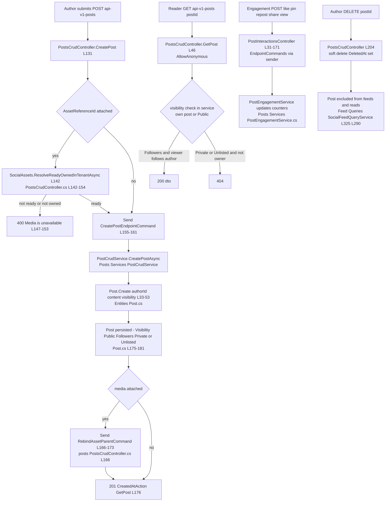
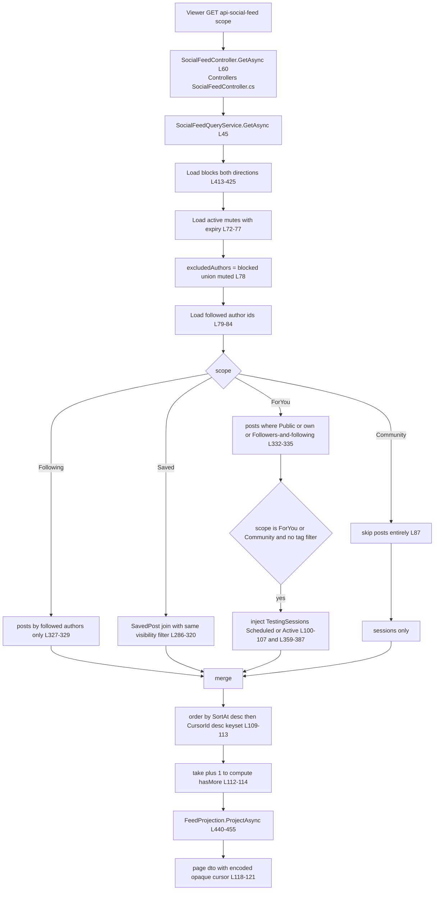
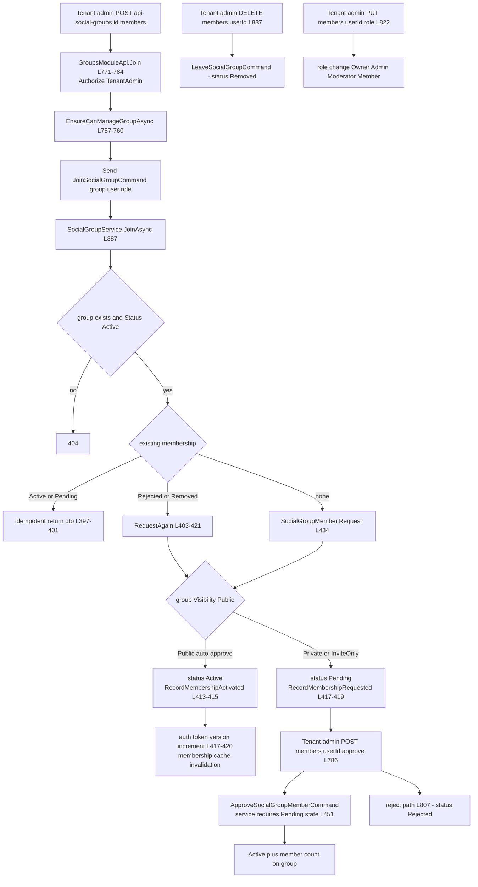
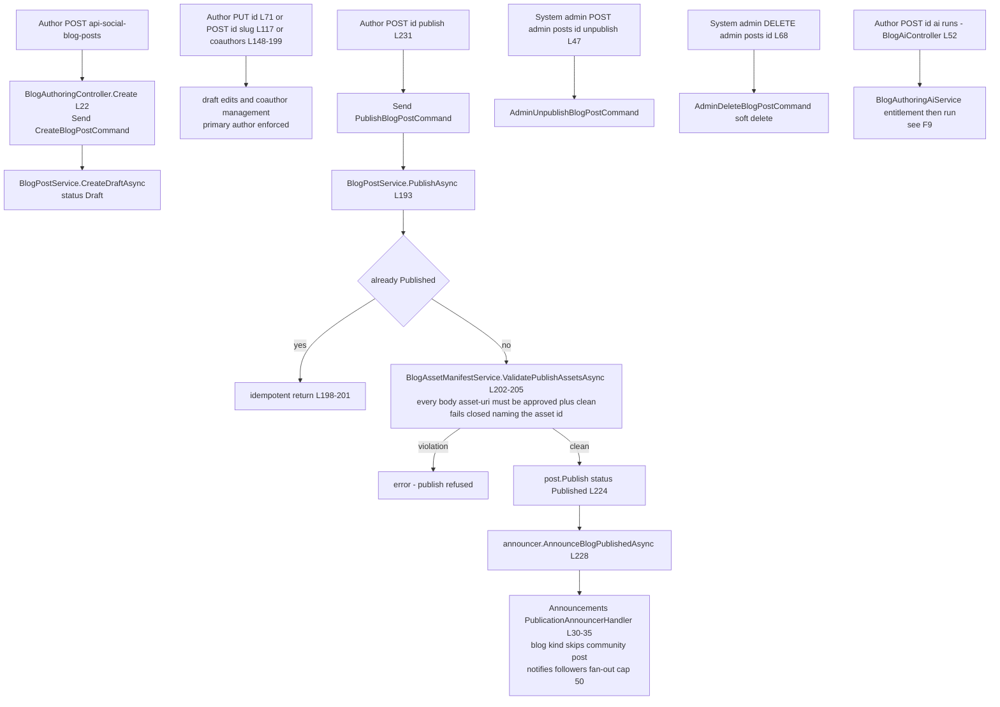
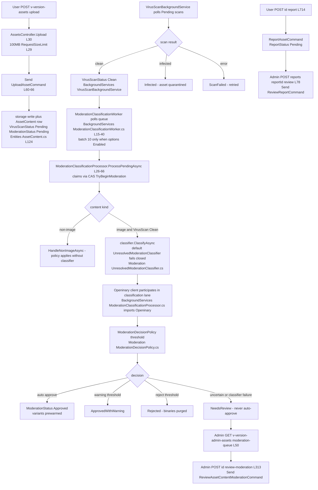
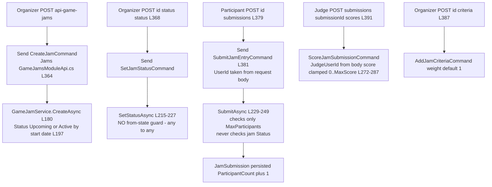
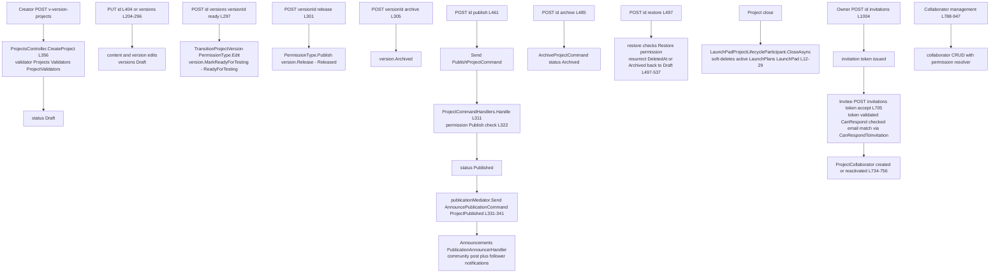
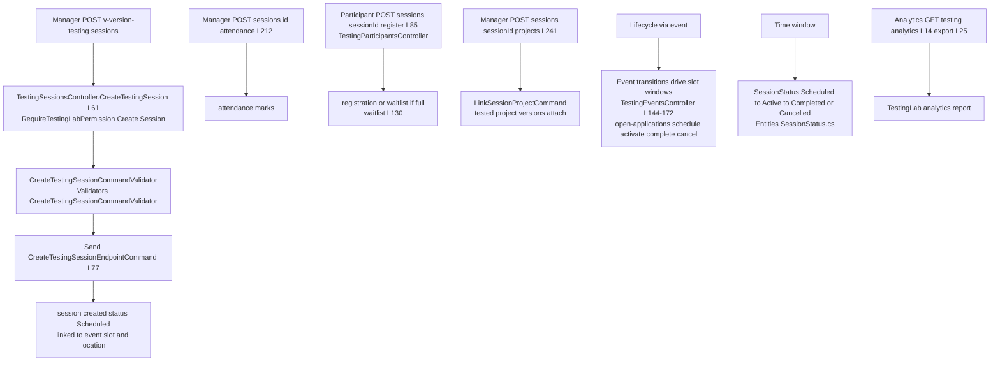
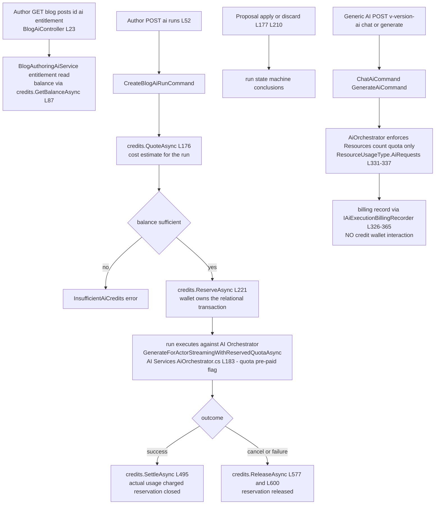

# Social + Platform — User Flows

> Documented against `develop` commit `43603cb5b`. All Mermaid diagrams are `flowchart TD` with no parentheses and no colons in labels. Citation shorthand: `Posts:` = `Modules/GameGuild.Social.Posts/`, `Feed:` = `Modules/GameGuild.Social.Feed/`, `Groups:` = `Modules/GameGuild.Social.Groups/`, `Blog:` = `Modules/GameGuild.Social.Blog/`, `Follows:` = `Modules/GameGuild.Social.Follows/`, `Reactions:` = `Modules/GameGuild.Social.Reactions/`, `Profiles:` = `Modules/GameGuild.Social.Profiles/`, `SocialAssets:` = `Modules/GameGuild.Social.Assets/`, `Announcements:` = `Modules/GameGuild.Social.Announcements/`, `AI:` = `Modules/GameGuild.AI/`, `AiCredits:` = `Modules/GameGuild.Finance.Economy.AiCredits/`, `Assets:` = `Modules/GameGuild.Assets/`, `Jams:` = `Modules/GameGuild.GameJams/`, `Projects:` = `Modules/GameGuild.Projects/`, `TestingLab:` = `Modules/GameGuild.TestingLab/`, `LaunchPad:` = `Modules/GameGuild.LaunchPad/`, `Resources:` = `Modules/GameGuild.Resources/`, `Host:` = `Source/GameGuild.API/`.

## F1 — Post lifecycle (create → visibility → engage → soft-delete), and the moderation-queue truth

**The moderation-queue truth.** There is no post moderation queue. `Post` has no moderation status (`Entities/Post.cs` — fields are content, visibility, counters, timestamps); there is no flag/report endpoint for posts or post comments in any of the three Posts controllers; and the `TrustSafety` module that would host trust-and-safety enforcement is **disabled** in the host composition (`Host:/Core/Setup/ApiProductComposition.cs:113-115`, module body is three files under `Modules/GameGuild.TrustSafety/`). The only content gates on the post path are:

1. the attached-media safe-to-serve check at create (`PostsCrudController.cs:141-154`) — media must be owned by the author and have finished Assets security processing;
2. nothing for text — `CreatePostEndpointCommand` carries the raw content straight to persistence.

The **Assets moderation queue that does exist is Platform surface** (`AssetsAdminController.cs:50` GET `moderation-queue`), documented in flow F5. Moderation truth is therefore asymmetric: media is machine-classified before it can attach; text is published unmoderated. Gap N1.

### Edge-case matrix — post lifecycle

| # | Case | Behavior | Evidence |
|---|---|---|---|
| 1 | Unauthenticated create | 401 (`GetCurrentUserId` empty) | `PostsCrudController.cs:133-137` |
| 2 | Attached asset belongs to another user | 400 "Media is unavailable" | `PostsCrudController.cs:141-154` |
| 3 | Attached asset still in virus scan / moderation | 400 same path — fails closed | `PostsCrudController.cs:141-154` |
| 4 | Visibility `Followers`, viewer does not follow author | hidden from feed queries; direct GET filters by service-side visibility check | `Feed:/Queries/SocialFeedQueryService.cs:332-335` |
| 5 | Anonymous `POST {id}/view` | accepted (AllowAnonymous) — view counter incrementable unauthenticated | `PostInteractionsController.cs:96-97` |
| 6 | Comment on soft-deleted post | rejected by comment service load (`DeletedAt` filter) | `Posts:/Services/PostCommentService.cs` |
| 7 | Author soft-deletes then re-creates same content | allowed — no duplicate-content check anywhere | `Post.Create` has no dedup |
| 8 | Repost of own post | permitted; `Post.CreateRepost` copies source with Public visibility | `Entities/Post.cs:55` |

## F2 — Feed assembly (scopes, cursor, exclusions, the TestingSession injection)

Notable truths:

- **"for-you" is not personalized.** The ForYou scope is pure reverse-chronological public+own+followers-visible posts merged with TestingSessions; `PostStatistics.TrendingScore` is maintained by the Posts module but never consulted by the feed (no reference to it anywhere in `Feed:/`). Gap N11.
- **The tag filter silently removes sessions**: sessions are only injected when `tag` is null/whitespace (`SocialFeedQueryService.cs:100-101`), and the Community scope with a tag returns an empty page (no posts fetched, sessions skipped).
- **Cursor is keyset-based** (`FeedCursor.TryDecode` throws `InvalidFeedCursorException` on tampering, `Queries/FeedCursor.cs`), `take` clamped 1-30 (`L58`).
- **The legacy FeedItem inbox is a parallel, write-starved surface**: `GET/POST /api/social/feed/users/{userId}` (+ read/hide) operate on `FeedItem` rows whose only writer is the inbox's own `POST` (`FeedModuleApi.cs:85` — `AddFeedItemCommand`). No producer projects posts, blog publications, or sessions into it. Gap N3.

### Edge-case matrix — feed assembly

| # | Case | Behavior | Evidence |
|---|---|---|---|
| 1 | Blocked author published a Public post | excluded — blocks are bidirectional | `SocialFeedQueryService.cs:413-425` |
| 2 | Mute expired yesterday | mute no longer excludes (expiry checked) | `SocialFeedQueryService.cs:72-74` |
| 3 | `scope=community&tag=x` | empty result — posts skipped by scope, sessions skipped by tag | `SocialFeedQueryService.cs:87,100-101` |
| 4 | Tampered cursor | `InvalidFeedCursorException` → error response | `SocialFeedQueryService.cs:62-64` |
| 5 | `take=500` | clamped to 30 | `SocialFeedQueryService.cs:58` |
| 6 | Saved post whose author later blocked viewer | dropped by exclusion filter on the join | `SocialFeedQueryService.cs:293-297` |
| 7 | Session whose manager is muted | excluded like a post author | `SocialFeedQueryService.cs:368-370` |
| 8 | Saved post soft-deleted by author | dropped (`post.DeletedAt == null` in join) | `SocialFeedQueryService.cs:290` |

## F3 — Group membership

Key truths:

- **Ordinary users cannot join groups through the API** — every membership operation, including the "join", carries `[Authorize(Policy = Policies.TenantAdmin)]` and `EnsureCanManageGroupAsync` (`GroupsModuleApi.cs:751-845`). The endpoint takes the target `UserId` from the request body. Gap N4.
- Membership status machine: `Pending → Active | Rejected`, `Active → Removed`, and re-request from `Rejected`/`Removed` (`Entities/SocialGroup.cs:261-267`).
- Group status gates joins: only `Active` groups accept membership (`GroupsModuleApi.cs:391-394`); `Suspended`/`Archived` groups reject with 404.

### Edge-case matrix — group membership

| # | Case | Behavior | Evidence |
|---|---|---|---|
| 1 | Non-admin calls any membership endpoint | 403 (TenantAdmin policy) | `GroupsModuleApi.cs:751-845` |
| 2 | Join a Suspended group | 404 from service (`Status != Active`) | `GroupsModuleApi.cs:391-394` |
| 3 | Double-join while Pending | idempotent — returns existing dto | `GroupsModuleApi.cs:397-401` |
| 4 | Approve a non-Pending member | 404 (handler requires Pending) | `GroupsModuleApi.cs:451` |
| 5 | Public group join | auto-Active, no approval step | `GroupsModuleApi.cs:412-415` |
| 6 | Re-request after Rejected | `RequestAgain` re-enters Pending (or Active if Public) | `GroupsModuleApi.cs:403-421` |
| 7 | Approver not authenticated | 403 (`SubjectIdAsGuid` missing) | `GroupsModuleApi.cs:790-794` |

## F4 — Blog publish (draft → publish, gates, fan-out, admin takedown, AI authoring)

Notable truths: the publish gate is **asset-manifest only** — text is unmoderated (same truth as F1, gap N1); the announcement fan-out is capped at 50 followers (`PublicationAnnouncerHandler.cs:17`) with failures swallowed by design (`L60-66`) — announcements must never fail the domain operation.

### Edge-case matrix — blog publish

| # | Case | Behavior | Evidence |
|---|---|---|---|
| 1 | Non-primary coauthor publishes | error "Only the primary author can publish" | `BlogPostService.cs:196` |
| 2 | Body references a Rejected asset | publish refused, error names asset id | `BlogPostService.cs:199-203` |
| 3 | Publish twice | idempotent — returns current post | `BlogPostService.cs:198-201` |
| 4 | Reader hits resolve-legacy slug | redirect resolution via `ResolveLegacyBlogSlugQuery` | `BlogPublicController.cs:66` |
| 5 | Comment on Draft post | rejected — comments require Published | `BlogPostService.cs` AddCommentAsync |
| 6 | Announcement fan-out failure | logged, swallowed; publish still succeeds | `PublicationAnnouncerHandler.cs:60-66` |
| 7 | Primary transfer | `POST {id}/transfer-primary` swaps primary coauthor | `BlogAuthoringController.cs:200` |

## F5 — Asset upload → moderation (ModerationClassificationWorker) — the real queue

Key truths:

- The pipeline is **fail-closed**: with no host-registered classifier, `UnresolvedModerationClassifier` returns `IsFailure=true` and the decision policy routes to `NeedsReview` — never auto-approve (`Moderation/UnresolvedModerationClassifier.cs`).
- Only `VirusScanStatus.Clean` image content enters classification; non-image content takes the no-classifier policy path (`ModerationClassificationProcessor.cs:37-45`).
- The consumer-facing gate is downstream: `SocialAssets.ResolveReadyOwnedInTenantAsync` (post attach, F1) and the blog manifest gate (F4) refuse content that has not finished security processing — that is how moderation actually reaches Social.
- The worker exits immediately when `AutoModerationOptions.Enabled` is false (`ModerationClassificationWorker.cs:17-21`) — a config-off moderation freeze (gap N13 notes the operational dependency).

### Edge-case matrix — asset moderation

| # | Case | Behavior | Evidence |
|---|---|---|---|
| 1 | Classifier unavailable | NeedsReview — never auto-approve | `UnresolvedModerationClassifier.cs` |
| 2 | Non-image upload (pdf, zip) | policy path without classification | `ModerationClassificationProcessor.cs:37-45` |
| 3 | Moderation disabled in options | worker never starts | `ModerationClassificationWorker.cs:17-21` |
| 4 | Two workers claim same content | CAS `TryBeginModerationAsync` serializes | `ModerationClassificationProcessor.cs:47-50` |
| 5 | Classification throws | failure recorded, consecutive-failure map | `ModerationClassificationProcessor.cs:52-64` |
| 6 | Rejected content binaries | purged on reject | processor summary |
| 7 | Report on already-Approved asset | allowed — report queue is independent | `AssetsController.cs:714` |
| 8 | Admin force-delete | bypasses soft delete, undeletable mark guards | `AssetsAdminController.cs:108,270-288` |

## F6 — Game jam lifecycle

Key truths (all gaps): `SetStatusAsync` performs a blind write — `Cancelled → Active`, `Completed → Upcoming` are all accepted (`GameJamsModuleApi.cs:215-227`, gap N6); submissions ignore jam status entirely — entries land on cancelled/completed jams (`:229-249`, gap N6); submitter and judge identities are caller-asserted request fields (`:381`, `:391`, gap N5). Also `CreateJamProjectCommand` (project-from-jam bridge, `ProjectsController.cs:392`) is the Projects-side entry.

### Edge-case matrix — game jam

| # | Case | Behavior | Evidence |
|---|---|---|---|
| 1 | Set status Cancelled then Active | accepted — no guard | `GameJamsModuleApi.cs:215-227` |
| 2 | Submit to Completed jam | accepted — status never read | `GameJamsModuleApi.cs:229-249` |
| 3 | Submit with another user's id | accepted — body UserId | `GameJamsModuleApi.cs:381` |
| 4 | Jam at participant cap | rejected InvalidOperationException | `GameJamsModuleApi.cs:233-236` |
| 5 | Score above criteria MaxScore | clamped to MaxScore | `GameJamsModuleApi.cs:281` |
| 6 | Score with unknown criteria | error "Criteria not found" | `GameJamsModuleApi.cs:275-278` |

## F7 — Project lifecycle + collaboration

Key truths: project publish fans out to Social via the announcements bridge (`ProjectCommandHandlers.cs:331-341` → `PublicationAnnouncerHandler`) — the one true Platform→Social event sequence (see `04-event-inventory.md` S2). Restore resurrects both archived and soft-deleted projects (`ProjectsController.cs:497-537`). Collaborator permission changes rely on `_permissionResolver.CanGrantPermissionsAsync` (cannot grant permissions you lack).

### Edge-case matrix — project lifecycle

| # | Case | Behavior | Evidence |
|---|---|---|---|
| 1 | Publish without Publish permission | NotFound-shaped failure (existence hidden) | `ProjectCommandHandlers.cs:322-324` |
| 2 | Publish already-Published project | re-announces — no from-state guard | `ProjectCommandHandlers.cs:311-341` |
| 3 | Restore a live project | 409 Project.NotRestorable | `ProjectsController.cs:521-523` |
| 4 | Accept expired invitation | 409 no longer pending or expired | `ProjectsController.cs:713-716` |
| 5 | Re-accept after leaving | collaborator reactivated (`LeftAt` cleared) | `ProjectsController.cs:746-756` |
| 6 | Version release without ready | entity method ordering enforced in `Release()` | `ProjectVersionLifecycle.cs` |
| 7 | Project close with active launch plans | plans soft-deleted | `LaunchPadProjectLifecycleParticipant.cs:12-29` |
| 8 | Share with role | `:share-with-role` grants template permissions | `ProjectPermissionController.cs:181` |

## F8 — TestingLab session

Sessions inherit their operating window from the parent TestingEvent and its slots; the session status set is `Scheduled/Active/Completed/Cancelled` (`Entities/SessionStatus.cs`). Registration vs waitlist is capacity-driven (`TestingParticipantsController.cs:85-162`). The feed injects `Scheduled`/`Active` sessions (F2).

### Edge-case matrix — TestingLab session

| # | Case | Behavior | Evidence |
|---|---|---|---|
| 1 | Create without Create permission | 403 (attribute) | `TestingSessionsController.cs:61` |
| 2 | Register for full session | waitlist entry | `TestingParticipantsController.cs:130` |
| 3 | Public sessions list | anonymous read | `TestingSessionsController.cs:136` |
| 4 | Restore soft-deleted session | `POST sessions/{id}:restore` | `TestingSessionsController.cs:118` |
| 5 | Attendance report | per-session report endpoint | `TestingSessionsController.cs:203-212` |
| 6 | Link same project twice | idempotent upsert in link handler | `TestingSessionsController.cs:241` |

## F9 — AI credit consumption

Key truth: **two different AI billing regimes coexist**. The blog (and Learning.Courses `AuthoringAiService.cs:52`) path runs the full credit lifecycle Quote → Reserve → Settle/Release against `IAiCreditWalletService` (`AiCredits:/Integrations/AiCreditWallet.cs:220`); the generic `/ai` endpoints enforce only the Resources `AiRequests` count quota and record a billing trail without ever touching credits (`AiOrchestrator.cs:331-337`) — chat/generation is effectively free of credit accounting (gap N12).

### Edge-case matrix — AI credits

| # | Case | Behavior | Evidence |
|---|---|---|---|
| 1 | Quote exceeds balance | run refused before reservation | `BlogAuthoringAiService.cs:176-190` |
| 2 | Run cancelled mid-stream | reservation released | `BlogAuthoringAiService.cs:577` |
| 3 | Provider failure after reserve | release with code | `BlogAuthoringAiService.cs:600` |
| 4 | Wallet throws on balance read | balance reported as zeroed dto | `BlogAuthoringAiService.cs:776-783` |
| 5 | Generic chat at quota cap | 4xx quota error, billing row "Failed" | `AiOrchestrator.cs:333-337` |
| 6 | Generic chat below cap | no credit charge at all | `AiOrchestrator.cs:331-365` |
| 7 | Moderation blocks input | billing row "ModerationBlocked", no quota consume | `AiOrchestrator.cs:326` |
