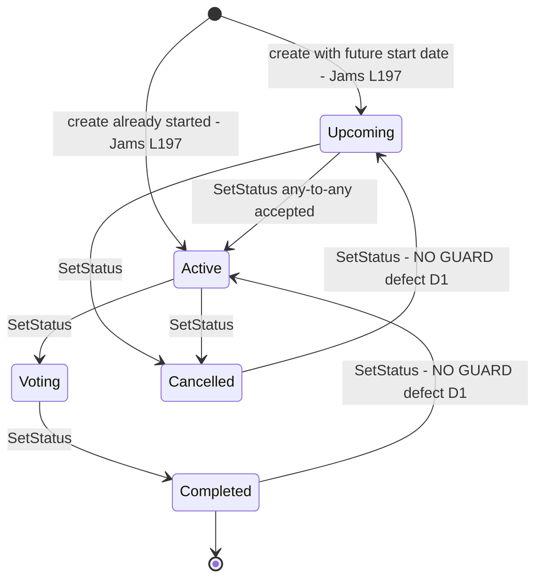
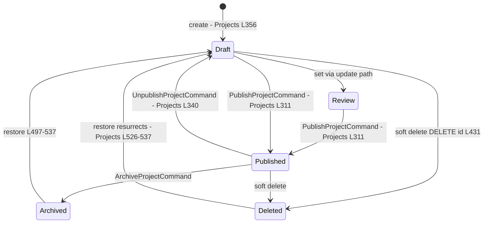
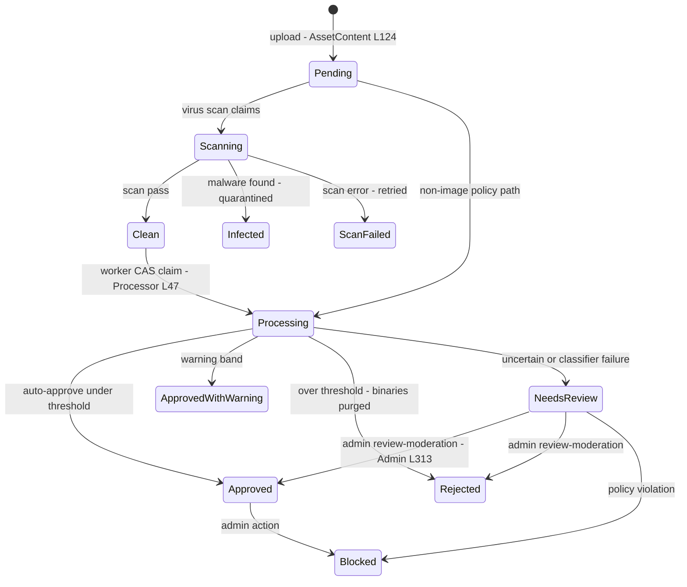
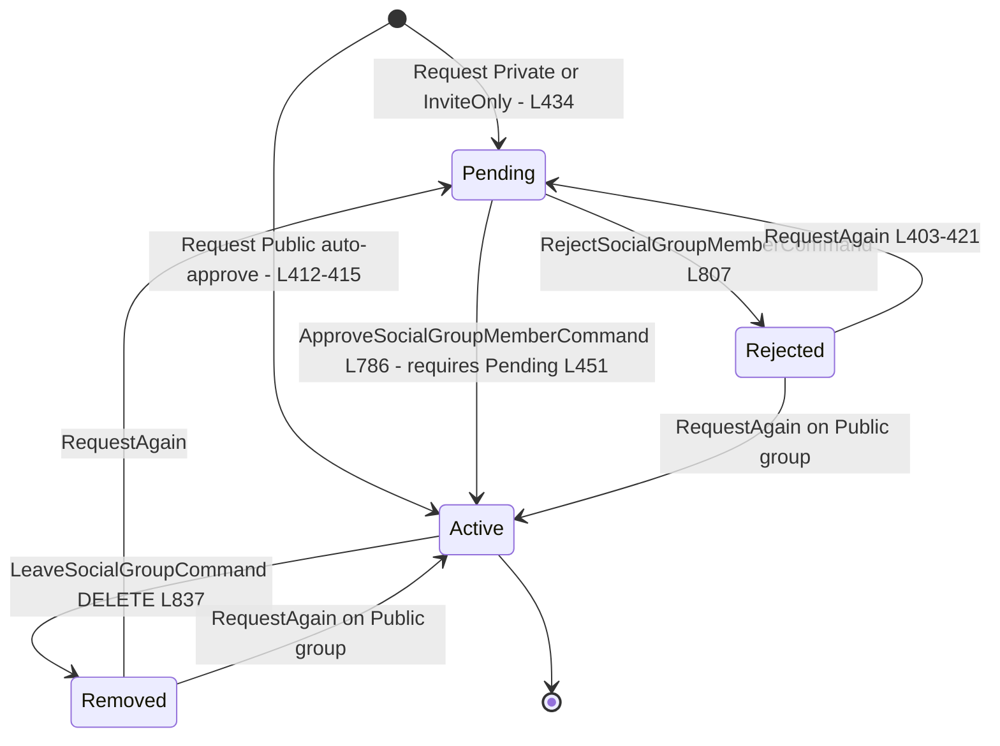
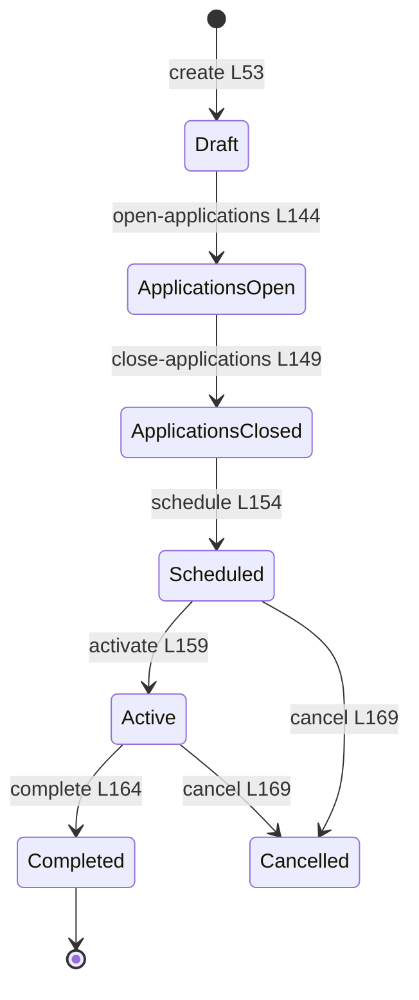

# Social + Platform — State Machines

> Documented against `develop` commit `43603cb5b`. All diagrams are `stateDiagram-v2` with no parentheses and no colons in labels. Citation shorthand as in [`01-user-flows.md`](01-user-flows.md).

## SM1 — Game jam (`Jam.Status`, `Jams:/Models/JamStatus.cs:3-5`)

**Transition audit.** `GameJamService.SetStatusAsync` (`Jams:/GameJamsModuleApi.cs:215-227`) loads the jam, assigns `jam.Status = status`, saves. There is no legal-transition table, no role check beyond `[Authorize]`, and no time-based automation (no worker flips Upcoming→Active at start date — creation-time inference only, `L197`). Submissions (`L229-249`) never read `jam.Status`.

| Defect | Description | Evidence | Gap |
|---|---|---|---|
| D1 | any-to-any status transition accepted, incl. resurrecting cancelled/completed jams | `GameJamsModuleApi.cs:215-227` | N6 |
| D2 | submissions accepted regardless of jam status | `GameJamsModuleApi.cs:229-249` | N6 |
| D3 | submitter and judge identities are caller-asserted body fields | `GameJamsModuleApi.cs:381,391` | N5 |

## SM2 — Project (`Project.Status`, `ContentStatus` from `SharedKernel:/Enums/ContentStatus.cs:6-19`) and project version

**Transition audit.** `PublishProjectCommand` does not check the from-state — a `Review` or even `Archived` project can be re-published directly (`ProjectCommandHandlers.cs:311-341`); publishing is guarded only by `PermissionType.Publish`. Unpublish always returns to `Draft` regardless of origin. Restore (`ProjectsController.cs:497-537`) is the only guarded transition (409 unless archived or soft-deleted). `ContentStatus.Review` exists in the enum but **no endpoint sets it** — the state is dead in the Projects family (grep: no writer).

| Defect | Description | Evidence | Gap |
|---|---|---|---|
| D4 | publish has no from-state guard; re-publish re-announces | `ProjectCommandHandlers.cs:311-341` | N14 |
| D5 | `ContentStatus.Review` unreachable on projects | `SharedKernel:/Enums/ContentStatus.cs:12`; no setter | N14 |

Project **version** lifecycle (`Projects:/ProjectVersionLifecycle.cs:3-9`): `Draft → ReadyForTesting → Released → Archived`, with entity methods `MarkReadyForTesting()`/`Release()` enforcing ordering, endpoint permissions `Edit` for ready, `Publish` for release/archive (`ProjectsController.cs:297-306`). Submission policy (`VersionSubmissionPolicy`, `ProjectVersionLifecycle.cs:11-32`) decides whether a version stays mutable after submission to TestingLab.

## SM3 — Asset moderation (`Assets:/Models/Enums.cs:63-106`)

**Transition audit.** Two orthogonal machines on `AssetContent`: `VirusScanStatus` (`Enums.cs:63-79`) and `ModerationStatus` (`Enums.cs:84-106`) — classification only starts from `VirusScanStatus.Clean` (`ModerationClassificationProcessor.cs:37-45`). The claim is compare-and-set (`TryBeginModerationAsync`), preventing double-processing. Terminal-ish states `Rejected`/`Blocked` are enforced downstream by the Social gates (F1/F4) rather than by delivery middleware; reports run a third machine `ReportStatus Pending → UnderReview → Resolved|Dismissed` (`Enums.cs:138-151`) with decisions `ReviewDecision` (`Enums.cs:156-175`).

| Defect | Description | Evidence | Gap |
|---|---|---|---|
| D6 | moderation freeze when `AutoModerationOptions.Enabled=false` — queue never drains, assets stay Pending forever (no alerting) | `ModerationClassificationWorker.cs:17-21` | N13 |

## SM4 — Group membership (`Groups:/Entities/SocialGroup.cs:261-267`)

**Transition audit.** The membership machine itself is sound (Pending-gated approval, idempotent rejoin for Active/Pending, re-request from terminal states). The defect is **who may operate it**: every transition, including join, requires `Policies.TenantAdmin` + `EnsureCanManageGroupAsync` (`GroupsModuleApi.cs:751-845`), and the acting member id comes from the body — there is no self-service member path. The **group** status machine (`SocialGroupStatus Active/Archived/Suspended`, `SocialGroup.cs:246-251`) is a blind setter like the jam (activate/archive/suspend accept any from-state, `GroupsModuleApi.cs:735-748`).

| Defect | Description | Evidence | Gap |
|---|---|---|---|
| D7 | membership operations are tenant-admin-only; no member self-service | `GroupsModuleApi.cs:751-845` | N4 |
| D8 | group status transitions unguarded | `GroupsModuleApi.cs:735-748` | N4 |

## SM5 — TestingLab event and session

Testing **event** (`TestingLab:/Enums/TestingEventWorkflowEnums.cs:16-25`):

Applications run their own sub-machine (`TestingApplicationStatus`, `TestingEventWorkflowEnums.cs:27+`: Draft → Submitted → UnderReview → Approved/Rejected/Waitlisted/Withdrawn) with committee votes on the review path (`TestingEventsController.cs:427-483`).

Testing **session** (`TestingLab:/Entities/SessionStatus.cs:3`): `Scheduled → Active → Completed | Cancelled`; sessions are created `Scheduled` (`CreateTestingSessionEndpointCommand`), go public in feed only while `Scheduled|Active` (`Feed:/Queries/SocialFeedQueryService.cs:365-370`).

| Defect | Description | Evidence | Gap |
|---|---|---|---|
| D9 | withdrawn — committee voting verifies membership, UnderReview state and duplicates from the actor context | `TestingApplicationHandlers.cs:559-600` | — |

## SM6 — Blog post (`BlogPostStatus`)

`Draft → Published` via `Publish()` with the asset-manifest gate; `Published → Draft` via `Unpublish()`; soft delete terminal (`Blog:/Services/BlogPostService.cs:190-254`). Publish is idempotent (already-Published short-circuits). The AI run inside a blog post has its own run-status stream persisted as events (`BlogAuthoringAiService` AddEvent status trail), feeding F9.
