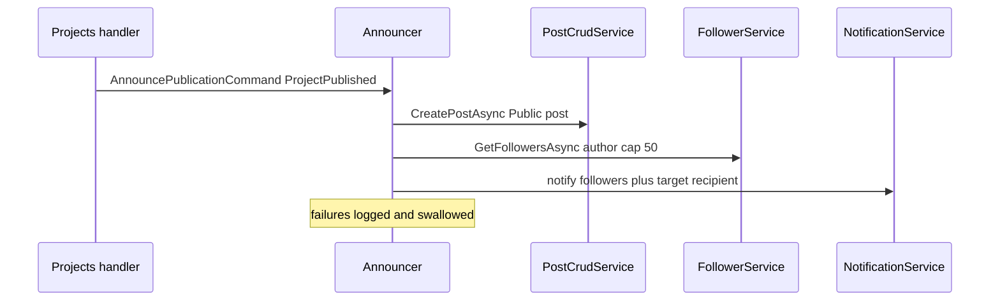
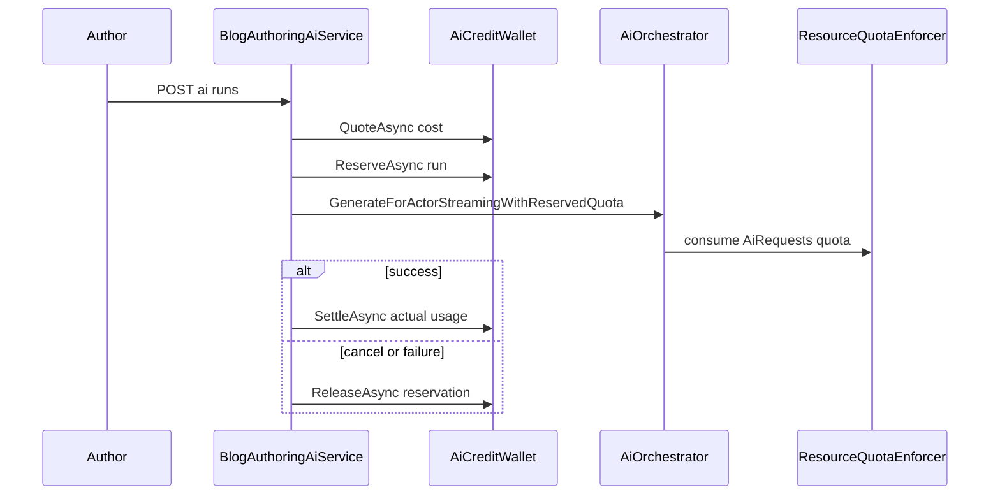
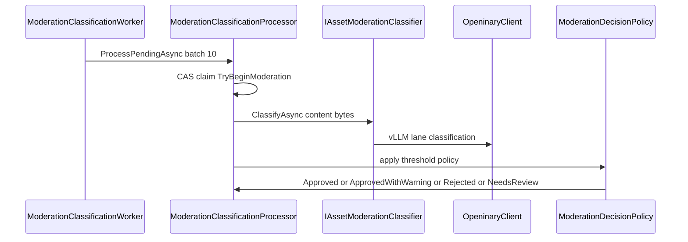

# Social + Platform — Event Inventory and Cross-Module Sequences

> Documented against `develop` commit `43603cb5b`. Citation shorthand as in [`01-user-flows.md`](01-user-flows.md).

## E1 — Domain events declared in the Social family: the twelve orphans

`Posts:/Events/PostEvents.cs` declares twelve domain events: `PostCreatedEvent` (L6), `PostUpdatedEvent` (L17), `PostDeletedEvent` (L28), `PostLikedEvent` (L38), `PostUnlikedEvent` (L50), `PostCommentedEvent` (L61), `PostSharedEvent` (L74), `PostPinnedEvent` (L85), `PostViewedEvent` (L95), `PostTrendingEvent` (L107), `PostTaggedEvent` (L118), `PostContentReferencedEvent` (L128).

**All twelve are orphans**: grep across `Modules/` and `GameGuild.API/` finds zero construction sites (`new PostCreatedEvent(` etc.), zero dispatch calls, and zero consumers — Notifications has no subscriber for any of them (`GameGuild.Notifications/` grep: no hits). No other Social module declares domain events: Feed, Profiles, Groups, Follows, Reactions, Blog, Announcements, Social.Assets have no `Events/` or `IDomainEvent` types.

Two consequences worth recording:

1. **The engagement→notification path does not exist.** A like, comment, or repost produces no notification anywhere — the counters update and nothing else happens. The only Social→Notifications flow is the announcements bridge (E2).
2. **The orphans escape the CI dead-event guard.** Guard G4 (`Tests:/GameGuild.API.UnitTests/Architecture/EventProducerGuardTests.cs`, baseline `wiring-gap-baseline.txt:31-53`) lists dead events for Commerce.Subscriptions, Features, Identity.Tenants and Learning — but no `Social.*` entries. The guard's scan keys on the durable-event interface; the Post events are plain records deriving a local `DomainEventBase` (`PostEvents.cs:140`), so they are invisible to it. Declared-but-never-produced AND unguarded — gap N2.

## E2 — The announcements bridge (the one real Social↔Notifications flow)

`AnnouncePublicationCommand` (contract in `Modules/GameGuild.Announcements.Contracts/`, consumed by `Announcements:/Services/PublicationAnnouncerHandler.cs:16`) is the family's only cross-module event. Producers:

| Producer | Kind | Evidence |
|---|---|---|
| Projects publish handler | `ProjectPublished` | `Projects:/Handlers/ProjectCommandHandlers.cs:331-341` |
| Blog publish (via adapter) | `BlogPostPublished` | `Blog:/Services/PublicationAnnouncerAdapter.cs:39` ← `BlogPostService.cs:228` |
| Learning course publish | `CoursePublished` | `Learning.Courses:/Commands/PublishProgram/PublishProgramCommandHandler.cs` (outside family, listed for orientation) |
| TestingLab event created | `TestingEventCreated` | `TestingLab:/EventsWorkflow/TestingEventHandlers.cs:129` |
| TestingLab project joined event | `ProjectJoinedTestingEvent` | `TestingLab:/EventsWorkflow/TestingApplicationHandlers.cs:390` |

Consumer behavior (`PublicationAnnouncerHandler.cs:30-130`): non-blog kinds create a **Public community post** via `IPostCrudService` (so announcements land in every follower feed through F2); blog kind posts too (`NotifyBlogPostPublishedAsync` L101-130) plus co-author followers; every kind sends targeted + follower **notifications** via `INotificationService` with fan-out capped at `MaxFanOut = 50` (L17) and over-cap skipped with a warning (L126-129). All failures are swallowed (announcements must never fail the domain operation, L60-66, L107-112).

## E3 — Platform↔Economy credits (AI billing)

Two regimes, one wallet (`IAiCreditWalletService`, `AiCredits:/Integrations/AiCreditWallet.cs:220`):

1. **Credit-billed authoring** (Blog AI, Learning.Courses authoring): Quote → Reserve → Settle/Release with the wallet owning the relational transaction (`Blog:/Authoring/BlogAuthoringAiService.cs:176-221,495-600`). Wallet mutations write ledger rows in the Economy schemas — see the economy package (`docs/economy/`) for the settlement side.
2. **Quota-billed generic AI**: `/ai/*` enforces `ResourceUsageType.AiRequests` count quota via `Resources:` enforcer (`AI:/Services/AiOrchestrator.cs:331-337`) and records an execution-billing trail through `IAiExecutionBillingRecorder` (L326-365, NoOp default L18-20) — no wallet interaction (gap N12).

## E4 — Assets↔Openinary (moderation lane)

`Assets:/BackgroundServices/ModerationClassificationProcessor.cs` imports `GameGuild.Assets.Openinary` and takes `IOpeninaryClient` plus `IAssetModerationClassifier` (constructor L24-31). The classification lane runs serialized ("one item at a time — the backing vLLM lane runs with a tiny concurrency budget", file header L11-13). The classifier default is fail-closed (`Moderation/UnresolvedModerationClassifier.cs`) — when no host-registered classifier exists, everything routes to `NeedsReview`. Decisions persist through `ModerationDecisionPolicy` (`Moderation/ModerationDecisionPolicy.cs`).

## E5 — Use-case event contracts (the durable generic operation events)

Every command in the scoped Platform modules carries an assembly-level `UseCaseEventContractAttribute` mapping it to a dotted operation name with (mostly) `NoDomainEventReason` declaring that only the generic durable operation event fires: TestingLab 78 contracts, Projects 23, Resources 20, LaunchPad 19, Social.Blog 19, Assets 13, AI 7, Features 8, Analytics 4, Monitoring.SLA 4, GameJams 5 (each `Architecture/UseCaseEventContracts.g.cs`). These feed the durable-event machinery audited by `DurableEventArchitectureTests` — the operation event is the observable contract; no named domain events are declared for these commands. The Social modules other than Blog declare **no** use-case contracts and no durable events at all: their only integration surface is E2 and the direct FK-style queries in F2.

## E6 — Background workers in scope (cross-ref `docs/operations/background-workers.md`)

| Worker | Module | Trigger | Evidence |
|---|---|---|---|
| `ModerationClassificationWorker` | Assets | poll `ModerationPollingIntervalSeconds`, batch 10, exits when disabled | `Assets:/BackgroundServices/ModerationClassificationWorker.cs:15-40` |
| `VirusScanBackgroundService` / `AssetVirusScanProcessor` | Assets | poll pending virus scans | `Assets:/BackgroundServices/VirusScanBackgroundService.cs` |
| follow-token version bump | Groups | on membership activation (inline, not a worker) | `GroupsModuleApi.cs:417-420` |

## E7 — Project lifecycle participants (Platform internal coupling)

`Projects` exposes `IProjectLifecycleParticipant`; the only implementation in scope is `LaunchPad:/LaunchPadProjectLifecycleParticipant.cs:10-29` — project close soft-deletes the project's active `LaunchPlan`s. Registered `LaunchPad:/LaunchPadModule.cs:14`.

## "Not wired" register

| Claimed integration | Reality | Evidence |
|---|---|---|
| Post engagement notifications | not wired — no producer, no consumer | E1 |
| FeedItem inbox projections from Posts/Blog/TestingLab | not wired — single self-producer | `Feed:/FeedModuleApi.cs:85`; gap N3 |
| TrendingScore → feed ranking | not wired — computed, never read | gap N11 |
| TrustSafety enforcement for Social content | module disabled in host | `Host:/Core/Setup/ApiProductComposition.cs:113-115`; gap N1 |
| Generic AI endpoints → credit wallet | not wired — quota + billing record only | `AI:/Services/AiOrchestrator.cs:331-365`; gap N12 |
| Teams module HTTP surface | none — consumed via entities/services only | `Teams:/TeamsModule.cs` |
