# Social + Platform — Data Flow Diagrams

> Social family (9 sub-modules) + Platform family (13 sub-modules) · Documented against `develop` commit `ce31d585` (citations re-verified at HEAD).
> **L0 context + one L1 per STRIDE family** (the twelve families of [`07-stride-threat-model.md`](07-stride-threat-model.md): C1–C6 Social, P1–P5 Platform). Notation follows the repo standard (`docs/authorization/08-dfds.md` §1): external entities as rectangles, processes as stadiums, stores as cylinders, **trust boundaries as subgraphs**. Mermaid labels carry no parentheses and no colons.
> PII flows are marked **[PII]** on the edges where personal data crosses a boundary. STRIDE cross-reference: each family's threat table lives in 07 §2–§13.

Citation shorthand as in [`01-user-flows.md`](01-user-flows.md).

## 1. Level 0 — context diagram

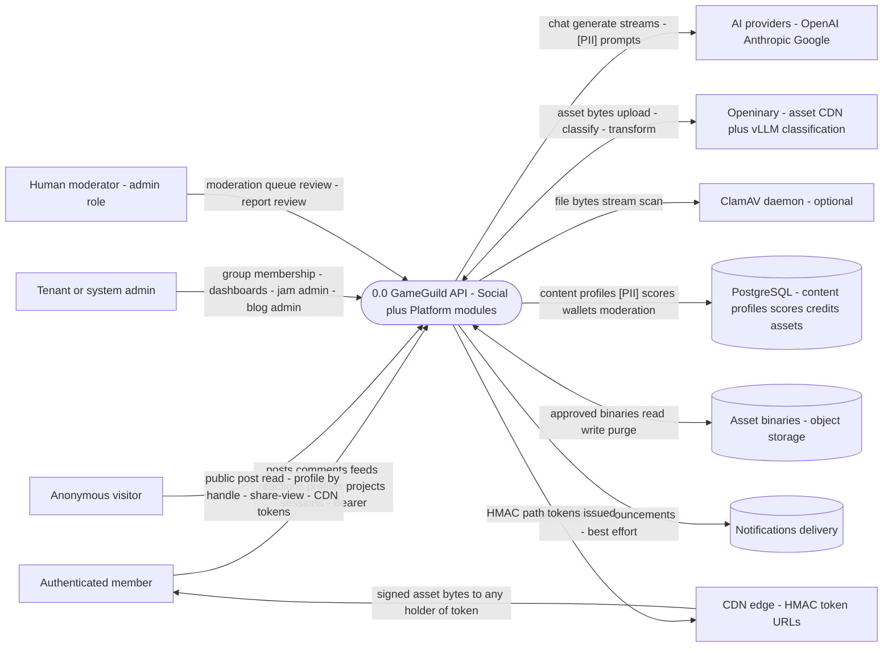

Trust boundaries on L0:

| ID | Boundary | Crossing flows | Notes |
|---|---|---|---|
| **TB1** | user/browser → web client | all rendering | first-party render escapes by default; only JSON-LD uses `dangerouslySetInnerHTML` with `<` escaping (`Web:lib/seo/jsonld.tsx:235-242`) |
| **TB2** | client → API host | `[Authorize]` / `[AllowAnonymous]` per controller; the middleware chain (`docs/authorization/cross-module-sequences.md` §1) | anonymous in-scope reads: post GET + comments GETs, share/view/statistics, profile `@{handle}` + search, public blog, TestingLab public session list, CDN token routes |
| **TB3** | API → PostgreSQL | content, scores, credits, moderation states | the tamper surface; N10 is the live cross-tenant instance |
| **TB4** | API → moderation lane | virus scan, classification queue | machine trust; fail-closed per-scanner, fail-open per-feature (07 §8 SP2) |
| **TB5** | API → CDN/asset delivery | HMAC-SHA256 path tokens, `[AllowAnonymous]` token-gated | 09 §5 |
| **TB6** | API → AI providers | prompts [PII], streams, usage tokens | DI-default HttpClient (100 s implicit), 07 §12 / 10 §2 |
| **TB7** | tenant A → tenant B | id-addressed reads/writes | N10 class; 09 §6 |

## 2. L1 — C1 post lifecycle and moderation truth

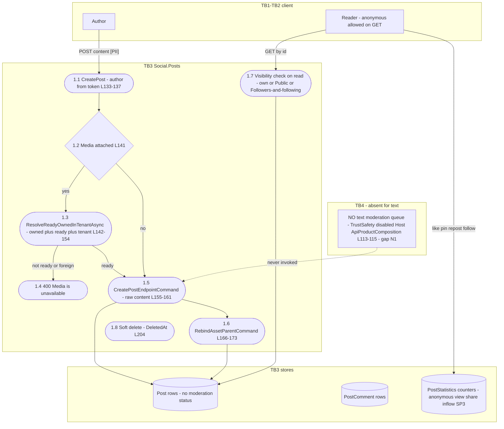

Flows of note: 1.5 carries raw content across TB3 with no sanitization or moderation hop (07 §2 T verdict); 1.3 is the only security gate on the path and it covers media, not text.

## 3. L1 — C2 feed assembly

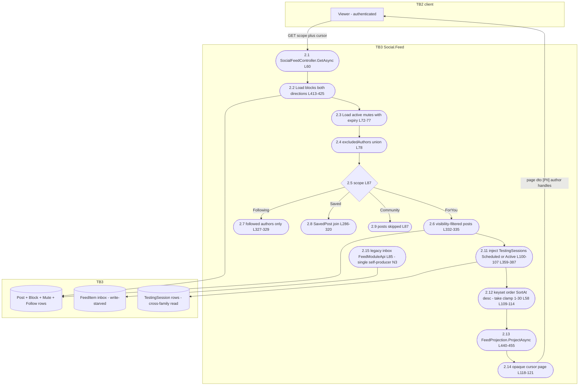

Flows of note: there is **no ranking hop anywhere** — 2.11→2.13 is straight visibility-filter + merge + keyset sort; the only manipulation-resistant property is that there is nothing to manipulate yet (07 §3). The exclusion set built at 2.2 has no term over `RepostOfPostId` (07 SP4).

## 4. L1 — C3 group membership

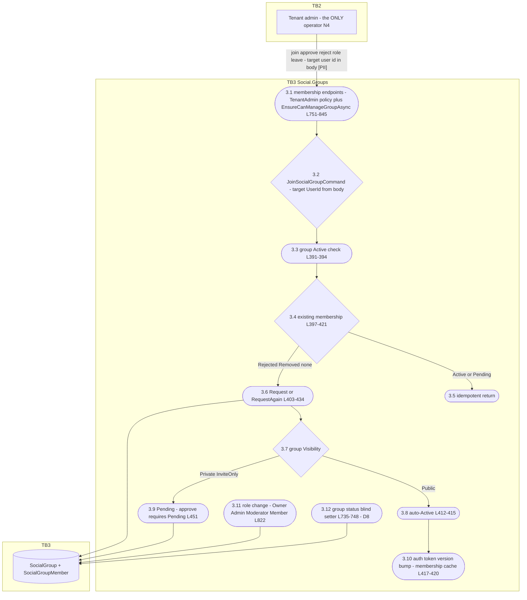

Flows of note: every membership transition enters at 3.1 — there is no member-self-service edge from a non-admin principal (07 §4 E verdicts); 3.12 accepts any from-state.

## 5. L1 — C4 blog publish

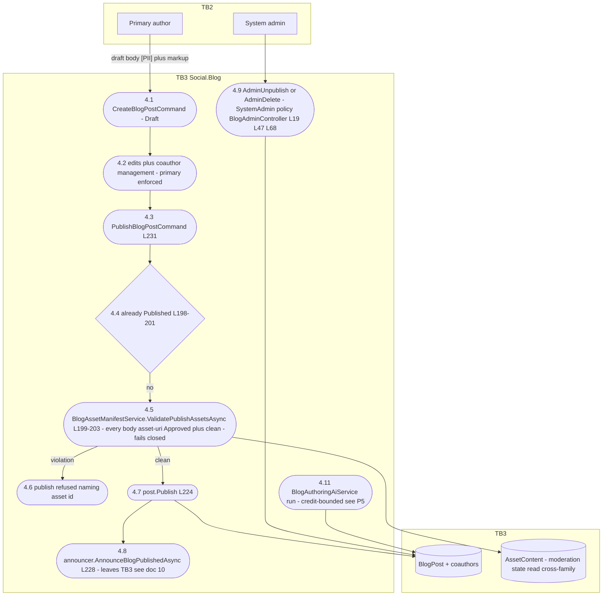

Flows of note: 4.5 is the only publish gate and it is media-only — body **text** has no moderation hop (N1, 07 §5); 4.8 crosses into the announcements bridge (TB3→Notifications, doc 10 §1).

## 6. L1 — C5 reactions and engagement

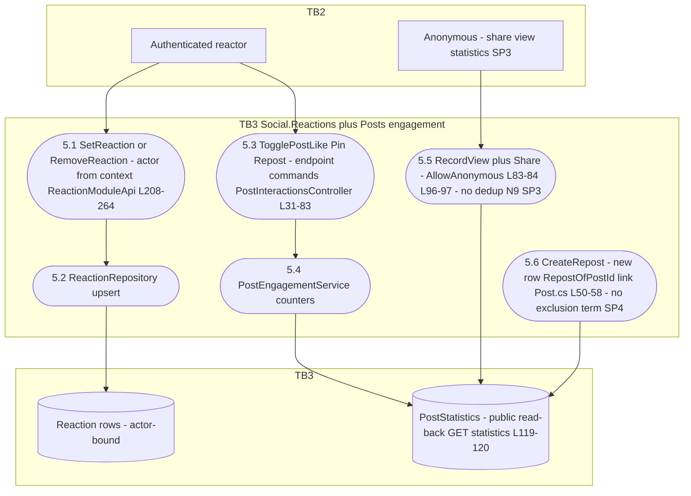

## 7. L1 — C6 profile exposure [PII]

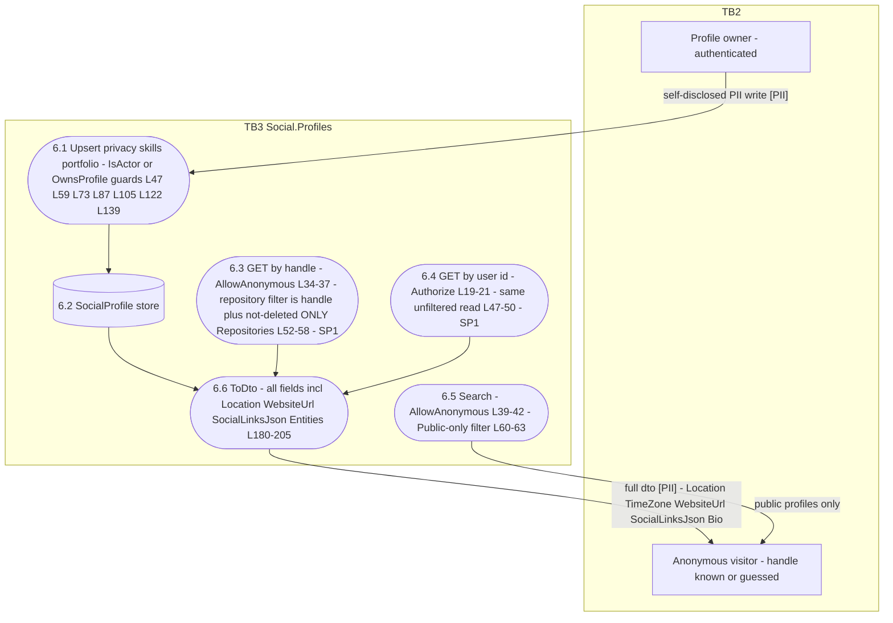

Flows of note: the [PII] edge 6.6→anonymous visitor is the SP1 leak — the privacy switch (`ProfileVisibility`, `ShowActivity/ShowPortfolio/ShowSkills`) is stored but the by-handle and by-user read predicates never consult it; only 6.5 (search) does.

## 8. L1 — P1 asset upload → moderation

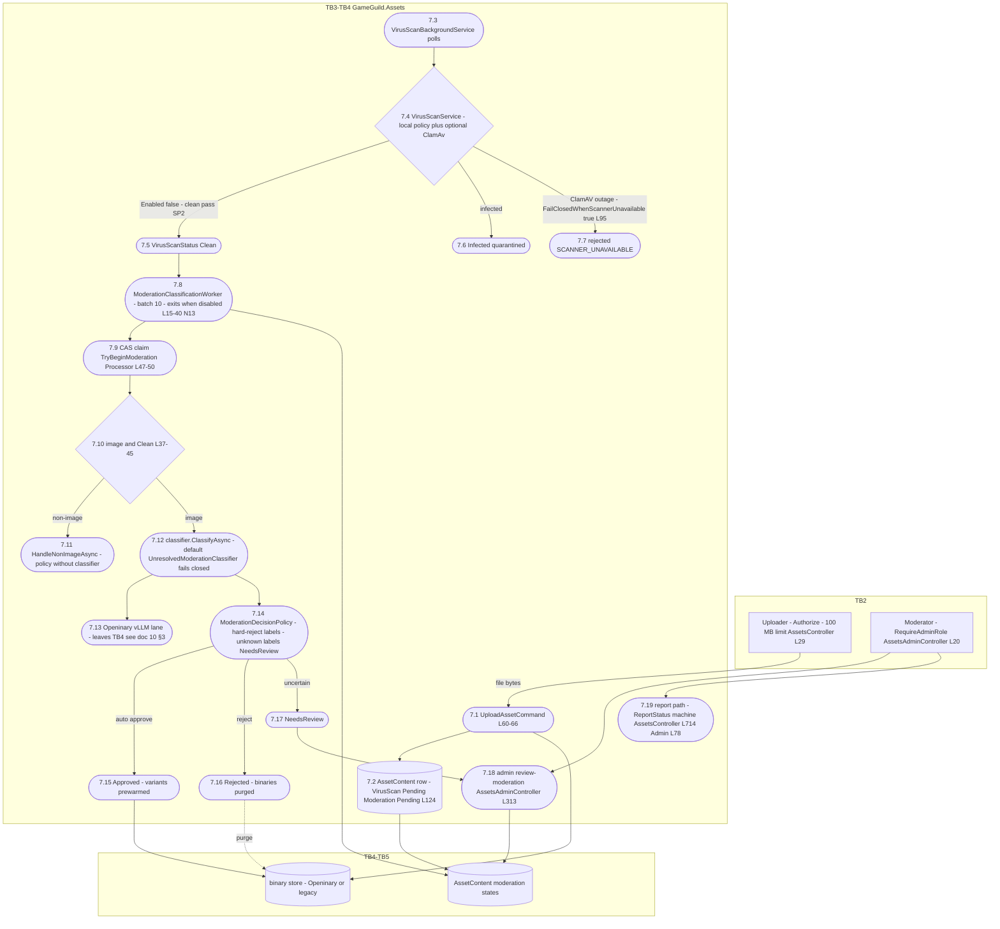

Flows of note: 7.4's clean-pass branch (SP2) and 7.8's config-off exit (N13) are the two silent fail-open/freeze branches of an otherwise fail-closed pipeline (07 §8).

## 9. L1 — P2 game-jam lifecycle and scoring

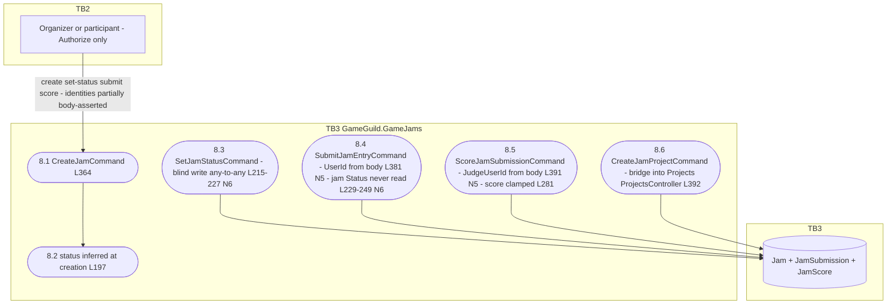

## 10. L1 — P3 project lifecycle and data exfiltration

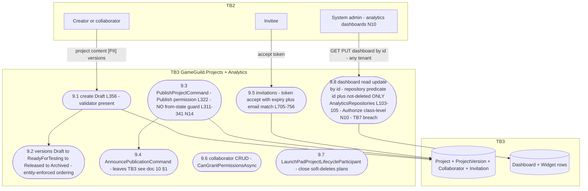

Flows of note: 9.8 is the live TB7 breach — every flow into it is id-addressed with no tenant predicate (07 §10 I verdict; N10).

## 11. L1 — P4 TestingLab session

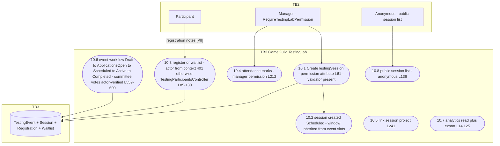

Flows of note: 10.3 resolves identity from the actor context — the correct pattern P2 lacks (07 §11); session rows flow out to the feed at C2/2.10.

## 12. L1 — P5 AI credit consumption

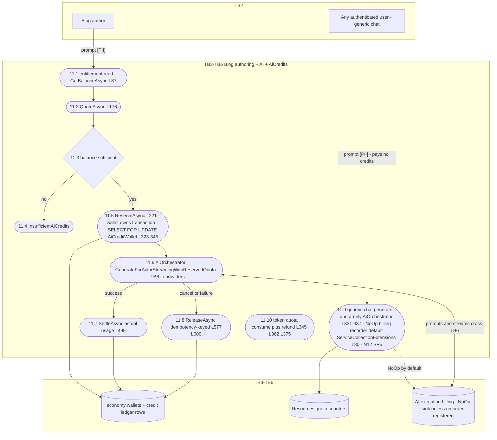

Flows of note: two regimes share one wallet boundary — the authoring lane (11.1–11.8) is credit-bounded and transaction-joined; the generic lane (11.9) exits TB3 having touched only quota counters (07 §12, N12/SP5).

## 13. Flow-to-family-to-threat index

| L1 | STRIDE family (07 §) | Highest-severity open item |
|---|---|---|
| §2 | C1 post lifecycle | N1 (no text moderation) |
| §3 | C2 feed assembly | SP3/SP4 (counter pollution, repost laundering) |
| §4 | C3 group membership | N4 (admin-only + blind status setter) |
| §5 | C4 blog publish | N1 (text) — asset gate covered |
| §6 | C5 reactions | N9 extension SP3 |
| §7 | C6 profile exposure | **SP1 [PII] anonymous read of Private profiles** |
| §8 | P1 asset moderation | SP2 (scan-disabled clean pass) + N13 |
| §9 | P2 jam | N5/N6 |
| §10 | P3 project | N10 (cross-tenant dashboards) + N14 |
| §11 | P4 TestingLab | accepted-role-trust items only |
| §12 | P5 AI credits | N12 + SP5 |
