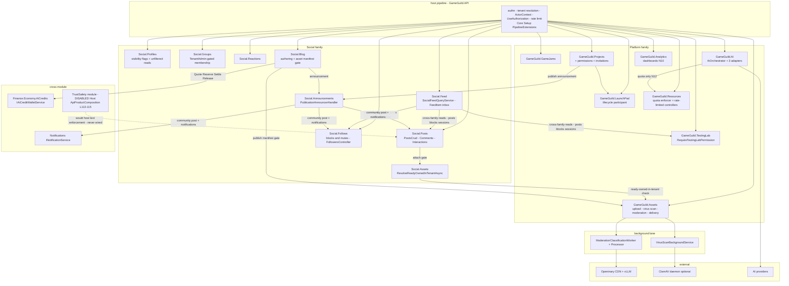

# Social + Platform — Security Architecture

> Social family (9 sub-modules) + Platform family (13 sub-modules) · Documented against `develop` commit `ce31d585` (citations re-verified at HEAD).
> Companion: STRIDE [`07-stride-threat-model.md`](07-stride-threat-model.md), DFDs [`08-dfds.md`](08-dfds.md), sequences with timeout/fail-open verdicts [`10-cross-module-sequences.md`](10-cross-module-sequences.md), gap register [`05-gaps.md`](05-gaps.md) (filed as issue **#1250**; new findings SP1–SP5 in 07 §14).

Citation shorthand as in [`01-user-flows.md`](01-user-flows.md).

## 1. Component diagram

## 2. The moderation pipeline (machine lane + the human queue + the disabled module)

The **only working moderation pipeline in both families is asset-side** (Platform `GameGuild.Assets`); the Social text path has none. Three layers, two queues, one disabled module:

1. **Local policy scan** — extension blocklist (`.exe/.dll/.msi/.bat/.cmd/.ps1/.sh/…`, `Assets:/VirusScan/VirusScanService.cs:102-104`, enforced `:409`) and oversize rejection (`MaxScanSizeBytes` 100 MB, `:73-74`).
2. **ClamAV daemon scan (optional)** — streamed bytes, 60 s scan timeout (`:72`), outage behavior governed by `FailClosedWhenScannerUnavailable` **default true** → `SCANNER_UNAVAILABLE` rejection (`:95`, `:228-242`).
3. **Classification lane** — `ModerationClassificationWorker` polls (batch 10, `BackgroundServices/ModerationClassificationWorker.cs:15-40`), processor claims rows by CAS `TryBeginModerationAsync` (`ModerationClassificationProcessor.cs:47-50`), classifies only `VirusScanStatus.Clean` images (`:37-45`), and routes through `ModerationDecisionPolicy` (`Moderation/ModerationDecisionPolicy.cs`): hard-reject labels above threshold → `Rejected` (+ binary purge); unknown labels / no labels / classifier failure / human-review mime types → `NeedsReview` — **never auto-approve on uncertainty**. The default classifier binding is the fail-closed `UnresolvedModerationClassifier` (`Moderation/UnresolvedModerationClassifier.cs`).
4. **Human queue** — `GET v{v}/admin/assets/moderation-queue` and `POST {id}/review-moderation` behind `RequireAdminRole` (`Controllers/AssetsAdminController.cs:20,50,313`); the report path runs its own `ReportStatus` machine (`AssetsController.cs:714`, admin review `AssetsAdminController.cs:78`).
5. **TrustSafety — disabled.** The module that would host text/content enforcement is in the host's disabled list (`Host:/Core/Setup/ApiProductComposition.cs:113-115`; verified at HEAD the disabled set is exactly `Compliance.FinancialCrime`, `TrustSafety`). Consequence (gap N1 / #1250): post text, post comments, and blog text reach persistence with no classification, no queue, no report route. The two Social gates that *do* exist consume Assets' output: the post attach gate (`PostsCrudController.cs:141-154` — media must be **owned + ready + in-tenant**) and the blog publish manifest gate (`Blog:/Services/BlogPostService.cs:199-203` — every body `asset-uri` must be **Approved + clean**; fails closed naming the asset).

**Verdict table for the pipeline** (consolidated; sequences in 10 §3):

| Condition | Behavior | Verdict |
|---|---|---|
| Classifier not registered | `UnresolvedModerationClassifier` → `NeedsReview` | **fail-closed** |
| Unknown label name / no labels / human-review mime | `NeedsReview` | **fail-closed** |
| ClamAV unreachable | rejection when `FailClosedWhenScannerUnavailable=true` (default) | **fail-closed** (config default) |
| `VirusScanOptions.Enabled=false` | `ScanAsync` returns clean "Scanning disabled" (`VirusScanService.cs:206-210`) | **fail-open — SP2** (silent, no alert) |
| `AutoModerationOptions.Enabled=false` | worker exits; queue freezes; assets stay Pending (N13) | **fail-closed downstream** (Social gates refuse Pending) but a silent availability freeze |
| Crashed `Processing` rows | re-picked indefinitely without lease | K1 / #1218 G4 |

## 3. The feed ranking trust boundary (there is no ranking)

The honest architecture fact: **feed assembly has no ranking component, therefore no ranking trust boundary exists yet** — and that is itself the control. `SocialFeedQueryService` composes ForYou/Following/Saved/Community from visibility-filtered post queries (`Feed:/Queries/SocialFeedQueryService.cs:87-113,327-335`), merges `Scheduled|Active` TestingSessions (`:100-107,359-387`), excludes blocked/muted authors (`:413-427`), and orders by keyset `SortAt desc, CursorId desc` (`:109-113`) with `take` clamped 1–30 (`:58`) and a tamper-detecting opaque cursor (`FeedCursor`). `PostStatistics.TrendingScore` — the only computed ranking signal in the family — is written by Posts and read by nothing in Feed (gap N11).

Two architectural consequences:

1. **The de-facto trust boundary is the database predicate** (visibility + blocks + soft-delete). Everything the feed shows is a function of SQL filters, so feed integrity == predicate integrity. The open defect class inside this boundary is the missing `RepostOfPostId` term in the exclusion set (07 SP4) and the anonymous, dedup-free `view`/`share` counters that would poison any ranking adopted later (07 SP3/N9).
2. **When ranking is added, it inherits pre-polluted inputs.** The N9/SP3 fix (authenticate + dedup counters) is a prerequisite for ranking, not a nice-to-have.

## 4. Who-can-moderate permission map

Every surface in both families that can create, review, remove, or administrate content, with its gate (verified at HEAD):

| Surface | Operation class | Gate | Evidence |
|---|---|---|---|
| Asset moderation queue + review | machine decisions overridden by human | `RequireAdminRole` — role `Admin` (`AuthenticationExtensions.cs:80`; assertion form `Admin`+`SystemAdmin` at `SecurityServiceCollectionExtensions.cs:348-349,548-549`) | `AssetsAdminController.cs:20,50,313` |
| Asset admin force-delete / reports review | destructive content ops | same `RequireAdminRole` class policy | `AssetsAdminController.cs:108,270-288,78` |
| Blog takedown (unpublish/delete) | text removal — the only Social text control that exists | `Policies.SystemAdmin` (`Identity.Authorization/Policies.cs:114`) | `BlogAdminController.cs:19` |
| Group membership + group status | membership approvals, role changes, suspend/archive | `Policies.TenantAdmin` (`Policies.cs:33`) + `EnsureCanManageGroupAsync` | `GroupsModuleApi.cs:751-845,735-748` |
| Post/comment moderation | **does not exist** | — (TrustSafety disabled) | gap N1 |
| TestingLab event/session/content approvals | session/event lifecycle, committee votes | `[RequireTestingLabPermission(action, resource)]` (`TestingLab:/Authorization/RequireTestingLabPermissionAttribute.cs:11-13`) + actor-context-verified committee membership | `TestingSessionsController.cs:61`; `TestingApplicationHandlers.cs:559-600` |
| Project publish/archive/restore, invitations | content lifecycle | `PermissionType.Publish/Edit` via project permission resolver; restore guarded 409 | `ProjectCommandHandlers.cs:311-341`; `ProjectsController.cs:497-537` |
| Analytics dashboards (read/write) | admin-adjacent surface | class `[Authorize]` only — **no tenant scoping** (N10) | `DashboardsController.cs:8`; `AnalyticsRepositories.cs:103-105` |
| AI prompt templates / tenant AI config | AI surface administration | `AiController` class `[Authorize]`; admin variant under `RequireAdminRole` (`AiPromptTemplatesController`, `TenantAiController`) | `AI:/Controllers/AiController.cs:18-20` |
| Feature flags / capabilities | platform behavior switches | `FeaturesController` admin policies (matrix §Features) | `02-cqrs-wiring-matrix.md` Features sections |

Read the map with the STRIDE verdicts of 07 §4/§8/§10: the assets lane is admin-gated and fail-closed; the blog lane is system-admin but takedown is not sticky; the groups lane is tenant-admin by design; the **post/comment lane is empty**.

## 5. CDN / asset delivery boundary (token-gated anonymous reads)

Two delivery surfaces share one token service:

- **`AssetsCdnController`** — `[AllowAnonymous]` by design ("Token-based authorization, not session-based", `Controllers/AssetsCdnController.cs:24`): `/assets/{referenceId}/{token}`, ephemeral `/e/{token}`, transformed `/t/{transformation}/{referenceId}/{token}` — CDN-friendly path tokens plus its own IP/token rate service (`IRateLimitService`).
- **`SecureAssetDeliveryController`** — full check stack: signed-token validation (`:123`), token-tenant vs actor-tenant validation (`Security/TenantAssetValidationService.cs:60,145` via `:131`), transformation validation, download windows, rate limits (`Security/SecureAssetDeliveryController.cs:16-58`).

**Token service**: HMAC-SHA256 with movable time windows (`Assets:Token` options — secret, 24 h default expiry, 8 h rotation window; `Services/AssetTokenService.cs:17-30,80+`), plus a bounded validation cache (`MaxCacheEntries` 10000, `:40-44`). Operational note: when `SecretKey` is unconfigured the service falls back to a **random per-process key** (`DevelopmentFallbackSecretKey`, `:46-48,58-63`) — fail-safe direction (tokens simply never validate across restarts; no bypass), but it silently breaks CDN links in any environment that forgot the secret — a deployment check, not a vulnerability.

Threat reading (07 §8 I): token possession == read grant; tokens are non-tenant-bound at the CDN edge, which is why the tenant check lives only on the secure-delivery surface and why the moderation gates upstream (Approved-before-attach/publish) are the actual content control.

## 6. The cross-tenant class (TB7) and the class sweep

N10 (dashboards readable/editable by id with predicate `id + DeletedAt == null`, `AnalyticsRepositories.cs:103-105`) is one live instance of a class. The architectural rule this package extracts for the family:

> **Every id-addressed read/write in Social+Platform that is not explicitly scoped by `ActorContext.TenantId` (or an ownership predicate like `IsActor`/`OwnsProfileAsync`/collaborator resolution) must be treated as presumptively cross-tenant until a repository predicate proves otherwise.**

Audited posture: Profiles writes are actor-guarded (N8 withdrawn — guards real, `SocialProfilesController.cs:47,59,73,87`); Projects reads run through permission resolution; TestingLab reads are permission- or actor-scoped; Analytics dashboards are the demonstrated breach; the sweep of the remaining 510-endpoint surface is exactly the "behavioral holes" class the wiring matrix cannot see (matrix §Wiring guarantees item 4) — flagged as the follow-up for #1250.

## 7. The AI credit wallet boundary

The wallet (`IAiCreditWalletService`, `AiCredits:/Integrations/AiCreditWallet.cs:220-226`) is the only monetary boundary in scope:

- **Actor binding** — `ValidateActor(tenantId, actorId)` on mutations (`:314`); the blog lane resolves the actor from context, never the body.
- **Serialization** — reservations join the ambient transaction or open one, then take a `SELECT … FOR UPDATE` row lock on `economy_wallets` (`:323-345`) — concurrent reservations on one wallet cannot interleave.
- **Idempotency** — `SettleAsync`/`ReleaseAsync` are keyed (`:396,405`); the blog passes deterministic keys (`release:{runId}`, `BlogAuthoringAiService.cs:577,600`).
- **The boundary is porous in exactly one direction**: the generic `/ai/*` lane never crosses it — quota counters only (`AI:/Services/AiOrchestrator.cs:331-337`), NoOp billing recorder by default (`AI:/ServiceCollectionExtensions.cs:30`) — gaps N12/SP5. Outbound from the wallet boundary to providers: the three adapters share the DI-default `HttpClient` (implicit 100 s timeout, `AI:/ServiceCollectionExtensions.cs:21`) with per-provider cancellation mapped to typed timeout failures (`OpenAiAdapter.cs:130-133`) — see 10 §2 for verdicts.

## 8. Fail-open / fail-closed verdicts (consolidated)

| Layer | On failure | Verdict | Where |
|---|---|---|---|
| Post attach gate (media not ready/foreign) | 400 | **fail-closed** | 07 §2; `PostsCrudController.cs:141-154` |
| Blog publish manifest gate | publish refused, asset named | **fail-closed** | 07 §5; `BlogPostService.cs:199-203` |
| Moderation classification (uncertain) | `NeedsReview` | **fail-closed** | §2; `ModerationDecisionPolicy.cs` |
| ClamAV outage | rejection (default config) | **fail-closed** (default) | §2; `VirusScanService.cs:95` |
| Virus scanning feature disabled | clean pass | **fail-open — SP2** | §2; `VirusScanService.cs:206-210` |
| Auto-moderation worker disabled | queue freeze (downstream gates still refuse Pending) | **fail-closed downstream / silent freeze** — N13 | §2 |
| Announcements bridge (post + notifications) | logged, swallowed | **fail-open** (by contract: announcements must never fail the domain op) | 10 §1; `PublicationAnnouncerHandler.cs:60-66,107-112` |
| Announcement fan-out over cap | skipped with warning | **fail-open (truncation)** | `PublicationAnnouncerHandler.cs:17,126-129` |
| AI wallet quote/reserve failure | run refused before provider call | **fail-closed** | 07 §12 |
| AI provider failure after reservation | release with code | **fail-closed for charge, fail-open for the run** (reservation returned) | `BlogAuthoringAiService.cs:600` |
| Wallet balance read throws | balance reported as zeroed dto | **fail-closed (conservative zero)** | `BlogAuthoringAiService.cs:776-783` |
| Openinary classification call | retry 3× on 408/5xx then failure → `NeedsReview` | **fail-closed** | 10 §3 |
| Generic AI quota exhaustion | 4xx quota error | **fail-closed** | `AiOrchestrator.cs:333-337` |

## 9. Open security work items (architecture lens)

| Item | Why architectural | Gap IDs |
|---|---|---|
| Text moderation lane missing end-to-end | TrustSafety enablement decision + queue + report routes + Social gates — a pipeline, not a patch | N1 (+#1250) |
| Cross-tenant class sweep | repository-predicate audit across the id-addressed surface; N10 fix is the anchor | N10, §6 |
| Jam identity + state machine | identity must move from body to ActorContext (TestingLab is the in-repo pattern, §4) | N5/N6 |
| Profile read-side visibility | one predicate on two repository reads; `ProfileVisibility` exists but is consulted only by search | **SP1** |
| Virus-scan feature switch | clean-pass on disabled is the only fail-open in an otherwise fail-closed pipeline — make it loud or closed | **SP2** |
| Counter integrity before ranking | authenticate/dedup view+share; add `RepostOfPostId` term to exclusions | N9/SP3/SP4 |
| AI credit parity + billing sink | generic lane must cross the wallet boundary or be explicitly declared free; recorder default hides usage | N12/SP5 |
| Validation desert | 344/510 endpoints unvalidated — amplifies every tampering vector | N7 |

## 10. Document register (this package)

| Document | Scope |
|---|---|
| `README.md` | package index + headline findings |
| `01-user-flows.md` | 9 critical user flows with edge-case matrices |
| `02-cqrs-wiring-matrix.md` | 510 endpoints × wiring × tests × holes |
| `03-state-machines.md` | 6 state machines with defect index |
| `04-event-inventory.md` | events + cross-module inventory |
| `05-gaps.md` | KNOWN + NEW gap register (filed as #1250) |
| `07-stride-threat-model.md` | STRIDE for 12 families; SP1–SP5 |
| `08-dfds.md` | L0 + 12× L1 with trust boundaries and [PII] flows |
| `09-security-architecture.md` | this document |
| `10-cross-module-sequences.md` | cross-module sequences with timeout/fail-open verdicts |
