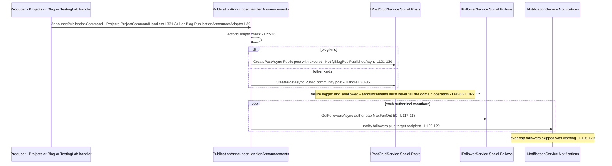
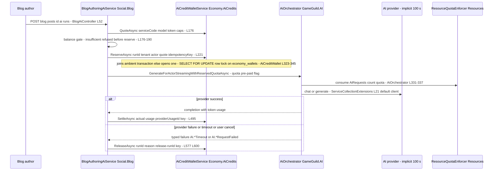
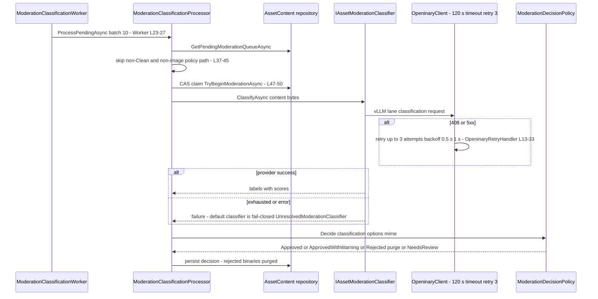
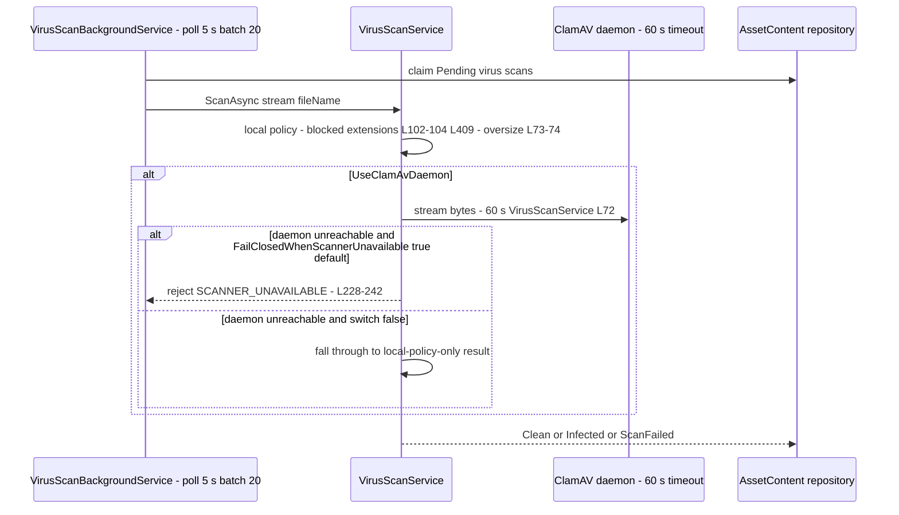

# Social + Platform — Cross-Module Sequences

> Social ↔ Notifications (the announcements bridge), Platform ↔ Economy (AI credits), Assets ↔ Openinary (the provider), plus the two security seams the DFDs cross (ClamAV virus scan, token-gated CDN delivery) · Documented against `develop` commit `ce31d585`.
> Conventions per the authentication package (`docs/auth/cross-module-sequences.md`): **one Mermaid `sequenceDiagram` per cross-module interaction; every call carries its trigger `file:line`; each section closes with the failure path, the retry policy, and the fallback verdict — fail-open (the operation proceeds) or fail-closed (the operation is denied/suppressed) — plus GAPS.** Mermaid labels carry no parentheses and no colons.
> Relationship to [`04-event-inventory.md`](04-event-inventory.md): 04 inventories the events; this document adds the timeout inventory and the per-call verdicts the inventory does not carry.

Citation shorthand as in [`01-user-flows.md`](01-user-flows.md).

Timeout inventory (the numbers cited by the diagrams — the families' only outbound HTTP lanes; everything else is in-process CQRS/database where DB command timeouts apply):

| Outbound call | Client | Timeout | Retry | Registration |
|---|---|---|---|---|
| Openinary upload/classify/transform | `OpeninaryClient` (typed client) | **120 s** (`OpeninaryOptions.TimeoutSeconds`, default 120) | **3 attempts** on 408/5xx, backoff 0.5 s / 1 s (`OpeninaryRetryHandler`) | `Assets:/Openinary/OpeninaryOptions.cs:57-59`; `Openinary/OpeninaryRetryHandler.cs:13-33` |
| ClamAV daemon stream scan | socket client in `VirusScanService` | **60 s** (`VirusScanOptions.TimeoutSeconds`), host localhost:3310 default | none at this layer (worker re-polls pending rows every 5 s, batch 20) | `Assets:/VirusScan/VirusScanService.cs:60-86`; polling `:79-84` |
| AI providers (OpenAI / Anthropic / Google) | DI-default `HttpClient` injected into each adapter | **implicit 100 s** (no explicit value; `services.AddHttpClient()`) — per-request cancellation mapped to typed timeout failures | in-stream retry ladder 200 ms × attempt in OpenAI adapter (`OpenAiAdapter.cs:193`); none elsewhere | `AI:/ServiceCollectionExtensions.cs:21`; catch maps `OperationCanceledException` → `AI.*Timeout` (`OpenAiAdapter.cs:130-133`, `AnthropicAdapter.cs:135-138`, `GoogleAiAdapter.cs:119-122`) |
| Announcements bridge (in-process) | `IPublisher`/CQRS command | none at this layer (no HTTP) | none — failures swallowed by contract | `Announcements:/Services/PublicationAnnouncerHandler.cs:60-66` |
| AI credit wallet (in-process) | `IAiCreditWalletService` over EF/PostgreSQL | none at this layer (DB command timeout applies) | idempotency keys make replays safe | `AiCredits:/Integrations/AiCreditWallet.cs:396,405` |
| Notifications delivery (in-process) | `INotificationService` → delivery service | none at this layer | none here (queueing semantics underneath) | `Notifications:/Services/NotificationService.cs:27-41` |

---

## 1. Social ↔ Notifications — the announcements bridge

The family's only real Social→Notifications flow (`04-event-inventory.md` E2). Producers: Projects publish, Blog publish (via adapter), Learning course publish, TestingLab event created, project-joined-testing-event. Consumer: `PublicationAnnouncerHandler`, which writes **Social content** (a Public community post through `IPostCrudService`) and **Notifications** (targeted + follower fan-out), capped at 50.

Failure paths and fallback verdicts:

| Path | What the user sees on failure | Retry | Verdict |
|---|---|---|---|
| Community post creation fails | publish/project operation **still succeeds**; no announcement appears | none (exception swallowed by contract) | **fail-open** — by design ("announcements must never fail the domain operation", `PublicationAnnouncerHandler.cs:60-66`); the cost: a silent gap in the Social record with no outbox/durable redelivery (04 E2 truth) |
| Follower notification fails | post exists; notifications absent | none (second swallow block `:107-112`) | **fail-open** |
| Fan-out over 50 followers | truncated audience, warning logged | none | **fail-open (truncation)** — `MaxFanOut = 50` (`:17`), not configurable per kind |
| Repeat project publish (N14) | duplicate announcements on every re-publish | n/a | **gap N14** — no from-state guard on `PublishProjectCommand` (`Projects:/Handlers/ProjectCommandHandlers.cs:311-341`), so the bridge can be driven repeatedly |

GAPS: the bridge is the *only* Social↔Notifications flow — post likes/comments/shares produce no notifications at all because the twelve `Post*` events are orphans (gap N2 / #1250). The bridge itself is in-process with no HTTP timeout; its risk profile is loss (fail-open), not latency.

## 2. Platform ↔ Economy — the AI credit wallet (authoring lane vs generic lane)

Two regimes cross this seam (04 E3): credit-billed authoring (Blog; Learning.Courses out of family) and quota-billed generic AI. The wallet owns the relational transaction.

The generic lane (`/ai/chat`, `/ai/generate`, `/ai/generate-content/*`) skips every wallet call above: `AiOrchestrator` consumes only `ResourceUsageType.AiRequests` count quota (`AI:/Services/AiOrchestrator.cs:331-337`), refunds it on provider-not-registered/provider-failure (`:345,362`), consumes `AiTokens` post-execution (`:375`), and records billing through `IAiExecutionBillingRecorder` — **NoOp unless a recorder is registered** (`AI:/ServiceCollectionExtensions.cs:30`).

Failure paths and fallback verdicts:

| Path | What the caller sees on failure | Retry | Verdict |
|---|---|---|---|
| Quote exceeds balance | run refused before any provider call — `InsufficientAiCredits` | user tops up | **fail-closed** (`BlogAuthoringAiService.cs:176-190`) |
| Wallet reserve throws | run fails; no provider call | idempotency key makes a retry safe | **fail-closed** |
| Provider timeout (implicit 100 s) or failure after reserve | typed `AI.*Timeout`/`AI.*RequestFailed`; reservation released with reason code | none at orchestrator level (in-stream 200 ms×n ladder in OpenAI adapter only, `OpenAiAdapter.cs:193`) | **fail-closed for the charge (credits returned), fail-open for the run (user may retry)** — `BlogAuthoringAiService.cs:600` |
| User cancels mid-stream | stream aborted; reservation released | none | **fail-closed for the charge** — `:577` |
| Wallet balance read throws | entitlement reports a zeroed dto | none | **fail-closed (conservative zero)** — `:776-783` |
| Generic lane at quota cap | 4xx quota error, billing row "Failed" | none | **fail-closed** (`AiOrchestrator.cs:333-337`) |
| Generic lane below cap | completion — **no credit charge, no billing row (NoOp recorder default)** | n/a | **fail-open for the credit economy — gap N12 + SP5 / #1250** |

GAPS: timeout asymmetry inherited from the auth package's P1 class — all three AI adapters share the DI-default `HttpClient` (implicit 100 s) with no Polly policy; a provider brownout holds authoring runs (and their **reservations**) for up to 100 s each. Reservations are eventually released on the failure path, but there is no reaper for a crashed process between reserve and settle — a wedged reservation holds credits until manual release. N12/SP5 are the economic gaps (filed).

## 3. Assets ↔ Openinary — the provider lane (classification + storage + transform)

`ModerationClassificationProcessor` takes both `IOpeninaryClient` and `IAssetModerationClassifier`; the classification lane runs serialized ("one item at a time — the backing vLLM lane runs with a tiny concurrency budget", `BackgroundServices/ModerationClassificationProcessor.cs:11-13`). The same client family backs upload storage and transformation delivery.

Failure paths and fallback verdicts:

| Path | What happens on failure | Retry | Verdict |
|---|---|---|---|
| Classification HTTP fails after 3 attempts | classifier returns failure → `NeedsReview` — **never auto-approve** | 3 attempts (408/5xx), 0.5 s / 1 s backoff (`OpeninaryRetryHandler.cs:13-33`) | **fail-closed** (`Moderation/ModerationDecisionPolicy.cs` — `classifier_failure` branch; default `UnresolvedModerationClassifier.cs`) |
| Unknown label name / empty labels | `NeedsReview` | none needed | **fail-closed** |
| Openinary storage/transform call fails | upload/transform operation surfaces the error to the caller | same retry handler | **fail-closed** for the operation |
| Worker disabled (`AutoModerationOptions.Enabled=false`) | queue freezes; uploads stay Pending; Social gates keep refusing Pending media | worker poll n/a — never starts | **fail-closed downstream, silent availability freeze — gap N13 / #1250** |
| Worker cycle throws | logged, next cycle after poll interval | poll loop (`ModerationClassificationWorker.cs:34-39`) | **fail-open for the cycle, fail-closed for content** |

GAPS: K1/#1218 G4 — crashed `Processing` rows re-enter the queue with no lease; with the serialized lane a poisoned item that fails after the CAS claim each cycle still burns the batch budget (`ConcurrentDictionary<Guid,int> _consecutiveFailures` exists but only tracks, `ModerationClassificationProcessor.cs:33`). The 120 s provider timeout × serialized lane means one slow vLLM call can stall classification for two minutes per item — availability, not integrity.

## 4. Assets ↔ ClamAV — the virus-scan seam

External daemon on the host network (default `localhost:3310`), reached only from `VirusScanBackgroundService`/`AssetVirusScanProcessor`.

Verdicts: ClamAV outage with the default switch → **fail-closed** (upload rejected); switch flipped false → **fail-open** (local extension policy only — no heuristic scan); `VirusScanOptions.Enabled=false` → **fail-open — SP2** (`ScanAsync` returns clean "Scanning disabled", `VirusScanService.cs:206-210`) — the only silent fail-open in the moderation stack. Retry: the worker re-polls `ScanFailed` rows every 5 s (batch 20, `:79-84`); a hard-down daemon with the fail-closed switch produces rejections, not retries.

## 5. Social ↔ Assets — the ready-gate and the token delivery seam

Two in-family seams close the loop between the DFD boundaries:

1. **Attach/publish gate (in-process, no HTTP)** — `Social.Assets.ResolveReadyOwnedInTenantAsync` (post attach, `PostsCrudController.cs:141-154`) and `BlogAssetManifestService.ValidatePublishAssetsAsync` (publish, `BlogPostService.cs:199-203`) read the Assets moderation state and refuse anything short of finished security processing. Verdict: **fail-closed both** (400 naming the unavailability / the asset id). This is how Platform moderation actually reaches Social content (07 §2/§5).
2. **Token delivery (API → CDN edge)** — the API issues HMAC-SHA256 path tokens (24 h default, 8 h rotation windows, `Assets:/Services/AssetTokenService.cs:17-30`); the CDN routes are `[AllowAnonymous]` token-gated (`Controllers/AssetsCdnController.cs:24`) and secure delivery adds tenant + transformation + download-window + rate checks (`Security/SecureAssetDeliveryController.cs:123-131`). Verdicts: bad/expired token → **fail-closed** (404/403); unconfigured `Assets:Token:SecretKey` → random per-process fallback key (`AssetTokenService.cs:46-48,58-63`) → **fail-closed (tokens stop validating after restart — availability only, no bypass)**.

## Cross-cutting gap summary

| # | Gap | Evidence | Status |
|---|---|---|---|
| S1 | Announcements bridge has no durable redelivery — swallowed failures are permanent gaps in the Social record | `PublicationAnnouncerHandler.cs:60-66,107-112` | open (accepted-by-design contract; 04 E2) |
| S2 | AI adapters share the implicit 100 s DI-default HttpClient — brownout holds reservations; no reaper for reservations orphaned by a crashed process | `AI:/ServiceCollectionExtensions.cs:21`; reserve/release `BlogAuthoringAiService.cs:221,577,600` | open (auth-package P1 class) |
| S3 | Generic AI lane never touches the wallet and records nothing by default (NoOp recorder) | `AiOrchestrator.cs:331-365`; `ServiceCollectionExtensions.cs:30` | open — N12/SP5 (filed #1250 + 07) |
| S4 | Moderation freeze when disabled — queue never drains, no alerting | `ModerationClassificationWorker.cs:17-21` | open — N13 (filed #1250) |
| S5 | Virus-scan feature switch is a silent clean-pass | `VirusScanService.cs:206-210` | open — SP2 (07) |
| S6 | Serialized classification lane + 120 s provider timeout — slow items stall the queue (availability) | `ModerationClassificationProcessor.cs:11-13`; `OpeninaryOptions.TimeoutSeconds` | open (operational) |
