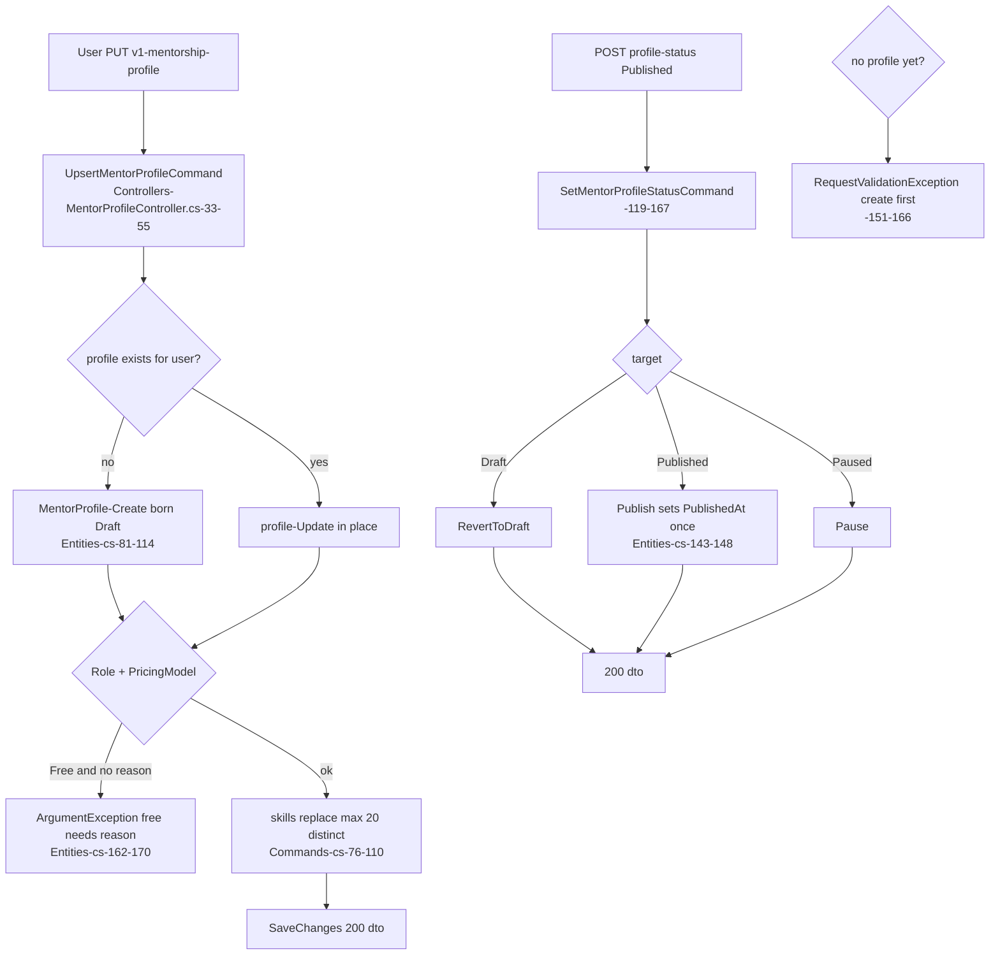
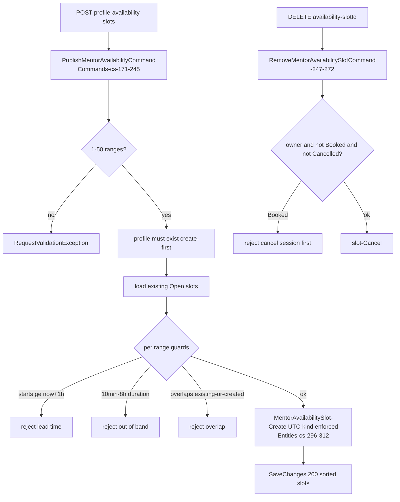
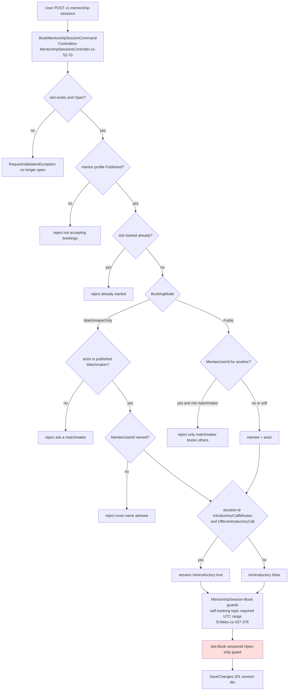
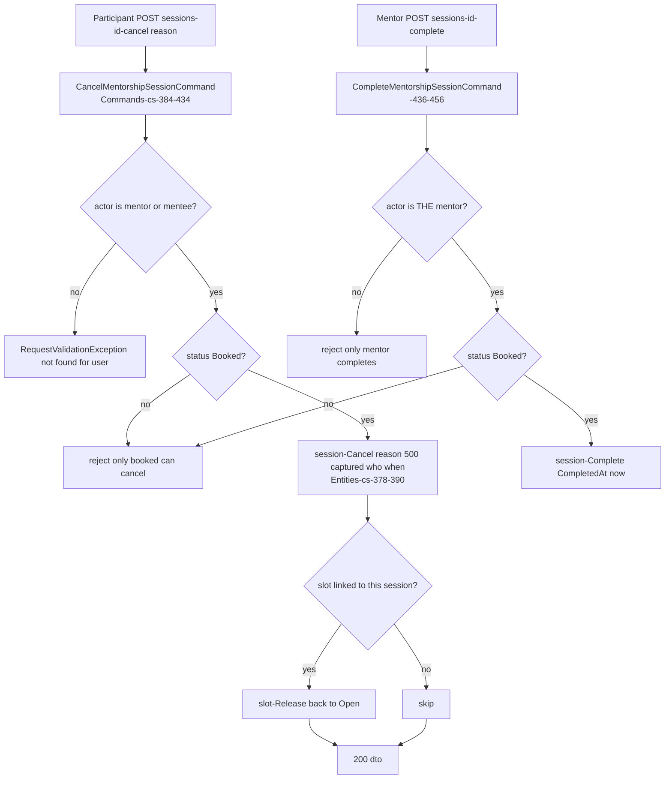
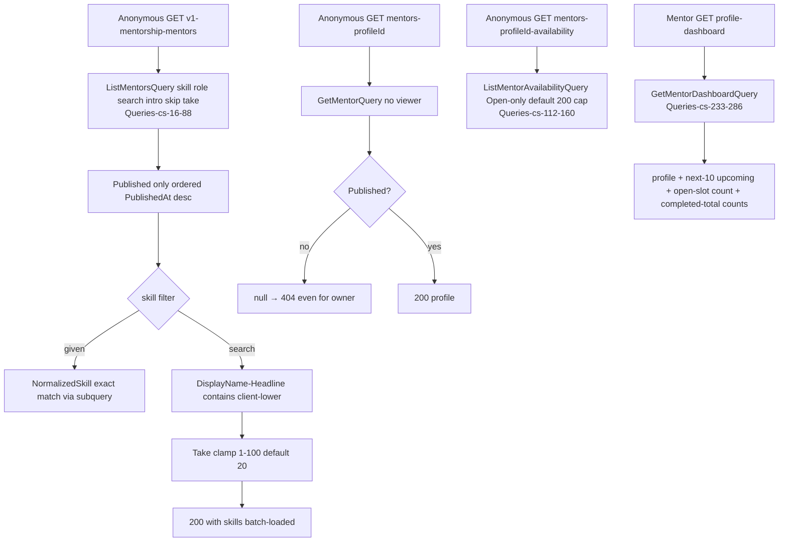

# Social.Mentorship — User flows

> Module `GameGuild.Social.Mentorship` · develop `ce31d5850c`. Shorthand `Men:` = module root. Families M1-M5 match 07/08 numbering (M6+ reserved for gaps).

## F1 — Mentor profile self-service (upsert → publish → pause)

Edge cases:

| Case | Behavior | Evidence |
|---|---|---|
| One profile per user | upsert keyed on `UserId` singleton | `Men:/Commands/MentorshipCommands.cs:32-34` |
| Free-contribution rule (issue #102) | `Free` without reason rejected at entity | `Men:/Entities/MentorshipEntities.cs:162-170` |
| Introductory minutes normalized | ≤0 → 15; else clamp 10-15 | `:172-180` |
| Skills normalized + capped | trim, distinct ignore-case, ≤20 (over-limit throws) | `Commands/MentorshipCommands.cs:76-96` |
| Role freely self-assigned | Mentor/Advisor/**Matchmaker** chosen by the user — no approval | `Entities/MentorshipEntities.cs:53` + no gate |
| Tenant stamp | actor tenant at create only | `Commands/MentorshipCommands.cs:60` |

## F2 — Availability publishing

Edge cases:

| Case | Behavior | Evidence |
|---|---|---|
| Draft/paused profiles can publish slots | only ownership checked, status not | `Commands/MentorshipCommands.cs:197-199` |
| UTC enforced at entity | non-UTC kind throws | `Entities/MentorshipEntities.cs:308-311` |
| Overlap check in-memory | existing Open + within-batch — no DB constraint backs it | `Commands/MentorshipCommands.cs:228-232` |

## F3 — Advisee books a session

The red node is the race (M1): `slot.Book` guards in memory only; concurrent requests can both pass `Open` and both insert sessions.

Edge cases:

| Case | Behavior | Evidence |
|---|---|---|
| Self-booking blocked | `mentorUserId == menteeUserId` throws at entity | `Entities/MentorshipEntities.cs:354-357` |
| Matchmaker booking self as mentee | blocked by the same rule | same |
| Matchmaker-only visibility | slots visible publicly but not self-bookable (issue #102) | `Entities/MentorshipEntities.cs:25-29` + flow |
| Topic required, ≤200 chars; notes ≤2000 | entity truncation/throw | `:366-369` |

## F4 — Cancel / complete

Edge cases:

| Case | Behavior | Evidence |
|---|---|---|
| Cancellation is symmetric | either side cancels; counterparty learns nothing (no notification) | `Commands/MentorshipCommands.cs:417-433` (M2) |
| Cancel releases the slot for re-booking | `slot.Release()` guarded to Booked | `Entities/MentorshipEntities.cs:272-283` |
| Mentee cannot complete | mentor-only | `Commands/MentorshipCommands.cs:447-450` |
| Completing a past session anytime | no time window check | `Entities/MentorshipEntities.cs:392-402` |

## F5 — Public directory + dashboard

Edge cases:

| Case | Behavior | Evidence |
|---|---|---|
| Directory search is case-insensitive contains | `ToLower()` in query — translatable (column-side, no custom method) | `Queries/MentorshipQueries.cs:55-58` |
| Availability window filter UTC-kind forced | `SpecifyKind` on from/to | `:139-148` |
| My sessions filter | mentor-or-mentee, or `asMentorOnly`; capped 200 | `:180-207` |
| Registry-listed anonymous surface | allow-list entry with published-only rationale | `API:/Security/AnonymousEndpointRegistry.cs:181-185` |
