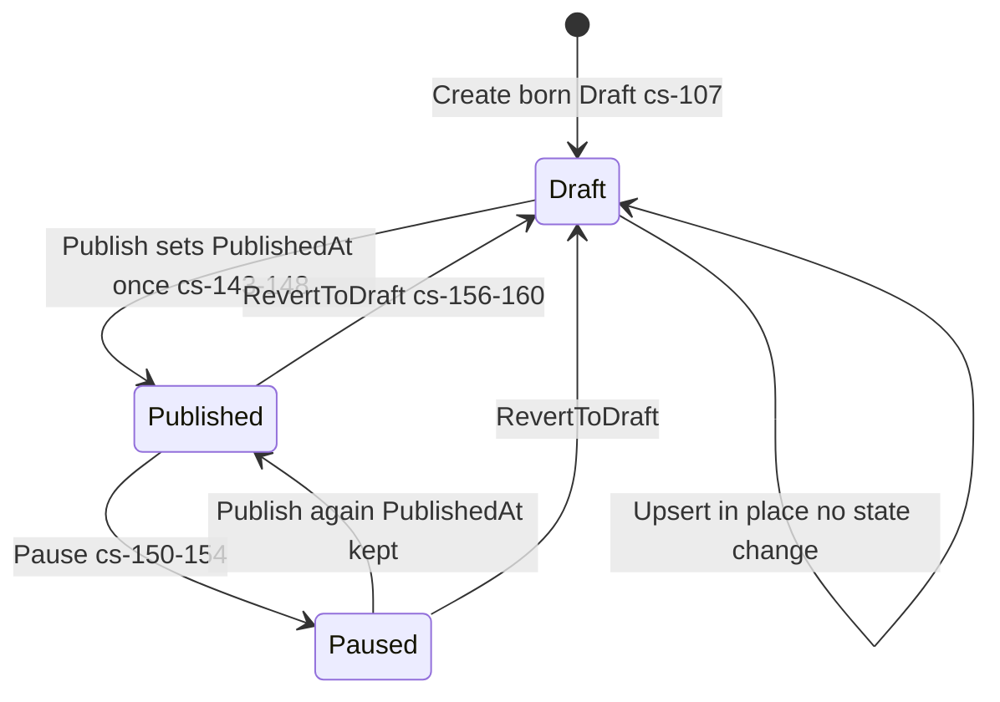
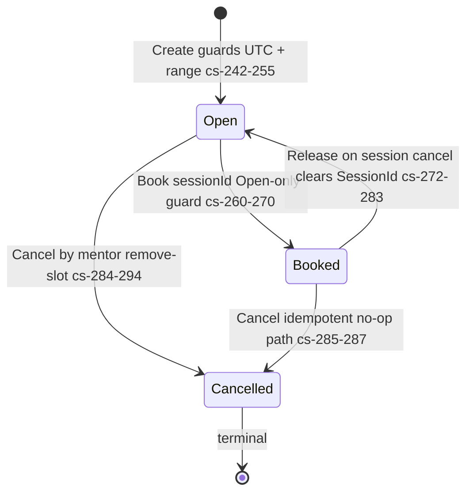
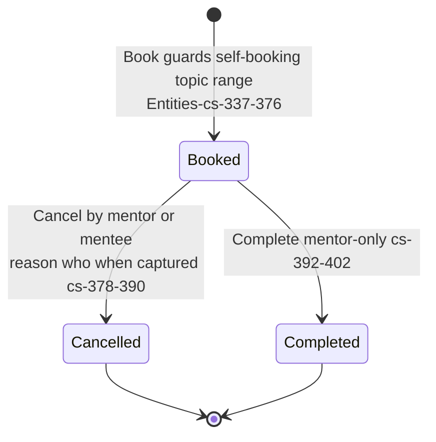

# Social.Mentorship — State machines

> Module `GameGuild.Social.Mentorship` · develop `ce31d5850c`. Shorthand `Men:`.

## 1. Mentor profile (`MentorProfileStatus`, `Men:/Entities/MentorshipEntities.cs:16-21`)

| Guard | Note |
|---|---|
| free transitions, no approval step | self-service publish — by design (#102), and the root of M4 (matchmaker role is publishable by anyone) |
| PublishedAt sticky | `??=` keeps first publish time for directory ordering (`:146`) |

Booking-side coupling: only `Published` profiles accept bookings (`Men:/Commands/MentorshipCommands.cs:302-305`) — pausing stops new bookings without touching existing sessions.

## 2. Availability slot (`MentorAvailabilitySlotStatus`, `Entities:32-37`)

Honesty notes:

| # | Truth | Evidence |
|---|---|---|
| 1 | The Open→Booked guard is **in-memory only** — the double-book race bypasses it (`slot.Book` after both loaded Open) | `Commands/MentorshipCommands.cs:289-294` + `:363`; no concurrency token on the entity, no unique index on `SessionId` (M1) |
| 2 | Booked slots cannot be removed — "cancel the session first" — and cancelling the session auto-releases | `Commands:263-266`, `:402-411` |
| 3 | Cancelled is terminal (no re-open) | no transition |

## 3. Session (`MentorshipSessionStatus`, `Entities:39-44`)

| Guard | Note |
|---|---|
| terminal states have no exits | no reschedule, no no-show, no re-open — the lifecycle is intentionally minimal |
| Cancel captures audit (`CancelledByUserId`, `CancelledAt`, `CancellationReason` ≤500) | `Entities:378-390` |
| Complete records only timestamp | who completed is implicit (mentor-only guard) |
| `IsIntroductory` computed at booking | duration ≤ intro minutes and profile offers intro (`Commands:346-349`) — never recomputed |
