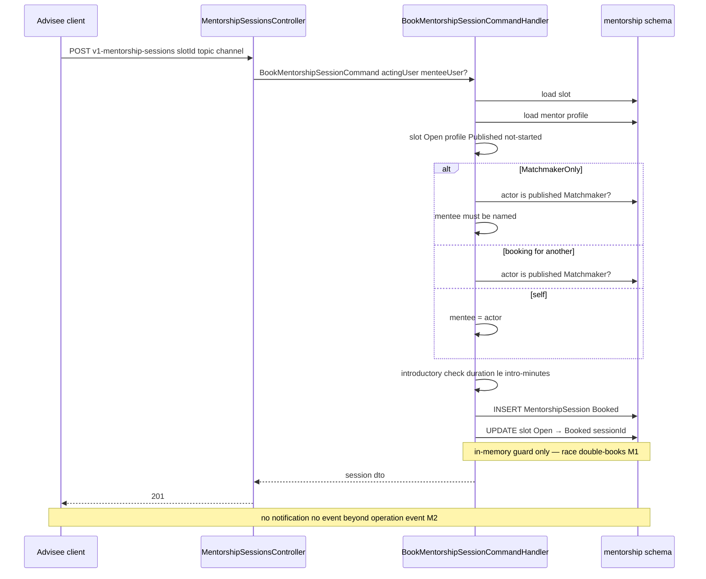
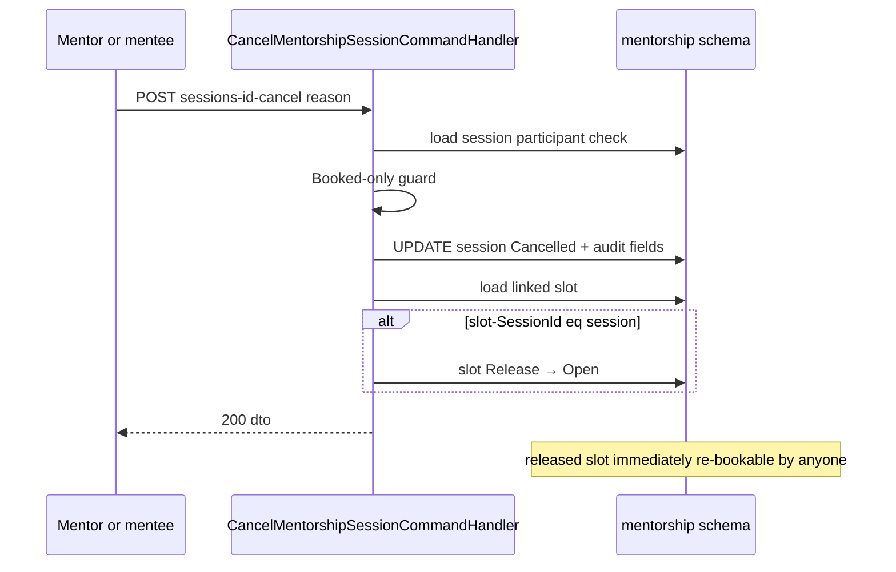
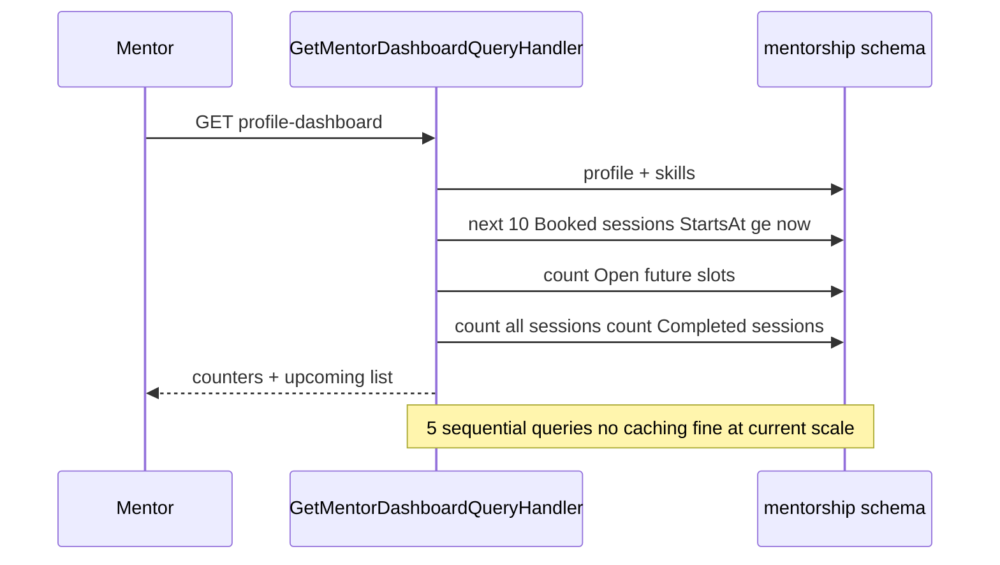
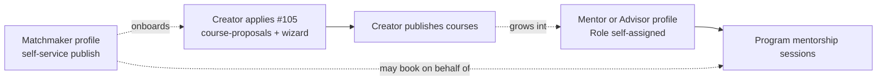

# Social.Mentorship — Cross-module sequences

> Module `GameGuild.Social.Mentorship` · develop `ce31d5850c`. Shorthand `Men:`.

## 1. Booking end-to-end (advisee self-service)

## 2. Cancel with slot release

## 3. Dashboard aggregation

## 4. The #1159 creator-process boundary contract

PR #1159 delivered two product tracks together — the content-creator pipeline (issue #105: public `POST /v1/content/course-proposals`, wizard at `apps/web/src/app/[locale]/(public)/content-creators/*`, actions in `apps/web/src/lib/content-creators/actions.ts`) and this module (issue #102). The relationship is **product-level and deliberately uncoupled at code level**:

- No module references `CourseProposals` from mentorship or vice versa (grep both ways — zero).
- No shared events; the tracks meet only in the UI journey and the issue text.
- Consequence for auditors: creator-pipeline changes cannot break mentorship and vice versa; but there is also **no enforcement** that a "Mentor" ever was a creator — the role is self-asserted (see M4).

## 5. Tenant boundary

Profiles stamp the creating actor's tenant (`Men:/Commands/MentorshipCommands.cs:60`); **no query filters by tenant** — the directory and bookings are platform-global by construction (anonymous directory lists across tenants). The tenant column is provenance, not isolation; documented so nobody assumes tenant scoping that does not exist.
