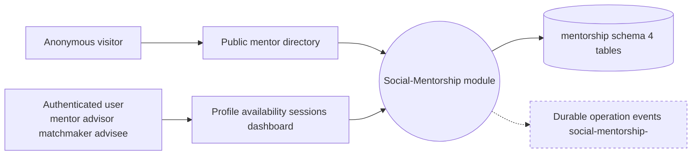
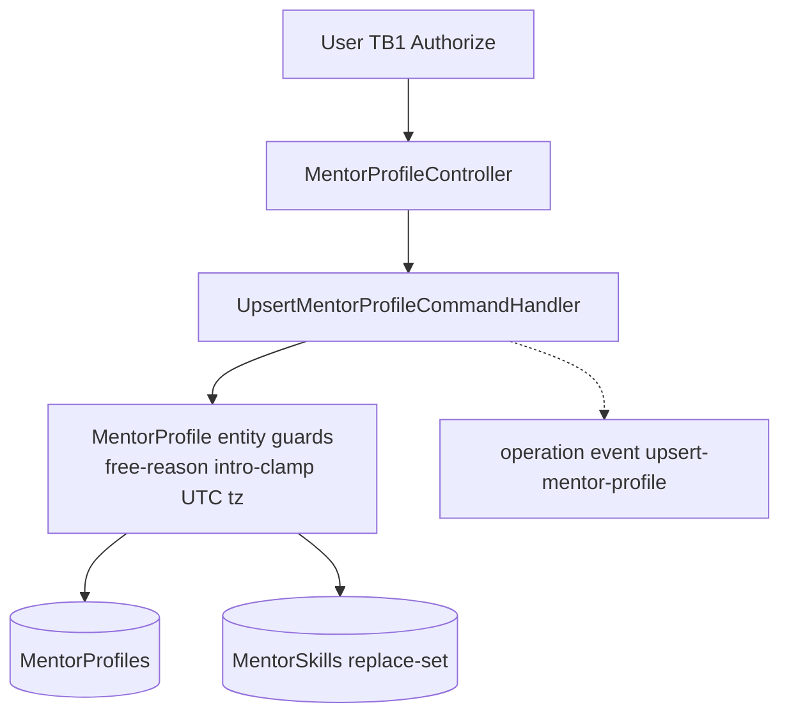
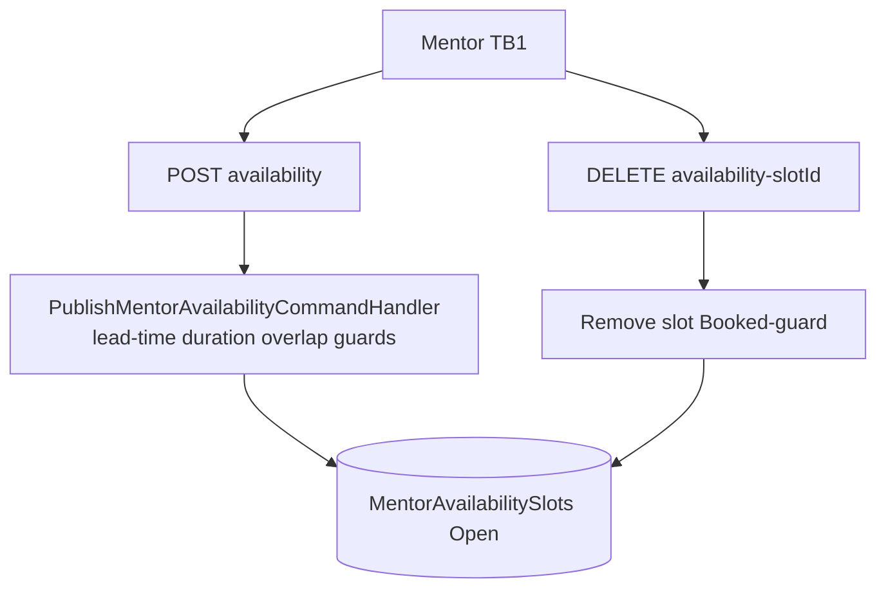
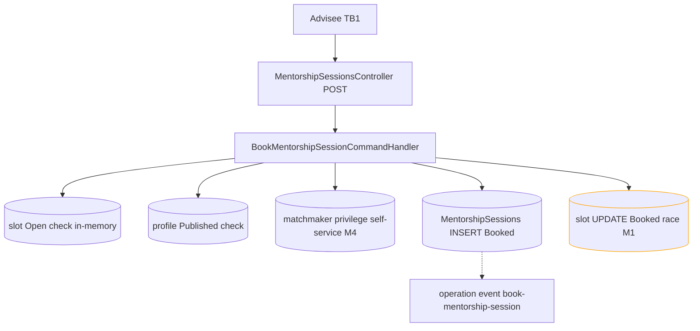
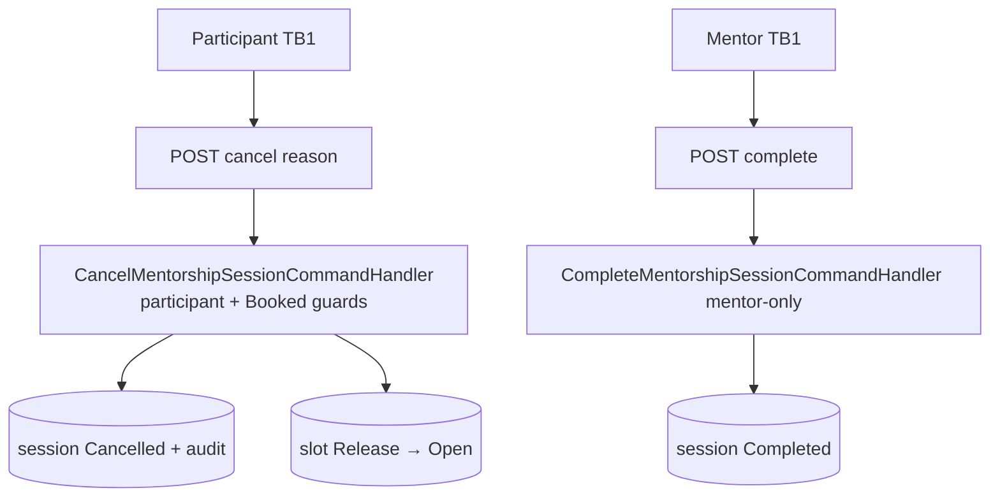
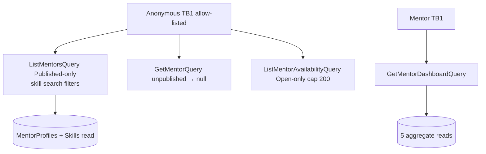

# Social.Mentorship — Data-flow diagrams

> Module `GameGuild.Social.Mentorship` · develop `ce31d5850c`. Families match 01/07.

## L0 — Context

Trust boundaries: TB1 internet→API (authN; directory anonymous + allow-listed), TB2 API→DB (EF Core). No external providers (calendar/Discord dispatch not built — declared in #1159).

## L1-F1 — Profile self-service

## L1-F2 — Availability

## L1-F3 — Booking

## L1-F4 — Cancel / complete

## L1-F5 — Public directory + dashboard

## Data stores summary

| Store | Written by | Read by |
|---|---|---|
| `MentorProfiles` | upsert/status handlers | directory, booking, dashboard |
| `MentorSkills` | upsert (replace-set) | directory/batch load, mappers |
| `MentorAvailabilitySlots` | publish/remove handlers, booking (Book/Release) | public availability, booking, dashboard count |
| `MentorshipSessions` | booking/cancel/complete | my-sessions, participant checks, dashboard |
