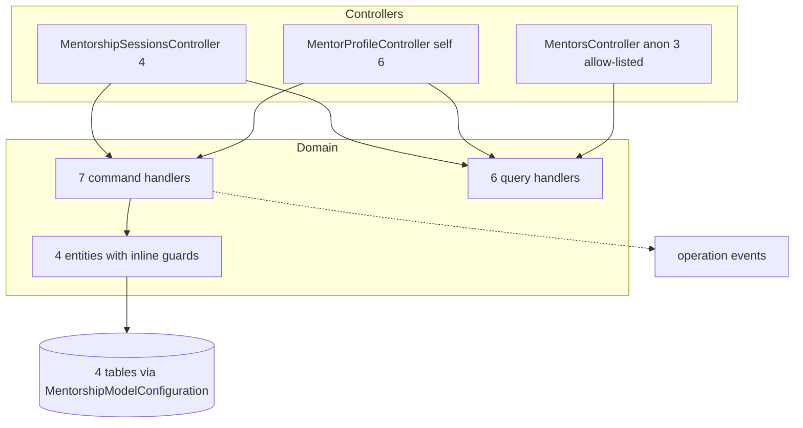

# Social.Mentorship — Security architecture

> Module `GameGuild.Social.Mentorship` · develop `ce31d5850c`.

## 1. Component view

No services layer (handlers touch `IApplicationDbContext` directly, like Gamification but with entity-level validation), no repositories, no workers, no validators — the module is one controller-to-entity hop, which is why its guard quality lives in `MentorshipEntities.cs` (strong) and its concurrency story lives nowhere (M1).

## 2. Permission map

| Surface | Gate | Notes |
|---|---|---|
| `v{version}/mentorship/profile/*` (6) | `[Authorize]` + actor id | self-service; status/role freely settable (M4) |
| `v{version}/mentorship/sessions/*` (4) | `[Authorize]` + participant/mentor guards in handlers | booking-for-others gated by self-service matchmaker role |
| `v{version}/mentorship/mentors/*` (3) | `[AllowAnonymous]` + `AnonymousEndpointRegistry` entries `:181-185` | Published-only reads |
| Admin surface | **none exists** — no route can repair or moderate mentorship data | noted: operational blind spot (07 aggregate) |

Tenant: stamped at create, never queried — provenance not isolation (05 §5).

## 3. Integrity properties — and non-properties

**Properties held:**

1. One profile per user (singleton upsert).
2. Slots: UTC-kind enforced, 10m-8h duration, ≥1h lead, non-overlapping at publish time.
3. Bookings: slot must be Open, profile Published, not started; self-booking impossible; matchmaker-mode requires a published matchmaker; introductory flag computed from clamped profile config.
4. Cancels: participant + Booked-only; slot auto-release tied by `SessionId` match.
5. Completion: mentor-only, Booked-only.
6. Public reads: Published-only, allow-listed.

**Non-properties:**

1. **No booking atomicity** — the Open→Booked guard is application-level only; concurrent bookings corrupt (M1).
2. **No booking provenance** — sessions do not record who created them (matchmaker vs self indistinguishable).
3. **No moderation/admin repair path** for any mentorship entity.
4. **No quota/no-show semantics** — slot squatting and perpetual Booked sessions are unhandled (M7).
5. **Role claims are self-asserted** — Matchmaker privilege by self-publish (M4).

## 4. Fail verdicts (from 07)

| Family | Verdict | Blocking gap |
|---|---|---|
| F1 profile/availability | pass (DoS weak) | M5 rate limits |
| F2 booking | **fail** | M1 race; M4 matchmaker; provenance |
| F3 cancel/complete | pass | cooldown absent (minor) |
| F4 directory | pass (accepted disclosure) | M5 |
| F5 meeting metadata | open (pre-registered) | validate URLs when S1 lands |

## 5. Deployment invariants

1. Migration `20261101152304_AddSocialMentorshipModule` (4 tables) must precede any traffic; the `MentorshipModelConfiguration` bridge stays assembly-scanned (`Men:/MentorshipModelConfiguration.cs:8`).
2. `AddMentorshipModule` must remain called at `API:/Core/Setup/ApiProductComposition.cs:185` and `"Social.Mentorship"` in `EnabledModules` (`:77`) — the empty-looking registration is load-bearing for handler discovery bookkeeping.
3. The 3 anonymous directory actions must stay registered in `AnonymousEndpointRegistry` (`API:/Security/AnonymousEndpointRegistry.cs:181-185`) — removing the entries breaks the allow-list guard contract (unregistered anonymous endpoints fail the planned-authorization guard).
4. If booking gains a transaction or concurrency token (M1 fix), keep the slot release path (cancel) inside the same consistency domain — a half-fixed release re-introduces the race through the back door.
5. When calendar/Discord dispatch lands (declared follow-up), treat `MeetingUrl` as untrusted input: scheme allowlist + per-channel domain validation (07 family 5 pre-registers the threat).
6. The module's route family lives under `v{version}/mentorship` **without** the `api/` prefix — OpenAPI and client generators must keep that shape; "fixing" the prefix is a breaking change.
