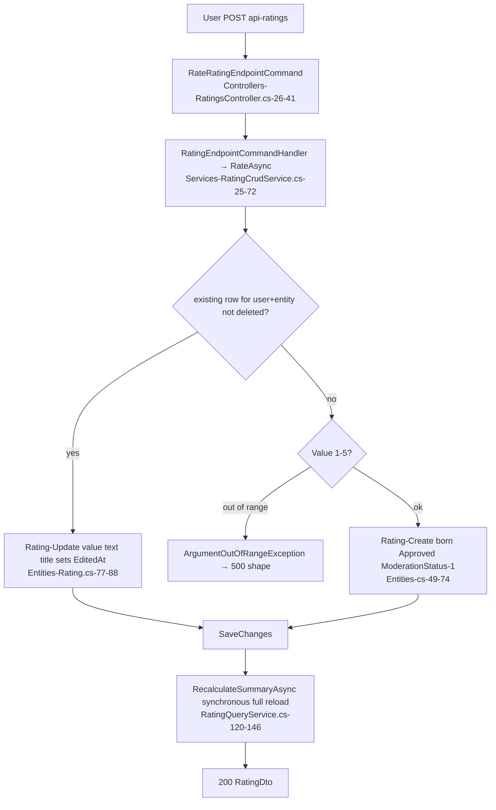
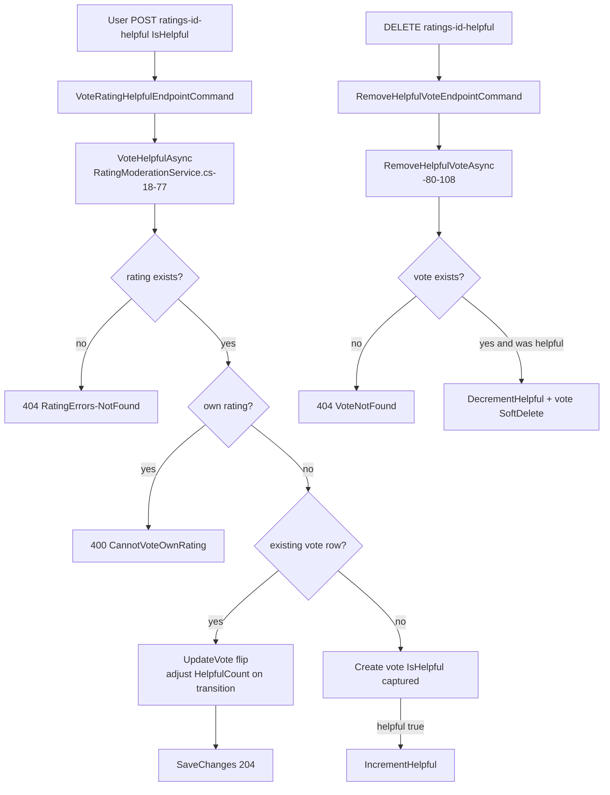
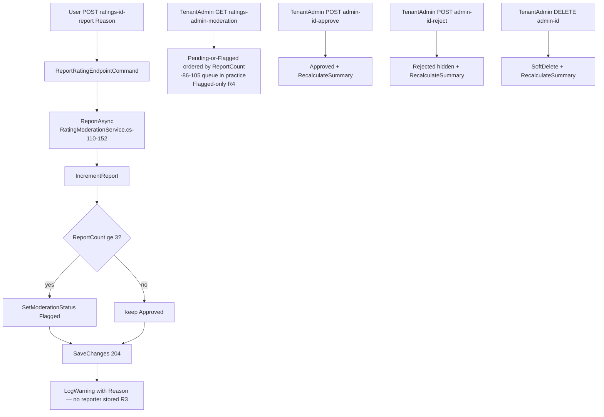
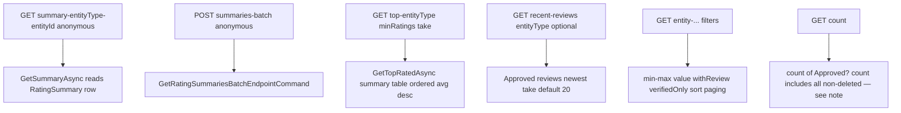
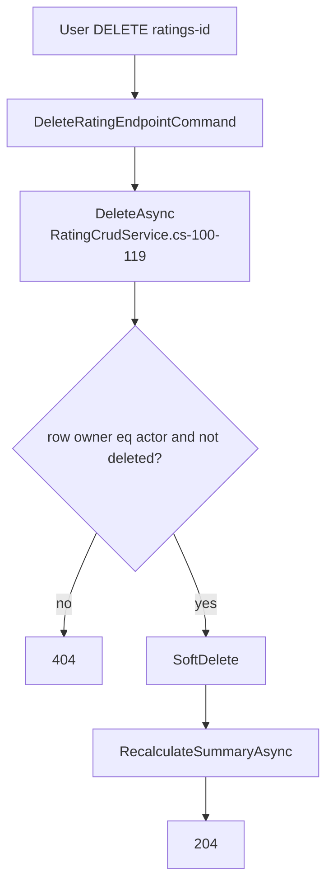

# Social.Ratings — User flows

> Module `GameGuild.Social.Ratings` · develop `ce31d5850c`. Shorthand `Rat:` = module root. Families match 07/08.

> **Reading note (R1)**: every read flow below is the *designed* behavior; at runtime against a real database each currently 500s on the `IsDeleted` translation failure until the E9 backlog item is fixed. The flows document the logic the route implements.

## F1 — Rate an entity (create or update)

Edge cases:

| Case | Behavior | Evidence |
|---|---|---|
| EntityType free text | any string ≤100; no existence check, no allowlist | `Rat:/Commands/RatingEndpointCommands.cs:5-10`; `Entities/Rating.cs:70` |
| One rating per user per entity | unique index; rate = update-in-place | `Entities/Rating.cs:22`; `Services/RatingCrudService.cs:33-45` |
| Value bounds enforced at entity | 1-5 or throw (controller passes through → error shape, not 400) | `Entities/Rating.cs:54-56, 77-80` |
| Review text/title unfiltered | no profanity/length service checks (MaxLength attributes only) — text moderation N/A platform-wide | `Entities/Rating.cs:36-43` |
| Summary updated post-save, no transaction | crash window leaves stale summary (R5) | `Services/RatingCrudService.cs:52-60` |

## F2 — Helpful vote

Edge cases:

| Case | Behavior | Evidence |
|---|---|---|
| Flip helpful→not | HelpfulCount decremented (vote row kept, `IsHelpful=false`) | `Rat:/Services/RatingModerationService.cs:44-54` |
| Vote on already-deleted rating | filtered (`!r.IsDeleted`) → 404 | `:26-30` |
| Remove decrements only helpful votes | `vote.IsHelpful` checked | `:96-103` |
| No dedup window | re-vote toggling is free (no cooldown) | handler shape |

## F3 — Report a review → auto-flag → moderation

Edge cases:

| Case | Behavior | Evidence |
|---|---|---|
| Reporter identity | **not persisted** — only a log line | `Rat:/Services/RatingModerationService.cs:150-152` |
| Unbounded reports | no per-reporter or per-rating bound | handler shape (R3) |
| Reason free text | logged, max length enforced only by DTO shape | `Controllers/RatingsController.cs:397` |
| Flagged excluded from public reads immediately | Approved-only filters | `Services/RatingQueryService.cs` reads |

## F4 — Aggregate reads

Edge cases / honesty notes:

| Case | Behavior | Evidence |
|---|---|---|
| Summary counts Approved-only; **GetCountAsync counts non-deleted regardless of moderation** | read paths disagree under moderation | `Rat:/Services/RatingQueryService.cs:120-146` (Recalculate Approved filter) vs count implementation — verify at fix time (R6) |
| Distribution percentages | computed on the DTO from histogram | `Entities/Rating.cs` `GetDistributionPercentages` |
| Top requires `TotalRatings >= minRatings` default 5 | Wilson-style correction absent — avg desc with count tiebreak only | `Services/RatingQueryService.cs:158-172` |
| Batch POST-shaped reads | query commands carrying POST bodies (no state change — contracts say so) | `Architecture/RatingUseCaseEventContracts.cs:7-8` |

## F5 — Delete own rating

Note: the **admin** delete (F3) is the same soft-delete plus TenantAdmin gate; there is no hard delete anywhere in the module.
