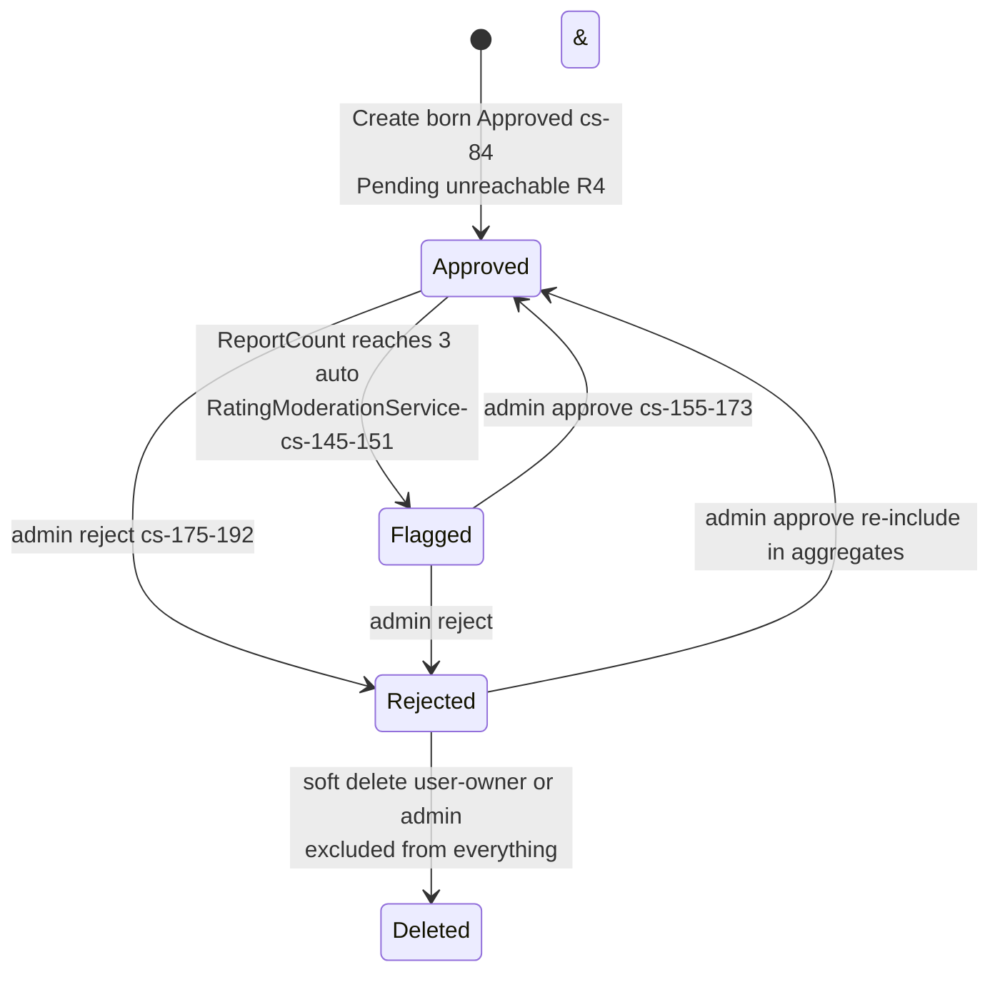
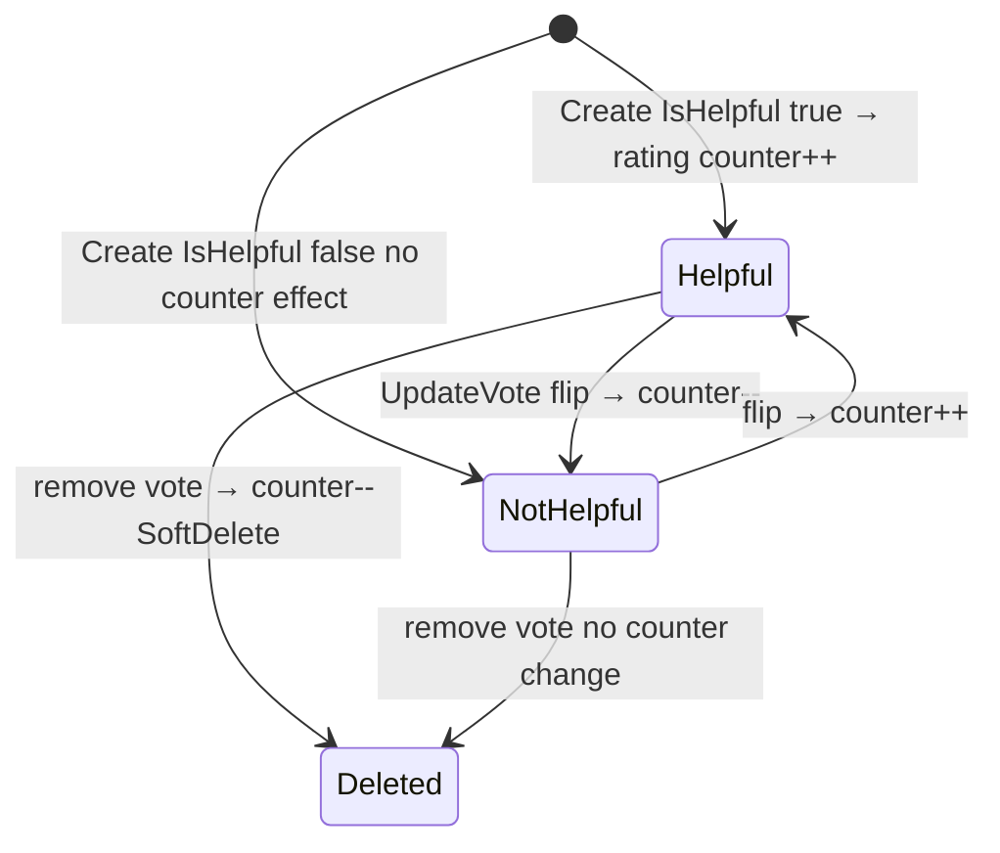

# Social.Ratings — State machines

> Module `GameGuild.Social.Ratings` · develop `ce31d5850c`. Shorthand `Rat:`.

## 1. Rating moderation lifecycle (`RatingModerationStatus`, `Rat:/Entities/Rating.cs:132-153`)

| Guard | Status |
|---|---|
| transition guard | **none** — `SetModerationStatus` is a blind setter (`Entities/Rating.cs:107-110`); only the admin routes drive it |
| `Pending` | **unreachable** — no constructor or handler sets it; the moderation queue query includes it but it can never match (R4) |
| `Deleted` | soft (`SoftDelete`); moderation filter uses `!IsDeleted` in-memory + query filter |

## 2. Helpful-vote lifecycle (`RatingHelpfulVote`)

Notes: one vote row per (rating, user) — unique index (`Entities/Rating.cs:107-110` area, `rating_helpful_votes` unique `(RatingId,UserId)`); own-rating voting blocked at service (`Services/RatingModerationService.cs:26-31`); the HelpfulCount on the rating row is a denormalized counter maintained by the service transitions — a crash between vote save and counter save can skew it (no transaction across the two writes, same shape as R5).

## 3. Report counter (scalar, not a machine)

`ReportCount` increments monotonically (`IncrementReport`, `Entities/Rating.cs:102`); the only threshold effect is the single flip to Flagged at ≥3 (`Services/RatingModerationService.cs:148-151`). No report rows exist (identity-less counter — R3), so there is no un-report, no per-reporter dedup, and no way to audit who reported.

## 4. Summary freshness (derived state)

`RatingSummary` is a cache with three writers, all synchronous full recomputations over Approved non-deleted ratings (`Rat:/Services/RatingQueryService.cs:120-146`):

| Writer | Trigger |
|---|---|
| `RecalculateSummaryAsync` | every rate / update / delete / user-delete / admin decision / admin delete / explicit admin recalculate |
| `RatingSummary.Create` | first rating for an entity |
| `LastCalculatedAt` | set inside `Recalculate` (`Entities/Rating.cs` summary class) |

Staleness windows: crash between mutation save and recalculate save (no transaction — R5); helpful-vote writes do **not** touch the summary (by design — votes don't affect aggregates).
