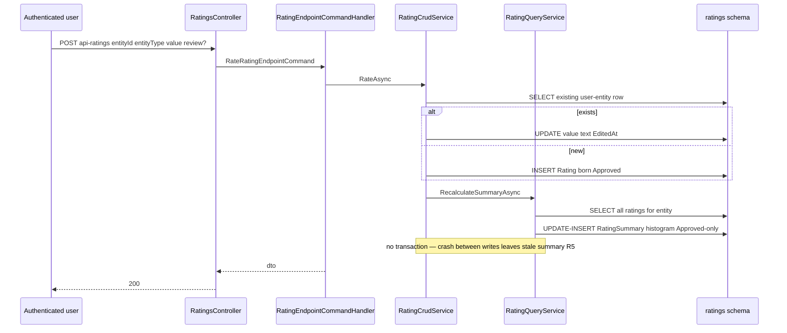
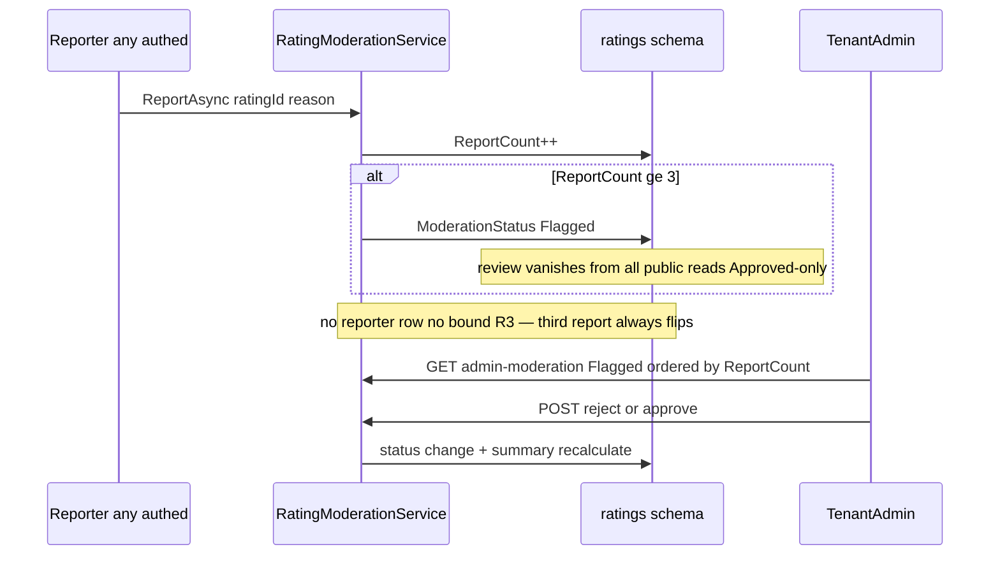
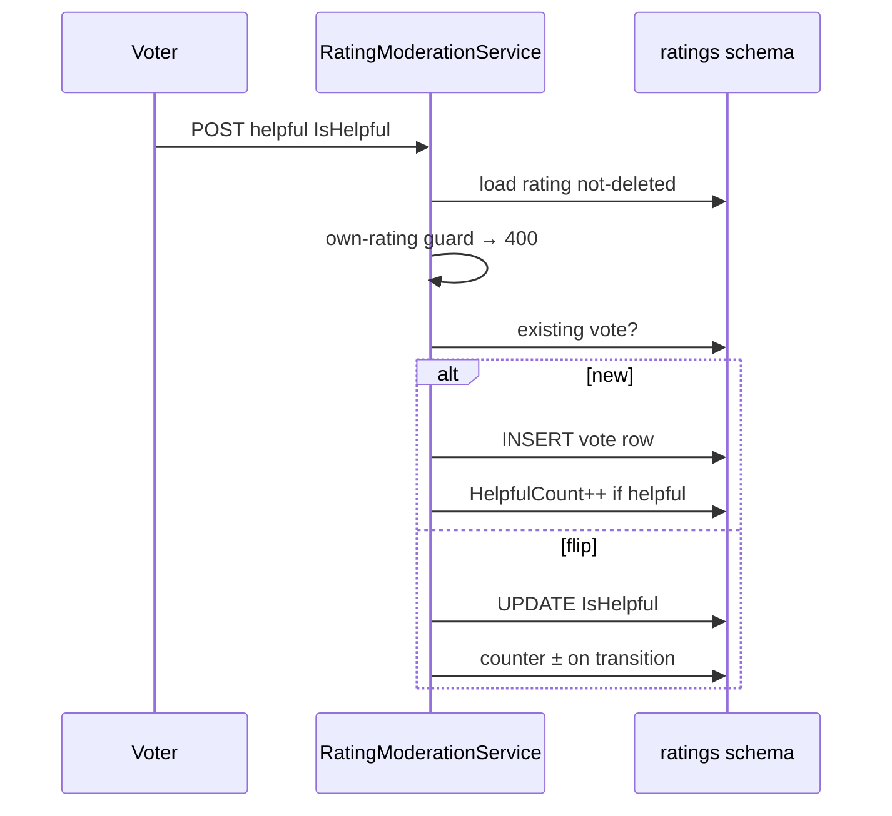
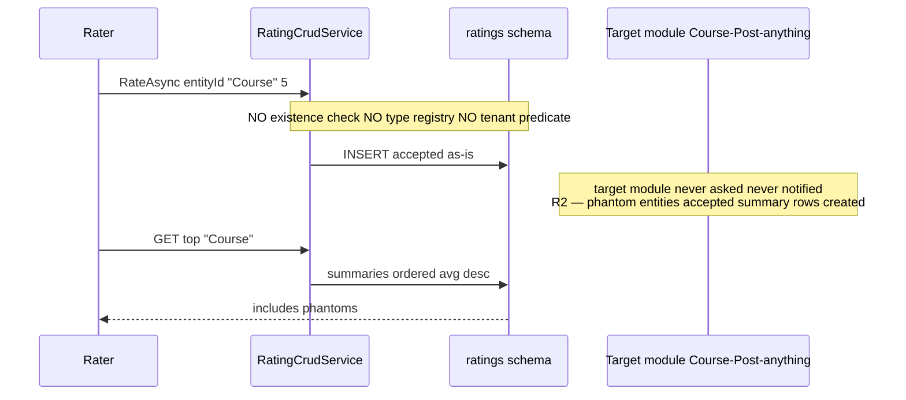
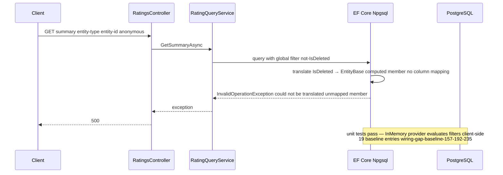

# Social.Ratings — Cross-module sequences

> Module `GameGuild.Social.Ratings` · develop `ce31d5850c`. Shorthand `Rat:`.

## 1. Rate → synchronous summary recomputation

## 2. Report → auto-flag → admin decision

## 3. Helpful vote with counter maintenance

## 4. The polymorphic EntityType boundary contract

The module is a **free-floating reputation store**: correctness of (EntityId, EntityType) pairs is entirely the caller's responsibility. Consumers today must treat EntityType strings as a convention, not a contract (grep for producer modules calling `RateAsync` — none in-repo yet; the surface is client-driven).

## 5. The E9 failure sequence (R1 — what actually happens at runtime)

Root cause and fix directions in 09 §4.
