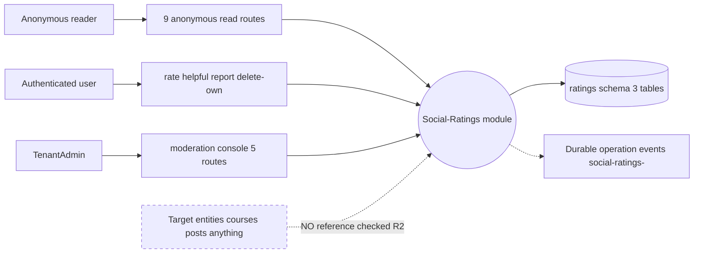
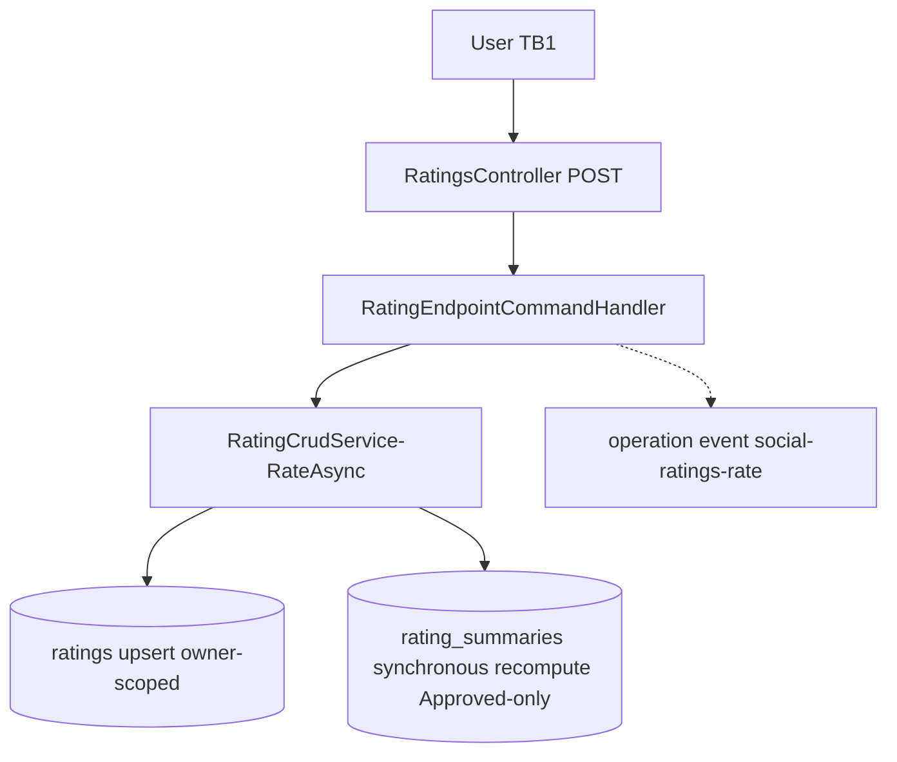
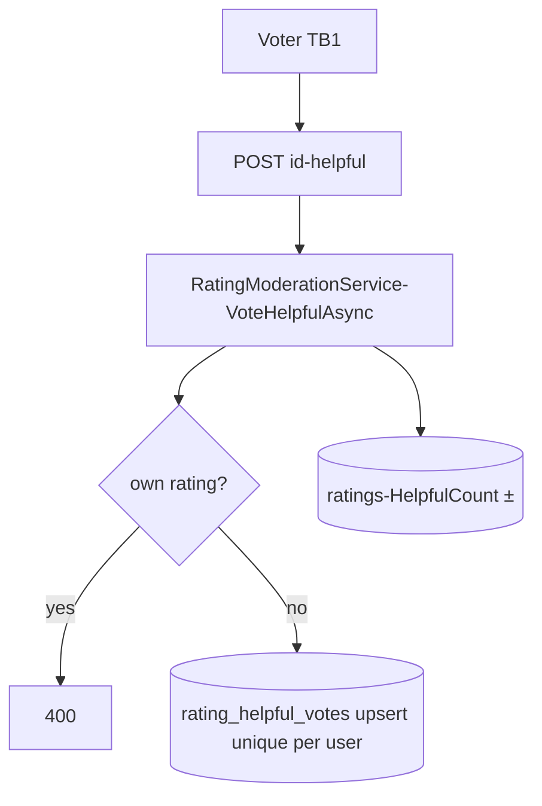
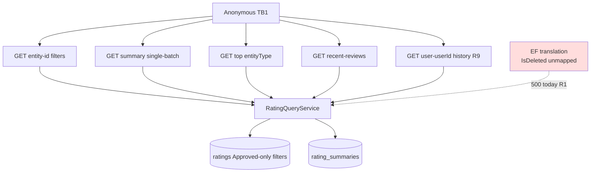

# Social.Ratings — Data-flow diagrams

> Module `GameGuild.Social.Ratings` · develop `ce31d5850c`. Families match 01/07.

## L0 — Context



Trust boundaries: TB1 internet→API (9 anonymous reads; writes authenticated; admin policy-gated), TB2 API→DB (EF Core — currently failing on translation, R1). Note the dashed input: the "target" of a rating is caller-asserted text+id, never verified against any store.

## L1-F1 — Rate



## L1-F2 — Helpful vote



## L1-F3 — Report → flag → moderate

```mermaid
flowchart TD
    R[Reporter TB1 identity NOT stored R3] --> C[POST id-report]
    C --> M[ReportAsync count++]
    M --> F{ge 3 → Flagged}
    F --> T1[(ratings ModerationStatus)]
    ADM[Admin TB1 TenantAdmin] --> Q[queue Flagged by ReportCount]
    ADM --> D[approve or reject or delete or recalculate]
    D --> T1
    D --> T2[(summary recompute]]
```

## L1-F4 — Reads and aggregates



## Data stores summary

| Store | Written by | Read by |
|---|---|---|
| `ratings` | rate/report/moderation handlers, soft deletes | entity reads, user history, recalc, moderation queue |
| `rating_helpful_votes` | vote/remove handlers | vote-existence checks (never exposed) |
| `rating_summaries` | synchronous recalc, admin recalculate | summary/batch/top reads |
