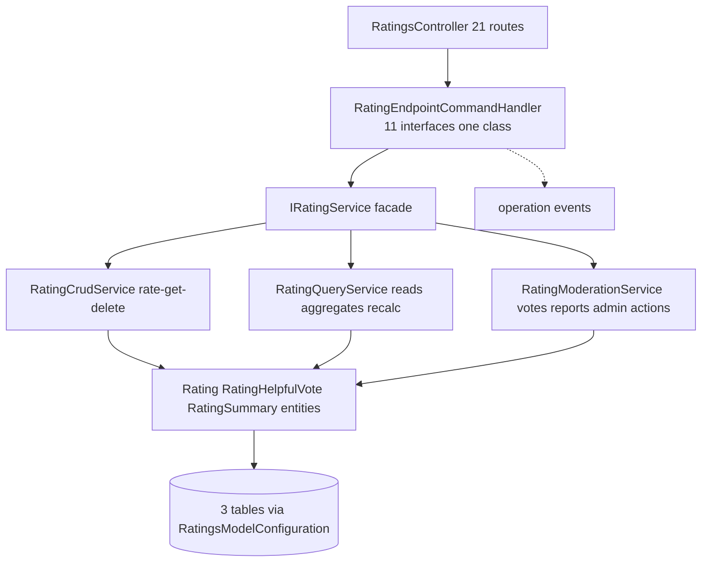

# Social.Ratings — Security architecture

> Module `GameGuild.Social.Ratings` · develop `ce31d5850c`.

## 1. Component view

Facade + focused sub-services — the same decomposition pattern as Notifications (registry of responsibilities rather than one god-service); unlike Gamification's single service. The 11-interface handler is a deliberate CQRS shape: every route is a command, even the POST-shaped batch reads (contracts mark them no-transition).

## 2. Permission map

| Surface | Gate | Notes |
|---|---|---|
| 7 write routes (rate, helpful×2, report, delete-own, my/batch, has-rated, my) | `[Authorize]` + actor scoping | owner checks in service for delete; rate is actor-by-construction |
| 9 read routes | `[AllowAnonymous]` | includes `user/{userId}` full-history (R9 — product call needed) |
| 5 admin routes | `[Authorize(Policy = "TenantAdmin")]` (`Authz:/Policies.cs:33`) | moderation + recalculate; no decision provenance (07 family 4) |
| Tenant | **no tenant predicate anywhere** — ratings are platform-global; the `TenantAdmin` gate is the only tenancy flavor | documented boundary |

## 3. Integrity properties — and non-properties

**Properties held:**

1. One rating per (entity, type, user) — unique index + rate-or-update (`Rat:/Entities/Rating.cs:22`).
2. Value bounded 1-5 at the entity (`:54-56`).
3. Aggregates count Approved non-deleted only, recomputed deterministically on every mutation and on demand (`Entities/Rating.cs` Recalculate).
4. Own-vote impossible (`Services/RatingModerationService.cs:26-31`).
5. Deletes are soft; admin and owner paths both recompute.

**Non-properties:**

1. **No target validation** — (EntityId, EntityType) is caller truth (R2).
2. **No mutation/recalc atomicity** (R5); counter writes for helpful votes share the shape.
3. **No reporter identity or report bound** (R3).
4. **No moderation provenance** — no who/when on decisions (07 family 4).
5. **`IsVerified` never settable through any path** (R7).
6. **Read paths disagree under moderation** (count vs summary, R6).

## 4. The E9 root-cause anatomy (the fix brief)

- **Symptom**: 19 route/principal combos 500 on a real database (`wiring-gap-baseline.txt:157-192, 235`); comment "ratings EF query translation failure (unmapped member)".
- **Mechanism**: `EntityBase.IsDeleted` is `public virtual bool IsDeleted { get => DeletedAt.HasValue; }` (`SK:/Entities/EntityBase.cs:40`) — computed, get-only, and **not mapped** (no `DeletedAt`-derived column binding is registered for these entities). `RatingEntityConfiguration` sets `builder.HasQueryFilter(e => !e.IsDeleted)` (`Rat:/Configuration/RatingEntityConfiguration.cs:32`) and services add explicit `!r.IsDeleted` predicates; Npgsql translation walks the member, finds no mapping, and throws `InvalidOperationException`.
- **Why tests missed it**: unit suites run the InMemory/SQLite provider, which evaluates query filters client-side; only the E9 route-smoke guard (real in-memory host + Npgsql translator surface, #1276/#1278) catches the class.
- **Fix options** (any one; verify against the E9 guard): (a) replace `IsDeleted` references with `DeletedAt == null` in filters and predicates; (b) map the property (`HasColumn`/shadow column or persisted `IsDeleted`); (c) move the filter into the base configuration repo-wide — note other modules using the same pattern would need the same sweep (the #1278 backlog lists siblings).

## 5. Deployment invariants

1. Migration `20261102105545_AddLedgersRatingsAndAchievementsTables` must be applied before enabling routes; `RatingsModelConfiguration` stays assembly-scanned (`Rat:/Configuration/RatingEntityConfiguration.cs:98-105`).
2. `AddRatingsModule` must remain called (`API:/Core/Setup/ApiProductComposition.cs:187`) and the module in `EnabledModules` (`:78`).
3. **Do not ship a client integration against the 9 anonymous reads until R1 is fixed** — every one of them 500s today.
4. `ModerationStatus` is string-converted (`HasConversion<string>` max 20, `Configuration:29-31`) — enum renames are schema changes.
5. If EntityType validation lands (R2), the allowlist must be seeded with every legitimate target type **before** enforcement, else existing integrations start 404ing; pair with a phantom-summary cleanup migration.
6. Any future consumer of `HelpfulCount` (sorting, badges) upgrades family-2 sybil risk from accepted to live — re-run 07 family 2 before building on the counter.
